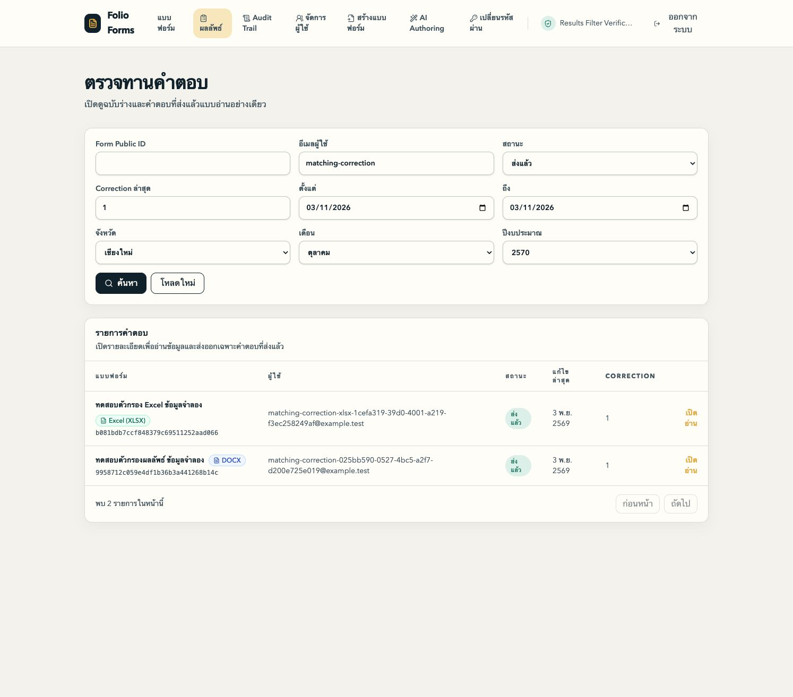

# Admin results filters implementation report

Status: resolved

Completed on 2026-11-03, Asia/Bangkok.

## Delivery

Integration branch: `codex/admin-results-tag-filters`.

Baseline: `5fe30b5967d8a8132f30009f5cf667de9d5b87b2`. Verified feature tip: `0a47732e3f841a47737cf229894be34230cb1b73`. Subsequent closure changes are documentation and evidence only.

| Ticket | Implementation | Integration merge | Status |
| --- | --- | --- | --- |
| 01, Province | `52b5190` | `16c20a5` | Resolved |
| 02, Month | `8fb4ae0` | `345fc93` | Resolved |
| 03, Fiscal year and combined search | `57588b9` | `41338c8` | Resolved |
| Review fixture extraction and requested padding | `99a076d` | `0a47732` | Complete |

The results page filters current saved scalar Field values through `province`, `month`, and `fiscal_year` for both DOCX and Excel XLSX Forms. All active existing and new filters combine with AND before cursor pagination. Draft and Submitting use saved Draft data. Submitted uses the latest Submission with its latest complete Correction.

Province comparison trims outer whitespace and uses the full Thai name. Month uses the full Thai name. Fiscal year accepts equivalent numeric and textual Buddhist Era years. Central choices include every province, twelve months, and twelve fiscal years spanning ten prior years through the following year, advancing on October 1 in Asia/Bangkok.

The user-requested responsive filter-form padding is included. The live browser measured 20px on every side at its current viewport.

## Verification

- Root integrated authenticated HTTP verification passed 42 tests: Province 15, Month 14, Fiscal year 13. Tests use the real application handler and isolated PostgreSQL/object storage.
- The complete relevant HTTP regression selection passed 107 tests after the shared-fixture extraction, including Viewer roles, Submission history, the Admin/User workflow, and Form catalog behavior.
- Root integrated results-page UI verification passed 20 tests. The broader targeted UI selection passed 115 tests across results, Admin Forms, Viewer access, and spreadsheet results.
- Root `bun run check`, `bun run check-types`, and `bun run build` passed. Type checks reported five successful tasks; build reported three successful tasks.
- HTTP fixtures cover both document kinds, missing/malformed values, declared scalar eligibility, current state/revision precedence, all existing-filter combinations, tied timestamps, and sparse matches beyond multiple candidate pages.
- Rendered-page controlled-clock tests cover the Bangkok October 1 boundary and the January calendar transition. At fiscal year 2570, choices are 2560 through 2571.

## Running browser

Verification used separate synthetic databases and buckets, a real API, and the actual rendered page. Plaintext login credentials were never printed and their owner-only temporary files were deleted after use.

- Province-only and Month-only searches returned the expected synthetic matches; adding both narrowed the results correctly.
- After adding XLSX fixtures, Fiscal year 2570 alone returned eight of nine current Responses. Province Chiang Mai plus October plus 2570 returned five, containing two XLSX and three DOCX results.
- Adding existing email, Submitted status, Correction 1, and the November 3 update-date boundaries returned two current Corrections, one XLSX and one DOCX. Adding either Form Public ID narrowed that combined search to the corresponding single document kind.
- Selecting the old XLSX Submission's province returned zero because its latest Correction changed the value. All central choices remained available.
- Reload retained the complete applied search, including both date values. Dates were selected through the native calendar UI.
- Opened Fields in both DOCX and XLSX confirmed current values Province Chiang Mai, Month October, Fiscal year 2570, agreeing with the selected latest Correction rather than the original Submission.

[XLSX current Fields evidence](evidence/xlsx-current-fields.png)

## Standards

No hard documented-standard violations found. No remaining baseline smells found. Tooling-enforced rules were excluded.

The original P3 Duplicated Code finding is resolved. `apps/server/test/http/helpers/results.ts:38` supplies the shared fixture factory used by all three results suites. Form, Response, Submission, Correction, authenticated request, and response-parsing logic now have one implementation. Suite-specific defaults remain explicit at each caller; the factory adds no unused configuration or speculative behavior.

The only production change is `apps/web/src/routes/admin/results/index.tsx:167`, adding the user-requested `p-4 sm:p-5`. It preserves labelled controls, keyboard access, validation, and filter behavior.

Reviewed the complete nonempty delta `41338c881eea5f4727880a2fbf955cf9cae51a4d...0a47732e3f841a47737cf229894be34230cb1b73` against `AGENTS.md`, `.omp/AGENTS.md`, domain guidance, `CONTEXT.md`, ADR 0004, TDD guidance and its test/mocking references, and the TypeScript/type-system guidance. CodeGraph was consulted before source exploration.

Independent read-only verification passed: `verify-review-refactor.py` confirms all three complete scenario bodies are byte-identical and production changes are limited to the padding file. The full delta also passes `git diff --check`. No database tests or services were run or changed by this reviewer.

Final Standards findings: 0. The initial P3 Duplicated Code judgment call is resolved.

## Spec

The initial independent review of the complete feature through `41338c8` reported no findings. The final delta review follows.

No findings.

Reviewed the pinned delta `41338c881eea5f4727880a2fbf955cf9cae51a4d...0a47732e3f841a47737cf229894be34230cb1b73` against `.scratch/admin-results-tag-filters/spec.md`, `CONTEXT.md`, ADR 0004, project instructions, and the user's explicit amendment `ใส่paddingให้หน่อย`.

The shared factory in `apps/server/test/http/helpers/results.ts:37` preserves suite-specific default Tags, labels, ordering, XLSX scalar bindings, published templates, custom Field overrides, Draft/Submitting data, Submission timestamps, complete Correction data, and lazy Admin authentication. Scenario bodies and expected assertions for all three suites remain byte-identical. The preservation verifier passed again, retaining canonical scalar eligibility, current saved revision selection, old/new AND combinations, sparse matches, tied timestamps, and cursor coverage.

The only production change is `p-4 sm:p-5` on the existing form at `apps/web/src/routes/admin/results/index.tsx:167`. It implements the authorized padding request without changing controls, handlers, applied criteria, requests, or pagination. No missing behavior or scope creep was identified in this delta.

This review ran the read-only scenario verifier and whitespace check. Both passed. It did not rerun tests or modify code, branches, databases, or services. Running-page acceptance remains with the parent agent.

Final Spec findings: 0. No outstanding requirements or review corrections remain.
