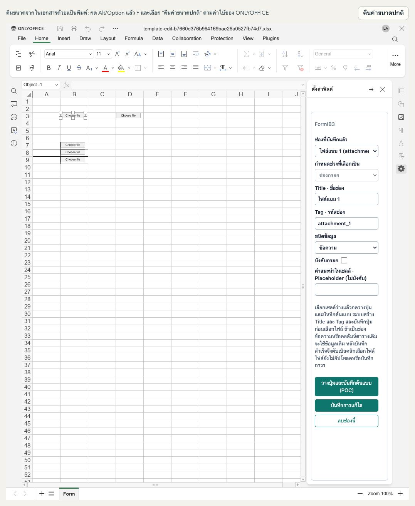
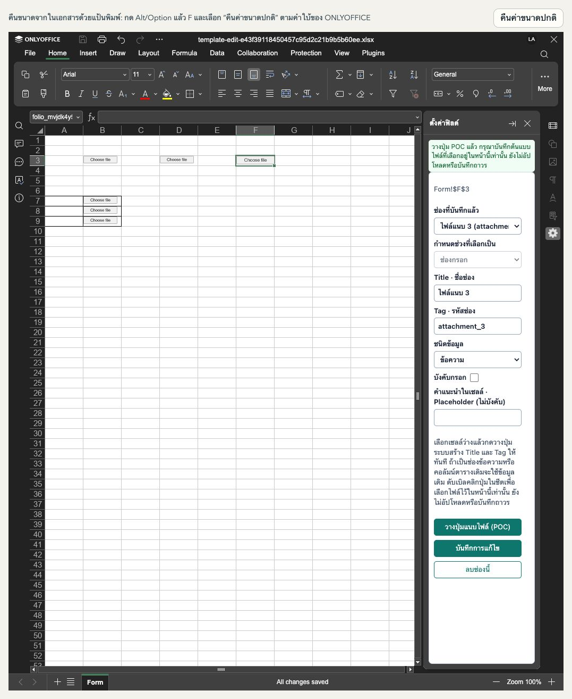
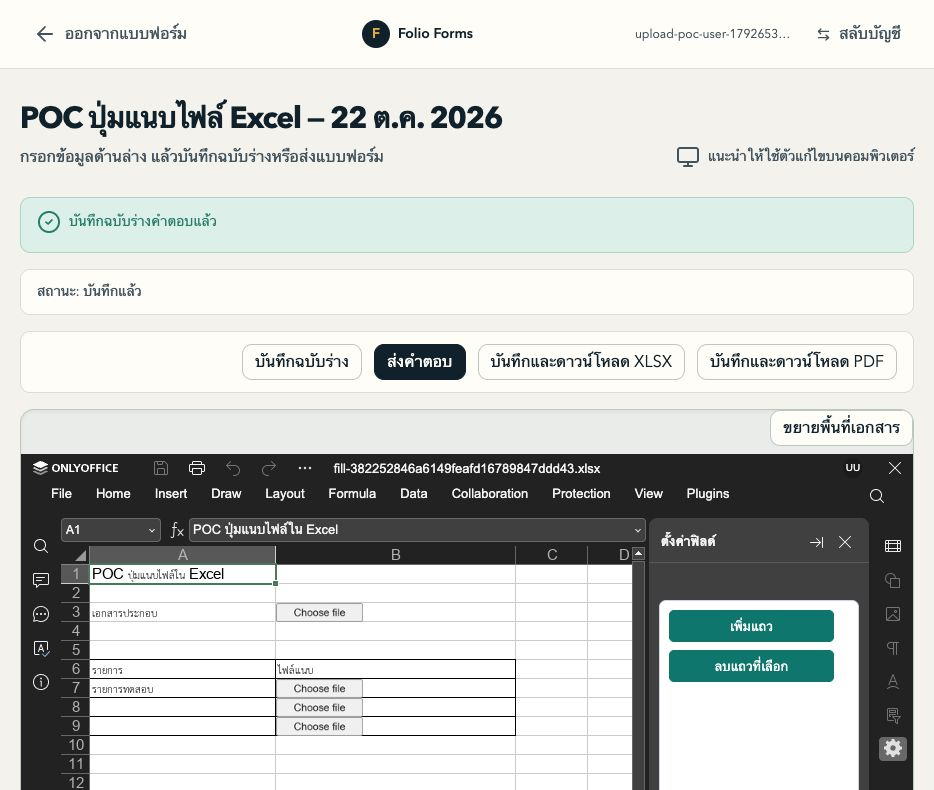
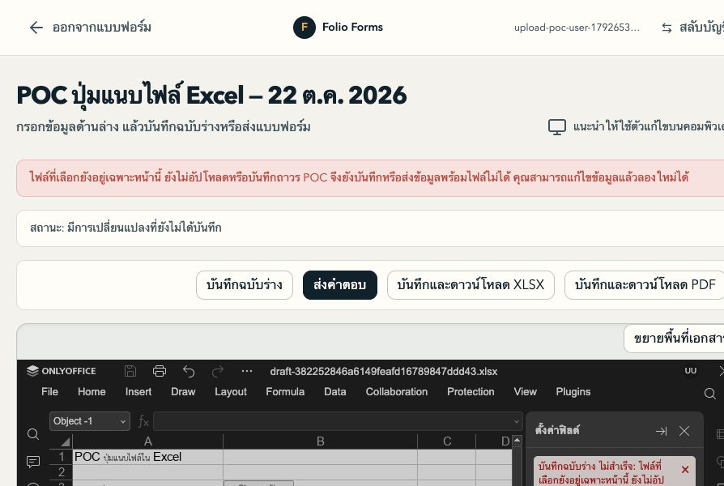
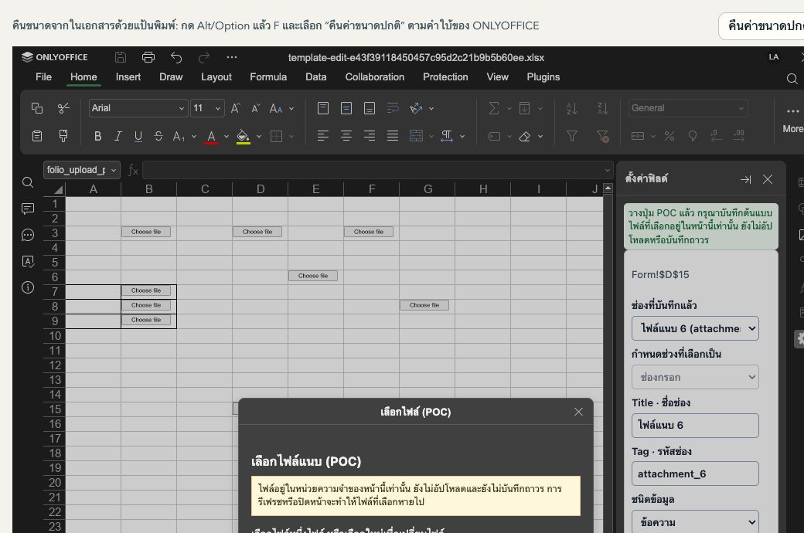
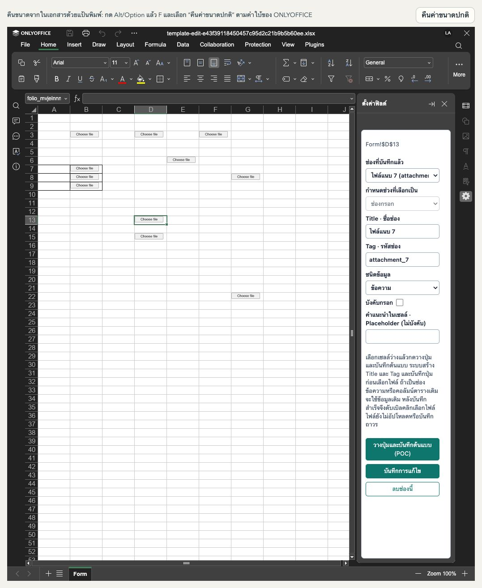

# วิธีทดลองปุ่มแนบไฟล์ใน Excel

รอบนี้เป็น POC สำหรับ **วางปุ่มและทดลองเลือกไฟล์จริง** ทั้งช่องเดี่ยว คอลัมน์ตาราง และแถวที่ผู้กรอกเพิ่ม เลือกและเปลี่ยนไฟล์ได้ แต่ยังไม่ส่งไฟล์ไป API หรือบันทึกถาวร ปุ่มนี้ต้องเปิดใน ONLYOFFICE ของ Folio หน้าตาเป็นปุ่มเล็กสีเทาคล้าย `input type="file"` ชิดซ้ายในเซลล์และไม่ยืดเต็มคอลัมน์

## Admin: วางปุ่มในช่องเดี่ยวด้วยคลิกเดียว

1. เปิดฟอร์ม Excel ฉบับร่าง แล้วเลือกเซลล์ว่างที่จะวางปุ่ม เช่น `B3` (หรือเลือกช่วงที่ merge เป็นเซลล์เดียวครบทั้งช่วง)
2. กด **วางปุ่มและบันทึกต้นแบบ (POC)** ในแผง **ตั้งค่าฟิลด์** ได้เลย ไม่ต้องกรอก Title/Tag หรือกดเพิ่มช่องจากช่วงที่เลือก การกระทำนี้บันทึกต้นแบบทั้งชีตรวมการจัดรูปแบบที่แก้ไว้
3. ระบบสร้างช่องข้อความที่ไม่บังคับกรอก พร้อม Title เช่น `ไฟล์แนบ 1` และ Tag เช่น `attachment_1` ที่ไม่ซ้ำ แล้วแสดงปุ่มเล็ก **Choose file** ในชีตทันที
4. ระบบบันทึกเบื้องหลังโดยคงตัวแก้ไข Excel เดิมไว้ รอผลบันทึกสำเร็จก่อนดับเบิลคลิกปุ่มเพื่อเลือกไฟล์ ระบบตรวจว่าปุ่มและตำแหน่งอยู่ในต้นแบบที่บันทึกแล้ว จากนั้นเลือกเซลล์อื่นเพื่อวางปุ่มถัดไปได้เลย
5. หากบันทึกล้มเหลว ให้แก้สาเหตุแล้วเลือกเซลล์เดิม กดปุ่มเดิมเพื่อลองบันทึกอีกครั้ง ระบบใช้ช่องเดิม ไม่สร้าง Tag ซ้ำ
6. หลังบันทึกสำเร็จ ดับเบิลคลิกปุ่ม → Choose File → เลือกไฟล์จริง หน้าต่างแสดงชื่อ/ขนาดและเลือกใหม่ทดแทนได้ ไฟล์ทดลองอยู่เฉพาะหน้านี้ และข้อจำกัดการกัน Save/Publish เมื่อมีไฟล์ค้างยังใช้กับ Admin ด้วย

เลือกช่องข้อความที่ตั้งไว้แล้วกดวางปุ่มจะใช้ Title/Tag เดิม การกดซ้ำไม่สร้างช่องใหม่หรือปุ่มซ้อน หากมีการแก้ค่าในแผงค้างอยู่ ต้องบันทึกหรือยกเลิกค่านั้นก่อน เพื่อไม่ทิ้งงานที่กำลังแก้

การเลือกเซลล์ว่างไปมาโดยไม่ได้พิมพ์แก้ Title/Tag ไม่ถือเป็นการตั้งค่าค้าง หากต้องการเปลี่ยน Title หรือ Tag ของช่องที่มีอยู่ ให้แก้และกด **บันทึกการแก้ไข** แล้วกด **บันทึกแบบร่าง** ก่อนทดลองเลือกไฟล์อีกครั้ง ระบบปรับข้อมูลปุ่มให้ตรงกับการตั้งค่าภายใต้ขั้นตอนบันทึก

ชนิดข้อความเป็นตำแหน่งทดลองที่ระบบเดิมรองรับ ยังไม่ใช่ attachment FieldType รุ่นใช้งานจริง POC ไม่เขียน URL หรือเปลี่ยนกฎบังคับกรอกของช่องเดิม

การวางปุ่มแต่ละครั้งยังบันทึกต้นแบบทั้งชีต รอให้บันทึกปุ่มแรกสำเร็จก่อนวางปุ่มถัดไป โดยไม่ต้องเปิด Excel ใหม่ ระหว่างบันทึกระบบพักการแก้ไขชั่วคราวเพื่อให้ตำแหน่งและข้อมูลตรงกับไฟล์ที่เก็บจริง หากบันทึกล้มเหลว ปุ่มยังไม่พร้อมเลือกไฟล์ ให้ลองปุ่มเดิมที่เซลล์เดิมอีกครั้ง การกด “บันทึกแบบร่าง” เองและการลบช่องในต้นแบบ Excel ใช้ตัวแก้ไขเดิมต่อได้เช่นกัน

## Admin: ดู Title/Tag และลบช่องที่มีปุ่ม

1. **คลิกปุ่ม Choose file ครั้งเดียว** ในชีต แผงตั้งค่าฟิลด์จะแสดง Title/Tag ของปุ่มนั้น แม้เซลล์ที่เลือกก่อนหน้าอยู่ที่อื่น ส่วนดับเบิลคลิกยังใช้เปิดหน้าต่างเลือกไฟล์
2. หากต้องการแก้ชื่อแสดงผลหรือ Tag ให้แก้แล้วกด **บันทึกการแก้ไข** จากนั้นกด **บันทึกแบบร่าง** ให้สำเร็จก่อนเลือกไฟล์ต่อ หากเปลี่ยนชนิดข้อมูลให้เลิกเป็นช่องข้อความ ปุ่มแนบไฟล์จะถูกนำออกเมื่อบันทึกต้นแบบ
3. หากต้องการลบ ให้ตรวจ Title/Tag แล้วกด **ลบช่องนี้** ด้านล่างแผง ระบบลบการตั้งค่าและปุ่มของช่องนั้นออกจากชีตปัจจุบัน พร้อมบันทึกต้นแบบทั้งฉบับอัตโนมัติ รอข้อความบันทึกสำเร็จแล้วทำงานต่อได้โดยไม่เปิด Excel ใหม่
4. ปุ่มในตารางเลือกการตั้งค่าของคอลัมน์ การลบจึงนำการตั้งค่าคอลัมน์นั้นและปุ่มทุกแถวของคอลัมน์ออก ไม่ใช่ลบเฉพาะปุ่มของแถวที่คลิก และไม่ลบเซลล์หรือข้อมูลในชีต
5. ถ้ามีไฟล์ POC ค้างในหน่วยความจำ ระบบจะกันการลบก่อนเปลี่ยนการตั้งค่า หากลบการตั้งค่าแล้วบันทึกต้นแบบล้มเหลว ให้กด **บันทึกแบบร่าง** เพื่อลองขั้นตอนบันทึกอีกครั้ง

หากใช้ Undo แล้วปุ่มที่ลบไปกลับมา แต่การตั้งค่าช่องถูกลบแล้ว ระบบจะหยุดบันทึกเมื่อพบข้อมูลไม่ตรงกัน ให้ใช้ Redo จนปุ่มนั้นหายตามการตั้งค่าที่ลบแล้ว ก่อนลองบันทึกอีกครั้ง ระบบไม่ล้างประวัติ Undo ของทั้งชีต

หากเลือกหลายวัตถุหรือวัตถุที่ไม่ใช่ปุ่ม POC ที่ตรวจสอบได้ แผงจะไม่ใช้เซลล์เดิมมาเป็นเป้าหมายแก้ไขหรือลบ รุ่นนี้ใช้การตรวจ selection ทุก 500 ms เฉพาะโหมด Admin เพื่อรองรับ ONLYOFFICE 9.4

## Admin: วางปุ่มในคอลัมน์ตาราง

1. สร้าง **ตารางรายการ** ตามขั้นตอนเดิมก่อน เช่นเลือก `A6:B8` ตั้ง Title/Tag ของตาราง และเลือกใช้หัวตารางตามต้องการ
2. เลือกเซลล์ข้อมูลในคอลัมน์ข้อความ เช่น `B7` แล้วกด **วางปุ่มและบันทึกต้นแบบ (POC)** ระบบใช้ Title/Tag ของคอลัมน์ที่มีอยู่และแสดงปุ่มทุกแถวข้อมูล โดยไม่วางทับหัวตาราง
3. รอผลบันทึกเบื้องหลังสำเร็จ Excel จะคงหน้าปัจจุบันไว้ แล้วทดลองเลือกไฟล์หรือเผยแพร่เมื่อพร้อมทดลองฝั่งผู้กรอก

คลิกเดียวสร้างช่องเดี่ยวใหม่ได้ ส่วนตารางต้องมีโครงสร้างตารางก่อน ไม่สร้างตารางจากเซลล์เดียวให้อัตโนมัติ Tag ตัวอย่าง `items.evidence` ในแผนเต็มจะเก็บ URL ใน `items[row].evidence` แต่ POC นี้ยังไม่บันทึกไฟล์หรือ URL

## User: ทดลองเลือกไฟล์และเพิ่มแถว

1. เปิด [หน้ากรอกฟอร์มทดลอง](http://localhost:8080/forms/382252846a6149feafd16789847ddd43/fill) ด้วยบัญชีผู้กรอก รอชีตโหลดเสร็จ
2. **ดับเบิลคลิกปุ่มเล็ก Choose file ในชีต** เช่น B3 จะเปิดหน้าต่างเลือกไฟล์ของ Folio ภายใน ONLYOFFICE
3. กดตัวเลือกไฟล์ในหน้าต่าง เลือกไฟล์จริงจากเครื่อง **หนึ่งไฟล์ต่อช่อง ขนาดไม่เกิน 10 MB** แล้วดูชื่อไฟล์ ขนาด และข้อความว่าเก็บไว้ในหน่วยความจำแล้ว
4. กดเลือกไฟล์อีกครั้งเพื่อเปลี่ยนไฟล์เดิม การยกเลิกหน้าต่างเลือกไฟล์หรือเลือกไฟล์เกินขนาดไม่ล้างไฟล์เดิม
5. กด **ปิด** แล้วดับเบิลคลิกปุ่มเดิมอีกครั้ง ชื่อไฟล์ยังอยู่ ช่องตารางแต่ละแถวเก็บไฟล์แยกกัน
6. เลือกเซลล์ข้อมูลในตาราง เช่น A7 แล้วกด **เพิ่มแถว** ในแผงตั้งค่าฟิลด์ รอชีตโหลดกลับ แถวใหม่จะมีปุ่มและเลือกไฟล์แยกได้ ไฟล์ของช่องเดิมยังอยู่

ไฟล์เก็บในหน่วยความจำของหน้าฟอร์มเท่านั้น **รีเฟรช ปิดหน้า หรือออกจากฟอร์มแล้วไฟล์ที่เลือกจะหาย** การโหลดเฉพาะตัวแก้ไขหลังเพิ่มแถวไม่ล้างไฟล์เหล่านี้

POC จะกัน **บันทึกฉบับร่าง / ส่งคำตอบ / บันทึกและดาวน์โหลด / ลบแถว** เมื่อมีไฟล์ที่เลือกอยู่ เพราะยังไม่มีการบันทึกไฟล์ถาวร หากต้องการเริ่มทดสอบใหม่ ให้รีเฟรชโดยยอมทิ้งไฟล์ชั่วคราวก่อน ส่วนเพิ่มแถวยังทำได้: ระบบบันทึกเฉพาะข้อมูลชีตตามกลไกเดิม ไม่ส่งไฟล์ที่เลือก แม้แสดงข้อความว่าบันทึกฉบับร่างแล้วก็ไม่ได้หมายความว่าไฟล์แนบถูกบันทึก

## ข้อความที่อาจพบ

- ถ้าเป็นช่องใหม่ ให้เลือกเซลล์ว่างหนึ่งเซลล์หรือช่วง merge ที่ครบ; ไม่วางปุ่มทับข้อความหรือสูตรเดิมโดยอัตโนมัติ
- หากมีการแก้แผงค้างอยู่: ใช้ปุ่มบันทึกการแก้ไข หรือยกเลิกการแก้นั้นก่อน ไม่ข้ามคำเตือน recovery
- หากขึ้น “ไม่พบตำแหน่งช่องใน Excel”: ข้อมูล Title/Tag ยังอยู่ แต่ตำแหน่งในชีตหาย ระบบจะแสดงชื่อช่องที่มีปัญหา เลือกเซลล์ที่ต้องการ → เลือกช่องเดิมใน “ช่องที่บันทึกแล้ว” → “ผูกตำแหน่งใหม่กับช่วงที่เลือก” แล้ววางปุ่มและบันทึกต้นแบบก่อนเลือกไฟล์ ห้ามสร้างช่องซ้ำเพื่อทับปัญหานี้
- เลือกเซลล์ข้อมูลในคอลัมน์ที่ต้องการ ไม่เลือกทั้งตารางหรือหัวตารางเพื่อวางปุ่ม
- ให้ดับเบิลคลิกปุ่มในชีตจริง ไม่เปิดรายการ “เลือกไฟล์ (POC)” จากแถบ Plugins โดยตรง เพราะรายการนั้นไม่มีบริบทของช่อง
- หากขึ้นข้อความว่ารุ่นตัวแก้ไขไม่รองรับ ให้หยุดทดสอบและตรวจความเข้ากันได้ตามหัวข้อด้านล่าง

## งานลำดับถัดไปที่ยังพักไว้

ส่งไป API ภายนอกเมื่อ explicit Save Draft/Submit, เก็บ URL ที่ API คืนใน tag และแทนปุ่มด้วย URL/ช่องว่างในผลส่งออก ต้องรอคำสั่งผู้ใช้ก่อนเริ่ม รวมถึงการแก้ไขและลบไฟล์หลังบันทึก

ดูการแบ่งงานและข้อค้นพบระบบเดิมใน [spec.md](spec.md) และ [map.md](map.md)

## เปิดตัวอย่างที่ทดสอบแล้ว

- [หน้า Admin ทดสอบบันทึกและลบโดยไม่รีเฟรช](http://localhost:8080/admin/forms/a3be7e8fb308464d912dcc9391e85d8a) — ทดสอบลบช่องเดี่ยว คอลัมน์ ตาราง และปุ่มสุดท้ายแล้ว ปัจจุบันไม่มีช่องที่ตั้งค่าไว้ แต่ข้อความ สูตร ตัวหนาและค่าเซลล์ยังอยู่
- [หน้า Admin ทดสอบวางปุ่มโดยไม่รีเฟรช Excel](http://localhost:8080/admin/forms/0138fd29fd284319ae12fdae79217ca4) — มีช่องเดี่ยว B3/D3/F3/H3/J3 และปุ่มตาราง B7:B9 เปิดใหม่แล้วครบ 8 ปุ่ม
- [หน้ากรอกฟอร์ม POC ในเครื่อง](http://localhost:8080/forms/382252846a6149feafd16789847ddd43/fill) — เปิดไว้ด้วยบัญชี User ทดสอบแล้ว มีแถวที่เพิ่มสำเร็จ
- [หน้า Admin ของฟอร์มตัวอย่าง](http://localhost:8080/admin/forms/382252846a6149feafd16789847ddd43) — ต้องใช้บัญชี Admin; ตัวอย่างนี้เผยแพร่แล้ว หากต้องการลองวางปุ่มเองให้สร้างสำเนาหรือสร้างฟอร์ม Excel ใหม่
- [ดาวน์โหลดต้นแบบ XLSX ที่บันทึกจริง](evidence/attachment-buttons-poc.xlsx) — แสดงปุ่มเท่านั้น ไม่ใช่ไฟล์ที่อัปโหลดได้เองเมื่อเปิดใน Microsoft Excel

ลิงก์ localhost ใช้ได้เมื่อเปิดบริการพัฒนาในเครื่องนี้ คู่มือนี้ใช้ปลั๊กอิน Folio ที่ build รวมกับระบบแล้ว ไม่ต้องติดตั้งตัวอย่างปลั๊กอินอัปโหลดแยกจากงานก่อนหน้า

### ภาพปุ่มเล็กรุ่นปัจจุบัน

### ภาพหลัง User เพิ่มแถว

จากเดิมมีปุ่มที่ B3/B7/B8 เมื่อเพิ่มแถวแล้วมี B9 ด้วย ค่า `รายการทดสอบ` ที่ A7 ยังอยู่

ผลทดสอบและรีวิวทั้งหมด: [verification.md](verification.md)

## หลักฐานการเลือกไฟล์จริง

ทดสอบเลือกไฟล์ช่องเดี่ยว เปลี่ยนไฟล์ เปิดกลับ และเพิ่มแถวแล้วเปิดปุ่มในแถวใหม่สำเร็จ

## ข้อจำกัดของตัวแก้ไขใน POC

ทดสอบกับ ONLYOFFICE **9.4** เท่านั้น ตัวอ่าน XLSX รุ่นนี้ไม่รักษาสถานะ unlocked ของ OLE จึงมี compatibility adapter เรียก internal SDK `ApiOleObject.Drawing.setProtectionLocked(false)` เฉพาะปุ่ม POC ที่ตรวจ GUID, metadata, binding, row และตำแหน่งตรงกัน เมื่อเปิดตัวแก้ไข ปุ่มยังถูกห้ามย้ายและย่อขยาย ส่วนชีตและวัตถุอื่นยังป้องกันตามเดิม หาก API ที่ต้องใช้ไม่พร้อมให้แสดงข้อผิดพลาดและหยุดเปิดใช้ปุ่ม

การลบโดยไม่เปิด Excel ใหม่ใช้ internal SDK `Drawing.deleteDrawingBase()` ของ 9.4 เพราะ spreadsheet OLE ไม่มี public Delete ในรุ่นนี้ เรียกเฉพาะวัตถุที่ตรวจ GUID, raw metadata, native ID และตำแหน่งแล้ว หลังทราบผล commit การตั้งค่าแน่นอน ภายใต้ขั้นตอน Save ที่ freeze editor หากยังพิสูจน์ผลไม่ได้ ระบบเก็บสถานะรอลองใหม่และไม่แจ้งว่าบันทึกสำเร็จ

ส่วนนี้เป็นข้อจำกัดสำหรับ POC ยังไม่ถือว่าพร้อม production หรือรองรับ ONLYOFFICE ทุกเวอร์ชัน และไม่ทำให้ Microsoft Excel ใช้ปลั๊กอินนี้ได้ ไฟล์ XLSX ตัวอย่างด้านบนเป็นหลักฐานจากรอบแสดงปุ่ม การทดลองเลือกไฟล์ล่าสุดให้ใช้หน้าฟอร์ม Folio ที่ลิงก์ไว้

## ตัวอย่าง Admin รุ่นคลิกเดียว

เลือกเซลล์ว่างแล้วกดปุ่มครั้งเดียว จะได้ปุ่มในชีตและ Title/Tag ในแผงทันที

### Admin เลือกไฟล์หลังสร้างปุ่มใหม่

แก้การตรวจ binding เก่าจากตอนเปิดหน้าแล้ว ภาพด้านล่างเป็นหลักฐานรอบก่อนเปลี่ยนขั้นตอนบันทึก รุ่นปัจจุบันต้องรอให้ต้นแบบบันทึกสำเร็จก่อนเลือกไฟล์ ขณะเปิด popup ซ้ำ native input อาจแสดง No file chosen แต่บรรทัด “ไฟล์ที่เลือก” แสดงไฟล์ที่ host เก็บไว้ในหน่วยความจำ

## รุ่นปัจจุบัน: วางพร้อมบันทึกแล้วเปิดใหม่

ช่อง 6 อยู่ D15 ช่อง 7 อยู่ D13 และช่องทดสอบใหม่ 8 อยู่ G22 ทดสอบเปิดหน้าใหม่แล้วปุ่มยังอยู่ และเลือกไฟล์ได้หลังยืนยันต้นแบบที่บันทึกแล้ว

