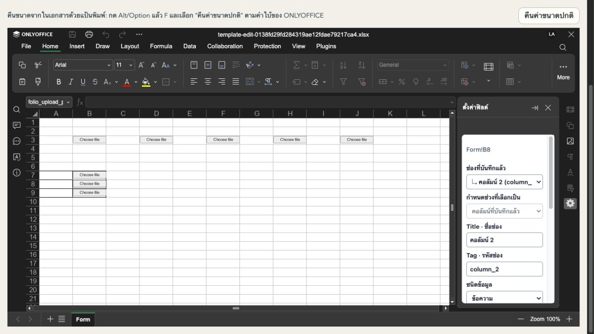
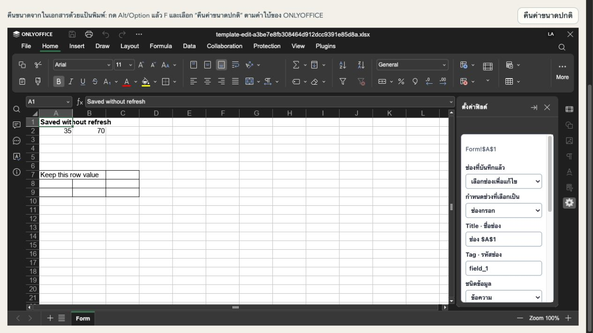

# ผลตรวจ POC ปุ่มแนบไฟล์ Excel

วันที่ 22 ตุลาคม 2026 — ทดสอบบนระบบพัฒนาในเครื่องและ ONLYOFFICE 9.4

## รอบแรก: แสดงปุ่ม

**ผลตรวจรอบแสดงปุ่มก่อนคำสั่งเพิ่ม file picker**: วางและแสดงปุ่มในช่องเดี่ยว/คอลัมน์ตาราง รวมถึงแถวที่ผู้กรอกเพิ่ม ไม่มีการเลือกไฟล์ ส่งไฟล์ หรือบันทึก URL งานอัปโหลดจริงและผลส่งออกตาม URL ยังพักตามคำสั่งผู้ใช้

## ชุดทดสอบที่ผ่านแล้ว

| การตรวจ | ผล |
| --- | --- |
| Plugin regression suite | 162 tests ผ่าน, 750 assertions; รันซ้ำหลังปรับปุ่มเล็กแล้ว |
| Server spreadsheet suite | 89 tests ผ่าน, 260 assertions; รันซ้ำหลังแพตช์สุดท้าย |
| Root `bun run check-types` | ผ่าน |
| Root `bun run build` | ผ่าน |
| Native ONLYOFFICE 9.4 | 1 test ผ่าน, 106 assertions; worker และ reviewer รันยืนยันแยกกัน |
| Focused plugin POC | 11 tests ผ่าน, 33 assertions |
| Root scoped formatter/lint | 13 ไฟล์โค้ดที่เปลี่ยนผ่าน |
| `git diff --check` | ผ่าน |

## ข้อบกพร่องที่พบระหว่างตรวจ

- การอ่าน defined name ที่ยังไม่มีใน native editor โยน exception: รองรับกรณีนี้ก่อนสร้าง marker แล้ว
- Native cell Width ใช้ pixel ส่วน Height ใช้ point: แปลงหน่วยแยกกัน และใช้ความสูงแถวเริ่มต้นเมื่อ native API คืนค่า 0/null
- บันทึกแล้วภาพปุ่มหายแม้ OLE ยังอยู่: เพิ่มการตรวจขนาดและ anchor หลังเปิด/บันทึกซ้ำ แทนตรวจเฉพาะจำนวน OLE
- Reviewer พบช่องทางเลี่ยงการปฏิเสธ embedding ที่ชื่อขึ้นต้นผิดรูปแบบ: คืนการตรวจ prefix เดิมและตรวจ OLE references ทุกกรณี พร้อม negative regression tests

## หลักฐานหน้าจอจริง

- ตรวจ Admin บันทึกแล้วโหลดเอกสารกลับ: ปุ่มช่องเดี่ยว B3 และคอลัมน์ B7/B8 ยังแสดงครบหลังแก้ native anchor
- ตรวจแป้นพิมพ์จริง: โฟกัสช่อง Placeholder → Tab → Enter เรียก action วางปุ่มสำเร็จ
- ปุ่มเล็กรุ่นสุดท้าย: บันทึก/โหลดกลับแล้วเห็น “Choose file” สีเทาครบ 3 ปุ่ม ขนาดไม่ยืดเต็มเซลล์
- User จริงเปิดฟอร์มที่เผยแพร่แล้ว: เริ่มด้วย 3 ปุ่มที่ B3/B7/B8
- กรอก `รายการทดสอบ` ที่ A7 แล้วเลือกเซลล์ในตารางและกดเพิ่มแถว: หลังบันทึก/โหลดใหม่มี 4 ปุ่มที่ B3/B7/B8/B9 และค่า A7 ยังคงอยู่
- ภาพหลักฐานที่เก็บไว้: [User หลังเพิ่มแถว](evidence/user-added-row-detail.jpg); ภาพ Admin รุ่นเก่าถูกลบระหว่าง cleanup โดยเก็บผลตรวจในรายงานนี้
- [ไฟล์ XLSX ต้นแบบที่บันทึกจริง](evidence/attachment-buttons-poc.xlsx) มีปุ่มเล็กช่องเดี่ยวและตาราง 2 แถว เปิดใช้งานผ่าน ONLYOFFICE ของ Folio ตามคู่มือ

## สถานะรีวิว

`sol_reviewer` ตรวจ diff รอบแรกแล้ว Agent หลักรับ finding เรื่อง embedding validation และให้แก้ ตรวจซ้ำผ่านแล้ว รอบสุดท้ายเพิ่ม assertions เรื่องขนาด/สัดส่วน/anchor/VML และภาพทั่วไปไม่เปลี่ยนตาม feedback จาก reviewer จากนั้น reviewer รัน native suite เองและสรุป **no actionable findings** Agent หลักรับผลภายในขอบเขต POC เท่านั้น

## ข้อจำกัดของรอบแสดงปุ่ม

- การแสดงปุ่มใน ONLYOFFICE ไม่ได้ทำให้ Microsoft Excel รันปลั๊กอินเดียวกันได้
- ปุ่ม POC ยังไม่มี file picker หรือ handler อัปโหลด และไม่เปลี่ยนค่าในช่องข้อความเดิม
- ยังไม่ทดสอบ API ภายนอก การเก็บ URL การแทนปุ่มใน export หรือการแก้ไข/ลบไฟล์ เพราะยังไม่ได้รับอนุญาตให้ทำเฟสเหล่านั้น
- ONLYOFFICE 9.4 CLI มีข้อจำกัดกับ OLE เมื่อเปิดและบันทึกทั่วไปโดยไม่สร้างปุ่มใหม่: เส้นทาง canonical ของ Folio จึงสร้าง managed buttons ใหม่และปรับ anchors ก่อนบันทึก; ไม่อ้างว่า roundtrip ในโปรแกรมภายนอกผ่านทั้งหมด
- ไม่ได้ commit, push หรือ deploy ระบบ production

## รอบเพิ่มเติม: เลือกไฟล์จริงจากปุ่มในชีต

ตามคำสั่งผู้ใช้เพิ่มเติม เปิด local file picker จากปุ่ม OLE จริง เก็บ File ใน parent page memory เท่านั้น ไม่มี external API integration หรือ URL persistence

### UI ที่ทดสอบกับระบบจริง

- ดับเบิลคลิกปุ่ม B3 เปิด picker; เลือก `poc-document-a.txt` (45 bytes) แสดงชื่อ/ขนาดถูกต้อง
- เลือกไฟล์เกิน 10 MiB: ปฏิเสธไฟล์ใหม่และคงไฟล์เดิม ตัวเลือกไฟล์ยังใช้งานได้
- เปลี่ยนเป็น `poc-document-b.txt` (51 bytes); ปิด/เปิดปุ่มเดิมยังแสดงไฟล์ใหม่
- B7 เลือก `poc-table-row.txt` (58 bytes) แยกจากไฟล์ของ B3
- เลือก A7 → เพิ่มแถว: editor remount สำเร็จ มีปุ่มใหม่ B10; เปิด B3/B7 แล้วยังแสดงไฟล์เดิมถูกช่อง
- B10 เลือก `poc-new-row.txt` (62 bytes) สำเร็จและไม่ทับ B3/B7
- กดบันทึกฉบับร่างและส่งคำตอบ: กันการทำงานพร้อมข้อความว่าไฟล์ยังอยู่เฉพาะหน้านี้ ไม่รายงานว่าบันทึกไฟล์สำเร็จ
- ตรวจข้อมูลที่บันทึกหลังเพิ่มแถวจริง: มี OLE 5 ตำแหน่ง (scalar rowIndex=null, table 0–3); answer attachment/evidence ยัง null และไม่พบชื่อหรือเนื้อหาไฟล์ทดสอบใน answer JSON หรือส่วนใดของ XLSX ที่แตก ZIP
- หลักฐานภาพรุ่นสุดท้าย: [เลือกไฟล์จริงในชีต](evidence/real-file-picker-final.jpg); ภาพก่อนปรับหน้าต่างถูกลบระหว่าง cleanup

### ประเด็นที่แก้ระหว่างตรวจ

- ONLYOFFICE 9.4 native import ทิ้ง OLE clientData/protection จาก XLSX การเขียน XML locked=false อย่างเดียวจึงเปิดปุ่มไม่ได้ในชีตที่ป้องกัน
- ใช้ internal SDK compatibility adapter เฉพาะ managed POC controls หลังตรวจ GUID, metadata, trusted binding/row, marker และตำแหน่งจริง ไม่ปลดป้องกันชีตหรือวัตถุทั่วไป ปุ่มคง noMove/noResize และเลือกได้
- Reviewer พบการเลือกไฟล์เกินขนาดแล้วตัวเลือกไฟล์ค้าง disabled: แก้ให้เลือกใหม่ได้และคงไฟล์ก่อนหน้า
- Reviewer พบ fallback init ทำงานก่อน content-ready แล้วไม่ retry: แก้ lifecycle และเพิ่ม regression ของ early attempt/in-flight ready
- เพิ่มการตรวจ public drawing locks ก่อน unlock และ rollback object protection เมื่อ adapter ทำงานไม่ครบ

### ข้อจำกัดปัจจุบัน

- รองรับการทดสอบ ONLYOFFICE 9.4 ใน Folio; internal SDK adapter ต้องทบทวนเมื่อเปลี่ยนรุ่น และยังไม่ถือว่า production-ready
- การ refresh/ออกจากหน้าล้าง File ในหน่วยความจำ ปิด/เปิด popup หรือเพิ่มแถวท้ายตารางไม่ล้าง
- เมื่อมีไฟล์ค้าง จะกัน explicit Save/Submit/export และการลบแถว; เพิ่มแถวยังบันทึกเฉพาะชีตตามระบบเดิม
- ยังไม่มี upload API, URL ใน tag, export URL/ช่องว่าง หรือ saved-file edit/delete ตามขอบเขตที่พักไว้
- ไม่ได้ commit, push หรือ deploy production

### ผลตรวจสุดท้ายของรอบเลือกไฟล์

| รายการ | ผล |
| --- | --- |
| Plugin suite รวม lifecycle/rollback | 176 tests / 813 assertions ผ่าน |
| Host pending + editor reconnect | 23 tests ผ่าน |
| Native ONLYOFFICE 9.4 regression | 123 assertions ผ่าน; worker และ reviewer รันแยกกัน |
| Reviewer focused activation + picker | 14 tests / 63 assertions ผ่าน |
| Root build / check-types | ผ่าน |
| Root formatter/lint | 395 files ผ่าน |
| git diff --check | ผ่าน |

`sol_reviewer` ตรวจซ้ำหลังแก้และสรุป **no actionable findings** Agent หลักรับผลสำหรับขอบเขต POC นี้ งาน API/upload/storage/export URL ยังไม่เริ่ม

Agent หลักตรวจ CSS รุ่นสุดท้ายใน dark theme แล้ว: หัวข้อไม่ถูกบังและคำเตือนอ่านชัด เลือกไฟล์จริงซ้ำจาก B10 ผ่าน ภาพ [รุ่นสุดท้าย](evidence/real-file-picker-final.jpg)

## รอบลดขั้นตอน Admin: วางปุ่มในคลิกเดียว

- ฟอร์มทดลองแยก `e43f39118450457c95d2c21b9b5b60ee`; ไม่แก้หรือโหลดหน้าต้นแบบที่ผู้ใช้กำลังทำงานใหม่
- เลือกเซลล์ว่าง B3 แล้วกดวางปุ่มเพียงครั้งเดียว: สร้าง `ไฟล์แนบ 1` / `attachment_1` พร้อมปุ่ม Choose file ทันที โดยไม่กดเพิ่มช่องหรือบันทึกต้นแบบก่อน
- กดซ้ำที่ B3: ยังเป็นช่องเดิม ไม่มีรายการ field ใหม่; เลือก D3 แล้วกดสร้างช่องใหม่ได้ `ไฟล์แนบ 2` / `attachment_2`
- ตาราง A7:B9 เลือก B7 แล้วกดวางปุ่ม: แสดงปุ่ม B7/B8/B9 ทันที ใช้ชื่อและ Tag คอลัมน์เดิม `column_2`
- กดบันทึกแบบร่าง: สำเร็จ โหลด editor กลับแล้วปุ่มทั้ง 5 ตำแหน่งและ metadata ยังอยู่
- เก็บหลักฐานภาพรุ่นสุดท้ายที่ [สร้างปุ่มพร้อม Title/Tag](evidence/admin-one-click-final.jpg); ภาพระหว่างทดสอบก่อนหน้านี้ถูกลบระหว่าง cleanup

รอบสุดท้ายทดสอบ F3 เพิ่มได้ `ไฟล์แนบ 3` / `attachment_3` หลังโหลด bundle ใหม่ [ภาพรุ่นสุดท้าย](evidence/admin-one-click-final.jpg)

ผลตรวจ incremental one-click: Plugin 181 tests / 834 assertions ผ่าน; reviewer รันแยกผ่านและตรวจ retry หลัง binding commit แต่ insertion failure ยืนยันใช้ช่องเดิม Finding selection race แก้แล้วและสรุป **no actionable findings** Plugin build, root check-types, root formatter/lint และ git diff --check ผ่าน

## แก้ Admin picker ตรวจ binding เก่า

ปุ่มใหม่สร้าง metadata ถูกต้อง แต่ host ใช้ spreadsheetBindings จาก config ตอนเริ่มหน้า ทำให้ปฏิเสธช่องที่เพิ่มภายหลัง แก้โดยอ่าน authenticated config ล่าสุดสำหรับคำขอ Admin และตรวจ document/action/scope/lease/current iframe ก่อนใช้ข้อมูล โดยไม่ remount หรือรับ bindings จาก picker

- เก็บแบบร่างที่ผู้ใช้เพิ่ม attachment_4/5 ก่อนแก้และ reload ระบบ
- หลังโหลด patch สร้าง D15 / attachment_6 ใหม่ แล้วเปิด picker และเลือก `poc-document-a.txt` ก่อน Save สำเร็จ
- เปลี่ยนเป็น `poc-document-b.txt` (51 bytes) สำเร็จ
- B7 เลือก `poc-table-row.txt` (58 bytes) แยกกัน; เปิด D15 กลับยังแสดงไฟล์ B
- [ภาพหลักฐาน](evidence/admin-picker-fresh-binding.jpg)
- Focused host/reconnect tests 24 ผ่าน; reviewer รันแยกผ่านและสรุป **no actionable findings**; root check-types และ scoped lint ผ่าน
- ไม่เปลี่ยน row-bound fallback ของ Admin ในรอบนี้ ไม่อ้างว่าเพิ่มการตรวจตำแหน่งแถวใหม่จาก workbook และไม่มี upload/storage API

## วางปุ่มพร้อมบันทึกก่อนเลือกไฟล์ และซ่อมช่องค้าง

ดู [ticket 08](issues/08-save-before-pick.md) สำหรับรายละเอียด รัน plugin 187 tests / 871 assertions, web 24 tests และ native ONLYOFFICE 9.4 129 assertions ผ่าน พร้อม root types/build/lint และ reviewer no actionable findings

UI จริงซ่อม attachment_6 ที่ D15 และ attachment_7 ที่ D13 โดยคง binding เดิม จากนั้นวางพร้อม SaveTemplate สำเร็จทั้งสองช่อง เลือก F20 → G20 → G22 โดยไม่แก้แผงแล้วสร้าง attachment_8 พร้อมบันทึกได้ ไม่มี false dirty เปิดหน้าใหม่แล้วปุ่มทั้งสามยังอยู่ เลือก File จริงของ 6 และ 7 ได้หลังเปิดใหม่ แล้วล้างเฉพาะ File ทดลองใน memory เพื่อให้ผู้ใช้ลองต่อ

[ภาพเปิดใหม่](evidence/saved-buttons-reopened.png) · [ภาพเลือกไฟล์หลังเปิดใหม่](evidence/saved-picker-after-reopen.png)

## คลิกปุ่มเพื่อดู Title/Tag และลบช่อง

สาเหตุเดิม: ONLYOFFICE เลือกปุ่มเป็น OLE แต่ plugin อ่านเฉพาะ active cell ซึ่งยังเป็นตำแหน่งก่อนคลิก ทำให้แผงแสดงข้อมูลคนละช่อง แก้ให้อ่าน selected drawing และตรวจ GUID/metadata/marker/ตำแหน่งกับ binding ก่อนเลือกช่อง รองรับการแจ้ง selection ของ ONLYOFFICE 9.4 ด้วย read-only polling ทุก 500 ms เฉพาะ Admin

ทดสอบ UI ในฟอร์มแยก `b7660e376b964169bae26a0527fb74d7`:

- เลือก A1 แล้วคลิกปุ่ม B3/D3 ครั้งเดียว: แสดง Title/Tag ของ attachment_1/attachment_2 พร้อม “ลบช่องนี้”
- คลิก B8 ในตาราง A7:B9: แสดง Title/Tag ของ column_2
- ลบ attachment_1 ผ่านแผง: บันทึกต้นแบบอัตโนมัติ และเปิดหน้าใหม่แล้ว B3 ถูกนำออก โดย D3 และปุ่มตารางยังอยู่
- ลบ column_2 ผ่านแผง: ปุ่ม B7:B9 และ mapping column_2 ถูกนำออก โดยตาราง, column_1 และเซลล์เดิมยังอยู่
- Guard ตรวจ pending File ก่อน mutation; save failure มีคำแนะนำให้ลอง “บันทึกแบบร่าง” อีกครั้ง

[ภาพการเลือกช่องเดี่ยว](evidence/click-button-settings.png) · [ภาพการเลือกคอลัมน์](evidence/click-table-button-settings.png) · [ภาพเปิดใหม่หลังลบช่องเดี่ยว](evidence/deleted-button-reopened.png)

ตรวจฟอร์มผู้ใช้ `e43f39118450457c95d2c21b9b5b60ee` หลังโหลด bundle ใหม่แบบอ่านอย่างเดียว: คลิก D13 แล้วแสดง Title `ไฟล์แนบ 7`, Tag `attachment_7` และ “ลบช่องนี้” ถูกต้อง เก็บ [ภาพยืนยันในฟอร์มเดิม](evidence/user-form-button-settings.png) โดยไม่ได้ลบช่องใดในฟอร์มนี้ พบคำเตือนแยกว่าช่องข้อความ `field_2` ไม่มีตำแหน่งที่บันทึกไว้ ต้องผูกตำแหน่งก่อนบันทึกต้นแบบ ไม่เดาตำแหน่งหรือแก้ binding นั้นในรอบนี้

ผลตรวจ: plugin **198 tests / 915 assertions**, native ONLYOFFICE 9.4 **145 assertions**, root check-types และ scoped format/lint ผ่าน Reviewer รันชุด plugin/native แยกและสรุป **no actionable findings** Native harness ตรวจ shared command/resolver โดย seed native selected flag เพราะ DocBuilder ไม่มี drawing selection controller; ไม่ใช่หลักฐาน actual click ซึ่งทดสอบผ่าน browser UI ต่างหาก

### ข้อสังเกตภาพ preview ระหว่างทดสอบ

พบหนึ่ง editor session ที่ D3 ยังมี metadata และคลิกได้ แต่ภาพปุ่มไม่แสดงจนเปลี่ยน selection ตรวจ XLSX จริงแล้ว OLE/VML/PNG/marker ครบ ไม่มี stale DrawingML หรือ shape ID ซ้ำ การทดสอบ A/B ใช้สำเนาฟอร์มทดสอบเท่านั้น: เพิ่มเฉพาะ row-height, ตัด row-height ออกจากไฟล์ที่ native save cleanup แล้ว และไฟล์ baseline ที่ไม่เปลี่ยน XML ทั้งสามแสดงปุ่มทันทีเมื่อใช้ document key ใหม่ จึงยังไม่สรุปว่า row-height เป็นสาเหตุ และไม่เพิ่ม workaround เปลี่ยนแถว/anchor/SDK redraw

เก็บไฟล์ A/B ใน evidence และคืนต้นแบบของฟอร์มทดสอบหลังจบ ไม่มีการปรับ template หรือ bindings ของฟอร์มผู้ใช้จากการทดลองนี้ การเปิด session ใหม่แสดงภาพได้ แต่ยังไม่ได้แก้หรือยืนยันสาเหตุของ transient rendering นี้

Reviewer รอบเอกสารพบ P2 ว่าคำแนะนำเปลี่ยน Tag เกินขอบเขตที่ทดสอบ: save-template ยังเก็บ Tag เดิมใน OLE และ picker จะปฏิเสธ metadata ที่ไม่ตรงกัน แก้คู่มือให้แนะนำเฉพาะการแก้ Title และระบุว่า POC ยังไม่รองรับเปลี่ยน Tag หลังวางปุ่ม ไม่มีการเพิ่ม rename synchronization ในงานนี้

Reviewer ตรวจคำแก้ทั้งสองตำแหน่งและข้อจำกัดซ้ำแล้ว สรุป final review: **no actionable findings** สำหรับขอบเขต selection/delete นี้

## วางปุ่มแล้วบันทึกเบื้องหลังโดยไม่รีเฟรช Excel

ดู [ticket 10](issues/10-background-placement-save.md) ใช้เฉพาะการวางปุ่มในต้นแบบ XLSX: request มี `preserveEditorSession:true` และ `uploadPocBindingId` ของ target จริง คง documentKey/lease เดิม แต่บันทึก canonical artifact ใหม่ผ่าน Operation/force-save/callback เดิมทุกครั้ง Host ข้าม remount เฉพาะ completed ACK ที่ตรวจ documentKey ตรงทั้ง native editor และ POC session การกด Save เอง การลบ และ Publish คงขั้นตอนเดิม

### หลักฐาน UI และไฟล์จริง

- ฟอร์มทดสอบแยก [POC บันทึกปุ่มเบื้องหลัง](http://localhost:8080/admin/forms/0138fd29fd284319ae12fdae79217ca4)
- สร้าง B3/D3/F3 ต่อเนื่องใน iframe เดิม (`frameEditorId` เดิม) ซูม 90% และ expanded คงอยู่ ไม่มีการเปิด Excel กลับระหว่างแต่ละ Save
- หลังแก้ control-state สร้าง H3/J3 และปุ่มคอลัมน์ B7:B9 ต่อเนื่องใน iframe เดิม และ Title/Tag/ชนิดข้อมูลกลับมา editable หลังจบ Save เปิด picker จาก B7 ได้โดยไม่มีข้อผิดพลาดตำแหน่งหรือยังไม่บันทึก
- Read canonical storage: documentKey ตรง baseline, objectKey/hash เปลี่ยน, savedButtons ครบ 8 slots และทุก target ผ่าน complete proof ดู [JSON canonical proof](evidence/background-eight-buttons-proof.json)
- Native ONLYOFFICE 9.4 เปิด [XLSX ที่อ่านจาก storage จริง](evidence/background-eight-buttons.xlsx) ใน container ใหม่: B3/D3/F3/H3/J3 มี distinct scalar bindings และ B7/B8/B9 มี table binding พร้อม rowIndex 0/1/2 ครบ GUID/metadata/geometry ผ่าน โดยไม่ใช้ browser cache ดู [native proof](evidence/background-eight-buttons-native-proof.json)
- Reload browser หลัง Save สุดท้าย: ปุ่มทั้ง 8 ยังอยู่ คลิก B8 แสดง Title คอลัมน์ 2 และ Tag column_2 ถูกต้อง

### Findings ที่แก้และผลตรวจ

- Reviewer P2: ตรวจแค่มี savedButtons อย่างน้อยหนึ่งปุ่มอาจยืนยันปุ่ม A แทน B ที่เพิ่งวางได้ แก้ exact target proof ทั้งช่องเดี่ยวและทุกแถวตาราง โดย server derive expected rows จาก bindings/marker จริง ไม่เชื่อ row count จาก client กรณี ForceSave(false) ใช้ canonical เก่าที่ไม่มี B ต้อง failed และไม่เขียนทับ artifact
- UI พบ nested disable เขียนทับสถานะ control เดิม แก้ให้รักษา snapshot ครั้งแรก คง originally-disabled controls และ draft/recovery guards ทดสอบ success/failure/retry แล้วแผงกลับมาแก้ไขได้
- Plugin full suite **214 tests / 1015 assertions**, web focused **25 tests**, spreadsheet unit **89 tests / 260 assertions**, native runtime **2 tests / 151 assertions** ผ่าน
- Isolated HTTP/storage/native regression `apps/server/test/http/spreadsheet-preserved-session.test.ts` ผ่านทั้ง worker และ reviewer แยกฐานข้อมูล (assertion count แตกต่างตามจำนวน poll); ครอบคลุม same-key saves, canonical new key/hash, callback replay, stale fallback, schema rejection และ normal save/deletion rotation พร้อม cleanup
- Root check-types และ scoped format/lint ผ่าน Reviewer ตรวจ P2 และ control-state delta ซ้ำแล้วสรุป **no actionable findings** พร้อมรัน focused plugin/web/server/native อิสระ
- Root production build ผ่านทั้ง server, plugin และ web; git diff --check ผ่านหลังปรับเอกสาร

ยังพัก editor ชั่วคราวระหว่างรอยืนยัน Save แต่ไม่เปิด iframe ใหม่ ให้รอ Save แรกสำเร็จก่อนวางปุ่มถัดไป ไม่มี external upload หรือการบันทึก File/URL เพิ่มในรอบนี้

## Admin บันทึกแบบร่างและลบช่องโดยไม่รีเฟรช Excel

ดู [ticket 11](issues/11-preserve-manual-save-delete.md) ซึ่งขยายพฤติกรรมรอบ ticket 10 มายัง manual Save และการลบในต้นแบบ XLSX ของ Admin ส่วน DOCX, publish และการกรอกคำตอบยังใช้เส้นทางเดิม

### การเปลี่ยนแปลงและเงื่อนไขยืนยัน

- แยก preserved purpose `placement`, `manual`, `delete` อย่างชัดเจน โดย placement ที่ขาด target ID ไม่กลายเป็น manual โดยปริยาย
- Manual/delete เขียน hidden local defined name ที่มี UUID ใหม่ อ้าง A1 หลัง native freeze ก่อน flush เพื่อพิสูจน์ snapshot ของทั้ง workbook ล่าสุด รวมค่า สูตร และรูปแบบ พร้อม exact retained-slot manifest และ deleted-ID/marker/OLE absence proof ก่อน canonical cleanup และก่อน transaction commit
- คง active lease, capability, bindingRevision และ callback claim/replay เดิม ปฏิเสธ checkpoint ที่เคยใช้แล้วภายใต้ lock เดียวกับการสร้าง Operation ส่วน `forceSave(false)` ที่ได้ canonical เก่าต้องไม่ ACK งานใหม่
- Native 9.4 ไม่มี public OLE Delete จึงตรวจ captured GUID/raw data/native ID/ตำแหน่งของทุกเป้าหมายก่อนเรียก `Drawing.deleteDrawingBase()` เฉพาะวัตถุนั้น หลัง confirmed metadata commit ภายใต้ Save freeze การคืน snapshot validation/named ranges เดิมไม่ได้ถูกอ้างว่ารองรับ rollback drawings
- หาก cleanup หรือ Save ล้มเหลว เก็บ pending cleanup และ dirty state ให้ลอง manual Save ใหม่ได้โดยไม่ DELETE metadata ซ้ำ การ Undo ที่คืนปุ่มขัดกับ metadata ต้อง fail closed ไม่เคลียร์ undo history ทั้งชีต และไม่ลบ foreign image/other OLE

### ผลทดสอบ UI และ canonical artifact จริง

ฟอร์มทดสอบแยก [POC บันทึกและลบไม่รีเฟรช](http://localhost:8080/admin/forms/a3be7e8fb308464d912dcc9391e85d8a):

- Manual Save ขณะไม่มีปุ่ม: A1 = `Saved without refresh` ตัวหนา, A2 = 21, B2 = `A2*2` ได้ 42 สำเร็จโดย iframe เดิมและซูม 90% Native 9.4 เปิด [storage bytes](evidence/manual-save-zero-poc.xlsx) ใหม่ได้ตรงกัน ดู [proof](evidence/manual-save-zero-poc-native-proof.json)
- สร้าง D3/F3 และคอลัมน์ B7:B9/C7:C9 รวม 8 ปุ่ม จากนั้นแก้ A2 เป็น 35, สูตรได้ 70 และ A7 เป็น `Keep this row value` แล้วกด manual Save โดยไม่ remount
- ลบ D3: 8→7; ลบ column_2: 7→4 โดย column_3 ยังครบ; ลบ table: 4→1; ลบ F3 ปุ่มสุดท้าย: 1→0 แต่ค่าเซลล์และเส้นขอบยังอยู่ ทุกครั้งยืนยัน iframe URL/identity เดิม ซูม 90% และ expanded ยังอยู่
- กด manual Save ซ้ำหลังไม่มีปุ่มเหลือ สำเร็จโดยไม่ remount
- ทดสอบ P1 ที่ reviewer พบใน UI จริง: สร้าง POC H3 → เปลี่ยน type เป็น number → บันทึกการตั้งค่า → manual Save สำเร็จ ปุ่มถูกนำออก แต่ binding number ยังอยู่ ดู [canonical type-change artifact](evidence/manual-type-change-number.xlsx) จากนั้นลบช่อง number ซึ่งไม่มี POC แล้ว autosave สำเร็จใน iframe เดิม
- ตรวจ DB/storage สุดท้าย: fields=0, table=null, saved POC slots=0, objectKey/hash ใหม่ และ **14 completed Operations ทั้งหมด** มี preserved ACK/documentKey เดิม ดู [canonical proof](evidence/manual-delete-final-proof.json)
- Cold native ONLYOFFICE 9.4 เปิด [final storage artifact](evidence/manual-delete-final.xlsx) ใน container ใหม่โดยไม่ใช้ browser cache: A1 ข้อความและตัวหนาเดิม, A2=35, B2=`A2*2`/70, A7 ข้อความเดิม, OLE=0 ดู [native proof](evidence/manual-delete-final-native-proof.json)
- Reload browser จริงแล้ว ข้อมูลข้างต้นยังครบ ปุ่มและรายการตั้งค่าที่ลบไม่กลับมา ไม่มีคำเตือน orphan binding

### Review และ regression

Reviewer พบ P1 ว่าเมื่อเปลี่ยน POC text เป็น number เดิมลบเฉพาะ marker แต่ OLE ยังอยู่ ทำให้ strict manual Save ใหม่ถูก block แก้ capture ก่อน type/key mutation และ enqueue cleanup/reprojection เฉพาะ confirmed commit ภายใต้ Save freeze โดยไม่ผ่อน server proof หรือ identity guards Type ที่ไม่รองรับ POC/computed ใช้ explicit ineligible cleanup; key/table-key changes ปรับ metadata ของปุ่มเดิมตาม identity ที่พิสูจน์แล้ว ข้อจำกัด Tag ในคู่มือรอบเก่าจึงถูกแทนด้วยขั้นตอน Save ใหม่นี้

- Full plugin **238 tests / 1148 assertions** ผ่าน; รวม metadata rejection, cleanup/storage failure และ retry, Undo mismatch, foreign object preservation, type/computed/key/table-key changes และ originally disabled controls
- Web focused **25 tests** ผ่าน; confirmed placement/manual/delete คง revision และ legacy/unverified ACK ยังมี remount fallback
- Spreadsheet units **92 tests / 274 assertions** และ isolated HTTP/native 9.4 integration **2 tests** ผ่าน (assertion count ของ integration เปลี่ยนตามจำนวน poll)
- Reviewer รัน plugin แยก **107 tests / 624 assertions**, unit proof/snapshot/POC **17 tests / 35 assertions** และ isolated HTTP/native หลัง P1 fix **2 tests** ผ่าน พร้อมล้างฐานข้อมูลทดสอบ แล้วสรุป **no actionable findings**
- Root check-types, root production build, scoped root format/lint และ git diff --check ผ่าน

ขอบเขตหลักฐาน: reviewer ตรวจ type/key changes ด้วย source/harness และ native integration ตรวจ checkpoint/normal deletion/canonical reopen; Agent หลักเพิ่ม UI จริงสำหรับ type→number ส่วน key/table-key renaming ยังไม่ได้อ้างว่าได้ทดสอบ browser mutation แยก ไม่มีการทำ external upload หรือเก็บ File/URL เพิ่ม
