# Folio Forms: แผนผังการทำงานทั้งระบบ

ทบทวน Excel lifecycle วันที่ 20 พฤศจิกายน 2026 บน `fix/xlsx-workbook-consistency` ที่ `fb4fc7daad` เทียบฐาน `ba895614f1`: Admin Apply เก็บ Rules ใน editor; Save/Publish ใช้ checkpoint เดียวเพื่อ commit Rules และ workbook ที่ตรงกันหรือคงฉบับที่บันทึกไว้ทั้งคู่. Draft ที่ binding หายต้องยืนยันการผูกใหม่หรือนำ Rule ออกก่อน Duplicate/Publish. Saved viewer/export ใช้ artifact ของ Draft หรือ Revision ที่เลือก ไม่อ่าน working copy; การทิ้ง Draft ของ User ไม่ลบประวัติที่เคยส่ง. User และ Correction ตรวจ cell/link ตาม physical row และ receipt ก่อน commit; การเปลี่ยน project ภายในไม่ย้ายไฟล์โดยไม่สั่ง Save. ดู §§05, 06, 09, 10 และ [หลักฐานตามตั๋ว](../excel-workbook-consistency-audit/spec.md); runtime ที่ไม่ได้ตรวจและผลจาก DCM จริงแยกออกจากผล sandbox.

ทบทวน Admin XLSX Template Draft วันที่ 20 พฤศจิกายน 2026 บน `fix/admin-excel-button-before-table` จากฐาน `1071d3c` พร้อม Working Tree: สร้างตารางครอบช่องแนบเดิมจะย้าย binding เข้าคอลัมน์ สร้างปุ่มครบแถวข้อมูล และบันทึกต้นแบบใน editor เดิม ดู §05 และ §08 ขอบเขตไม่รวม Production, DCM จริง หรือการแก้ฟอร์มเดิมอัตโนมัติ

ทบทวน source วันที่ 19 พฤศจิกายน 2026 บน `feat/ecm-attachment-safety-implementation` ต่อจาก `1071d3c` พร้อม Working Tree: แก้ cold initialization/rebuild ของปุ่มใน hidden/zero-width columns และ hidden/zero-height rows ให้คง physical binding และ preview ขนาด 0×0 ไม่ย้ายไปช่องข้างเคียง คง default-height fallback, protection และ invalid-geometry rejection การลบ Response ที่ initial SERIALIZABLE transaction abort ก่อน dispatch คืน conflict 409 ตามสถานะจริง ไม่ retry หรือลด isolation ผลแต่ละ source/runtime และขอบเขตที่ยังไม่ผ่านอยู่ใน [รายงาน continuation](../ecm-attachment-safety-implementation/acceptance-report.md#local-continuation-from-1071d3c--2026-11-19) ผลเดิมของ `c91472d` และ [native supplement N09–N18](../ecm-attachment-safety-implementation/acceptance/06-native-final/report.md) คง provenance เดิม ไม่ relabel เป็นผลรอบใหม่

Observed local evidence ของรอบแรกเพิ่ม own-Draft/history warnings, inert/loading/unknown/saved copy, exact lost-ack checkpoint reconciliation โดยไม่ resend, saved-removal/minimum-row/invalid/zero-byte/two-column, actual Back/reload/close และการสูญเสียงาน local, ordinary paste และ hidden row/column geometry พร้อม adjacent physical target ที่ไม่สลับ Tag ผล HTTP246 cases, plugin343, configured web282 บวก lifecycle12 และ types5/5 ผ่านตาม source provenance เดิม ตอนนั้น 03/06 ยัง needs-info และ 07–10 ยัง HOLD; สถานะล่าสุดคือปิดตั๋ว 01–10 ตามขอบเขตที่ผู้ใช้ตรวจรับ ไม่ใช่ full native matrix, settlement ของคำขอ DCM `HTTP 500` เดิม หรือการอนุมัติ deploy

Native continuation ใช้ Tab เลือก OLE ขนาดศูนย์ แล้ว Shift+F10 / Edit object เพื่อยืนยัน hidden physical target จริง ผ่าน Draft save, selected URL-only Excel export และ eligible Admin Correction ตามกรณีที่รายงาน Cold initialization 500 เดิมจึงมี causal fix และ native proof แยกจาก initialized-fixture workaround การชน cleanup ระหว่างลบยังทำให้ transaction abort ได้ แต่คืน 409 ก่อน external effects ไม่ใช่รับรองว่าจะลบสำเร็จทุก interleaving Native footer clipping ระหว่าง resize และ queued confirmed-removal/role-contract combinations ที่ยังไม่ตรวจคงเป็นข้อจำกัด ไม่แก้ guards หรือประกาศ full native/provider acceptance เพื่อปิดช่องว่าง

Pre-commit review เพิ่มการรองรับ XML `hidden="true"` ควบคู่กับ `hidden="1"` และให้กล่องยืนยันลบของ User Dashboard / Admin Result Detail ปิดและโหลดข้อมูลล่าสุดเมื่อได้ `409 operation_in_progress` ก่อนให้ยืนยันรอบใหม่โดยผู้ใช้ ไม่ส่ง DELETE ซ้ำหรือเปลี่ยนกฎอัปโหลด ตรวจแยกจากผลตรวจรับ DCM เดิมใน [รายงานตรวจรับ](../ecm-attachment-safety-implementation/acceptance-report.md)

Native acceptance พบว่าเปิดรอบใหม่ที่ยังไม่ได้กรอกกลับมี dirty/discard prompt เพราะ startup OLE activation สร้าง native history จากการคืน public locks/clientData แก้เฉพาะการคืน UI locks นี้ให้ suspend history แบบ synchronous และคืน counter ใน finally รวม rollback; ไม่ใช้การเพิกเฉย dirty events ของผู้ใช้ และไม่ recalculate workbook โดยไม่จำเป็น การตรวจ metadata/ตำแหน่ง/lock proof/rollback คงเดิม Regression มี 3 กรณี fail ก่อนแก้ และ activation 7/full plugin 339 ผ่านหลังแก้ Actual no-dirty opening และ subsequent user-edit warning ต้องตรวจ source ใหม่นี้ในตั๋ว 06

Implementation source รวม slices 01–05 แล้ว: active XLSX Save freeze native ก่อน pending guard และ host ใช้ inert พร้อม live status/focus; unsent command แยกจาก dispatched unknown ซึ่งคง original checkpoint และ no-resend notice เมื่อสำเร็จรับเฉพาะ captured generation และ normal remount ได้เมื่อไม่มีงานใหม่ หากมีงานใหม่หลัง captured Draft attachment Save จะต่อ native session เดิมได้เฉพาะเมื่อ server ตรวจ completed Operation/current canonical key/actor/session/opening/lease ครบ Internal row/project transition ที่มีงานใหม่ไม่ต่อ workbook geometry เก่า แต่คงงานและบล็อกไว้ Final Correction ที่ retired ไม่ Save ซ้ำ Cleanup warning หลัง commit ไม่ใช่ mutation HOLD ผลตรวจชุดรวมและ source provenance สุดท้ายอยู่ในตั๋ว 06; provider evidence/HOLD แยกใน 07–10

Source safety integration วันที่ 18 พฤศจิกายน 2026 ฐาน `c0387cf` พร้อม Working Tree corrections: template ใช้ชื่อฐานซ้ำและ paired receipt; minimum-one-row/navigation จาก slices ก่อนหน้าคงเดิม เพิ่ม locked attachment projections, native structural barriers, old Draft/Correction editable reprotection และ opening cache generation การทดสอบพบ canonical keys จบด้วย `/xlsx` จึงแก้ delivery ให้ใช้ owning Form.documentKind ไม่ใช่นามสกุลไฟล์ ผลล่าสุด: targeted native/old-artifact HTTP 6 cases/348 assertions, spreadsheet-unit 118/324, root format/lint และ types 5/5 ผ่าน Native pilot เปิด managed OLE บน protected cell และเห็น candidate/confirmed-pending จริง แต่ยังไม่ใช่ full gesture/role matrix หรือ final loading/continuation source และไม่ใช่ provider/Production acceptance บันทึกก่อนหน้านี้ด้านล่างคง revision/scope ของตน

ทบทวน safety implementation วันที่ 18 พฤศจิกายน 2026 บน integration `feat/ecm-attachment-safety-implementation` ฐาน `4fd024a` พร้อม Working Tree: ทุก XLSX table มี trusted pre-mutation minimum-one-row guard และ native builder ไม่ล้างแถวสุดท้าย ปุ่มลบแสดงเหตุผลและ disabled ตาม physical count; candidate ใน dialog รวมกับ dirty/navigation โดยไม่แทน confirmed pending และ explicit exit ทิ้งเฉพาะงาน local ไม่ Save/DELETE Response ผล observed บน integration: native Builder/button 14 tests, plugin 64, UI ที่เกี่ยวข้อง 79, spreadsheet-unit 116 และ ordinary table HTTP 3 cases ผ่าน; root lint/format และ types 5/5 ผ่าน Actual ONLYOFFICE 9.4 ตรวจ ordinary table เพิ่มแถว ลบจากสองเหลือหนึ่ง คง KEEP ROW ใน XLSX/JSON, Escape อยู่ต่อ และ explicit discard กลับ Dashboard โดย canonical key/data เดิมคงอยู่ controlled provider ไม่มี POST/DELETE Full candidate/native/loading matrix และ safety naming ยังรอ slice ถัดไป ไม่ใช้ผลนี้รับรอง provider หรือ Production

**ประวัติ naming ที่ superseded — ไม่ใช่ policy ปัจจุบัน:** ปรับคำอธิบายนโยบายชื่อปลายทางวันที่ 18 พฤศจิกายน 2026 บน working tree `feat/ecm-storage-templates` ฐาน `0a12d91a5b72d4470ae9ceed1c3d4845d2103ced`: mode `template` จัดสรร suffix สำหรับชื่อซ้ำเฉพาะ explicit save/upload batch ปัจจุบันก่อน ledger admission และ POST ตามรายละเอียดหัวข้อ 08 แหล่ง implementation คือ [shared attachment planner](../../apps/server/src/ecm/attachments.ts) ผล smoke ใหม่ผ่าน Bun HTTP listener จริงตั้งแต่ login, multipart Save Draft, Operation poll ถึง saved JSON และ canonical XLSX โดย local provider ใช้ filename เป็น resource key: ได้ชื่อเดิม, `-(1)`, `-(2)`, อ่าน bytes 11/12/13 ตรง physical rows และ URL ที่ C10/C11/C12 ไม่มี DELETE ใช้ ONLYOFFICE Builder จริง แต่ capture seam ใช้ XLSX สังเคราะห์ที่บันทึกไว้ ไม่ใช่ browser editor Root scoped format/lint สอง source files และ server typecheck ผ่าน ผล native/provider เก่าไม่รับรองนโยบายใหม่นี้ ยังไม่ยืนยัน DCM routing ของ suffix หรือความไม่ซ้ำข้าม batch และไม่มี live DCM calls ในงานนี้

ทบทวนกล่องแนบไฟล์วันที่ 17 พฤศจิกายน 2026 จาก working tree ใน delivery checkout เดิม: ปุ่มเลือกไฟล์มี label ภาษาไทยและซ่อน native file input เลือกใหม่แทนที่เฉพาะไฟล์ในหน้าต่าง **บันทึก** ยืนยันเข้าหน่วยความจำของ host หลัง trusted acknowledgement ส่วน **ยกเลิก/กากบาทก่อนยืนยัน** ทิ้งเฉพาะการเลือกในหน้าต่างและคงสถานะก่อนเปิดไว้ ปุ่มคืนไฟล์เดิม/นำไฟล์ออกแสดงตามสถานะ ไม่มีการ upload หรือแก้ canonical จาก dialog; การเก็บถาวรยังใช้ explicit Save Draft, Submit หรือ final Save Correction เดิม ไม่เปลี่ยน schema, mutation API หรือ provider contract และไม่เรียก DCM จริงในการตรวจ UI รอบนี้

ผลตรวจรอบกล่องไฟล์: plugin 336 tests, web UI 265 tests และ lifecycle 12 tests ผ่าน ตรวจ native ONLYOFFICE 9.4 แบบ scalar ด้วยฟอร์มสังเคราะห์ ไม่ต่อ PostgreSQL/RustFS/DCM: เลือก/แทนที่ บันทึก เปิดกลับ ยกเลิก/กากบาท คืนไฟล์เดิม/นำออก ไฟล์ศูนย์ไบต์ ปฏิเสธไฟล์เกินขนาด และ keyboard chooser ผ่าน ทดสอบหน่วง trusted acknowledgement ก่อนถึง picker จริงแล้ว Cancel/X ไม่ปิดระหว่างยืนยันหรือ timeout; late success ปิดได้โดยไม่ส่ง File ซ้ำ ตรวจสีข้อความผิดพลาดทั้ง system light/dark และไม่พบแนวนอนล้น หลังแยก helper เพื่อผ่าน lint ตรวจ native Save/Cancel/reopen ซ้ำบน source สุดท้ายแล้ว Root scoped lint/format 4 files ผ่าน, types 5/5 (server ตรวจใหม่ อีก 4 tasks ใช้ cache), build 3/3 (server/plugin ตรวจใหม่ อีก 2 tasks ใช้ cache) ผ่าน ไม่ใช้ผลนี้รับรอง native table ทุกกรณี, live DCM upload หรือ Production

คง context ของข้อความไฟล์เกินขนาด: แสดง Tag และเลขแถวข้อมูลแบบเริ่มที่หนึ่งเมื่อเป็นตาราง regression พบข้อความขาดตำแหน่งทั้ง scalar/table 2 กรณีก่อนแก้ และผ่านหลังแก้ โดยไม่ทำให้ File ที่ยืนยันแล้วหรือ local candidate ที่ valid ถูกแทนด้วยไฟล์เกินขนาด ไม่เปลี่ยน zero-based `row_index` ที่เก็บในคำตอบ

เมื่อรับ UI ชุดใหม่นี้ ให้จัดการงานค้างก่อนเปิด editor ใหม่ทั้งหน้า เพื่อโหลด footer **บันทึก/ยกเลิก** พร้อม picker รุ่นเดียวกัน ห้ามรีโหลดทิ้ง File ที่ยังไม่บันทึก การบันทึกใน dialog ไม่แทนการบันทึกคำตอบที่หน้าหลัก

วันที่ 17 พฤศจิกายน 2026 ถอด AI Authoring ตามคำสั่งเจ้าของระบบ ทั้งหน้า เมนู HTTP endpoints, Pi/OmniRoute, document worker และ config/dependencies เฉพาะฟีเจอร์ การสร้าง Form, DOCX/XLSX, Template Draft และข้อมูลเดิมยังใช้ flow ปกติ การ logout, เปลี่ยนรหัสผ่าน, account mutation และ SSO ยังคงเพิกถอน session ตามเงื่อนไขเดิม ไม่ทำ schema migration หรือลบข้อมูล/ไฟล์ที่บันทึกแล้ว ADR 0001 เก็บไว้เป็นประวัติพร้อมสถานะ Retired

ผลตรวจการถอด AI: retained HTTP 122 tests / 5,000 assertions จาก 8 suites (`callback`, `legacy-provisioning`, `legacy-review`, `legacy-session`, `legacy-roles`, `viewer-role`, `native-scalar`, `admin-user-workflow`) ผ่านบนฐาน PostgreSQL และ RustFS bucket แยก ใช้ migrations เดิม 36 รายการเฉพาะฐานทดสอบ; ไม่ migrate ฐานใช้งานเดิม เคส conversion/database/object-cleanup failure เป็น fault injection ที่มี assertions รองรับ ไม่ใช่ suite failure Web lifecycle 12 และ UI 265 tests ผ่าน Root typecheck 5/5 (web/server ตรวจใหม่ อีก 3 tasks ใช้ cache), build 3/3 (web/server ตรวจใหม่ prefill-mock ใช้ cache) และ scoped root lint/format 348 files ผ่าน ไม่ใช้ผลนี้อ้างว่า whole-repo Markdown format debt ที่อยู่นอกงานได้รับการแก้แล้ว

Smoke ผ่าน Bun HTTP listener จริง: AI endpoints เดิมทั้ง 6 คืน 404, สร้าง DOCX Draft ปกติได้, editor-config เป็น DOCX/edit และ logout ทำให้ bearer เดิมอ่าน session ได้ 401 Browser บน runtime แยกที่ 3030/5174 ยืนยันเมนู AI หาย หน้า New Form ยังมี DOCX/XLSX และ URL AI เดิมแสดง Not Found โดยไม่ส่ง AI API requests คู่มือเหลือ 22 diagrams, 25 page declarations, 104 API declarations และ 35 models; ตรวจภาพ 02/03/05/12 กับหน้าตารางและ source links แล้ว ไม่เรียก DCM/OmniRoute จริง และไม่ทดสอบ deployment ระหว่างตรวจพบ gateway เดิม 503 เพราะไม่มี listeners ที่ 3000/5173 จึงไม่อ้างว่า dev stack เดิมกำลังรัน หลังตรวจหยุด runtime ที่สร้างเอง ลบฐานทดสอบและ bucket พร้อม 82 objects แล้ว ไม่ลบ secrets, containers, volumes หรือข้อมูลเดิมของผู้ใช้

ทบทวนหน้า **ตั้งค่าระบบ** วันที่ 17 พฤศจิกายน 2026 จาก working tree บน `feat/ecm-storage-templates` ฐาน `0a12d91`: เปลี่ยนชื่อเมนูและชื่อหน้าเพื่อรองรับส่วนตั้งค่าอื่น โดยคง URL เดิม แม่แบบจัดเก็บเอกสารอยู่ในกรอบเดียว แยกตัวเลือกหัวข้อจากแบบเพิ่มและตาราง CRUD ใช้ selector หลักชุดเดียว ไม่มีปุ่มโหลดซ้ำในสถานะปกติ และมีปุ่มลองใหม่เฉพาะเมื่อโหลดผิดพลาด ตรวจผ่าน actual development gateway ทั้งเพิ่ม ชื่อซ้ำ แก้ชื่อ ย้ายหัวข้อ reload แล้วยังอยู่ ยกเลิกด้วย Escape/focus restoration และยืนยันลบรายการทดสอบแล้ว ทดสอบ category/catalog outage ด้วย browser HTTP interception และกู้คืนด้วยปุ่มลองใหม่ ตรวจ desktop 1440 และ mobile 375/320 pixels ไม่พบแนวนอนล้น; ปุ่มแถว mobile มีพื้นที่ 44×44 pixels รายการทดสอบ local catalog ถูกลบแล้ว ไม่ upload หรือ DELETE ไฟล์ DCM ไม่เปลี่ยน schema, API contract, permissions หรือ Published Template และไม่ใช่ผล deployment

ผลตรวจรอบ UI นี้: existing web UI 267 tests ผ่าน; root typecheck 5/5 (web ตรวจใหม่ อีก 4 tasks ใช้ cache), build 3/3 (web/server ตรวจใหม่ และ prefill-mock ใช้ cache) ผ่าน Root `bun run check` พบ Markdown format issues 23 files รวมเอกสารนอกขอบเขตงาน จึงไม่ใช้ผลนี้อ้างว่า whole-repo lint/format ผ่าน และไม่จัดรูปแบบ specs/tickets/CONTEXT ที่ไม่เกี่ยวข้อง

ทบทวน Storage Templates ครบวงจรวันที่ 17 พฤศจิกายน 2026 บน delivery integration `feat/ecm-storage-templates` ที่ `baf64cb590b5390954d7f9f233f59f26f1405ceb` (production source `d8162b8`): Admin CRUD/category ID, frozen scalar/table choices, no-year upload, trusted original reuse/current physical-row references, Correction/history และ deletion/follow-up ใช้ flow เดิม ผลส่วนกลาง: HTTP 505 กรณีไม่ซ้ำจาก 39 suites ผ่านแบบ resumed runs, UI 267, plugin 319, spreadsheet 116, root lint/format 47 files, forced types 5/5 และ build 3/3 ผ่าน กรณี late receipt ครั้งแรกใช้ fixture lease 90 วินาทีเกินอายุ จึงแก้เฉพาะ fixture ให้เปิด editor-config จริงหลัง settlement; changed case/expiry guard ผ่านบน integration โดยไม่เปลี่ยน TTL หรืออ้างสาเหตุที่รอบเดิมช้า Standards และ Spec recheck ไม่เหลือ code findings หลังแก้ stale choices ทีละช่องและ semantic recovery Actual native08/source90b ตรวจ scalar/table/current-B/0-byte, สิทธิ์, warnings, selected revisions และ 6 XLSX + 6 PDF + unsaved XLSX; actual changed-authoring native/source d816 ตรวจ repair/recovery/further save/publish โดยไม่ทิ้งงาน รายละเอียดใน [acceptance matrix](../ecm-storage-templates/acceptance-matrix.md) Submitted fixture ยกเลิกเฉพาะ automatic next-round `/start` หลัง Submit ไม่ใช่ uninterrupted default Submit→Correction และไม่เปลี่ยน eligibility Populated-ledger smoke รักษา attempt/reference เดิม ไม่เดา hash/row backfill ไม่มี reset หรือ migrate ฐานผู้ใช้เดิม ผล live เพียง PDF เดียว; all-type/boundary/overwrite/settlement/provider revision และ human release acceptance ยัง HOLD จึงไม่ปิดตั๋ว04/08

ทบทวน scalar upload และ whole-Response deletion วันที่ 17 พฤศจิกายน 2026 บน integration `feat/ecm-storage-templates` ที่ source commit `6c0ef6fc95a126f190e17348c9392f366f9d2bf6`: upload attempt เก็บ receipt เดิมแยกจาก canonical provider identity ที่ fence shared references/dispatch และใช้ปีเป็น nullable ตาม storage mode ผลส่วนกลางบน integration: scalar HTTP 90 tests ผ่านบน source ก่อน merge 07 และ deletion/follow-up HTTP 20 tests ผ่านหลัง merge 07 โดยไม่ใช้ผล worktree มาแทน การตรวจ native upload/reuse/table/Correction/export แบบรวมยังรอตั๋ว 04–06/08 ไม่ถือว่า feature ผ่านครบจากผลเหล่านี้

ทบทวน Storage Template catalog และ authoring วันที่ 17 พฤศจิกายน 2026 บน integration `feat/ecm-storage-templates` ที่ source commit `1d23d50a9bbc4b4ae37014b3c2ed358b50272b7b`: Admin CRUD/filter ใช้ category ID, popup เลือก category/template, publication ตรึง normal Field metadata และ duplication ได้ Form/link ใหม่ ผลตรวจส่วนกลางบน integration: catalog HTTP 3 tests, authoring HTTP 16 tests, plugin 312 tests, web UI 265 tests และ root type checks 5/5 ผ่าน ตรวจ actual Admin CRUD/keyboard และ actual ONLYOFFICE scalar configuration/no-year publication/duplicate แล้ว ไม่ใช่ผลรับรอง upload lifecycle ใหม่หรือทุกตั๋วในสเปค

รอบเดียวกัน live DCM ที่ผู้ใช้อนุญาตสร้างเพียง PDF สังเคราะห์ `กทอ.67-00-0001-ก่อหนี้-4_ขยาย(45).pdf` 629 bytes ที่ provider รายงานใต้ `2. มติและการก่อหนี้` ได้ object receipt ไม่ทดสอบชื่อสำรอง/overwrite/ชนิดไฟล์อื่น และไม่ DELETE ไฟล์ซึ่งผู้ใช้จะตามลบเอง `file_link` เปิด native viewer ได้; public `GET /api/beeecm/public/file?token=<trusted receipt file_token>` ผ่าน shared authentication คืน 629 original bytes ที่ hash ตรงกับ fixture แล้ว ผลนี้รับรองเฉพาะ PDF sample เดียว ไม่รับรอง supported all-type original-byte contract หรือการเปิดใช้ feature ทั้งหมด

ทบทวนวันที่ 9 พฤศจิกายน 2026 จากฐาน `codex/admin-result-downloads` ที่ `95534c9` รวมการย้ายปุ่มดาวน์โหลดในแถว Document / Fields ของหน้ารายละเอียด Results และการคง guard ห้ามลบคำตอบระหว่างส่งออก

ทบทวนส่วนตั้งค่าช่องแนบ Excel และ ECM authentication วันที่ 13 พฤศจิกายน 2026 บน `feat/ecm-attachments-config` จากฐาน implementation `b627865` ส่วนอื่นคงผลทบทวนเดิม ขอบเขตนี้เพิ่มการตั้งค่าจากปุ่มเดิมและ shared auth ไม่ได้ยืนยันวงจรอัปโหลดคำตอบ การตรวจ native browser หรือบริการ ECM จริง

ทบทวน cutover ของ PoC เดิม วันที่ 14 พฤศจิกายน 2026 บน `feat/ecm-attachments-legacy` จาก source commit `6a87d0004dccba530401531777c9de42162d00c6` ครอบคลุม explicit Draft conversion, Published ordinary contract, Duplicate และ pending dirty guards ผล HTTP/UI/native/browser ผ่านการตรวจส่วนกลางตามขอบเขต legacy แล้ว ไม่ใช่หลักฐาน live ECM หรือการ deploy และยังไม่ยืนยันวงจร scalar upload/export ทั้งหมด ทบทวนวงจร scalar attachment วันที่ 14 พฤศจิกายน 2026 บน `feat/ecm-attachments` จาก source-containing commit `1362d403580ae0f0f027f19791db35a663feea2f` ซึ่งรวม source `22dbd6f9f6c8b055cc0ae50f960bb55e1eebac25`, การคืน shared workbook extraction ใน `b90fcfb0840e22609f6d0b5e02001e04e00ba4e7` และการลบ mock-echo tests: เพิ่ม explicit Save Draft/Submit, durable intent/receipt, atomic commit, after-send unknown hold และ checkpoint recovery ที่ fence sender เดิมด้วย lease rotation รวมการตรวจ original checkpoint ก่อนเปิด editor และการกู้ original Submit ตามผลจริง ผลตรวจ automated และ native/browser ใช้ระบบทดสอบแยกตามขอบเขตที่ระบุ ไม่ใช่หลักฐานบริการ ECM จริงหรือการ deploy; exported PDF control-overlap ยังอยู่ในขอบเขตตั๋ว 07 และไม่อ้างว่าแก้แล้ว

ตรวจ integration artifact เพิ่มหลัง merge: พบว่า manifest สำหรับ commit scalar ตกหล่น shared workbook attachment extraction แม้ implementation worktree ผ่านการตรวจ จึงนำ extraction ที่ตรวจ native แล้วมารวมใน integration และตรวจ native HTTP 39 tests/679 assertions, root type checks 5/5 และ build 3/3 บน integration โดยตรง เมื่อตรวจ spreadsheet-unit พบ test ที่ตรวจ mock renderer echo และ copied manifest/defaults จึงลบ assertion/fixture ที่ผูก implementation เหล่านั้นโดยไม่ re-pin ผล spreadsheet-unit 116 tests/301 assertions และ native ONLYOFFICE Picture 2 tests/16 assertions ผ่าน รวมการรักษาตำแหน่ง/ขนาดผ่าน publish/reopen และรูปจริงใน protected workbook ผ่าน replace/remove/PDF export นี่เป็นขอบเขตการตรวจที่ทำจริง ไม่ใช่ผลตรวจรับทั้งสเปกหรือ live ECM

ทบทวน source วงจรเปลี่ยน/นำไฟล์ออกและ metadata ของ Draft วันที่ 14 พฤศจิกายน 2026 บน `feat/ecm-attachments-draft` จาก integration `b90fcfb0840e22609f6d0b5e02001e04e00ba4e7` พร้อม source changes ที่ยังไม่ commit: เพิ่ม trusted original-byte refetch, explicit removal, reconciliation ของ canonical references และ durable post-commit cleanup ต่อ initiating operation ผลตรวจส่วนกลางและ native/browser ของ change นี้ยังต้องยืนยัน ไม่ใช่ผลผ่านจากการเพิ่ม regression และไม่ใช่หลักฐาน live ECM

การแก้ source ต่อในรอบ Draft นี้แยก canonical document key ของ Folio ออกจาก native cache key ต่อ editor opening ของ XLSX เพื่อไม่ให้การเปิดไฟล์ที่บันทึกแล้วสืบทอดสถานะ editor เก่า ส่วนนี้เป็นคำอธิบาย source ที่ยังไม่ commit ไม่ใช่ผลยืนยันการเปิดกลับผ่าน native browser

ทบทวน source ช่องแนบรายแถววันที่ 14 พฤศจิกายน 2026 บน `feat/ecm-attachments-rows` จาก integration `402a8f0` พร้อม source changes ที่ยังไม่ commit: ขยาย lifecycle เดียวสู่ physical table slots, nested canonical objects, required active rows, reference reconciliation และ verified document/row transition สำหรับ pending Files เดิม ยังไม่ได้รัน HTTP/UI/build/type checks หรือ native/browser/export acceptance ของส่วนนี้ ผล RED ของ tracer ก่อนแก้ production ตรวจโดย Parent แล้ว ไม่ใช่ผลยืนยัน implementation หรือ live ECM

ทบทวน source recovery/follow-up วันที่ 14 พฤศจิกายน 2026 บน `feat/ecm-attachments-recovery` จาก integration `402a8f0` พร้อม source changes ที่ยังไม่ commit: เพิ่ม durable sender fence, request-settlement receipt, first-delete operator action, trusted tracking ที่ขยายใน Results เดิม และข้อความ hold ใน popup/fill หลัง rejected action การเพิ่ม source/regressions ยังไม่ใช่ผลผ่าน automated/native/browser และไม่ใช่หลักฐานบริการ ECM จริง ส่วน generated workflow artifacts ให้ขั้นตรวจส่วนกลางสร้างหลังรวม source

ทบทวน source Correction/history/export วันที่ 14 พฤศจิกายน 2026 บน `feat/ecm-attachments-revisions` จาก accepted integration `58227b7b3cd894b237e939733438a78c6006dddc`: final explicit Save Correction ใช้ shared durable attachment lifecycle โดยแยก Admin actor จากเจ้าของ Response, ตรวจ submitted/latest-base/workspace/lease/required ก่อน external write และรักษา immutable history; read-only และ XLSX/PDF ใช้ derived URL-only projection ไม่แก้ editable canonical workbook การเพิ่ม source/regressions นี้ยังไม่ใช่ผลผ่านส่วนกลางหรือ actual native/export acceptance และไม่ใช่หลักฐาน live ECM generated artifacts ให้ Parent สร้างหลังตรวจ source

ทบทวน source whole-Response deletion วันที่ 14 พฤศจิกายน 2026 บน `feat/ecm-attachments` จาก committed source `203245ec331106737040dfa02c42705a7836a0b0` ของ `feat/ecm-attachments-deletion` (ฐาน `d32e59332748678f223c9868bf0be3a7d43bd1c6`): owner-bound tombstone/case, pre-cascade attachment evidence, shared version fencing, separate data/file outcomes, durable owner warnings และ Results follow-up หลัง rows gone การทดสอบ RED ส่วนกลางพบ missing initial ECM DELETE และ Admin bypass ผ่าน User discard route จริง; source รอบนี้แก้ทั้งสองจุด ผล automated ส่วนกลางที่สังเกตจริง: HTTP 76 tests/2882 assertions; UI 260 tests/18 suites; forced type checks 5/5 และ build 3/3; plugin 297 tests/1409 assertions; spreadsheet-unit 116 tests/301 assertions; form-lifecycle 12 tests/75 assertions; native CLI 15 tests/264 assertions รวมสองคำสั่ง ไม่ใช่การรันเดียว ชุด regression ข้ามระบบ 16 คำสั่งมี 15 คำสั่งผ่าน และ ordinary-six ครั้งแรกไม่ผ่านจาก incidental whole-payload assertion; Parent ลบเฉพาะ assertion ดังกล่าวหกจุดโดยไม่ re-pin และคง behavioral assertions อื่นทั้งหมด จากนั้น ordinary-six ที่แก้แล้วผ่าน 21 tests/6038 assertions โดยไม่ข้ามการทดสอบ หลักฐาน actual native/browser ของตั๋ว 08 มีแล้ว แต่ Parent ยังไม่รับ final UI handoff จึงไม่อ้าง Native PASS หรือปิดตั๋ว และผลทั้งหมดนี้ไม่ใช่หลักฐาน live ECM หรือการ deploy

ทบทวน final-review fixes วันที่ 15 พฤศจิกายน 2026 จาก committed source `530410f7527bbe66d369a0359c57ec1c0898f600` บน `feat/ecm-attachments-final-fixes` และรวมแบบ fast-forward ใน `feat/ecm-attachments` จาก integration `f037eb8297b959730152dfbe66f7df41bb8bb568`: ตรวจครบ 13 paths แล้ว HEAD/index/filesystem ของ source และ integration ตรง checked artifact ทุก byte/SHA-256 รวม CONTEXT และคู่มือนี้ ก่อนปรับข้อความตรวจรับ คง File/removal ที่เลือกภายหลัง final Correction ใน editor เดิมจน explicit exit; ใช้ native modal สำหรับ operator confirmation; ยก Bun listener ceiling โดยยังจำกัด actual streamed body ตาม trusted slots และขอบเขตเดิมของ JSON routes ผล RED ก่อนแก้ที่ Parent ตรวจจริงพบ UI 3 failures และ actual TCP 14 × 10,000,000 bytes ถูกปฏิเสธ 413 ผล GREEN และ actual native ที่ Parent ตรวจรับภายหลังระบุในขอบเขตการตรวจท้ายเอกสาร ไม่ใช่ผลผ่านจากการเขียน source และไม่ใช่ live ECM/deployment acceptance

ข้อความ “ยังรอ native” ในบันทึกแต่ละ slice ข้างต้นเป็นประวัติเวลาทำงาน ไม่ใช่การลบล้างผลตรวจภายหลัง: final acceptance ของ rows/recovery ได้ตรวจ protected physical-row transitions, original late receipt/sender fence และ first DELETE กับ controlled provider แล้ว ส่วน receiptless unknown และ dispatched unknown DELETE ยังไม่มี confirmed external proof contract จึงเป็น external release prerequisite ตาม spec 254/255/377 และ decisions 05/09 ไม่ใช่สิทธิ์เพิ่ม manual unlock หรือ capability สมมติ ไม่มีการตรวจ live ECM หรือ production ในรอบนี้

ทบทวนข้อความตรวจเผยแพร่ช่องแนบวันที่ 16 พฤศจิกายน 2026 จากฐาน source `3ec718a5c7ec34549c0c8c5521310a38f66ee00c` พร้อม Working Tree รอบนี้: ย่อข้อความให้แสดงเฉพาะหมวดเอกสารและ Tag ของช่องกรอกเดี่ยวที่ยังขาดพร้อมกัน เงื่อนไขเผยแพร่ สิทธิ์ การบันทึก และสถานะเดิมไม่เปลี่ยน ไม่ได้เรียก ECM จริงหรือเผยแพร่ฟอร์มของผู้ใช้

ทบทวน authoring ช่องแนบวันที่ 16 พฤศจิกายน 2026 บน `feat/ecm-attachments` จากฐาน `3ec718a5c7ec34549c0c8c5521310a38f66ee00c` พร้อม Working Tree: เอา checkbox ออก ใช้ **เพิ่มช่องแนบไฟล์** / **แนบไฟล์** และ popup **เลือกหมวดหมู่จัดเก็บเอกสาร** ภายนอก sidebar ด้วย ONLYOFFICE `ShowInputHelper` แบบ PDMS ร่วมกันสำหรับเพิ่มหรือเปลี่ยนหมวด เฉพาะ XLSX Template Draft และไม่ขึ้นกับ PDMS flag แผงหลักโหลดรายการใหม่ทุกครั้งและถือ API capability/สิทธิ์บันทึก Parent relay ตรวจ scope/frame/request ก่อนส่งคำเลือก ไม่ให้ popup ถือ token ยืนยันก่อนสร้าง/เปลี่ยนช่อง คง canonical proof ของการแปลงช่องเดิม ไม่เปลี่ยน schema DB, auth contract หรือจังหวะ upload ผล automated และขอบเขต browser smoke ของรอบนี้ระบุใน spec; ไม่ใช่การยืนยัน DCM จริงหรือ production

ทบทวน ECM provider contract วันที่ 16 พฤศจิกายน 2026 บน baseline เดิมพร้อม Working Tree: การตรวจที่ผู้ใช้อนุญาต login จริง 1 ครั้งและ GET หมวด 1 ครั้งได้ HTTP 200 ทั้งคู่ แต่ parser เดิมปฏิเสธ `expire` แบบมีช่องว่างและไม่มี timezone และรอ `data` envelope ที่ response หมวดไม่มี ผู้ใช้ยืนยัน UTC+7 และแจ้งอายุ token 15 วันพร้อมการเพิกถอน token เดิมทันทีเมื่อ login ใหม่ จึงแปลงวันหมดอายุโดยระบุ offset และอ่าน root array ตาม response example ทางการ ไม่ใช้ 15 วันเป็น fallback ไม่เพิ่ม login ทุกครั้งที่เปิด popup ไม่เปลี่ยน schema หรือแก้ข้อมูลฟอร์มจริง

เพิ่มเติมการต่ออายุ ECM วันที่ 16 พฤศจิกายน 2026 บน baseline/Working Tree เดิม: ผู้ใช้เลือกตรวจเมื่อมีคำขอ ไม่ทำ cron เมื่อ token cache เหลือไม่เกิน 12 ชั่วโมงจะ claim shared login job ก่อนโหลดหมวด/อัปโหลด/ลบ สำหรับอายุ 15 วันตรงกับประมาณวันที่ 14 ครึ่งเมื่อมีงาน ใช้ `expire` จริง ไม่สร้าง login timestamp หรือ schema ใหม่ Token ที่เพิ่ง login ยังผ่าน request-budget/skew validation เดิม การ login ใหม่อาจตัดคำขอที่ยังใช้ token เก่า จึงคง generation fence และไม่ resend mutation อัตโนมัติ

ทบทวน Storage Template catalog วันที่ 17 พฤศจิกายน 2026 บน `feat/storage-templates-01` จาก integration baseline `7d4859c`: เพิ่มหน้า Admin และ persisted CRUD แยกจาก Form/Response ใช้ numeric category ID กับ shared ECM auth เดิม ไม่แก้ข้อมูลหรือไฟล์เดิม ไม่เรียก provider file mutation ผลตรวจของตั๋วระบุใน ticket 01; ไม่ใช่หลักฐาน live DCM routing ส่วน generated artifacts สร้างหลังรวม source โดย integration owner

ทบทวน Storage Template authoring วันที่ 17 พฤศจิกายน 2026 บน `feat/storage-templates-02` จาก integration `03c4906`: normal Field metadata เก็บ storage mode/category ID/catalog identity/name; publication ตรวจ local mapping ภายใน transaction แล้วตรึง snapshot ส่วน upload lifecycle ของ mode ใหม่เป็นงานตั๋ว 03 ไม่ถือว่าเปิดใช้ upload ได้จาก authoring ที่เสร็จแล้ว

ทบทวน scalar Storage Template upload วันที่ 17 พฤศจิกายน 2026 บน `feat/storage-templates-03` จาก integration `1d23d50`: new mode ในรอบนั้นใช้ multipart สอง field, filename ไม่มี suffix และไม่บังคับปี; แยก attempt evidence จาก canonical provider identity พร้อม destination/reference/delete fencing ก่อน dispatch ข้อความนี้เป็นประวัติก่อนนโยบาย suffix ภายใน batch ในหัวข้อ 08 การตรวจรับระบุในตั๋ว 03 ไม่ใช่หลักฐาน Production หรือ all-type original retrieval ซึ่งยังเป็นงาน 04

เอกสารนี้อธิบายพฤติกรรมตาม source ที่ทบทวนและระบุขอบเขตที่ตรวจด้วยระบบทดสอบไว้ท้ายเอกสาร

รายการ source ครอบคลุมหน้าและ layout ฝั่งเว็บ, HTTP routes ของเซิร์ฟเวอร์หลัก และ Prisma models

ดูรายการที่สร้างจาก source และคำสั่งตรวจซ้ำได้ใน [inventory.md](inventory.md), [inventory.json](inventory.json) และ [survey.py](survey.py)

## วิธีอ่าน

ถ้าต้องการรู้ว่า "บันทึกแล้วกลับมาแก้ได้ไหม" ให้อ่านภาพ 15 ถึง 22 ก่อน ส่วนภาพ 01 เป็นวงจรหลัก ภาพ 02 เป็นแผนที่หน้า ภาพ 03 ถึง 11 อธิบายแต่ละ feature และภาพ 12 ถึง 14 แสดงบริการ การเก็บข้อมูล และการกู้สถานะงานค้าง

ลูกศรทึบแสดงลำดับหรือการเรียกโดยตรง ลูกศรประแสดงเส้นทางเพิ่มเติมหรือการเชื่อมระบบภายนอก ข้อความบนลูกศรตัดสินใจอธิบายเงื่อนไขจริง

## ตอบเรื่องบันทึกและกลับมาแก้ก่อน

กลับมาแก้ได้เมื่อเป็นร่างและการบันทึกของ Folio สำเร็จแล้ว โดยมีร่างสองแบบที่เป็นคนละข้อมูลกัน

| สิ่งที่กำลังทำ | บันทึกอะไร | กลับมาแก้ต่อที่ไหน | เมื่อใดแก้ฉบับเดิมไม่ได้ |
| --- | --- | --- | --- |
| Admin ออกแบบ Form | Template Draft และกฎฟิลด์ของต้นแบบ | `/admin` แล้วเปิด Form เดิม | เมื่อ Publish สำเร็จแล้ว ต้อง Duplicate เพื่อเปลี่ยนโครงสร้าง |
| User กรอกคำตอบ | Response Draft ที่เก็บค่าคำตอบกับไฟล์เอกสาร | `/dashboard` แล้วกดกรอกต่อ หรือเปิดลิงก์ Form เดิมด้วยบัญชีเดิม | ระหว่าง submitting หรือเมื่ออ่าน Submission ที่ส่งแล้ว ฉบับที่ส่งแล้วไม่ถูกเขียนทับ |
| Admin แก้คำตอบที่ส่งแล้ว | Correction ใหม่พร้อมเหตุผล | Results ของ Response นั้น | ถ้า Response กลับเป็น draft แล้ว หรือ Submission เป้าหมายไม่ใช่ล่าสุด จะสร้าง Correction นั้นไม่ได้ |

คำว่า `draft` ของ Form คือ "ต้นแบบยังไม่เผยแพร่" ส่วน `draft` ของ Response คือ "คำตอบรอบปัจจุบันยังไม่ส่ง" Form อาจเป็น `published` ในขณะที่ Response ของผู้กรอกเป็น `draft` ได้ตามปกติ

ปุ่มบันทึกของ Folio ต้องรอผล `Operation = completed` การพิมพ์ใน editor การกด Save ของ ONLYOFFICE เพียงอย่างเดียว หรือการเห็นสถานะกำลังบันทึก ยังไม่ยืนยันว่าฉบับที่กลับมาเปิดใหม่ถูกเก็บครบแล้ว

บนหน้ากรอก Excel ปุ่ม **ดาวน์โหลด Excel** และ **ดาวน์โหลด PDF** ให้สำเนาจากสมุดงานที่กำลังเปิด รวมค่าที่เพิ่งแก้ การกลับมาเปิดร่างใน Folio ใช้ค่าจากการบันทึก Draft ที่สำเร็จครั้งล่าสุด

<a href="#section-15">อ่านโฟลวบันทึกและเปิดกลับ</a> · <a href="#section-16">สถานะ Form</a> · <a href="#section-17">สถานะคำตอบ</a> · <a href="#section-21">สถานะทั้งหมด</a> · <a href="#section-22">ตัวอย่างใช้งานข้ามวัน</a>

## 01 ภาพรวมตั้งแต่เข้าระบบจนอ่านผล


Admin กรอกแบบฟอร์มในฐานะเจ้าของ Response ของตนเองได้ด้วย ส่วน Viewer ใช้ได้เฉพาะหน้ารายการและรายละเอียด Results ใน UI การมี share link ไม่ยกเว้นการเข้าสู่ระบบ

อ้างอิง [AuthGate](../../apps/web/src/routes/__root.tsx#L37), [การเริ่ม Response](../../apps/server/src/routes/public-forms.ts#L130) และ [การจบ Submission](../../apps/server/src/operations/response-completion.ts#L97)

## 02 แผนที่ทุกหน้า


| หน้าและผู้ใช้ | หน้าไว้ทำอะไร | วิธีเปลี่ยนข้อมูลและหน้าถัดไป |
| --- | --- | --- |
| `/`, ทุกบทบาท | ตรวจบัญชีแล้วส่งไปหน้าเริ่มต้น | ไม่มีข้อมูลให้แก้ ผู้ไม่มี session ไป Login, Admin ไป Forms, User ไป Dashboard, Viewer ไป Results |
| `/login`, guest และผู้ทำ SSO | เข้าด้วยอีเมลและรหัสผ่าน หรือไป PDMS | เก็บ session แล้วกลับ `returnTo` ที่อนุญาต หรือตามบทบาท บัญชี local ที่มีรหัสชั่วคราวไป Change password |
| `/change-password`, ผู้มี session | เปลี่ยนรหัสปัจจุบันเป็นรหัสใหม่ | ตรวจรหัสเดิม บันทึก hash ใหม่ เพิกถอน sessions แล้วให้เข้าสู่ระบบใหม่ |
| `/legacy-sso/confirm`, ผู้เริ่มสลับบัญชี | แสดง Folio ปัจจุบันและบัญชี PDMS เป้าหมาย | ยืนยันก่อนเปลี่ยน session แม้เป็นคนเดียวกัน ยกเลิกแล้วใช้ session เดิม |
| `/handoff`, ทุกคน | แสดงว่า Prefill handoff ใช้ไม่ได้หรือหมดอายุ | ลองโหลดใหม่หรือกลับระบบต้นทาง หน้านี้ไม่สร้าง session หรือ Response |
| `/dashboard`, User และ Admin ที่เปิดเข้ามา | แสดงสถานะล่าสุดของ Response ที่ตนเป็นเจ้าของ | ร่างเปิดกรอกต่อ ผล submitted เปิดใบรับ ผู้ที่เคยส่งเปิดประวัติทั้งหมดได้ รวมเมื่อกลับมาเป็นร่าง มีปุ่มทิ้งร่างตามภาพ 10 |
| `/admin`, Admin | ค้นหา แบ่งหน้า กรองชนิดไฟล์และสถานะ ดูจำนวนร่างและ Submission | สร้างฟอร์ม เปิดรายละเอียด หรือลบร่างที่ยังไม่เคยเผยแพร่และไม่มี Response |
| `/admin/forms/new`, Admin | เลือก DOCX หรือ XLSX และใส่ชื่อกับคำอธิบาย | DOCX เริ่มเปล่าหรืออัปโหลดได้ XLSX เริ่มจาก workbook เปล่า สร้างแล้วไปหน้า editor |
| `/admin/forms/:formId`, Admin | ออกแบบต้นแบบ ตั้งค่าฟิลด์ บันทึก เผยแพร่ คัดลอกลิงก์ | หลังเผยแพร่เปลี่ยนชื่อและคำอธิบายได้ มีลิงก์ประวัติการส่งของทุกคน เปลี่ยนโครงสร้างด้วย Duplicate เป็น Form ใหม่ เก็บถาวรหรือเปิดกลับได้ |
| `/admin/forms/:formId/submissions`, Admin | ดู Submission ทุกครั้งของฟอร์มนั้น | เปิดรายละเอียดแต่ละ `submissionId` ประวัตินี้แยกจากสถานะปัจจุบันของ Response |
| `/admin/forms/:formId/submissions/:submissionId`, Admin | อ่านข้อมูลและประวัติ Correction ของ Submission ที่เลือก | สลับ revision และดาวน์โหลด DOCX หรือ XLSX ตามชนิดฟอร์ม รวม PDF |
| `/admin/results`, Admin และ Viewer | ค้นหาสถานะปัจจุบันของ Response ทั้งระบบ | กรอง Form, ผู้ใช้, จังหวัด, เดือน, ปีงบประมาณ, สถานะ, Correction และช่วงเวลา แล้วเปิดรายละเอียด |
| `/admin/results/:responseId`, Admin และ Viewer | อ่านร่างที่บันทึก หรือ Submission ล่าสุดพร้อม Correction | มีแท็บ Document / Fields และปุ่มดาวน์โหลดชุดเดียวด้านขวาเฉพาะ submitted: Excel สำหรับ XLSX หรือ DOCX สำหรับ DOCX รวม PDF ตาม revision ที่เลือก Admin ไป Correction หรือลบ Response ได้ |
| `/admin/results/:responseId/correction`, Admin | แก้ Submission ล่าสุดผ่าน editor แยก | กรอกเหตุผลแล้วบันทึก Correction ใหม่; กลับรายละเอียดเมื่อไม่มี pending File/removal ใหม่ หากมีให้คง editor และเตือนก่อน explicit discard ไม่บันทึกซ้ำด้วย workspace เดิม |
| `/admin/users`, Admin | ค้นหาและจัดการบัญชี กับคำขอเชื่อมบัญชี PDMS | สร้างบัญชี เปลี่ยนอีเมล บทบาท เปิดปิดบัญชี reset รหัส ลบบัญชีหลังลบ Responses แล้ว และอนุมัติหรือปฏิเสธการเชื่อม |
| `/admin/storage-templates`, enabled Admin | ตั้งค่าระบบ: ส่วนแม่แบบจัดเก็บเอกสาร เลือกหัวข้อชุดเดียวเพื่อดูและเพิ่มรายการในกลุ่มนั้น | ตารางเพิ่ม/แก้ชื่อ/ย้ายหมวด และยืนยันลบ local catalog; modal แก้ไข/ลบรองรับ Cancel/Escape ไม่เปลี่ยนข้อมูล ไม่แตะไฟล์หรือ Published Template |
| `/admin/audit`, Admin | อ่าน Audit Trail ที่ระบบบันทึก | กรองผู้กระทำ action เป้าหมาย outcome และช่วงเวลา หน้านี้ไม่แก้หรือลบ event |
| `/forms/:publicId/fill`, User และ Admin | เริ่มกรอกหรือกลับมาร่างเดิม ใช้ Native form หรือ ONLYOFFICE | กรอก บันทึกร่าง และส่ง XLSX ดาวน์โหลดจากสมุดงานในตัวแก้ไข DOCX บันทึกก่อนดาวน์โหลด เมื่อมีงานค้างจะเตือนก่อนออกหรือเปลี่ยน session ส่งสำเร็จแล้วเปิดร่างรอบถัดไป |
| `/forms/:publicId/submissions`, เจ้าของ Response | ดูประวัติที่ตนเคยส่งของฟอร์มนั้น | เปิดใบรับแต่ละ Submission หรือกลับ Dashboard |
| `/receipt/:submissionId`, เจ้าของและ Admin | ใบรับคำตอบของ Submission หนึ่งครั้ง | อ่านข้อมูล เลือก Correction revision ดาวน์โหลดเอกสารหรือ PDF และกลับระบบต้นทางตาม URL ที่เซิร์ฟเวอร์กำหนด |

### Storage Template catalog

หน้า **ตั้งค่าระบบ** คง URL `/admin/storage-templates` และมีส่วน **แม่แบบจัดเก็บเอกสาร** เป็นกรอบอิสระสำหรับวางร่วมกับส่วนตั้งค่าอื่น ตัวเลือก **หัวข้อเอกสาร** ชุดเดียวทางซ้ายแสดง `type` แต่ผูกด้วย numeric `id` และกำหนดทั้งรายการในตารางและหัวข้อของแม่แบบใหม่ ทางขวาเป็นช่องชื่อกับปุ่มเพิ่มและตารางแก้ไข/ลบ จอเล็กเรียงส่วนเลือกไว้เหนือตาราง ไม่แสดงตัวกรองซ้ำ ปุ่มโหลดใหม่ถาวร หรือกล่อง empty แยกท้ายหน้า; สถานะว่างอยู่ในตารางแทน ป้ายชื่อซ้ำไม่ยุบ identity เก็บ `StorageTemplate` ใน `storage_templates` มี UUID `id`, globally unique `template_name` และ `document_category_id` พร้อม index ของหมวด รอบ UI นี้ไม่เปลี่ยน schema หรือ Responses

ฝั่งเลือกหัวข้อกว้าง `24rem` (384 pixels ในธีมปัจจุบัน) เมื่อแสดงสองคอลัมน์ จอเล็กยังเรียงแนวตั้ง การปรับนี้ไม่เปลี่ยน CRUD หรือ API

ตัวเลือกหัวข้อทั้งในส่วนหลักและ modal แก้ไขแสดงเฉพาะชื่อ `type` ไม่ต่อท้าย `(ID …)` โดย `option.value`, การเลือกหัวข้อ และ CRUD ยังใช้ numeric category ID เดิม การปรับข้อความนี้ไม่เปลี่ยน API หรือข้อมูลที่บันทึก

`apps/server/src/routes/storage-templates.ts` ตรวจ enabled Admin ก่อนทุก action รวม GET categories: `GET /api/admin/storage-templates` อ่าน persisted catalog และกรองด้วย `document_category_id`; `POST` เพิ่ม, `PATCH /:id` แก้ชื่อ/หมวด และ `DELETE /:id` รับ `{confirm:true}` เท่านั้น ชื่อไม่ trim/rewrite และปฏิเสธ blank/control/unsafe filename characters; unique index ป้องกัน concurrent duplicates ด้วย error ที่แก้ได้

`GET /api/admin/storage-templates/categories` คืน `{categories:[{id,type}]}` จาก `EcmClient.categoryEntries()` ซึ่งใช้ request/coordinator/renewal เดิม ไม่ส่ง Bearer ไป browser interface นี้เก็บ ID และ label ตาม provider และปฏิเสธ duplicate IDs; legacy `EcmClient.categories()` ยังคืน deduplicated `string[]` เพื่อคง contract เดิม

การเพิ่มหรือเปลี่ยน category ต้องตรวจ provider list จริง Rename ในหมวดเดิมและ delete ไม่เรียก provider; outage ไม่ล้าง catalog หรือ input และยังดูรายการในหัวข้อที่บันทึกไว้ได้ แต่เพิ่มรายการใหม่ไม่ได้จนมีหัวข้อจาก provider หน้าแยก loading/empty/error แสดงปุ่มลองใหม่เฉพาะส่วนที่โหลดผิดพลาด และ reload รายการหลัง mutation โดยไม่แสดง optimistic success การแก้ไขเปิด native modal แยกจากแบบเพิ่ม จึงไม่ล้างชื่อใหม่ที่ยังไม่ได้บันทึก; modal แก้ไขและลบจัด focus/Cancel/Escape และปิดการยกเลิกระหว่างส่งคำขอ การลบ choice ไม่ลบ DCM file/template/folder และไม่แก้ immutable Form contracts, canonical answers หรือ receipts Chooser/publication ใช้ catalog นี้ตามภาพ 08 แต่ local category relation ไม่ได้พิสูจน์ routing หรือ physical folder ของ DCM

Viewer ถูก UI จำกัดไว้ที่ `/admin/results` และ `/admin/results/:responseId` แม้ API อ่าน Submission จะยอมรับบทบาท Viewer ด้วย

`formId` ใน URL ฝั่ง Admin เป็นชื่อ parameter ที่ใช้เก็บ `Form.publicId` ไม่ใช่ primary key ของ Form ส่วน `responseId` กับ `submissionId` เป็นคนละ entity และใช้แทนกันไม่ได้

layout ที่ไม่มีหน้าต่างใหม่ของตนเองคือ `__root`, `/admin`, `/admin/forms/$formId`, `/admin/forms/$formId/submissions` และ `/admin/results` เส้นทางที่ลงท้าย `/` ใน source เป็น index page ของ layout

อ้างอิง [inventory หน้าเว็บ](inventory.md#pages-and-route-layouts), [หน้าเริ่มต้น](../../apps/web/src/routes/index.tsx#L5) และ [ขอบเขต Viewer](../../apps/web/src/lib/api.ts#L425)

## 03 Login, session, เปลี่ยนรหัส และออกจากระบบ


Session มีอายุ 1 ชั่วโมงและไม่ refresh อัตโนมัติ เว็บเก็บ opaque bearer ใน localStorage และส่งให้ API ตรวจบัญชีจริง รวม `enabled`, role และเวลาหมดอายุ การเตือนล่วงหน้า 5 นาทีไม่ใช่การขยาย session

รหัสผ่าน local ยาว 12 ถึง 128 ตัวอักษร ไม่มีการสมัครสมาชิกด้วยตนเอง การเปลี่ยนรหัสและ reset บังคับเข้าสู่ระบบใหม่ SSO session ได้รับข้อยกเว้นจากข้อบังคับเปลี่ยนรหัสชั่วคราวของ local

อ้างอิง [Better Auth config](../../packages/auth/src/index.ts#L10), [identityFor](../../apps/server/src/auth/identity.ts#L24), [AuthProvider](../../apps/web/src/lib/auth.tsx#L73) และ [password route](../../apps/server/src/routes/auth.ts#L53)

## 04 PDMS SSO และการเชื่อมบัญชี


ระบบเชื่อมบัญชีด้วย provider และ subject ที่คงที่ อีเมลตรงกันไม่พอจะเชื่อมบัญชีอัตโนมัติ การอนุมัติคำขอไม่ทำให้ login ได้ทันที ต้องเริ่ม SSO รอบใหม่หลังอนุมัติ หลักฐานที่เปลี่ยนระหว่างรอตรวจทำให้ต้อง review ใหม่ บัญชี Admin ก็ต้องผ่านขั้นตอนนี้

| PDMS roles ที่ได้รับ                        | Folio role ที่คำนวณ |
| --------------------------------------- | ----------------- |
| มี `admin (กปม.)` โดยไม่แยกตัวเล็กใหญ่       | Admin             |
| ไม่มี role ข้างต้น แต่มี `เจ้าหน้าที่ กปม.` ตรงชื่อ | Viewer            |
| valid role list แบบอื่น รวม list ว่าง      | User              |

การเข้า SSO ครั้งแรกที่ยังไม่มี baseline ใช้ role ที่คำนวณ หลังจากนั้น ถ้า PDMS mapping ไม่เปลี่ยนจะรักษา role ที่ Admin แก้ใน Folio ถ้า mapping เปลี่ยนจึง sync role ใหม่ การเปลี่ยน role จริงเพิกถอน session เก่า และไม่ยอมลดสิทธิ์ enabled Admin คนสุดท้าย ระบบไม่ติดตาม PDMS role ระหว่าง login

อ้างอิง [SSO routes](../../apps/server/src/routes/legacy-sso.ts#L16), [การเชื่อมหลังอนุมัติ](../../apps/server/src/legacy-sso/accounts.ts#L198), [role finalization](../../apps/server/src/legacy-sso/finalize.ts#L105) และ [ADR 0002](../../docs/adr/0002-legacy-one-time-code-sso.md)

## 05 Admin สร้าง ออกแบบ เผยแพร่ และแก้แบบฟอร์ม


DOCX อัปโหลดได้ไม่เกิน 25 MiB ใช้ content controls ที่มี Tag เป็น key ส่วน Title/Alias เป็นชื่อที่แสดง ถ้าไม่มี Title ใช้ Tag แทน แผง Form Bridge ตั้ง required, Prefill pointer และ policy ได้

XLSX ไม่รับนำเข้าต้นแบบ ใช้ native editor จัด workbook แล้วผูกเซลล์หรือ merged cell กับ key ผ่าน named ranges ฟิลด์ร่วมกันอยู่ใน `DraftFieldRule` ก่อนเผยแพร่ และ `ManifestField` หลังเผยแพร่ ไม่สร้างตารางข้อมูล Excel อีกชุด

เมื่อช่วงข้อมูลของตารางใหม่ครอบช่องแนบเดิมที่อยู่เซลล์เดียว ระบบย้ายช่องนั้นเข้าคอลัมน์และบันทึก Template Draft อัตโนมัติ ตารางที่ไม่ได้ย้ายช่องแนบยังใช้ปุ่ม **บันทึกแบบร่าง** เดิม

การแปลงช่องข้อความเดิมต้องบันทึกหลักฐาน marker และปุ่มตรงตำแหน่งก่อนเปลี่ยน Rules เป็นช่องแนบ. ทั้งรอบตรวจหลักฐานและรอบเปลี่ยน Rules ใช้ commit point เดียวกับ Save; ช่องแนบใหม่ไม่มีขั้นตรวจ marker เก่า.

ใน XLSX การใช้ค่าจากแผงตั้งค่ายังอยู่เฉพาะ editor opening และไม่เปลี่ยน `DraftFieldRule` หรือ workbook ที่บันทึก. Save/Publish ส่งชุดกฎและ snapshot ที่ตรวจร่วมกันเข้า Operation ภายใต้ opening, actor/session, lease และ base revision. เมื่อยืนยัน bytes แล้ว Server commit กฎและ pointer/hash ของ workbook พร้อม revision ใน transaction เดียว. จนถึงจุดนั้น การเปิดใหม่และการอ่านฉบับบันทึกใช้คู่เดิม. ถ้าคำตอบของ Save หาย ให้ตรวจ checkpoint ของคำขอเดิม ไม่ส่งใหม่อัตโนมัติ. ตั้งใจยังไม่ผูกตำแหน่งกับตำแหน่งที่สูญหายเป็นคนละสถานะ.

ถ้า Publish สำเร็จแต่คำตอบหาย หน้า Form ที่เผยแพร่แล้วไม่มี editor ให้เปิดใหม่. Admin คนเดิมกู้ผล Operation เดิมได้จาก checkpoint ที่ตรงกัน แม้ session เปลี่ยน; การอ่านนี้ไม่เปิด lease และไม่อนุญาตให้เริ่ม Publish ซ้ำ. ผลที่ตรวจไม่ครบยังคงสถานะไม่ทราบผล.

ร่าง XLSX เดิมที่ตำแหน่งไม่ตรงยังเปิดและดาวน์โหลดได้. Admin เห็น diagnosis และเลือกช่วงหรือยืนยันตำแหน่งคอลัมน์ด้วยตนเอง จากนั้นกด Save ผ่าน commit เดียวกัน. การทำสำเนาร่างที่ยืนยัน mapping ไม่ได้จะหยุดและขอให้ตรวจร่าง ไม่เดาตำแหน่งจาก Tag, offset หรือความกว้างตาราง.

Save Template ไม่ใช่ Publish เมื่อ Publish สำเร็จ โครงสร้างและ policy ถูกตรึง Form เดิมไม่ให้แก้โครงสร้างหรือ publish ซ้ำ การ Duplicate คัดลอกเอกสารและกฎไป Form ใหม่พร้อม share ID ใหม่ โดยไม่ย้าย Response หรือ Submission

ชื่อและคำอธิบายแก้ได้ภายหลัง การเปลี่ยน DOCX Fill Method ใช้กับ Response ที่มีอยู่ด้วย และ Native form ต้องผ่านการตรวจชนิดฟิลด์ที่รองรับ XLSX ใช้ ONLYOFFICE เสมอ

Archive ปิดเริ่ม Response สำหรับผู้ที่ยังไม่มี Response แต่ผู้ที่มี Response ของฟอร์มนั้นแล้วผ่านเงื่อนไขเปิดต่อได้ จึงไม่ใช่การลบหรือปิดอ่านประวัติทั้งหมด

อ้างอิง [form catalog routes](../../apps/server/src/routes/form-catalog.ts#L64), [authoring routes](../../apps/server/src/routes/form-authoring.ts#L109), [completePublishOperation](../../apps/server/src/operations/template-completion.ts#L270) และ [หน้าแก้ Form](../../apps/web/src/routes/admin/forms/$formId/index.tsx#L148)

## 06 User เริ่มกรอก บันทึก ส่ง และกรอกครั้งถัดไป


หนึ่งบัญชีมี Response ได้ไม่เกินหนึ่งตัวต่อ Form แต่ Response หนึ่งตัวส่งได้หลายครั้ง แต่ละครั้งสร้าง Submission แยก กดส่งซ้ำไม่ได้เขียนทับ Submission เดิม

หน้า fill ปัจจุบันเปิด Draft รอบถัดไปให้หลังส่งสำเร็จ ถ้าเป็น DOCX จะเริ่มจากข้อมูลและไฟล์ของ Submission ล่าสุด ถ้าเป็น XLSX จะเริ่มจาก PublishedTemplate เพื่อกรอกชุดใหม่ สำหรับ DOCX เส้นทางนี้อ่าน `Submission.data` และ `Submission.objectKey` โดยตรง ไม่ได้เลือกไฟล์ Correction ล่าสุดมาเป็นต้นร่าง

XLSX เป็นข้อยกเว้นที่ตั้งใจจาก generic seeded Response: ไม่คัดคำตอบ ordinary, `fiscal_year`, `docs_number`, URLs หรือ file references จาก Submission/Correction รอบก่อนเข้ารอบใหม่ แต่ Resume Draft ที่บันทึกแล้วใช้ canonical เดิม หน้า fill ยังคงเรียก start หลัง Submit ตามปกติ ไม่เปลี่ยนเป็น receipt navigation เพื่อให้เพิ่ม Correction ได้ ประวัติเดิมยังอ่านแยกด้วย submission/revision ที่เลือก

ก่อนสร้างไฟล์ของรอบใหม่ XLSX ระบบบันทึก cleanup intent สำหรับ object key ที่จะเขียน. ถ้า process หยุดก่อน commit รอบใหม่ bootstrap recovery เก็บเฉพาะ object ที่ไร้เจ้าของ; ถ้า commit แล้ว intent ไม่กระทบ workbook ที่ canonical pointer อ้างอยู่. การเปิดรอบต่อไปล้มเหลวไม่ย้อนผล Submit เดิม.

Prefill ของร่างเดิมเป็น snapshot ตอนเริ่ม Resume ไม่ดึงข้อมูลต้นทางมาเติมซ้ำ Handoff ของ Response ที่ submitted อยู่แล้วพาไป receipt แทนการเปิดรอบใหม่

เมื่อเจ้าของเคยส่งแบบฟอร์ม Dashboard แสดงลิงก์ไปประวัติรายฟอร์ม รวมเมื่อเปิดร่างรอบใหม่ หน้า `/forms/:publicId/submissions` แสดงเฉพาะ Submission ของเจ้าของและเปิดใบรับแต่ละครั้ง ประวัติแบบฝังในหน้า Native form ใช้ตามรายการฟอร์มในโค้ด ส่วน Admin เปิดประวัติของทุกคนจากหน้าออกแบบ Form

บนหน้า XLSX ปุ่มดาวน์โหลดรอให้ Form Bridge พร้อม เมื่อกด ปลั๊กอินยืนยันค่าเซลล์ที่ยังแก้ค้างผ่าน SDK ของ ONLYOFFICE 9.4 บน gateway ต้นทางเดียวกัน แล้วสร้างสำเนา XLSX ของสมุดงานปัจจุบัน แต่ละคำขอใช้ session ของเจ้าของ Response และ capability ผูกกับ editor lease และ document key ปัจจุบัน API อ่านสำเนาผ่าน cache ของ ONLYOFFICE ที่ตรวจต้นทางและขอบเขต แล้วตรวจโครงสร้างไฟล์และกฎ external resources ของสมุดงาน

ปุ่ม Excel คืนสำเนาเป็นไฟล์ `.xlsx` ปุ่ม PDF ส่งสำเนาชั่วคราวเข้าเครื่องแปลง PDF เดิม แล้วเบราว์เซอร์เริ่มดาวน์โหลดเมื่อแปลงเสร็จ ปุ่มแสดงสถานะเตรียมไฟล์และลองใหม่ได้เมื่อดาวน์โหลดล้มเหลว ผลของการดาวน์โหลดเป็นไฟล์สำหรับผู้กรอก การอัปเดต Draft เกิดเมื่อบันทึกผ่าน Operation สำเร็จ

เมื่อ capability หรือ lease หมดอายุ หน้า fill ขอสิทธิ์ใหม่หนึ่งครั้งภายใต้ session เดิม แล้วใช้กับสำเนาที่จับไว้หากตัวแก้ไขและ document key ยังตรงกัน คำขอปกติใช้สิทธิ์จากการเปิด editor และอ่านสำเนาจาก ONLYOFFICE

Canonical document key ไม่เปลี่ยนเพียงเพราะเปิด Draft เดิมกลับมา และเป็นค่า `bridge.documentKey` ที่ใช้กับ guard, capability, pending attachment และ Operation ส่วน XLSX `config.document.key` เป็น native key แบบ opaque ที่ผูกกับ canonical document, ผู้ใช้, Folio session และ opening UUID ที่ตรวจแล้ว การต่ออายุ capability หรือหมุน lease ภายใน opening เดิมไม่เปลี่ยน native key; การเปิด editor ใหม่ได้ key ใหม่ Read-only viewer ใช้ native cache แยกใหม่โดยยังอ่านไฟล์ canonical เดิม DOCX ไม่เปลี่ยนพฤติกรรม key เดิม

เมื่อ ONLYOFFICE รายงาน `unchanged` หลัง capture ที่ล้มก่อน commit ให้ reuse เฉพาะ bytes ที่ผูกกับ canonical key, native opening, action และ active lease เดิม. ถ้าตรวจหลักฐานไม่ครบหรือ lease เปลี่ยน จะไม่รายงานว่าบันทึกสำเร็จด้วย workbook เก่า. Opening ใหม่ใช้ canonical ที่บันทึกแล้วและไม่ฟื้น capture เก่าจาก opening อื่น.

อ้างอิง [การออกและตรวจ native identity](../../apps/server/src/onlyoffice.ts), [ขอบเขต capability](../../apps/server/src/editor/authorization.ts) และ [native identity ที่เก็บกับ Operation](../../apps/server/src/operations/model.ts)

อ้างอิง [start และรูปแบบการเปิดใหม่](../../apps/server/src/routes/public-forms.ts#L260), [userEditorConfig](../../apps/server/src/responses/editor.ts#L336), [fill หลัง Submit](../../apps/web/src/routes/forms/$publicId/fill.tsx#L444), [native submit](../../apps/web/src/routes/forms/$publicId/fill.tsx#L623), [จับสำเนาในปลั๊กอิน](../../apps/onlyoffice-plugin/src/office.js#L52) และ [API ดาวน์โหลดจาก editor](../../apps/server/src/routes/responses.ts#L228)

## 07 การกดบันทึกหนึ่งครั้งเดินทางอย่างไร

ตัวอย่างนี้เป็นเส้นทาง ONLYOFFICE ของ save, publish, submit และ correction การ commit แต่ละชนิดใช้ completion handler ต่างกัน

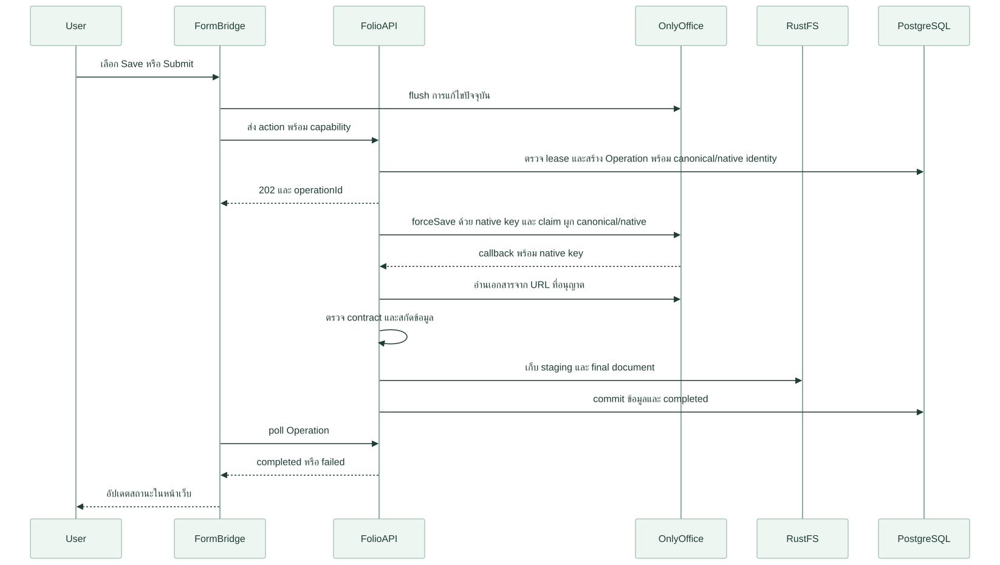

Native form ใช้ action API และ Operation เดียวกัน แต่สร้างหรือ overlay DOCX ที่เซิร์ฟเวอร์จากค่าที่กรอกและรูปภาพ จึงไม่ต้องรอ ONLYOFFICE force-save callback ในเส้นทางนั้น

การกด Save ใน editor หรือได้ HTTP 202 ยังไม่ใช่หลักฐานว่า Draft หรือ Submission สำเร็จ UI ต้องรอ Operation เป็น `completed` โดยเซิร์ฟเวอร์บันทึกทั้งข้อมูล JSON และไฟล์เอกสารที่สอดคล้องกันก่อน

Callback มีการตรวจ JWT, canonical document key ใน claim, native key ที่ตรงกับ Operation และ payload, claim, operation และแหล่ง URL ก่อนใช้ claim กันการประมวลผลซ้ำ Native key จาก client ไม่ให้อำนาจเปลี่ยน canonical document หรือ Operation ถ้า ONLYOFFICE ตอบว่าไม่มีการเปลี่ยนไฟล์ มีเส้นทางใช้ snapshot ที่ตรวจความน่าเชื่อถือแทน callback ปกติ ส่วน Excel บางงานต้องมี checkpoint และหลักฐาน editor save เพิ่ม

เมื่อ ONLYOFFICE ยืนยันว่าไม่มีการแก้ใหม่ การนำ capture จาก action ที่ล้มเหลวกลับมาใช้ต้องตรงกับ native opening key ของ Operation ปัจจุบันด้วย ไม่ใช่เพียง canonical document key เดียวกัน การเปิดใหม่เริ่มจากไฟล์ canonical ที่บันทึกแล้ว จึงห้ามนำค่าธรรมดาที่ยังไม่บันทึกของ opening เก่ากลับมา ส่วน retry ใน opening เดิมยังใช้ capture ที่ยืนยันไว้ของตนเองได้

อ้างอิง [plugin operations](../../apps/onlyoffice-plugin/src/operations.js#L393), [createOperation](../../apps/server/src/operations/create.ts#L20), [force-save](../../apps/server/src/operations/force-save.ts#L147), [finalizeCallback](../../apps/server/src/operations/callback.ts#L155) และ [native processing](../../apps/server/src/operations/response-completion.ts#L192)

## 08 Excel, field mapping, ช่องแนบ ECM และตัวเลือกโครงการ PDMS


Contract รองรับ scalar fields และหนึ่ง repeating table ในหนึ่ง worksheet ที่แก้ได้ Key ของคอลัมน์ใน metadata ใช้ `tableKey.columnKey` แต่คำตอบเก็บเป็น array ของ object Named ranges ช่วยติดตามตำแหน่งเมื่อแทรกหรือย้ายคอลัมน์ หากระบุตำแหน่งไม่ชัด ระบบหยุดบันทึก

Table ข้ามแถวที่ input ว่างทั้งหมดและไม่มีไฟล์ แต่ `0`, `false` และไฟล์ 0 bytes เป็นข้อมูล แถวที่มีแต่สูตรไม่กลายเป็น record ช่องแนบใช้ column Tag เดิมและ category/required ร่วมทุกแถว ไม่สร้าง Tag หรือ ID รายแถว แถวที่มี input, saved attachment หรือ selected File ต้องคงอยู่และ Submit ตรวจ required columns ทุกชนิด ไม่ใช่เฉพาะ attachment Workbook cells เป็น URL projection เท่านั้น ไม่ถือ URL ที่พิมพ์เองเป็น ownership

PDMS Ongoing ถูกเรียกที่ `/api/pages/projects/names-and-doc-numbers` ฝั่ง server เลือกเฉพาะชื่อไม่ว่างและรวมชื่อซ้ำเป็นตัวเลือกเดียว คำตอบเก็บชื่อที่เลือก ไม่ได้เก็บ project ID สำหรับไปอ้างความเป็นโครงการเดียวกัน

Catalog ที่โหลดสำเร็จเป็น snapshot ของการเปิด editor นั้น ผูกผู้ใช้ Folio session, lease, document และ target เมื่อ submit ต้องโหลด catalog สำเร็จ การ retry ใช้ endpoint แยก ชื่อที่เคยบันทึกแล้วมีเส้นทางยอมรับแม้ต้นทางเปลี่ยนชื่อหรือเอาออก

Production จะเปิดความสามารถนี้เมื่อ `PDMS_PROJECT_NAME_SOURCE_ENABLED` เป็นจริงและมี configuration ที่ใช้ได้ แผนผังนี้ไม่ได้ยืนยันว่าระบบปลายทางเปิด flag แล้ว

ปุ่มเดิมต่อยอดผ่าน **เพิ่มช่องแนบไฟล์** และปุ่มในชีต **แนบไฟล์** คง GUID, stable binding, marker และ protocol identifiers เดิม Admin แก้ Title, Tag และ required ในแผง Field เดิม Storage Template กำหนดต่อ scalar หรือ column ทุกแถวใช้ตัวเลือกเดียวกัน type ยังคง text แต่สัญญาแนบระบุด้วย `attachment` ไม่เดาจาก Tag/ข้อความ Migration เพิ่ม `attachmentStorageMode`, `attachmentCategoryId`, `attachmentTemplateId`, `attachmentTemplateName` ใน normal DraftFieldRule/ManifestField ไม่ใส่ routing metadata ใน placement-only Excel Binding

เมื่อสร้างตารางใหม่ครอบช่องแนบเดิม ระบบตรวจตำแหน่งและปุ่มจริงก่อนย้าย เก็บ binding ID, Title, Tag ของช่อง, required และ Storage Template เดิมไว้ในคอลัมน์ ลบ scalar binding และ named range เดิม เปลี่ยน Tag บนปุ่มเป็น `tableKey.columnKey` และวางปุ่มครบทุกแถวข้อมูลโดยไม่รวมแถวหัวตาราง แล้วบันทึกต้นแบบและตรวจ workbook ใน editor เดิมโดยไม่เรียก DCM หากมีหลายช่องแนบในคอลัมน์เดียวหรือช่วงข้อมูลทับช่องที่ย้ายไม่ได้ ระบบหยุดก่อนแก้ข้อมูล หากผลบันทึกต้นแบบยังไม่สำเร็จ ให้ยืนยันผลการตั้งค่าก่อนเมื่อจำเป็น แล้วใช้ **บันทึกแบบร่าง** เพื่อลองบันทึกต้นแบบเดิมก่อนแก้ช่องอื่น

ก่อนเผยแพร่ทุก managed PoC OLE ต้องมีหลักฐาน saved-button ที่ตรวจจริงตรงกับ marker, binding, Tag และตำแหน่ง/แถว ไม่มี orphan หรือปุ่มซ้ำ และทุก declared attachment ต้องมีปุ่มจริงครบช่อง scalar หรือทุกแถวของ column การมี marker อย่างเดียวไม่พอ ระบบปฏิเสธก่อน engine เปลี่ยน workbook ไม่ strip ปุ่มที่ยังไม่ได้ตั้งค่าเพื่อทำให้ Publish ผ่าน และไม่เพิ่มการลบ foreign objects หรือบังคับให้ Template Draft ตั้งค่าครบ

การเปลี่ยน Field/column เดิมจาก ordinary เป็น attachment ต้องเป็นคำสั่ง Admin ใน Template Draft และตรวจ canonical XLSX ที่บันทึกแล้วด้วย saved-button proof เดียวกัน โดยใช้ binding/Tag/ตำแหน่งก่อน PATCH ไม่เดาจาก `attachment_N`, label หรือ URL หากไม่มี marker/OLE ตรงกัน มี mapping ขัดแย้ง หรือ rules ปัจจุบันไม่ตรงต้นแบบที่บันทึก ให้หยุดโดยไม่เปลี่ยน revision/ข้อมูล และให้ Admin บันทึกต้นแบบเดิมให้สำเร็จก่อนตั้งค่าใหม่ การ rename Tag ใน PATCH ที่มีหลักฐานเดิมถูกต้องยังใช้ machinery เดิมและคง stable binding/placement

การเพิ่มช่องเปิด external popup เดิมผ่าน ONLYOFFICE `ShowInputHelper` ก่อนสร้าง Field/ปุ่ม แล้วโหลด numeric categories และ Storage Templates ใหม่ เลือกหมวดก่อนแล้วเลือก template ของหมวดนั้น หมวดไม่มี template ไม่เป็น option เปลี่ยนหมวดล้าง template เดิม Confirm ปิดระหว่าง loading/error/empty และจนทั้งคู่ valid Cancel/Escape ไม่เปลี่ยน Field/ปุ่มและคืน focus ตาม machinery เดิม Confirm จึงสร้าง `attachment_N` หรือใช้ช่อง/column เดิม การแปลง ordinary mapping บันทึกปุ่มเดิมเพื่อตรวจ canonical proof แล้ว PATCH config และบันทึกต้นแบบอีกครั้ง ล็อก authoring ตลอด multi-step save; lease/revision, dirty/navigation guards และ native proof เดิมยังใช้ทั้งหมด ไม่เริ่ม upload

ช่องแนบแสดงชื่อ Storage Template ที่บันทึกพร้อม **เปลี่ยนหมวด** เปิด popup เดียวกัน การเปลี่ยน choice คงปุ่ม/id/Tag/rules ถ้า provider ล่มหรือ mapping ถูก rename/move/delete แสดงชื่อเดิมแยกและไม่เปลี่ยนตาม master Draft PATCH ตรวจเฉพาะ choice ใหม่หรือ tuple ที่เปลี่ยนให้ UUID/category ID/name ตรง local catalog ภายใต้ row lock; choice ใหม่ที่ stale ถูกปฏิเสธโดยไม่ทิ้ง Draft หรือเพิ่ม revision Choice เก่าที่ยัง stale ไม่ขัดขวาง Title/Tag/required edit, การลบ หรือการเลือกใหม่ทีละ Field/column จึงซ่อมหลายช่องได้โดยไม่ทิ้งงาน แต่ publication ยังตรวจ current mapping ครบทุกช่อง ไม่มี template answer Tag และ User เลือกปลายทางไม่ได้

เมื่อ PATCH commit แล้วแต่ acknowledgement หาย การ recovery เปรียบเทียบ semantic attachment tuple ที่ normalize category/category ID/mode/template ID/name และ legacy defaults ไม่เปรียบเทียบ insertion order ของ nested JSON จึงอ่านผลจริงแล้วคืน authoring ได้โดยไม่ replay committed PATCH Document/revision/settlement/native-state proofs เดิมยังจำเป็น และ tuple ที่เปลี่ยนจริงยังเป็น conflict Actual integration native ตรวจ response503 หลัง real commit, GET ผลจริง, แก้ Field ต่อ บันทึกร่าง และ publish สำเร็จแล้ว ไม่มี production failure hook หรือการอ่อน lease/guard

Published PoC เก่าคง manifest/type/required และคำตอบ text/URL ตามเดิม รวม Save Draft, Submit และประวัติ ไม่สร้าง attachment object, receipt หรือสิทธิ์ลบจาก string ปุ่มเดิมคืนข้อความถาวรให้ประสาน Admin ทำสำเนา/ตั้งค่า Form ใหม่ โดย popup ปิด choose/retry และไม่รับ File เข้า memory เป็น fallback พร้อมซ่อนคำอธิบาย memory-only และส่วนเลือกไฟล์ที่ใช้ไม่ได้ เพื่อให้ข้อความแนะนำอ่านได้ชัดเจนภายใน dialog โดยไม่ถูก footer บัง หน้า Template Draft ใช้ตั้งค่าเท่านั้น ไม่รับไฟล์ตัวอย่าง ปุ่ม Duplicate เดิมคัด template/การตั้งค่า ไม่คัด Responses, answers หรือไฟล์ User และไม่ archive/delete/redirect/หา successor ให้ต้นฉบับ

pending Files ของช่องที่ตั้งค่าจริงรวมกับ native/editor dirty ผ่าน `onDirtyChange` เดิม เพื่อให้ navigation, session-change และ before-unload guards ที่มีอยู่เตือนก่อนเสีย selection การส่ง dirty=false จาก native bridge ไม่ล้าง pending Files และไม่ถือชื่อไฟล์เป็น bytes ที่กู้คืนได้ ไม่มีการ persist pending bytes/filename เพื่อหลบ guard

Candidate ที่ยังไม่ยืนยันใน dialog ส่งเพียง scoped dirty signal ผ่าน trusted editor frame/origin/bridge/document ไม่ส่ง bytes เข้า host จน dialog Save สำเร็จ Host แยก candidate, confirmed pending และ canonical saved; completion มี `hasAttachmentCandidates` และรวมใน pending fence เพื่อไม่ remount Draft/Correction workspace ทับกล่องที่ยังมีงาน ปิด Cancel/X ก่อน dispatch คืน baseline เดิม การออกจาก fill เป็น local discard เท่านั้น ไม่ Save-and-exit หรือ DELETE Response; reauthentication ยังมี explicit save flow แยก

กล่องแนบไฟล์ซ่อนข้อความ native เช่น No file chosen และแสดงชื่อ/ขนาดไฟล์เฉพาะที่จำเป็น ปุ่มเลือกไฟล์รองรับ keyboard และใช้ file input ที่มี label เลือกใหม่แทนที่ File ที่ยังไม่ยืนยันโดยไม่แก้ host การปิด file chooser โดยไม่เลือกไม่ทิ้งตัวเลือกก่อนหน้า บันทึกใน dialog จึงส่ง set/cancel/remove ที่ผูก binding, physical row, document, bridge และ scope เดิม แล้วปิดเมื่อได้รับคำตอบสำเร็จที่ตรงกัน หาก acknowledgement ยังไม่มา/หมดเวลา จะคง File และไม่ให้ Cancel/X แสร้งว่าย้อนการยืนยันได้; คำตอบผิดรูปไม่ปิด timeout และ trusted late success ปิดได้โดยไม่ส่งซ้ำ การนำออก/คืนไฟล์เดิมยังต้องยืนยัน ส่วนการ Cancel dialog ก่อนยืนยันคง canonical และ pending choice ที่มีอยู่ก่อนเปิด ไม่เท่ากับยกเลิก pending change ที่เคยยืนยันแล้ว

คำเตือนปกติบอกจังหวะ upload และความเสี่ยงจากการปิด/รีเฟรชหน้า พร้อมแจ้งลิงก์สาธารณะ หากมี mutation/commit recovery notice กล่องคง recovery/cleanup instructions และซ่อนคำแนะนำที่อาจชวนให้ส่งซ้ำ กล่องและ host ปฏิเสธไฟล์นอกขนาด 2–10,000,000 bytes หรือนามสกุลท้ายชื่อไม่ใช่ `.pdf`, `.docx`, `.xlsx`, `.png`, `.txt` ไม่แยกตัวพิมพ์ ข้อความขนาดเดิมคงอยู่ การปฏิเสธไม่ทำให้ไฟล์ที่บันทึกแล้วหรือการเลือกที่ยืนยันแล้วสูญหาย

Native OOXML อาจแทนปุ่มเดียวด้วย anchored `Choice` และ empty `Fallback` ภายใน `AlternateContent` เดียวกัน ระบบนับ alias เป็นปุ่มเดียวเฉพาะเมื่อ shape ID/relationship ตรงกันและแต่ละด้านมีหนึ่งรายการเท่านั้น ปุ่มซ้ำหรือ orphan นอกโครงสร้างที่พิสูจน์นี้ยังต้องถูกปฏิเสธ

Template Draft เก็บ mode `template` ที่ choice ยังไม่ครบได้ Publish ต้องมี current local mapping ทุก attachment Field/column และ exactly one root scalar `docs_number` ที่ไม่ใช่ attachment/computed ไม่บังคับ `fiscal_year` จาก attachment prerequisite หรือค่าคำตอบในต้นแบบ ตรวจ revision และ lock mapping อีกครั้งภายใน publication transaction จน Manifest commit; provider outage ไม่ขัดขวาง saved valid mapping ไม่ live lookup มาเปลี่ยน published routing ภายหลัง

Publish errors ระบุชื่อ/Tag ที่ยังไม่มีแม่แบบและ `docs_number` เฉพาะเมื่อขาด คง HTTP 422 และ `attachment_category_required` ก่อน `attachment_metadata_required` เมื่อขาดทั้งคู่ Mapping ที่เปลี่ยนแล้วคืน `attachment_template_stale` ให้เลือกใหม่ ไม่ follow rename/move Published legacy contracts คง `mode: legacy` และ category name เดิม ไม่เดาจาก `fiscal_year`; migration ไม่แก้ Responses/answers/files

`GET /api/admin/forms/:publicId/attachment-categories` ภายใต้ configure-fields capability/active lease คืน `{categories:[{id,type}],templates:[{id,document_category_id,template_name}]}` จาก `categoryEntries()` และ local catalog ไม่ส่ง ECM Bearer ไป browser Popup/bridge ตรวจ scoped request/pinned frame/current tuple Backend ตรวจ catalog ซ้ำอย่าง race-safe ไม่ใช้ label เป็น identity Duplicate ได้ Form/link ใหม่ คัดเฉพาะ template/config ไม่คัด Responses/answers/files และไม่เปลี่ยนต้นฉบับ สำเนา legacy ล้าง destination choice ต้องเลือกใหม่โดยชัดแจ้ง สำเนา new-mode คัด snapshot แต่ต้องตรวจ current catalog ก่อนเผยแพร่

ECM ใช้เฉพาะ `ECM_API_URL`, `ECM_USERNAME`, `ECM_PASSWORD` ของ Folio และ `ECM_TOKEN_ENCRYPTION_KEY` ที่ส่งผ่าน secret management เป็น key 32 bytes แบบ Base64 ห้าม login บัญชีนี้นอก coordinator เดียวกัน HTTPS จำเป็นนอก loopback ห้ามตาม redirect พร้อม credentials และไม่ fallback ไป Ongoing Configuration ผิดกระทบเฉพาะงาน ECM ไม่ทำให้ Forms ปกติหรือ Folio login ใช้ไม่ได้

`compose.yaml` ส่งตัวแปร ECM ทั้งสี่แบบ optional เฉพาะ container `server` ไม่ส่งไป web หรือ ONLYOFFICE ตัวอย่าง root/server `.env.example` ใช้ค่าว่างเท่านั้น การ provision/หมุน encryption key และบัญชีเฉพาะต้องทำผ่านช่องทาง secret ตาม [README](../../README.md) ไม่มีการ deploy หรือใส่ credential จริงใน change นี้

Bearer ใน PostgreSQL เข้ารหัสและแยก key ออกจาก cache row แยก cache ตาม endpoint/account รับ `expire` แบบ ISO ที่มี offset หรือ DCM `YYYY-MM-DD HH:mm:ss` ซึ่งผู้ใช้ยืนยัน UTC+7 แปลงเป็นเวลาสากลโดยไม่อิง timezone ของเครื่อง ผู้ใช้แจ้งอายุ token 15 วันแต่ login DCM ซ้ำจะเพิกถอนตัวเก่าทันที จึงใช้วันหมดอายุที่ตอบจริงและ HTTP 401 ไม่ใช้ `now + 15 วัน` เป็น fallback ตรวจ cache เมื่อมีคำขอโหลดหมวด/อัปโหลด/ลบและต่ออายุล่วงหน้าเมื่อเหลือไม่เกิน 12 ชั่วโมง หรือไม่ครอบคลุม request timeout บวก clock skew 30 วินาที ไม่ทำ cron และไม่ login ระหว่างไม่มีงาน Token ใหม่หลัง login ตรวจ request-budget/skew ตามเดิม ไม่บังคับอายุ 12 ชั่วโมงหรือ 15 วัน Login ใช้ shared job deadline 30 วินาที lease เผื่อ persistence 5 วินาที มี backoff 1/2 วินาทีและเคารพ valid Retry-After ภายใน deadline เฉพาะ transient network/timeout/408/429/5xx เท่านั้นที่ retry ผลช้าและ late 401 ของ generation เก่าแก้ state ใหม่ไม่ได้ ไม่มี transaction ค้างระหว่าง HTTP และ waiter ที่ยกเลิกไม่ปล่อย claim งานเดิม เมื่อ job ถูกทิ้งและ lease หมด คำขอที่พบจบด้วย error ก่อนให้คำขอใหม่เริ่ม job ใหม่ Shared job ไม่ได้ drain คำขอที่ส่งด้วย token เก่า จึงยังอาจถูกเพิกถอนระหว่างดำเนินงาน โดยไม่ resend mutation อัตโนมัติ

การเปลี่ยน cache เป็น ready ต้อง lock แถว job ที่ owner/generation ตรงกันผ่าน materialized CTE ก่อน แล้วตรวจ deadline ของแถวที่ lock ได้กับทั้ง policy clock และ `clock_timestamp()` ของ PostgreSQL ภายในคำสั่งเดียว UPDATE ที่รอ row lock จนเลย deadline จึงไม่ทำให้ token กลับมาใช้งานได้

ไม่มี ECM login UI หรือ public token endpoint และไม่มี credentials/Bearer ใน browser, answers หรือ workbook การเรียก category/upload/delete ที่ถูกปฏิเสธไม่ถูกส่งซ้ำหลัง refresh โดยอัตโนมัติ ผลจาก isolated HTTP double และ native browser เป็นหลักฐานคนละประเภท ไม่รับรอง provider matrix จาก Folio file-size validation

Scalar และ table-row slots ใช้ File จริงใน host เดิมจน explicit User Save Draft/Submit หรือ final Save Correction Server ตรวจ actual bytes ขนาด 2–10,000,000 bytes และนามสกุลท้ายชื่อ `.pdf`, `.docx`, `.xlsx`, `.png`, `.txt` แบบไม่แยกตัวพิมพ์ ไม่ใช้ MIME/Content-Length เป็นหลักฐานและไม่ตรวจเนื้อหา ไม่เขียน attachment binary ลง RustFS/JSON/XLSX ก่อน external write ตรวจ root scalar `docs_number` ตาม native Field rules; legacy เท่านั้นที่เพิ่ม `fiscal_year` prerequisite ตรวจชื่อไฟล์รวมและหยุดพร้อมระบุ Field/physical row หากผิด ไม่แก้ unsafe characters Mode `template` ใช้ชื่อฐานซ้ำตาม contract ด้านล่าง ไม่เลือก destination ใหม่เพื่อหลบ resource/unknown guard

`POST /api/forms/:publicId/draft` และ `/submit` รับ multipart `payload` กับ `attachment:<bindingId>` สำหรับ scalar หรือ `attachment:<encodeURIComponent(JSON.stringify([bindingId,rowIndex]))>` สำหรับ table โดยมี trusted native `snapshotUrl` และ checkpoint ของรอบนั้น Encode เฉพาะ multipart boundary เพื่อไม่ให้ Content-Disposition เปลี่ยน JSON quotes; server decode/validate หนึ่งครั้ง Host store ยังคง JSON slot key เดิม Client rowIndex เป็นเพียง slot request; server ตรวจ binding/button/physical bounds จาก canonical workbook และตรวจ native edits ก่อนเริ่มส่ง Multipart limit คำนวณจากจำนวน slot จริงของ trusted table ปัจจุบัน Host สร้าง Blob part จาก original File พร้อมชื่อเดิมเพื่อผ่าน renderer disk-file grant โดยไม่เปลี่ยน File identity ใช้ shared ECM client ส่ง original bytes ทีละไฟล์, `template="0"`, root ปี/เลขของ snapshot, หมวด frozen ต่อช่อง/column และ filename UUID version เดิม ไม่มี table upload flow แยก

Planner ใช้ `<docs_number>-<template_name>.<original-extension>` ซ้ำได้ทุก scalar/table slot และข้าม Save/Submit/final Save Correction ไม่เติม generated counter/timestamp/UUID/physical-row suffix หรือ durable filename reservation คง literal suffix/dots/whitespace ที่ valid และ original extension/casing; ไม่มี extension ให้จบที่ template name ชื่อที่ส่งตรงกับ ledger filename และ multipart โดย `original_name`/metadata คำตอบกับ frozen `template_name` ไม่เปลี่ยน Mode `template` ส่ง original `documentFile` กับ `template` ข้อความ `"1"` เท่านั้น ไม่ส่ง year/number/category/ID แยกหรือ lookup catalog ปัจจุบันเพื่อเปลี่ยน routing ส่วน `legacy` คง multipart/UUID filename เดิม ไม่มีปีได้ใน ledger ของ new mode โดยไม่สร้างปีปลอม ชื่อเดียวกันไม่ใช่ resource identity; ทุก original attempt เก็บ paired receipt ของคำขอนั้น ไม่เลือก search-by-name/latest

Final Save Correction ใช้ Published Template ของ Submission ที่เลือก ไม่ตาม catalog ที่ rename/move/delete ระหว่างเปิด workspace และไม่เปลี่ยน legacy transport การเปลี่ยน `docs_number` ใช้ shared original-byte/hash/current physical-row reference paths เดียวกับ Draft/Submit Internal workspace/project save ไม่ upload/delete Settled filename coincidence ไม่บล็อก new template upload แต่ scope/actor/lease/revision/unresolved-attempt/resource/reference/delete fences คงเดิม Actual new upload ที่คืน exact paired receipt ของ surviving Submission/Correction หยุดด้วย `attachment_history_receipt_conflict`; own unprotected current Draft ใช้ `attachment_draft_receipt_conflict` และ history มี precedence Partial/one-sided/multiple/held aliases หยุดด้วย `attachment_receipt_conflict` ตามหลักฐาน ไม่เดาประเภทจากชื่อ Receipt evidence ถูก persist และ shared identity ถูก hold ก่อน error โดยไม่ commit canonical snapshot หรือ DELETE resource ร่วม Unchanged reuse ที่ไม่มี POST ไม่ถูกกฎนี้บล็อก

`Operation.result.attachmentErrorReason` เป็น optional semantic reason ในช่องทางเดิม Top-level failure ยังคง `document_save_failed` ส่วน safe `errorMessage` ระบุ Field/Tag/physical row และเฉพาะ same-Response history references ที่มีสิทธิ์เห็น ไม่เผย raw token/link หรือ reference IDs ของผู้อื่น และไม่สั่ง refresh/resend เพื่อหลบ conflict Adapter คง numeric upstream HTTP status ใน safe diagnostic message พร้อม `ecm_rejected` โดยไม่ส่ง raw provider body/credentials ไป browser และไม่เพิ่ม logging/retry subsystem การหยุด canonical commit ไม่ย้อน remote bytes ที่อาจเปลี่ยนก่อน receipt กลับมา Provider evidence และ original-request settlement ยังแยกเป็น HOLD ไม่ใช่ผลจากชื่อซ้ำผ่านใน local model

Listener ของ `createApp` ใช้ `maxRequestBodySize: Number.MAX_SAFE_INTEGER` แทน Bun default 128 MiB เพื่อไม่กำหนด aggregate attachment limit ที่ขัดกับ per-file contract ทุก startup ที่ใช้ factory เดียวกันรับ policy นี้ รวม entrypoint ปกติ ไม่ใช้ `0` ซึ่ง Bun 1.4.4 ไม่ได้ตีความว่า unlimited ตัวอ่าน multipart เดิมยังนับ stream จริงก่อน parse ตามจำนวน scalar/table slots ใน trusted current workbook, ตรวจแต่ละ File ที่อัปโหลดใหม่ให้มีขนาด 2–10,000,000 bytes และตรวจ canonical JSON 262,144 bytes ตามเดิม ไม่เชื่อ Content-Length อย่างเดียว

JSON consumers ที่เคยอาศัย auto/raw parsing ได้แก่ sign-in, password change, prefill handoff/status, attachment checkpoint recovery และ Results cancel/settle ใช้ bounded house reader กับ `parse: none`; คงเพดานเดิม 128 MiB เมื่อ route ไม่มีขอบเขตที่แคบกว่า โดยไม่ลด valid legacy/prefill payload เป็น 262 KiB Sign-in คง non-object rejection เดิมผ่าน bounded bytes กับ platform JSON parser ส่วน route readers ที่มี contract limit อยู่แล้วไม่เปลี่ยน Gateway ของ repo ส่ง `/api` ไป server โดยไม่มี aggregate body cap เพิ่มใน config; external ingress และ real ECM capacity ยังต้องตรวจ deployment จริง

ขอบเขตนี้ยึด JSON contract ของ [web API helpers/sign-in](../../apps/web/src/lib/api.ts) และ [prefill connector](../../apps/prefill-mock/src/mock.ts) ซึ่งส่ง `application/json` กับ `JSON.stringify` จริง ไม่คง incidental URL-encoded/form-data parsing ของ Elysia ใน JSON endpoints เหล่านี้ และไม่อ้าง transport compatibility ของรูปแบบที่ไม่ได้อยู่ใน contract ส่วน `/prefill/handoff` ที่ระบุ top-level form และ native multipart/template upload ยังคง parser กับ byte bounds เดิม `handleEmailSignIn` ส่งต่อให้ `auth.handler` เฉพาะ email/password JSON ที่ประกอบใหม่จากข้อมูลที่อ่านแบบ bounded แล้ว ไม่ส่ง raw inbound stream ให้ delegated auth parser

Canonical scalar เป็น `null` หรือ strict object สี่ค่า `file_link`, `file_token`, `original_name`, `size_bytes`; table object อยู่ใต้ column key ใน nested row และเพิ่ม `row_index` แบบ zero-based physical body index ไม่ใช่ compact array index หลาย attachment columns ของแถวเดียวกันต้องตรง physical index และไม่ซ้ำ slot การ extract รับ canonical attachments เป็น argument ที่สี่เดิม แล้วรวม ordinary physical rows กับ saved/selected attachment rows ก่อน compact จึงรักษา gaps และ attachment-only/zero-byte rows ทั้งคำตอบไม่เกิน 262,144 UTF-8 bytes Workbook รับเฉพาะ URL projection ไม่รับ token จาก cell/client เป็น ownership ก่อน upload และก่อน commit ตรวจสิทธิ์/lease/current document อีกครั้ง Commit document pointer, JSON, references และ Operation result ใน transaction เดียว Draft ขาด required attachment ได้ แต่ Submit ต้องได้ receipt ครบและผ่าน required columns ของ active rows ก่อน external write

ไฟล์ 0–1 byte หรือไฟล์นอก allowlist ที่บันทึกไปแล้วคงอยู่ใน canonical answer และนับว่ามีไฟล์ ไม่ใช้ข้อจำกัดการอัปโหลดใหม่ระหว่างอ่านหรือ reuse โดยไม่เปลี่ยนปลายทาง หากเปลี่ยนปลายทางจนต้องอัปโหลดต้นฉบับซ้ำ ให้หยุดก่อนดึง bytes จาก provider และขอไฟล์ใหม่ ไม่แก้ receipt/history เดิม

Batch/version intent ไม่มี cascading relation กับ Response จึงไม่เสียหลักฐานเมื่อ Operation failed/expired หรือ Response ถูกลบ Started ที่ไม่มี verified receipt รวม provider HTTP4xx หลังส่ง bytes ไม่มีหลักฐานว่าไม่เขียน และ canceled batch ที่ cleanup ไม่ครบ block mutation ต่อโดยอิสระจากสถานะ Operation การ cleanup claim lock version ร่วมกับ reference creation ก่อน HTTP DELETE และไม่ reuse canceled receipts คำตอบ canonical เดิมยังอ่านได้ หาก Folio response หาย host ตรวจ `GET /api/responses/:id/attachment-operations/:checkpoint` และ poll Operation เดิม ไม่ส่ง bytes ซ้ำ Session storage เก็บเฉพาะ checkpoint ไม่เก็บ File หรือชื่อไฟล์เพื่ออ้างว่ากู้ bytes ได้

`EcmAttachmentIdentity` แยก proven provider resource จาก `EcmAttachmentVersion` ซึ่งเป็น original attempt ที่เก็บ mode/frozen mapping/request/receipt ของตัวเอง Unique `(accountKey,fileToken)` และ `(accountKey,fileLink)` อยู่ที่ identity; legacy/unchanged-reference reuse ที่ผ่าน paired receipt/destination/ownership guards อาจมีหลาย attempts ใช้ identity เดียวกันโดยไม่ rewrite evidence เก่า ส่วน actual new template upload อยู่ใต้ semantic history/Draft/alias conflicts ข้างต้น Receipt ที่ขัดกันเก็บเป็น attempt แต่ไม่ adopt identity และ hold resource ที่เกี่ยวข้อง ไม่มี search/latest fallback

ทุก ledger admission ใช้ transaction advisory fence เดียวก่อน batch/version locks และคง durable unsettled-attempt destination fence ตลอด external request interval ไม่ใช่ allocator/reservation เพื่อบังคับชื่อใหม่ทุก upload ก่อน POST ยังคง account/scope/uncertain-attempt และ known unsafe-resource checks แต่ settled filename-only coincidence ไม่เป็น owner/history conflict ของ new template upload เมื่อ receipt จริงกลับมาจึงตรวจ paired identity/aliases/references และใช้ shared fence เดียวก่อน reference commit/DELETE Same identity ที่ยังมี reference ไม่สร้าง cleanup; distinct unreferenced resource ลบหลัง complete snapshot commit เท่านั้น Failed in-place commit คง hold และไม่ DELETE shared saved identity เพื่ออ้าง rollback

Canonical completion และ whole-Response deletion รับ shared ledger fence ก่อน Operation/Response/Form row locks เพื่อไม่กลับลำดับกับ sender/cancel/cleanup Resource ที่ receipt ใหม่จับคู่ ownership ไม่ได้คง state `held` และแสดง mutation notice ต่อเจ้าของ canonical reference เดิมด้วย หลักฐาน `overwriteIdentityIds` ของ attempt เก็บ identities ที่อาจถูกเขียนทับก่อน dispatch แยกจาก `identityId` ที่พิสูจน์ได้จาก receipt จริง

Draft ใช้ `attachmentRemovals: [{bindingId, rowIndex}]` ใน `payload` เดิม โดย scalar ใช้ null และ table ใช้ physical index ที่ server ตรวจซ้ำจาก trusted current workbook ไม่รับ binding/slot แปลก ซ้ำ หรือ File กับ removal ของช่องเดียวกัน ทั้ง removals และ Files ถูกปฏิเสธใน internal row/project request การไม่ส่ง removal หมายถึงคงไฟล์เดิม การ cancel เกิดใน pending host state ไม่เปลี่ยน canonical หรือส่ง DELETE Removal ที่ทำให้แถวว่างทั้งหมดนำแถวนั้นออกจาก compact JSON โดยไม่สลับไฟล์ใน column อื่น

Legacy mode เมื่อปีหรือเลขเปลี่ยน server ใช้ paired owned committed receipt อ่าน original ตาม exact-origin/no-redirect/size policy เดิม New mode ไม่ GET/upload/login เมื่อปีเปลี่ยนอย่างเดียว; เมื่อเลขเปลี่ยนและไม่มี replacement ตรวจ committed attempt ที่ current canonical snapshot อ้างอยู่ พร้อม Response/binding/receipt/account/origin ก่อนเรียก public `GET /api/beeecm/public/file?token=<trusted file_token>` ผ่าน shared auth ตรวจ actual bounded stream, exact expected size และ SHA-256 ของ original upload attempt ก่อนเริ่ม upload ใด ๆ จึงปฏิเสธ same-size viewer/error/converted bytes โดยไม่ห้าม legitimate HTML เก็บเฉพาะ nullable digest metadata ใน ledger ไม่เก็บ bytes/answer JSON เพิ่ม และไม่ fake-backfill hash จาก mutable URL ของ legacy/intermediate attempts ที่ไม่มี hash Pending replacement ชนะ refetch และ removal ไม่ refetch ช่องนั้น หลักฐาน live ของ parent ยืนยันเพียง PDF 629 bytes/hash เดิม; all-type/HTML/zero/10MB/encrypted matrix เป็น provider-double proof เท่านั้น ไม่ใช่ live provider guarantee

ถ้า internal row/project save เก็บ routing answers ใหม่ทั้งที่ Draft ยังอ้าง receipt ปลายทางเดิม หน้า Fill แจ้งว่าการย้ายไฟล์ยังรอ Save Draft หรือ Submit. ข้อความยังแสดงเมื่อเปิดร่างที่บันทึกแล้วและหายเมื่อ explicit Save แก้ mismatch; internal action ไม่ส่งไฟล์และไม่ลบไฟล์เดิม.

Initial Correction workspace clone ยังไม่มี attachment references ของ document key ใหม่: original planning และ canonical completion ใช้ captured Operation เดียวกันตรวจ enabled Admin, Response, lease, workspace/object key, base key/revision และ latest Submission/Correction ผ่าน shared workspace validation ก่อนใช้ references ของ base ที่ตรวจแล้วเท่านั้น หาก current snapshot มี references อยู่แล้วต้องใช้ current snapshot; receipt mismatch ไม่ย้อนหา history และ workspace ที่เคย save แล้วแต่ไม่มี references ไม่ย้อนคืนไฟล์จาก base Internal workspace save ยังคงไม่ fetch/upload/delete ECM

ทุก canonical Draft transition รวม implicit row/project save ย้าย references ไป document key ใหม่ใน transaction เดียว ไม่อาศัย reference ของ Draft เก่าที่ไม่ใช่ canonical แล้ว การ retire refs ไม่แตะ snapshot ที่ Submission/Correction/workspace/eligible Operation หรือ Draft อื่นยังใช้ และนับ surviving refs ทั่วระบบ การ acquire ref กับ deletion claim lock version row เดียวกัน จึง acquire ไปยัง deleting/deletion-unknown version ไม่ได้ Internal workspace/Correction completion รักษา canonical receipt ของ base revision และ references โดยไม่เริ่ม attachment writes

Existing append และ delete-selected ยังคงพฤติกรรมของ ordinary tables เดิม สำหรับ attachment-aware transition server ตรวจ native snapshot เทียบ canonical workbook, ใช้ command ที่รองรับกับ Builder แล้ว resolve contract/output ใหม่ ตรวจ actual body count/column offsets และทุก surviving input cell ตาม old/new physical mapping ก่อน commit Canonical table objects เปลี่ยนเฉพาะ current `row_index`; `EcmAttachmentVersion.rowIndex` เก็บ immutable original upload position และไม่ถูก rewrite การเลื่อนแถวไม่ upload ใหม่ Reference lookup ใช้ nested table column data และ paired receipt เดิม ไม่ index root ด้วย dotted Tag

ก่อน commit Draft/Submit/internal transition/Correction ที่เปลี่ยน attachment projections ระบบอ่านค่าของเซลล์และปลายทาง hyperlink จาก XLSX ผลลัพธ์ วัดกับ paired receipt และ physical row ที่เชื่อถือได้; ช่องที่เอาไฟล์ออกต้องว่างและไม่มีลิงก์. ถ้าตรวจไม่ผ่าน canonical เดิมยังอ่านได้ และคำขอ provider ที่ส่งไปแล้วต้องติดตามด้วย Operation เดิม ไม่ส่งซ้ำ.

`EcmAttachmentReference.rowIndex` เก็บ **ตำแหน่ง physical row ปัจจุบันของ snapshot นั้น** แยกจาก original attempt position; ไม่ใช่ stable row ID และไม่เพิ่ม Tag/filename suffix หรือ answer JSON Field ใหม่ New upload เลือก own-operation attempt ที่ row ตรงกัน Saved slot เลือกเฉพาะ current canonical refs ที่ row ตรงกัน แล้ว remap ผ่าน trusted workbook `attachmentTransition` ใน Draft/workspace commit เท่านั้น Submit/final Correction คงตำแหน่งเดิมใน final snapshot ที่ใช้ document key ใหม่ คง shared destination/identity/reference/delete fences เดิม ชื่อ template ซ้ำได้โดยไม่กลายเป็น row identity

คอลัมน์ metadata ใหม่นี้ nullable และไม่เดา backfill แถวเก่า การรักษา aliases แบบหยาบเพียงอย่างเดียวไม่พอ: rows0/2 อาจมี receipt/name/size เดียวกันแต่ bytes ต่างกัน เมื่อลบ A ผ่าน verified row command แล้ว B เลื่อนเหลือ1 การเปลี่ยนเลขต้องใช้ digest ของ current B เพื่ออ่าน original B ได้ ไม่เอา A มาทำให้เกิด false HOLD และไม่เลือก attempt ด้วย timestamp สำหรับ refs เก่าที่พิสูจน์ current position ไม่ได้ยังรักษาหลักฐานร่วมแบบ conservative; original reuse ที่มี digest ขาด/ขัดกันหยุดก่อนเขียน ไม่สร้าง independent-byte guarantee จาก provider URL เดียว Native และ HTTP proof ของตั๋ว05แยกจาก live-provider/release acceptance ตาม [บันทึกตั๋ว05](../ecm-storage-templates/issues/05-table-template-attachment-lifecycle.md)

Completed Operation ส่ง `attachmentTransition` ที่มี from/to canonical document keys, table binding, old/new row counts และ row mapping Host ตรวจ proof ก่อน remount แล้วย้าย keys ของ pending Files/removals/validation errors โดยคง File object เดิม รวมกรณี append และการลบแถวอื่น การลบแถวที่มี pending slot ถูกหยุดก่อนเริ่มคำสั่ง Scope/document/contract ที่เปลี่ยนโดยไม่มี proof หยุดและรักษา selections ไม่ล้าง pending หรือเสนอ force reload Internal transitions ไม่เริ่ม ECM writes แม้ retire saved reference; cleanup-only record รอติดตามโดย authorized operator ไม่อาศัย upload batch เป็นเงื่อนไขว่ามีงานค้าง

Minimum-one-row ใช้กับทุก XLSX repeating table ทั้ง ordinary/no-attachment, old PoC และ durable legacy/template ไม่ใช่แค่ branch ที่มีไฟล์แนบ Server อ่าน body ของ trusted saved document ก่อนเรียก worker; builder มี guard ก่อน clear/write และ full transition ตรวจจำนวนแถวทั้งมี/ไม่มี attachment เมื่อเหลือหนึ่งแถว delete-selected disabled พร้อมเหตุผล การเรียกข้าม UI/stale/race ต้องไม่ล้าง values, formulas/validation, buttons, JSON/references, pending state หรือ revision ไม่มี clear-last-row/confirmation ใหม่ และไม่เพิ่ม row controls ใน Correction

Configured attachment cell values/hyperlinks เป็น protected projection ไม่ใช่ช่องพิมพ์หรือหลักฐาน ownership ส่วน managed OLE ที่ผ่าน native identity/anchor checks ยังเปิดเลือกไฟล์ได้โดยไม่ปลด worksheet และคง noMove/noResize Native sheet มี explicit sort/autofilter และ structural barriers; ก่อน prepare/upload ตรวจ protection/style/binding/merge/sort evidence ที่เกี่ยวข้อง ไม่ยืนยัน file identity จาก row count เท่ากัน Ordinary inputs และ old Published PoC text/URL semantics คงเดิม Hidden/zero-geometry และ keyboard/gesture combinations ต้องมี actual native proof ของตน ไม่ถือ disabled ribbon เป็น proof ของทุก shortcut

Cold initialization และ trusted rebuild ไม่ถือ hidden/zero-area geometry ว่าไม่มี binding และไม่เติมพื้นที่ปุ่มไปแถวหรือคอลัมน์ข้างเคียง Native command ตรวจ whole-row `GetHidden()` แยก default `GetRowHeight() = null` ออกจาก explicit zero/hidden row; normalizer อ่านทั้ง `hidden="1"` กับ `hidden="true"` ของ row/column และคง zero extents แม้มีค่า height/width เดิม ปฏิเสธ negative/nonfinite geometry แม้ถูกซ่อนไว้ การเปิด collapsed OLE ด้วย keyboard ยังต้องผ่าน saved-button/metadata/physical-target checks เดิม ไม่สร้าง visible-index alias หรือสิทธิ์ใหม่ให้ hidden slots

Editable `/onlyoffice/document/:key` เสริม protection ของ old initialized Draft/Correction โดยอ่าน document kind จาก owning Form และ trusted Published contract ไม่ตรวจจากนามสกุล object key เพราะ canonical native keys อาจจบด้วย path segment `/xlsx` Projection ไม่เขียน canonical object/answers/receipts/references/revision; คง Prefill policy เดิมของแต่ละ workspace Native opening HMAC มี protection-generation namespace ให้ config ที่เปิดใหม่ไม่ใช้ pre-guard cached workbook ส่วน frame ที่เปิดอยู่ไม่ hot-upgrade และ unsafe capture ต้องหยุดก่อน ECM writes โดยไม่สั่ง reload/discard การ authoring Template Draft และ read-only/export ไม่ถูกข้อจำกัดนี้ขยาย scope

`EcmAttachmentCleanup` บันทึก initiating operation/version/Response และสถานะก่อน dispatch ใน transaction ของ snapshot ใหม่ ไม่มี cascading relation กับ Response Initial cleanup อ่านเฉพาะ pending intents ของ explicit operation นั้น ไม่ sweep งานค้างทั้ง Response และไม่ resend failed/unknown DELETE รุ่นเก่าหลัง Save รอบถัดไป `bridge.uploadPoc.cleanupWarning` เป็น safe string หรือ null จาก durable pending/started/unknown records จึงเห็นหลัง reopen และคงอยู่แม้ Save ถัดไปสำเร็จ ข้อมูลใหม่ยังอ่าน/ส่งออกได้ ส่วน canceled-batch cleanup ไม่ครบคง independent mutation hold เดิม ไม่มี queue, daemon หรือสมมติฐานว่า HTTP error/not-found พิสูจน์ผลลบแล้ว

ก่อน upload แต่ละไฟล์ durable admission เปลี่ยนได้เพียง `prepared` ที่ยังไม่มี `sentAt` ภายใต้ batch lock เดียวกับ cancel/commit เท่านั้น การ cancel หรือ Operation failure fence batch ก่อนให้ sender เก่าเริ่มไฟล์ถัดไป และเปลี่ยน intents ที่ยังไม่ส่งเป็น canceled ส่วน started ไม่ถือว่าไม่มีไฟล์ การได้รับ validated receipt ผูกกับ original intent พร้อม `requestSettledAt` ใน transaction เดียว แม้ batch ถูก cancel ไปแล้วก็เก็บไว้เป็น cleanup pending ไม่ revive canonical commit การ restart ไม่ reset started/deleting ให้เป็นงานที่ส่งซ้ำได้

User อ่าน `GET /api/responses/:id/attachment-status` ตามสิทธิ์เดิมเพื่อแสดง slot/row/reason/next action จาก durable state ใน fill และ popup เดิม เมื่อ upload อาจเกิดขึ้นแล้ว popup ไม่อ้างว่า “ยังไม่ได้อัปโหลด” เพียงเพราะ File ยังอยู่ใน memory การตรวจหรือการกดคำสั่งที่ถูกปฏิเสธยังคงข้อความติดต่อ Admin/ห้ามส่งซ้ำ ต่างจาก own Folio commit ที่ต้องตรวจ checkpoint เดิม และจาก committed cleanup warning ที่ไม่ block งานใหม่ ถ้าตรวจ checkpoint ก่อนเปิดแก้ไม่ได้ ยังมี action แยกเปิด canonical Excel ที่บันทึกไว้ผ่าน `GET /api/responses/:id/draft/viewer-config` ตามสิทธิ์เดิมใน existing read-only viewer ที่ไม่มี mutation capability ไม่ capture native snapshot ไม่ล้าง checkpoint และไม่รวม pending File

Lookup404 ไม่ใช่หลักฐานว่าคำขอเก่าจะเริ่มไม่ได้ Host ใช้ `POST /api/responses/:id/attachment-operations/:checkpoint/recover` ภายใต้สิทธิ์ action เดิม โดย server lock Form แล้ว lease ตาม admission ของ `createOperation` หากพบ batch คืน Operation เดิม หากไม่พบและไม่มี active mutation จึง rotate UUID ของ lease เดิมใน transaction เพื่อให้ sender เก่าที่ค้างก่อน admission ผ่าน locked recheck ไม่ได้ คืน negative-admission proof พร้อม normal lease bridge แล้วจึงล้าง checkpoint เก่า คง File และ native edits ให้ผู้ใช้กด Save/Submit ใหม่ผ่าน capability renewal เดิม Host รับ bridge เฉพาะ expected old lease/scope ที่ยังตรงและไม่รับ stale renewal มาย้อน UUID ไม่มีการ resend ด้วยเวลา/404 หรือสร้าง save framework ใหม่

ผลสำเร็จของ checkpoint เก่าเป็นหลักฐาน recovery ไม่ใช่หลักฐานว่า ordinary snapshot ที่เพิ่ง capture ถูกบันทึกแล้ว ก่อนสร้าง editable native frame ระบบตรวจ checkpoint ที่เก็บไว้ ใช้ bounded `waitForOperation` เดิมและ renew lease เดิมระหว่างรอ แล้วอ่าน canonical config ใหม่ก่อนเปิดแก้ หากผลยังยืนยันไม่ได้จะแสดง retry ที่มีขอบเขต ไม่ล้าง UUID หรือเปิดให้แก้ระหว่าง old commit ที่ยังอาจเกิดขึ้น ส่วน own request ที่ไม่ทราบผลจะคง native readOnly เดิม แต่เปิดปุ่มตรวจผลเดิม การ reconnect ของ plugin ตรวจ guard เดียวกันก่อนคืน editing ไม่อาศัย SDK edit counter หรือ hash ที่เดาเอง

การตรวจผลเดิมใช้ actor-scoped checkpoint GET ก่อนขอ mutation capability ใหม่ จึงไม่ติด PDMS changed-document guard หลัง old commit เปลี่ยน native key Server คืน action จาก `Operation.type` จริงเท่านั้น Native รายงาน action เดิมพร้อม `requestedAction` ของปุ่มที่ผู้ใช้เพิ่งกดแยกกัน จึงไม่เปลี่ยน old Draft เป็น Submission หรืออ้าง old Submit ว่าเป็น Draft ใหม่ Intent ออกหน้า/export/reauth ของคำขอใหม่ไม่ถูกนำไปใช้กับ receipt เก่า Draft recovery ก่อนเปิด editor ไม่ส่ง success ของ snapshot ใหม่ ส่วน completed Submit ตรวจหลักฐานก่อนเรียก old editor-config ที่ปิดแล้ว และใช้ existing new-entry transition จาก Submission เดิม โดยคง UUID จน transition สำเร็จ Key ใน session storage เป็นเพียง routing hint ไม่ใช่ ownership proof ไม่มี File reconstruction หรือ implicit resend

เมื่อ old outcome failed และ batch canceled ที่ยืนยันแล้ว จึงปล่อย checkpoint ให้ explicit Save/Submit ใหม่ได้ โดยคง File ที่ยังไม่ได้รับและใช้ version/UUID ใหม่ Known terminal failure หรือ negative-admission proof คืน native editing ตาม semantics เดิม ส่วน completed scalar ที่เปลี่ยน document key คง frozen จน host remount canonical เรียบร้อย Guard/identity-equal File clearing และ terminal replay dedupe เดิมยังอยู่

Excel Fill Download ที่ไม่มี pending Files/removals ยังคง ordinary unsaved edits ใช้ existing native command กับ pinned `Api.GetActiveSheet().worksheet.workbook.oApi` และ `GetFileToDownload` เดิม ไม่ปลด worksheet/object protection Native acceptance ของ rows/recovery ได้ตรวจ physical gaps, attachment-only zero-byte rows, Add row, supported delete-selected mapping, pending continuity, protection, canceled late receipt และ authorized first cleanup กับ controlled provider แล้ว ขอบเขตนี้ไม่ใช่ proof ว่าบริการ ECM จริงรับไฟล์หรือยืนยันทุก unknown outcome ได้ Final-review source `530410f` ผ่าน actual aggregate TCP ingress และ central gates; actual Correction late selection, modal และ selected-revision exports ตรวจตามขอบเขตและข้อจำกัดที่ระบุท้ายเอกสาร

อ้างอิง [shared attachment request/checkpoint](../../apps/server/src/responses/attachment-operation.ts), [durable attachment lifecycle](../../apps/server/src/ecm/attachments.ts), [strict scalar/table canonical data และ physical slots](../../apps/server/src/responses/attachment-data.ts), [trusted workbook extraction](../../apps/server/src/documents/spreadsheets/workbook.ts), [trusted native preparation/row proof](../../apps/server/src/operations/spreadsheet-document.ts), [original host pending Files](../../apps/web/src/features/onlyoffice/upload-poc-pending.ts), [completion consumer](../../apps/web/src/components/onlyoffice-editor.tsx), [HTTP scalar/table acceptance](../../apps/server/test/http/ecm-scalar-save-submit.test.ts) และ [pending transition consumer tests](../../apps/web/test/ui/upload-poc-pending.test.tsx)

อ้างอิง [spreadsheet bindings](../../apps/server/src/routes/spreadsheet-authoring.ts), [shared fields](../../apps/server/src/forms/spreadsheet-fields.ts), [PDMS loader](../../apps/server/src/pdms/projects.ts#L27), [catalog scope](../../apps/server/src/pdms/catalog.ts#L136), [selection target](../../apps/server/src/pdms/selection.ts#L26) และ [Upload POC / publication verification](../../apps/server/src/documents/spreadsheets/upload-poc.ts)

อ้างอิงเพิ่ม [ECM client และ auth coordination](../../apps/server/src/ecm/client.ts), [category provenance](../../apps/server/src/ecm/categories.ts), [native Field settings](../../apps/onlyoffice-plugin/src/spreadsheet.js), [HTTP authoring regressions](../../apps/server/test/http/ecm-attachment-authoring.test.ts) และ [HTTP shared-auth regressions](../../apps/server/test/http/ecm-auth.test.ts) Tests อยู่ใน `test:http` ปกติ ไม่มี opt-in flag; ผลตรวจต้องดู handoff ของ implementation ไม่ถือแผนภาพนี้เป็นหลักฐานว่ารันผ่านแล้ว

Authoring dialog ใช้ [native category dialog](../../apps/onlyoffice-plugin/src/attachment-category-dialog.js) ร่วมกับแผงเดิม ตรวจการยืนยัน/ยกเลิก, fresh load, late result, outage/empty/retry, การคงหมวดเมื่อเปลี่ยน Tag และการแปลงช่องเดิมพร้อม busy fence ใน [placement regressions](../../apps/onlyoffice-plugin/test/spreadsheet-upload-poc-one-click.test.js) และ [saved-category outage regression](../../apps/onlyoffice-plugin/test/spreadsheet-attachment-category.test.js) Browser smoke ของ UI จริงใน isolated iframe แยกจากการตรวจ actual ONLYOFFICE/DCM; ไม่อ้างว่า test harness เป็นบริการจริง

Cutover อ้างอิง [legacy HTTP lifecycle](../../apps/server/test/http/ecm-legacy-poc.test.ts), [host pending/authority gate](../../apps/web/src/features/onlyoffice/upload-poc-pending.ts), [existing dirty integration](../../apps/web/src/components/onlyoffice-editor.tsx), [trusted popup](../../apps/onlyoffice-plugin/src/upload-poc-picker.js) และ [duplicate flow](../../apps/server/src/routes/form-catalog.ts) หลักฐาน native/browser และผลตรวจจริงให้ดู handoff ของผู้ตรวจส่วนกลาง ไม่ถือการเพิ่ม regression เป็นผลผ่าน

## 09 Results, ประวัติ, Correction และการดาวน์โหลด


Results เป็นรายการสถานะปัจจุบันของ Response ไม่ใช่หนึ่งแถวต่อ Submission ทุกครั้ง ถ้า User ส่งแล้วหน้า fill เปิด Draft รอบใหม่ Results จะจัด Response นั้นเป็น draft อีกครั้ง แต่ประวัติ Submission เดิมยังอ่านได้ด้วย `submissionId` จนกว่าจะมีการลบ Response

ผล submitted ใช้ข้อมูลของ Submission ล่าสุดและ Correction ล่าสุดของ Submission นั้นตาม revision ที่เลือก จังหวัด เดือน และปีงบประมาณอ่านจาก scalar tags `province`, `month`, `fiscal_year` ไม่ใช่ profile ของผู้ใช้ การแสดงผลเก็บค่าตามที่บันทึก ส่วน filtering ยอมรับรูปแบบที่กำหนดแยกจากการแสดง

เมื่อโหลดรายละเอียดแล้ว หน้า Results และหน้า Admin Form History ส่ง `submissionId` และ revision เดียวกันสำหรับ viewer, Fields และดาวน์โหลด. ถ้า Response เปิดร่างหรือส่งรอบใหม่ระหว่างคำขอ การเปิดประวัติยังใช้ Submission ที่เลือก; ID ผิด Response หรือ revision ไม่พบให้แจ้งข้อผิดพลาด ไม่สลับ latest เงียบ ๆ. หน้า list ยังเลือก current Response ตาม ADR 0004.

Correction เริ่มจากเอกสาร revision ปัจจุบันใน workspace แยก การบันทึก workspace ระหว่างเลือกโครงการยังไม่สร้าง Correction ที่เผยแพร่จริง การบันทึก Correction ต้องมีเหตุผลและผ่านการตรวจ Response ยัง submitted, Submission ยังเป็นล่าสุด และ base revision ไม่เปลี่ยน

สำหรับ declared attachment Fields การเลือก/นำออกยังเป็น pending ใน browser จนกด Save Correction สุดท้ายเท่านั้น ใช้ multipart original bytes กับ native snapshot และ original checkpoint ผ่าน lifecycle เดียวกับ User Save/Submit แต่ target เป็น Correction, actor เป็น current Admin และ owner ยังเป็น User เดิม ไม่มีสิทธิ์แก้ Draft ของคนอื่นเพิ่ม Validation ที่ตรวจได้รวม required scalar/table rows ทำก่อน external writes ตรวจ enabled Admin, session/lease, workspace, latest Submission/base และสถานะอีกครั้งก่อน dispatch และ canonical commit ไม่ blind resend เมื่อผลไม่ชัด

Editor capability ไม่เปลี่ยนผู้ใช้หรือ session ที่ส่ง credential มาด้วย ถ้ามี Folio bearer หรือ cookie จะตรวจแต่ละ credential แยกด้วย session resolver เดิม แล้วให้ account/role ตรงกับ signed capability และให้ `editorLeaseProof` ตรง session เดิมเมื่อ capability มี lease proof; Viewer หรือ credential ขัดกัน/ใช้ไม่ได้ถูกปฏิเสธก่อนรับ Operation ไม่ fallback เป็น Admin จาก capability ส่วน native plugin ที่ `credentials:omit` ไม่มี Folio credential ยังใช้ signed capability พร้อม enabled-user/lease checks เดิม การตรวจ cookie นี้จำกัดใน editor authorization เพื่อปฏิเสธ credential ที่ขัดกัน ไม่เปิด ordinary API ให้ cookie-only: `identityFor`/`requireIdentity` ยังคง bearer-only ตาม ADR 0002 โดยไม่เปลี่ยนข้อสรุปของ ADR

Workspace/project saves ไม่ส่งไฟล์ออก ไม่สร้าง Correction และไม่ล้าง pending Files/removals การย้าย document key ต้องมี verified canonical transition และ physical-row mapping จาก Operation เดิม ไม่ใช้ native opening key แทน canonical key หรือย้าย File ข้ามบัญชี/Response การเปลี่ยนที่พิสูจน์ไม่ได้หยุดก่อน discard การเปิด native XLSX แต่ละครั้งยังใช้ opaque opening-scoped key แยกจาก bridge documentKey และ same-opening callback/export/recovery fences เดิม

Final Save Correction ล้างเฉพาะ pending snapshot ที่รับไปแล้ว หากเลือก File ใหม่หรือนำออกหลัง snapshot นั้น Host ส่ง `hasPendingAttachments` และ route ไม่ navigate/remount คง bytes/removal ใน editor เดิมพร้อมบอกว่า Correction รอบก่อนบันทึกแล้ว แต่งานใหม่ยังไม่บันทึก Server completion ปิด workspace keys จึงไม่ให้กด Save ซ้ำจากหน้านี้และไม่ย้าย File ไป workspace ใหม่โดยเดา Navigation/session/before-unload guards ยังทำงานแม้ native ส่ง dirty=false; อยู่ต่อหรือ Escape ไม่ทิ้ง File การยืนยันออกจึงทิ้งเฉพาะงานใหม่ที่ยังไม่บันทึก ก่อนเปิด Correction ฉบับปัจจุบันและเลือกไฟล์ใหม่ ไม่รับรองว่า File ใน browser กู้ได้หลัง reload

แต่ละ Submission/Correction เก็บ document/JSON/file references ของตัวเอง Metadata change สร้าง attempt ใหม่ตาม filename contract ของ storage mode และอ่าน original bytes ที่ server พิสูจน์ ownership; removal ของฉบับใหม่ไม่ลบ historical files ที่ยังอ้างอยู่ Reference-versus-delete fence ยังคงใช้ transaction เดียว ห้าม lookup latest มาแทน broken historical URL

เมื่อ User เปิดร่างรอบถัดไปแล้ว จะเพิ่ม Correction บน Submission เก่าไม่ได้ ประวัติเดิมยังอ่านได้ Revision number ของ Correction นับต่อในระดับ Response แต่ข้อมูลและเอกสารผูกกับ Submission ที่แก้

การดาวน์โหลดจากใบรับหรือรายละเอียด Submission ใช้ไฟล์ DOCX หรือ XLSX ที่บันทึกแล้ว PDF สร้างตามคำขอจาก revision ที่เลือก ถ้าแปลง PDF ไม่สำเร็จ Submission ที่ส่งสำเร็จแล้วไม่ได้ถูกย้อนกลับ หน้า receipt แสดงข้อมูลและดาวน์โหลดได้ แต่ไม่ได้มี editor สำหรับเปลี่ยน Submission

Read-only Results/Draft/receipt/history และ saved XLSX/PDF ใช้ URL จาก selected revision และตัดเฉพาะ declared managed attachment OLE/VML/native preview ในสำเนาที่ derive ผ่าน helper เดิม `stripSpreadsheetUploadPoc` รูป ordinary, legacy controls และ protection คงอยู่ ไม่เปลี่ยน editable canonical, Template Draft หรือ published ordinary contracts PDF conversion ใช้ private immutable `withSpreadsheetExportSnapshot`; saved links ไม่ต้อง login ECM เพื่ออ่าน ไม่มี attachment preview/decryption หรือ proxy และ main Form viewer เดิมไม่ถูกแทนที่

Results/Draft viewer ของ XLSX เซ็นสิทธิ์อ่าน object ที่ commit แล้วพร้อมบริบทของ Published Template. `/onlyoffice/document` ส่งฉบับที่ตรึงไว้หรือแจ้งว่าไม่พบ; ไม่อ่านไฟล์ staged ของ Operation หรือแทนด้วย canonical pointer ล่าสุด. Builder, editable workspace และ live download ใช้ resolver ของงานเดิม.

Excel Fill Download ยังคง capture workbook ปัจจุบัน รวม ordinary unsaved edits/active cell ก่อน Enter แล้วจึง derive URL-only copy ไม่เปลี่ยนเป็น saved-only Pending attachments ต้อง explicit Save/Submit ก่อน export; export ไม่ upload และไม่สร้าง filename/blob/fake URL Credentials/file-token metadata ไม่อยู่ใน workbook/export ทุก part ลิงก์ ECM ยังคง public/nonexpiring: ผู้ได้ URL อาจเปิดโดยไม่ login Folio และ Folio permissions ไม่ทำให้ origin เป็น private

ADR 0003 ยังรักษาคำตอบ project-name ไม่ใช่ project identity จึงไม่อนุมาน docs_number จากชื่อ ส่วน ADR 0004 ยังคงกรอง current Response จาก scalar tags/latest Correction; การอ่าน/export historical revision ไม่เปลี่ยนตัวกรองให้ใช้ฉบับเก่า การทบทวนนี้ไม่เปลี่ยนข้อสรุปของ ADR ทั้งสอง

หน้า Results ของ Admin และ Viewer ย้ายปุ่มดาวน์โหลดมาอยู่ด้านขวาของแถว Document / Fields เพียงชุดเดียว ใช้ได้จากทั้งสองแท็บและตัดบรรทัดบนจอแคบ โดยปุ่มอยู่นอก tablist จึงไม่เปลี่ยนการสลับแท็บด้วยปุ่มลูกศร XLSX แสดง “ดาวน์โหลด Excel” ส่วน DOCX แสดง “ดาวน์โหลด DOCX” และทั้งสองชนิดมี “ดาวน์โหลด PDF”

ปุ่มใช้ Submission และ revision ที่เลือก รวม Original และ Correction เก่า ไม่บังคับกลับไปรุ่นล่าสุด เมื่อประวัติยังไม่พร้อม โหลดล้มเหลว หรือไม่มี revision ที่เลือก จะดาวน์โหลดไม่ได้ ระหว่างส่งออกทั้งสองปุ่มถูกปิดเพื่อกันคำขอซ้ำ ข้อผิดพลาดเดิมแสดงให้ลองใหม่ได้โดยไม่บันทึก Draft ไม่ส่งคำตอบ และไม่เปลี่ยนข้อมูลหรือสถานะ Submission ตัวเลือก Revision และคำสั่ง Correction ยังอยู่ตำแหน่งเดิม Viewer ไม่ได้รับคำสั่งแก้ไขหรือลบเพิ่ม หน้ารายละเอียด Submission อีกหน้ายังคงใช้แท็บและปุ่มส่งออกเดิมโดยไม่รับ actions เพิ่ม

หน้า Results รายละเอียดของ Draft ปัจจุบันแสดงอ่านอย่างเดียวและไม่มีปุ่มดาวน์โหลด ทั้ง Admin และ Viewer ส่วน API export Draft แยกมีสิทธิ์ของเจ้าของและ Viewer ตาม route จึงต้องแยกความสามารถของ API ออกจากปุ่มที่มีในหน้านี้

ส่วนติดตาม ECM อยู่ในหน้า Results เดิมและขยายได้เป็นราย original operation ทั้ง Admin และ Viewer อ่านได้ แต่ Viewer ไม่มี cancel/settle mutations รายการนี้กรองด้วย Form และค้น exact deletion case reference หรือ Operation ได้ โดยบอกชัดว่าไม่ใช่ normal result row หลัง Response deletion ยังใช้ batch/version/cleanup ที่ไม่มี cascade และ retained form scope ได้ พร้อม case reference เดียวกับผลลบ โดยไม่คืน deleted answer JSON และไม่สร้างลิงก์เปิด Response ที่ลบแล้ว รวม cleanup records ที่ไม่มี batch จาก internal transition ด้วย ไม่มี dashboard ใหม่หรือ Audit-only substitute

Operator cancel/first-delete confirmation ใช้ `<dialog>.showModal()` แบบเดียวกับ Correction exit guard แทน section ที่ประกาศ `aria-modal` อย่างเดียว Native modality กัน background interaction; เริ่มที่ปุ่มยกเลิก Escape ยกเลิกโดยไม่ส่ง mutation และปิดแล้วคืน focus ให้ตัวเปิด ระหว่างส่งคำขอไม่ปิดเพื่อแสร้งว่า external request ถูก cancel ไม่มี custom focus trap หรือ dependency ใหม่ Actual Chromium ตรวจ `:modal`, initial Cancel focus, Tab/Shift+Tab, Escape และ reopen/Cancel พร้อมคืน focus ให้ปุ่มเดิมและไม่มี API writes พบหนึ่ง Tab sample เป็น BODY ไม่ใช่ background control และไม่ได้วัด `document.hasFocus` จึงไม่อ้างว่า focus อยู่ภายในทุก Tab sample

`POST /api/admin/results/attachment-follow-up/:operationId/cancel` ตรวจ current enabled Admin กับ batch generation แล้ว fence sender/commit และยุติ original Operation การทำเช่นนี้ไม่ยืนยันคำขอที่ ECM รับไปแล้ว การดำเนินการ `/settle` รับเฉพาะ trusted version identity/generation ตรวจสิทธิ์อีกครั้งหลัง auth ก่อน dispatch ตรวจ sender fence, validated original receipt/request settlement, exact Folio account, cleanup ที่ยังไม่เคย dispatch และ global references ภายใต้ version-row fence เดียวกับการ acquire reference จึงเริ่ม DELETE ครั้งแรกได้จริงพร้อม actor/evidence/audit และเก็บ verified-delete confirmation โดยไม่ adopt ไฟล์กลับเป็นคำตอบ

Unknown upload ที่ไม่มี usable receipt และ DELETE ที่เคย dispatch แต่ผลไม่ชัด ไม่มี API ปลดด้วย free text/checkbox/empty search/รอเวลา `/settle` ไม่ resend งานที่ attempted แล้ว ผลลบ confirmed ของ canceled batch ปลด hold เฉพาะเมื่อทุก version เป็น canceled/deleted ส่วน committed old-file cleanup ยังเป็น warning ที่ใช้คำตอบใหม่ต่อได้ ปัจจุบันไม่มี trusted provider proof chain ที่ตกหล่นจาก implementation: original late receipt, sender fence และ verified first DELETE คือหลักฐานที่ใช้ได้จริง ส่วนการยืนยัน request settlement/cleanup ของ receiptless unknown หรือ uncertain dispatched DELETE ต้องมี authorized PM/ECM contract และหลักฐานตรวจได้ก่อนเปิดใช้ หากไม่มีต้องคง blocked ตาม spec 255/377 ไม่เพิ่ม lookup/webhook/attestation/checkbox สมมติ และไม่เปลี่ยน approved business decisions

รายละเอียดติดตามแสดงวันที่และเวลาของการเริ่มรอบ เริ่มส่ง รับ receipt สิ้นสุดคำขอ เริ่ม DELETE และยืนยันผล ด้วยรูปแบบวันเวลาเดิมของระบบ ไม่ลดเหลือเพียงวันที่จนประสาน PM ไม่ได้ เมื่อ Dashboard ทิ้งร่างแล้วได้รับ `attachment_outcome_unresolved` กล่องยืนยันคงคำแนะนำให้ติดต่อผู้ดูแลและไม่ส่งไฟล์ซ้ำ แทนข้อความให้ลองใหม่ทั่วไป ข้อมูลคำตอบยังอยู่และไม่มี automatic DELETE retry

อ้างอิง [trusted follow-up query/actions](../../apps/server/src/ecm/follow-up.ts), [sender/request/reference fences](../../apps/server/src/ecm/attachments.ts), [Results inline tracking](../../apps/web/src/routes/admin/results/index.tsx), [durable User status](../../apps/server/src/routes/responses.ts) และ [HTTP recovery regressions](../../apps/server/test/http/ecm-scalar-save-submit.test.ts)

อ้างอิง [Results API](../../apps/server/src/routes/results.ts#L271), [current result state](../../apps/server/src/responses/query.ts#L269), [Results actions และ revision](../../apps/web/src/routes/admin/results/$responseId/index.tsx#L491), [layout แท็บและ actions](../../apps/web/src/components/submission-result-viewer.tsx#L199), [handler ส่งออกเดิม](../../apps/web/src/routes/admin/results/$responseId/index.tsx#L266), [Correction workspace](../../apps/server/src/responses/editor.ts#L57), [Correction commit](../../apps/server/src/operations/response-completion.ts#L421) และ [Submission API](../../apps/server/src/routes/submissions.ts#L34)

## 10 จัดการบัญชี Audit และการลบข้อมูล


Admin ทุกบัญชีมีอำนาจจัดการบัญชีระดับเดียวกัน การ disable, เปลี่ยน role, แก้อีเมล หรือ reset มีการจัดการ session และ audit ตาม action ห้ามลบ ปิด หรือ demote enabled Admin คนสุดท้าย

การลบ account ไม่ได้ลบ Response ให้เอง ต้องลบ Responses และรอ RustFS/ECM cleanup ที่ผูกกับ owner จริงให้ครบ แม้ Response rows หายแล้ว Tombstone เก็บ owner จาก live Response ก่อน cascade ไม่อนุมาน owner จาก Admin/upload actor และไม่ backfill owner ของ legacy tombstone โดยเดา เส้นทาง Admin ต้อง `{confirm:true}`, ปฏิเสธ editor lease และเพิกถอน sessions ของเจ้าของ ส่วน User discard ตรวจ owner และ Draft ภายใน transaction แม้ผู้เรียกเป็น Admin จึงใช้ทางนี้ลบ Submission/ของคนอื่นหรือเลี่ยง Admin confirmation ไม่ได้ Admin ยังทิ้ง Draft ของตนพร้อม lease ได้ตามเดิม Active Operations และ unknown/unsettled uploads ยังคงห้ามลบ

เมื่อเจ้าของกดทิ้ง Draft และ Response นั้นมี Submission เดิม (รวมเคยส่งแล้วเริ่ม XLSX รอบถัดไป) Server ตอบ `409 draft_has_history` ก่อนสร้างคำสั่งลบหรือแตะ storage/provider. Dashboard อธิบายว่าเก็บทั้งร่างและประวัติไว้; เจ้าของยังเปิดอ่านประวัติได้. ไม่เพิ่มการทิ้งร่างเฉพาะรอบ และไม่เปลี่ยนการยืนยันลบทั้ง Response ของ Admin.

ก่อน cascade shared helper เก็บ reference identities ของทุก snapshot, owned versions, batch generation, workspace document/object keys และ eligible Operation identities ลง durable case โดยไม่เก็บ answer JSON ซ้ำ ล็อก Form ก่อน Response ตาม admission fence และล็อก batch/version ร่วมกับ lifecycle เดิม ลบเฉพาะ refs ที่มี responseId ตรงกัน ไม่ลบไฟล์ที่ยังมี global refs จาก Response อื่น การสร้าง reference เข้า deleting/unknown-deletion version ยังถูกปฏิเสธ Late sender/callback ไม่มี Response/Operation/lease ให้คืน canonical เดิม

ถ้า initial SERIALIZABLE transaction abort ด้วย Prisma `P2034` หรือ `P2010` ที่มี SQLSTATE `40001` ให้ shared `isSerializationConflict` แยกเป็น HTTP409 `operation_in_progress` ก่อนเริ่ม ECM/object DELETE ข้อมูลและ references ของ transaction นั้นไม่ commit เมื่อ User Dashboard หรือ Admin Result Detail ได้ conflict นี้ ให้ปิดกล่องยืนยันเดิม โหลดรายการหรือรายละเอียดล่าสุด (รวม revision ปัจจุบันสำหรับ Submission) และแจ้งให้ตรวจข้อมูลก่อนเปิดกล่องยืนยันใหม่ ถ้าโหลดไม่สำเร็จจะไม่ให้ใช้ข้อมูลเก่าเพื่อลบซ้ำ ไม่มี automatic retry หรือการลด isolation/advisory/reference fences ข้อยกเว้นนี้ไม่ครอบ postcommit cleanup และไม่แปล uncertain dispatched DELETE ว่ายังไม่เกิดผล

หลัง rows gone จึงเริ่ม initial DELETE ที่ได้รับอนุญาตผ่าน helper เดิม: paired Folio receipt, settled request, account และ generation ต้องตรง ไม่ถือ URL text/client token เป็น authority Tombstone กับ cleanup intents เก็บผลแยก `deleted`/`discarded` และ `attachmentCleanup` (`complete` หรือ `pending`, case reference, warning) การลบ ECM failed/unknown ไม่คืน Response เป็นรายการปกติ ไม่ rollback และไม่ resend จาก repeated DELETE/Save/timer; pending ที่พิสูจน์ว่ายังไม่ dispatch ทำต่อได้เฉพาะ authorized Admin action ตามหลักฐานเดิม

Dashboard และ Admin detail แสดงผลข้อมูลถูกลบกับไฟล์ค้างแยกกัน Fill คง warning ระหว่างออก และปลายทาง AppShell อ่าน `GET /api/responses/deletion-status` ใหม่ตาม owner ที่ login อยู่ จึงยังเห็น URL-risk/case reference หลัง navigation/reload แม้ไม่มี normal Response row ผู้ใช้อื่นไม่เห็น warnings ของ owner; Admin/Viewer ใช้ existing Results tracking เพื่อติดตาม case โดยไม่เพิ่มสิทธิ์ mutation ให้ Viewer Archive ยังไม่ลบไฟล์/history และ Published Form DELETE ยังไม่อนุญาต

AuditEvent เก็บ action, actor, target, outcome, เวลา และ safe metadata การอ่านและ export บางชนิดก็บันทึก audit ด้วย RustFS tombstone/intents ยังรองรับ recovery เดิม แต่ ECM evidence ใช้ one-initial-attempt/generation/sender/request-settlement fences เดิม ไม่ใช้ automatic retry แบบเดียวกับ RustFS

อ้างอิง [account routes](../../apps/server/src/routes/accounts.ts#L53), [account deletion guards](../../apps/server/src/routes/accounts.ts#L485), [response deletion](../../apps/server/src/responses/deletion.ts#L104), [การลบประวัติใน transaction](../../apps/server/src/responses/deletion.ts#L433), [Dashboard discard](../../apps/web/src/routes/dashboard.tsx#L123) และ [Audit API](../../apps/server/src/routes/audit.ts#L24)

## 11 Prefill handoff จากระบบภายนอก


Handoff เป็นการนำข้อมูลเข้ากรอก ไม่ใช่การ login แทน SSO ระบบตรวจอีเมลของ Folio account หลัง login ว่าตรงกับ handoff ก่อน redeem และรับเฉพาะค่าที่อยู่ใน published Prefill configuration

`editable` ให้แก้ค่าที่เติมไว้ ส่วน `lock_when_available` ล็อกเมื่อมีค่าที่ใช้ได้ Resume ใช้ PrefillSnapshot เดิม การเปิดผ่าน GET `/prefill/handoff` ไม่ได้ redeem code เพราะ route นี้บังคับ top-level POST

`apps/prefill-mock` เป็น mock integration สำหรับทดสอบ Compose เปิดเฉพาะ profile `verification` จึงไม่ควรใส่ในเส้นทาง production ปกติว่ามีระบบภายนอกทำงานอยู่แล้ว

อ้างอิง [Prefill routes](../../apps/server/src/routes/prefill.ts#L23), [create/launch](../../apps/server/src/prefill/create-launch.ts#L36), [redeem](../../apps/server/src/prefill/redemption.ts#L49) และ [handoff error page](../../apps/web/src/routes/handoff.tsx#L19)

## 12 บริการและการเชื่อมต่อจริงตาม Compose


Gateway ปัจจุบันใน `compose.yaml` เป็น Pingap และ TLS อยู่ที่ external ingress ที่ไม่ได้ประกาศใน Compose นี้ `/api`, `/onlyoffice` และ `/prefill` ไป API, `/office` ไป ONLYOFFICE โดยตัด prefix, `/assets` ไป web-assets และหน้าอื่นไป Web SPA

PostgreSQL เก็บบัญชี session กฎฟอร์ม JSON คำตอบ และสถานะงาน RustFS เก็บ canonical DOCX หรือ XLSX และไฟล์ชั่วคราวที่เกี่ยวข้อง Browser และ ONLYOFFICE รับเอกสารผ่าน API ที่ออกสิทธิ์ให้ ไม่ได้รับการเปิด bucket สาธารณะ

การทำงาน XLSX เรียก ONLYOFFICE Document Builder และ conversion ผ่าน `documents/spreadsheets/engine.ts` โดยไม่ใช้ AI document worker

ข้อแตกต่างของเอกสารเดิม: README ตอนต้นยังบรรยาย Caddy แต่ Compose และ `gateway/pingap.toml` ใน commit ที่สำรวจใช้ Pingap แผนผังนี้ยึดไฟล์ deployment ปัจจุบัน ไม่ได้สรุปว่า production ที่รันอยู่ deploy commit นี้แล้ว

อ้างอิง [Compose](../../compose.yaml), [gateway routes](../../gateway/pingap.toml), [API composition](../../apps/server/src/app.ts#L167) และ [XLSX engine](../../apps/server/src/documents/spreadsheets/engine.ts)

## 13 ความสัมพันธ์ข้อมูลหลัก


ER แสดงความสัมพันธ์หลักสำหรับอ่านวงจรฟอร์ม โดยย่อ FK ที่ซ้ำเพื่อให้ภาพอ่านได้ ส่วน schema จริงและ inventory มีรายการครบทุก model `Response` มี unique constraint บน `formId + userId` ไม่ใช่ unique บน Submission และ `Correction` มี unique บน `responseId + revision`

| กลุ่มข้อมูลที่เหลือ | Models และหน้าที่ |
| --- | --- |
| ตัวตนและ session | `Account` เก็บ local credential หรือ provider binding, `Session` เก็บ Folio sessions, `Verification` เก็บ SSO transaction/switch/transfer ตาม identifier, `LegacyAccountLinkRequest` เก็บผล review, `LoginFailure` เก็บตัวจำกัดความพยายาม login |
| การนำข้อมูลเข้า | `Handoff` และ `PendingClaim` ควบคุมการนำ Prefill เข้าใช้ครั้งเดียว |
| การแก้เอกสาร | `EditorLease` กันหลาย session แก้ target เดียวกัน, `Operation` เก็บงาน asynchronous, `CallbackClaim` กัน callback ใช้ซ้ำ |
| Catalog ต่อการเปิด editor | `PdmsProjectCatalogSession` ผูกรายชื่อโครงการกับผู้ใช้ auth session, lease, target และ document |
| ECM auth และ Document Category | `EcmAuthState` เก็บ encrypted token, expiry, generation และ shared claim; authoring ใช้ numeric category IDs และ local `StorageTemplate` ไม่เก็บ credentials ใน browser |
| Scalar/table attachment lifecycle และ recovery | `EcmAttachmentBatch` ผูก original checkpoint/actor/lease/document, generation และ independent mutation hold; `EcmAttachmentVersion` เก็บ immutable original intent/paired receipt/request settlement รวม original physical `rowIndex` โดยไม่เก็บ bytes; current canonical `row_index` ย้ายได้ผ่าน trusted mapping; `EcmAttachmentReference` fence references ทุก nested table/scalar snapshot กับ deletion claim; `EcmAttachmentCleanup` เก็บ initiating operation/version/retained form scope, attempt generation, verified actor/evidence และ durable cleanup warning แยกจาก canceled batch โดยไม่มี cascading relations |
| Canonical provider identity | `EcmAttachmentIdentity` unique ต่อ service account/token และ account/link; attempts เก็บ receipt แยก, nullable year, frozen storage snapshot และ identity FK; shared aliases ใช้ reference/delete fence เดียวกัน Unknown overwrite คง hold ไม่อ้าง DB rollback คืน external bytes |
| การตรวจย้อนหลังและ cleanup | `AuditEvent` เก็บเหตุการณ์, `ObjectCleanupIntent` เก็บไฟล์หลักที่ต้องลบต่อ, `DeletionTombstone` กันข้อมูลกลับจาก handoff และเก็บ owner จริง/pre-cascade attachment context; `EcmAttachmentCleanup.deletionCaseId` ผูก pending external cleanup กับ case หลัง rows gone โดยไม่พึ่ง upload actor |

อ้างอิง [Prisma schema](../../packages/db/prisma/schema.prisma#L95) และ [รายการ models ครบ](inventory.md#database-models)

## 14 เริ่มระบบ งานค้าง และการกู้สถานะ

Bootstrap สร้าง Admin เริ่มต้นเมื่อยังไม่มี Admin โดยใช้ค่าที่กำหนดนอก repository ไม่ seed บัญชีตัวอย่าง การ recovery ทำก่อนเริ่มรับงานและทำซ้ำทุก 60 วินาที

`/health` บอกว่า API process ตอบได้ ส่วน `/ready` ตรวจ PostgreSQL, RustFS และ starter template การตอบ ready ของ API ไม่ใช่หลักฐานว่า PDMS SSO, Ongoing และทุกฟังก์ชันใน ONLYOFFICE ใช้ได้ทั้งหมด Compose มี health check ของ ONLYOFFICE แยก

งานที่ล้มเหลวไม่ควรเปลี่ยน canonical document ไปเป็นไฟล์ที่ยังตรวจไม่ผ่าน เส้นทาง submitting ที่ failed มี lifecycle handler จัดสถานะให้กลับมาแก้ต่อได้ การ cleanup ใช้ intents และตรวจว่าไฟล์ยังเป็น canonical หรือไม่ก่อนลบ

อ้างอิง [startup](../../apps/server/src/index.ts#L9), [readiness](../../apps/server/src/readiness.ts#L6), [recovery](../../apps/server/src/operations/recovery.ts#L11) และ [operation lifecycle](../../apps/server/src/operations/lifecycle.ts)

## 15 บันทึกแล้วปิดหน้า กลับมาแก้ต่อได้อย่างไร


| เหตุการณ์ | สิ่งที่ระบบเก็บ | ผลเมื่อเปิดกลับ |
| --- | --- | --- |
| Admin สร้าง Form สำเร็จแต่ยังไม่ออกแบบต่อ | Form และไฟล์ตั้งต้นของ Template Draft | Form อยู่ในรายการร่าง เปิดออกแบบต่อได้ |
| Admin กด Save Template และ completed | ไฟล์ต้นแบบฉบับที่บันทึกกับข้อมูลที่ต้องใช้เปิดใหม่ | กลับมาแก้ต้นแบบเดิมได้ตราบใดที่ยังไม่ Publish |
| Admin บันทึกชื่อหรือคำอธิบาย | Form metadata ผ่านคำขอแยก | ชื่อใหม่ไม่ได้ยืนยันว่าการแก้เนื้อหาใน editor ถูก Save Template ไปด้วย |
| Admin Apply ตั้งค่าฟิลด์ | กฎฟิลด์ผ่าน API และการปรับใน editor ตามชนิดเอกสาร | ต้องบันทึกต้นแบบให้ไฟล์กับกฎสอดคล้องกันก่อนถือว่างานพร้อมเปิดใหม่หรือ Publish |
| User เริ่มกรอกแล้วพิมพ์เฉย ๆ | มี Response ตั้งต้น แต่ค่าที่พิมพ์ยังอาจอยู่ใน browser หรือ editor | ไม่รับประกันว่าค่าที่พิมพ์ค้างจะกลับมาครบ |
| User ดาวน์โหลด Excel หรือ PDF จากหน้ากรอก XLSX | ได้สำเนาจากสมุดงานที่เปิดอยู่บนเครื่องผู้กรอก | Folio เปิดจาก Draft ที่บันทึกสำเร็จล่าสุด |
| User กดบันทึกฉบับร่างและ completed | ค่าคำตอบและไฟล์ DOCX หรือ XLSX ของร่างเดียวกัน | เปิดต่อได้ด้วยบัญชีเจ้าของเดิม ใช้ Response เดิม ไม่สร้างคำตอบใหม่เพิ่ม |
| User บันทึกแล้วปิด browser และ login ใหม่ | ร่างยังอยู่ในฐานข้อมูลกับ object storage | กลับมาทำต่อได้ ถ้าบัญชียังใช้ได้ Form และ Response ยังอยู่ และได้สิทธิ์ editor |
| User พิมพ์เพิ่มหลังบันทึกครั้งล่าสุดแล้วปิดหน้า | ฉบับที่ยืนยันแล้วคือครั้งล่าสุดที่ completed | ค่าที่เพิ่มหลังครั้งนั้นไม่ถือว่าบันทึกเข้าร่างของ Folio แล้ว |

การกลับมาแก้ Response ต้องเป็นเจ้าของบัญชีเดิม Admin ที่อ่านร่างของคนอื่นผ่าน Results ได้สิทธิ์อ่าน ไม่ใช่การเปิดร่างนั้นเป็นผู้กรอกแทนเจ้าของ ส่วน Admin ที่มีสิทธิ์ออกแบบ Form สามารถเปิด Template Draft ต่อกันได้ แต่ editor lease จะกันคนละ session แก้ target เดียวกันพร้อมกัน

ถ้าเปิดกลับแล้วขึ้น editor ถูกใช้อยู่ ต้องให้ session เดิม release หรือหมดอายุ Lease มีช่วงอายุ 90 วินาทีและเว็บ renew ทุก 30 วินาที ภายใต้อายุ Folio session การรอไม่ได้ทำให้ค่าที่ไม่เคย Save ในหน้าต่างเก่ากลายเป็นข้อมูลที่บันทึกแล้ว

อ้างอิง [completeTemplateOperation](../../apps/server/src/operations/template-completion.ts#L32), [completeDraftOperation](../../apps/server/src/operations/response-completion.ts#L25), [start/resume](../../apps/server/src/routes/public-forms.ts#L239), [claimEditorLease](../../apps/server/src/editor/leases.ts#L98) และ [lease renewal interval](../../apps/web/src/features/onlyoffice/editor-protocol.ts#L33)

## 16 สถานะ Form และสิ่งที่ Admin ทำได้ในแต่ละสถานะ

Form มี status จริงสามค่า การลบ Form เป็นการนำ record ออก ไม่ใช่ค่า `deleted` ของ FormStatus ดู flow การลบแยกในภาพ 10


| Form status | สร้างหรือเกิดเมื่อใด | แก้อะไรได้ | สิ่งที่ยังทำไม่ได้ |
| --- | --- | --- | --- |
| `draft` | สร้างจาก New form หรือ Duplicate | ออกแบบเอกสาร ตั้งฟิลด์ บันทึก เปิดกลับมาแก้ เปลี่ยนชื่อและคำอธิบาย Publish หรือ Duplicate | คนทั่วไปยังใช้ share link เริ่มกรอกไม่ได้ เปลี่ยน Fill Method จาก UI ก่อน Publish ไม่ได้ |
| `published` | Publish Operation completed | แก้ชื่อและคำอธิบาย คัดลอกลิงก์ อ่าน Submission, Duplicate, Archive และเลือก DOCX Fill Method ที่รองรับ | แก้โครงสร้างหรือ policy ของต้นแบบเดิม Publish ซ้ำ หรือ hard-delete Form นี้ไม่ได้ |
| `archived` | Admin กด Archive | เปลี่ยน metadata, อ่านข้อมูลเดิม และ Unarchive | ไม่รับเริ่ม Response ของผู้ที่ยังไม่เคยมี Response กับฟอร์มนี้ ปุ่ม Duplicate ใน UI ยังไม่เปิดให้ใช้จน Unarchive |

การ Save Template ไม่เปลี่ยน Form จาก `draft` เป็น `published` การ Publish ล้มเหลวก็ไม่ทำให้ Form กลายเป็น published

การ Duplicate สร้าง Form อีกตัวที่เป็น `draft` มี publicId และ share link ใหม่ ต้นฉบับยังอยู่ในสถานะเดิม ไม่ใช่การนำ published กลับเป็น draft และไม่คัดลอก Response หรือประวัติการส่งไปด้วย สำเนาอ่านไฟล์ฉบับที่บันทึกแล้ว จึงไม่ใช้การแก้ค้างที่ยังไม่ Save ใน editor เป็นข้อมูลอัตโนมัติ

หลัง Archive ผู้ที่มี Response อยู่แล้วมีเส้นทางเปิดต่อและส่งได้ตามเงื่อนไขเดิม ข้อมูลเก่าไม่ได้หายไป การ Archive จึงต่างจากการลบ

อ้างอิง [FormStatus](../../packages/db/prisma/schema.prisma#L16), [metadata และ archive rules](../../apps/server/src/routes/form-catalog.ts#L74), [publish commit](../../apps/server/src/operations/template-completion.ts#L270) และ [ปุ่มตามสถานะ](../../apps/web/src/routes/admin/forms/$formId/index.tsx#L309)

## 17 สถานะ Response และเหตุผลที่ส่งแล้วกลับเห็นร่าง


| Response status | ผู้กรอกแก้ได้ไหม | บันทึกหรือส่งซ้ำได้ไหม | ข้อมูลที่ Admin อ่านใน Results |
| --- | --- | --- | --- |
| `draft` | เจ้าของเปิดกรอกต่อได้ | Save Draft ได้ ส่งได้เมื่อผ่าน validation และไม่มี Operation ค้าง | ร่างที่บันทึกไว้ ไม่ใช่ค่าที่กำลังพิมพ์ในหน้าต่างเจ้าของ |
| `submitting` | เส้นทางแก้และส่งใหม่ถูกกันไว้ | รอ Operation เดิม เมื่อส่งล้มเหลวระบบคืนเป็น draft | API สรุปสถานะ Results เป็น draft สำหรับสถานะที่ยังไม่ใช่ submitted จึงต้องดู Operation ด้วย |
| `submitted` | Submission ที่ส่งแล้วอ่านอย่างเดียว | เปิดกรอกใหม่ได้ โดยกลับมาเป็น draft ของ Response เดิมและเพิ่ม Submission ใหม่เมื่อส่งอีกครั้ง | Submission ล่าสุดพร้อม Correction ล่าสุด หรือ revision ที่เลือก |

เมื่อส่งสำเร็จ เซิร์ฟเวอร์เพิ่ม Submission ใหม่ก่อนแล้วตั้ง Response เป็น `submitted` แต่หน้า fill ปัจจุบันเรียก start เพื่อเปิดร่างรอบถัดไปทันที ถ้าขั้นเปิดใหม่สำเร็จ Response จะกลับเป็น `draft` ดังนั้น "เห็นร่าง" ไม่ได้แปลว่าส่งครั้งก่อนล้มเหลว ต้องดูประวัติ Submission และผล Operation ประกอบ

| หลังส่งครั้งก่อน | รอบใหม่เริ่มจากอะไร | สิ่งที่ยังคงอยู่ |
| --- | --- | --- |
| DOCX ทั้ง Native และ ONLYOFFICE | ไฟล์กับค่าของ Submission ล่าสุดโดยตรง | Submission ทุกครั้งก่อนหน้าและ Correction ของแต่ละครั้งยังอ่านแยกได้ |
| XLSX | PublishedTemplate ชุดใหม่ ไม่ seed ordinary answers, ปี/เลขหนังสือ, URLs หรือไฟล์จากรอบก่อน; Resume saved Draft เป็นอีกกรณี | ประวัติ Submission/Correction พร้อม document/JSON/file references เดิมยังอ่านแยกได้ |
| เข้าจาก Prefill handoff ขณะยัง submitted | เส้นทางนี้คืน receipt ของ Submission ล่าสุด | ไม่เปิดร่างใหม่ผ่าน handoff นั้น |

หากเปิดร่างรอบถัดไปไม่สำเร็จ แต่ Operation ส่งสำเร็จแล้ว ต้องแยกสองผลลัพธ์นี้ การเปิดร่างใหม่ล้มเหลวไม่ได้ลบ Submission ที่ commit ไปแล้ว

หนึ่ง Response จึงประกอบด้วย "สถานะงานรอบนี้" กับ "ประวัติที่เคยส่ง" อยู่พร้อมกัน Dashboard แสดง Response ไม่ใช่รายการหนึ่งแถวต่อการส่งทุกครั้ง หากต้องการดูแต่ละรอบใช้หน้า Submissions รายฟอร์ม หรือ receipt ตาม submissionId

การลบเป็นการนำ record ทั้ง Response ออกตาม flow ในภาพ 10 ไม่ใช่การย้อนสถานะกลับไปก่อนส่ง ส่วน Save Draft และการเพิ่ม Correction ไม่เปลี่ยน status จึงแสดงผลของ action เหล่านี้ไว้ในตาราง

อ้างอิง [ResponseStatus](../../packages/db/prisma/schema.prisma#L49), [รับ Submit](../../apps/server/src/routes/response-actions.ts#L240), [commit Submission](../../apps/server/src/operations/response-completion.ts#L97), [เปิดร่างรอบใหม่](../../apps/server/src/routes/public-forms.ts#L260) และ [Results state](../../apps/server/src/responses/query.ts#L269)

## 18 สถานะการบันทึกสำเร็จกับสถานะของฟอร์มเป็นคนละเรื่อง

| Operation status | ผู้ใช้ควรเข้าใจว่าอะไรเกิดขึ้น | ออกจากหน้าแล้วถือว่าบันทึกไหม |
| --- | --- | --- |
| `pending` | API รับคำขอไว้แล้ว ยังไม่ใช่ผลลัพธ์สุดท้าย | ยังไม่ถือว่าสำเร็จ |
| `processing` | รอ editor save, callback หรือกำลังตรวจและเก็บเอกสารกับข้อมูล | ยังไม่ถือว่าสำเร็จ |
| `completed` | completion handler ยืนยันการบันทึกของ action นั้นแล้ว | ฉบับที่ action นี้บันทึกสำเร็จใช้เปิดกลับหรืออ่านผลต่อได้ |
| `failed` | คำขอนี้ทำไม่สำเร็จ มี error code หรือเหตุผล | อย่าตีความว่าฉบับที่เพิ่งแก้ถูกเก็บแล้ว ให้ดูฉบับสำเร็จก่อนหน้า |

| Action ที่สำเร็จ | สถานะทางธุรกิจหลัง completion |
| --- | --- |
| Save Template | Form ยัง `draft` ต้นแบบฉบับที่บันทึกเปลี่ยน |
| Publish | Form เป็น `published` และเกิด PublishedTemplate กับ Manifest |
| Save Draft | Response ยัง `draft` แต่ค่ากับไฟล์ร่างเปลี่ยน |
| Submit | เพิ่ม Submission และตั้ง Response เป็น `submitted` ก่อนหน้า fill เริ่มรอบใหม่ |
| Save Correction workspace | เก็บงานชั่วคราวใน workspace ยังไม่เพิ่ม Correction ที่เผยแพร่จริง |
| Save Correction | เพิ่ม Correction ใหม่ Response ยัง `submitted` |

การล้มเหลวไม่ได้มีผลเหมือนกันทุกกรณี ถ้า Submit Operation failed ระบบคืน Response จาก `submitting` เป็น `draft` ถ้า Save Draft failed ฉบับสำเร็จก่อนหน้ายังเป็นฉบับอ้างอิง ถ้า Publish failed Form ยังไม่กลายเป็น published

ถ้า API รับคำขอแล้วแต่ browser หลุดก่อนทราบผล ไม่ควรเดาว่า success หรือ failure ต้องเปิดตรวจสถานะปัจจุบันและฉบับที่บันทึกอีกครั้ง งานเดิมอาจจบฝั่ง server ไปแล้ว การกด retry หลังงาน failed สร้าง Operation ใหม่ ไม่ย้อน Operation เก่าไป pending

Operation ที่ pending หรือ processing และไม่มีการอัปเดตความคืบหน้าเกิน 4 นาที มีเส้นทางถูกตัดเป็น failed ผ่าน polling หรือ recovery รอบถัดไป ตัวจับเวลานี้ไม่ใช่คำรับประกันว่าทุกงานเสร็จภายใน 4 นาทีรวม

DOCX แสดงผลบันทึกและดาวน์โหลดแยกกันเมื่อการบันทึกสำเร็จแล้วแต่แปลง PDF ล้มเหลว บนหน้ากรอก XLSX การดาวน์โหลดมีสถานะเตรียมไฟล์และข้อผิดพลาดของตัวเอง การบันทึก Draft แสดงผลจาก Operation ของคำสั่งบันทึก

อ้างอิง [Operation lifecycle](../../apps/server/src/operations/lifecycle.ts#L26), [คืน submitting เป็น draft](../../apps/server/src/operations/lifecycle.ts#L149), [poll Operation](../../apps/server/src/routes/operations.ts#L19) และ [คำสั่งหน้ากรอก](../../apps/web/src/routes/forms/$publicId/fill.tsx)

## 19 ออกจากหน้า Reload เน็ตหลุด และ session หมดอายุ

ภาพนี้แสดง dialog ของหน้า User fill ส่วนการบังคับปิดแท็บหรือ browser ใช้คำเตือนของ browser และไม่รับประกันว่าจะทำ Save ให้เสร็จแทนผู้ใช้


| เหตุการณ์ | พฤติกรรมปัจจุบัน |
| --- | --- |
| กดกลับจาก fill โดยไม่ได้แก้เพิ่ม | ไป Dashboard ได้ |
| มีการแก้แล้วกดออกหรือเปลี่ยนหน้าภายในแอป | native dialog ให้ explicit ทิ้งการเปลี่ยนแปลงและออก หรืออยู่หน้านี้ต่อ ไม่มี automatic Save-and-exit |
| ดาวน์โหลดจากหน้ากรอก XLSX ขณะที่มีงานค้าง | ยังเตือนก่อนออก การยืนยัน local discard ยุติการรอดาวน์โหลดฝั่ง browser แต่ไม่ Save/DELETE คำตอบหรืออ้างว่ายกเลิก request ภายนอกแล้ว |
| กดอยู่ต่อ | ปิด dialog และยกเลิก navigation ค่าที่กำลังพิมพ์ยังอยู่ในหน้าปัจจุบัน |
| ขอ Save ก่อนเข้าสู่ระบบใหม่ | เป็น reauthentication flow แยก รอ explicit Save สำเร็จจึงเปลี่ยน session ไม่ใช่ตัวเลือก navigation discard ปกติ |
| กดทิ้งการเปลี่ยนแปลงและออก | ทิ้งเฉพาะ unsaved local changes คง saved Response/history/checkpoint และไม่มี Save/DELETE อัตโนมัติ |
| กด Reload หรือปิดแท็บขณะมี dirty data | ตั้ง beforeunload warning ไว้ แต่ไม่ใช่ flow บันทึกอัตโนมัติที่รับประกันข้อมูลครบ |
| เน็ตหลุดก่อน action ถึง API | ยังไม่มีหลักฐานว่า Folio รับบันทึกไว้ ฉบับที่ไว้ใจได้คือฉบับสำเร็จก่อนหน้า |
| เน็ตหลุดหลัง action ถึง API | งานอาจยังทำต่อฝั่ง server ต้องตรวจผลจริงเมื่อเชื่อมต่อได้ ไม่สรุปจากการที่หน้าต่างเดิมหายไป |
| เหลืออายุ session 5 นาที | แสดงเตือนให้บันทึกและเข้าสู่ระบบใหม่ ไม่ต่อ session อัตโนมัติ |
| ขอเปลี่ยน session ขณะ User มีงานค้าง | reauthentication dialog ให้ explicit Save ก่อนหรืออยู่ต่อ ไม่ใช้ local discard เป็นการลบ Response |
| Admin ขอเปลี่ยน session ขณะมีงานค้าง | guard ให้บันทึกการแก้ต้นแบบ metadata หรือรอ Operation ให้จบก่อน |
| session หมดอายุหรือถูก revoke ไปแล้ว | ไม่รับประกันว่าจะ Save ค่าค้างสำเร็จ ต้อง login ใหม่และเปิดจากฉบับที่บันทึกแล้ว |
| editor ขึ้น blocked | อาจมี lease ของ session อื่นหรือสิทธิ์ editor ไม่พร้อม ยังไม่ใช่สถานะว่า Form ถูก Archive |
| editor เปิดใหม่ได้หลัง lease หมด | กลับมาใช้เอกสารที่ API เลือกจากฉบับที่เก็บไว้ ไม่ย้ายการพิมพ์ที่ยังไม่บันทึกจากเครื่องอื่นมาให้เอง |

ปุ่ม logout ของ AppShell เพิกถอน session ส่วนหน้า fill มี blocker สำหรับ navigation และ flow บันทึกก่อนเปลี่ยน session ของตนเอง จึงควรกดบันทึกและรอผลก่อนตั้งใจออก ไม่ถือว่าการ logout ทุกกรณีคือ Save Draft

XLSX ยังมีสถานะการตั้งค่าฟิลด์ที่ผลการเขียนไม่แน่ชัด หากระบบยังยืนยันว่า Apply สำเร็จหรือ rollback สำเร็จไม่ได้ จะกัน mutation ต่อ การปิดข้อความ error ไม่ได้ทำให้การตั้งค่านั้นปลอดภัยที่จะ Save หรือ Publish ต่อทันที

อ้างอิง [saveAndExit และ discardDraft](../../apps/web/src/routes/forms/$publicId/fill.tsx#L801), [ตัวเลือก dialog](../../apps/web/src/routes/forms/$publicId/fill.tsx#L998), [navigation blocker](../../apps/web/src/routes/forms/$publicId/fill.tsx#L201), [reauth guard](../../apps/web/src/lib/use-reauthentication-guard.ts#L8) และ [Admin guard](../../apps/web/src/routes/admin/forms/$formId/index.tsx#L181)

## 20 ส่งแล้วแก้ได้แค่ไหน และ Correction กลับมาทำต่อได้ไหม


| ต้องการทำอะไร | ทำได้อย่างไร | ข้อมูลที่เปลี่ยน |
| --- | --- | --- |
| User เปลี่ยนคำตอบหลังส่ง | เปิด fill เพื่อทำรอบถัดไป แล้วส่งอีกครั้ง | ใช้ Response เดิม เพิ่ม Submission ใหม่ ไม่เขียนทับผลที่ส่งครั้งก่อน |
| Admin แก้คำตอบของ User ที่ส่งแล้ว | เปิด Correction ของ Submission ล่าสุด ขณะ Response ยัง submitted | สร้าง Correction ใหม่พร้อมเหตุผล ผู้แก้ เวลา ค่าที่เปลี่ยน และเอกสาร |
| Admin อ่านฉบับก่อนแก้ | เลือก Original หรือ revision ที่ต้องการในประวัติ | เป็นการอ่าน ไม่เขียนทับข้อมูล |
| Admin ต้องการแก้ Correction ที่สำเร็จแล้ว | เริ่มการแก้อีกรอบจาก revision ปัจจุบัน | เพิ่ม revision ใหม่ ไม่แก้ row Correction เก่า |
| Admin ทำ Correction ค้างแล้วออก | งานที่ยังไม่ commit อยู่ใน workspace ที่ผูกกับ lease | ไม่ใช่ Draft ถาวรแบบ User Response การเปิดกลับขึ้นกับ workspace และ lease ที่ยังใช้ได้ |
| Admin กดยกเลิก | มีงานค้างต้องยืนยันก่อนทิ้ง; อยู่ต่อหรือ Escape คงไฟล์และเอกสาร ขณะกำลังบันทึกยังออกไม่ได้ | ผลที่เผยแพร่ล่าสุดยังเป็นฉบับก่อนหน้า การออกไม่เท่ากับ Save Correction |
| Admin เลือก File/removal ใหม่ระหว่าง final Correction ที่สำเร็จ | คงหน้าและ editor เดิมจนตัดสินใจออก; Save ซ้ำถูกปิดเพราะ workspace เดิมจบแล้ว | Correction ที่รับ snapshot ไปแล้วสำเร็จ แต่งานใหม่ยัง local; ยืนยันออกจึงทิ้งงานใหม่ ก่อนเปิดฉบับปัจจุบันและเลือกไฟล์ใหม่ |
| User เปิดร่างรอบถัดไปขณะ Admin กำลังแก้ | การ commit ต้องตรวจสถานะและ base ใหม่ | ไม่ให้ Correction เก่าเขียนทับรอบใหม่ที่เปลี่ยนสถานะไปแล้ว |

Correction ไม่มี `status` ของตนเองใน Prisma schema การมี workspace หรือการ Save workspace สำเร็จจึงไม่ใช่หลักฐานว่าเกิด Correction revision ที่ผู้ใช้คนอื่นอ่านแล้ว

ระหว่าง Save host บล็อก pointer/keyboard/picker/คำสั่งซ้ำบน native surface จริง และให้ live status กับ saved-copy access อยู่ภายนอก Loading จบเมื่อยืนยัน outcome; timeout หลัง dispatch แสดง unresolved/no-resend ไม่อ้างว่าคำขอถูกยกเลิก การตรวจ original request ไม่ใช่การส่งไฟล์ซ้ำ ส่วน postcommit cleanup warning ไม่ย้อนผลที่บันทึกแล้วหรือบล็อกการใช้งาน snapshot ใหม่

หาก captured Draft attachment Save สำเร็จพร้อมงาน local ที่เกิดภายหลัง การคง native frame เดิมต้องใช้ signed continuation ของ Operation ที่ตรง canonical key ปัจจุบันและ native opening/actor/session/lease เดิม ไม่ใช้ key ที่ client ส่งมาโดยลำพัง Native frame ปกติอาจ remount ได้เมื่อไม่มีงานใหม่ แต่ internal geometry-changing transition ไม่ใช้ continuation นี้ข้าม row mapping

ก่อนคืนการแก้ไขให้ retained Draft ต้องคืน canonical attachment projections ล่าสุดจาก authenticated editor-config ลงเฉพาะ scalar/physical `row_index` ที่ตรวจตำแหน่งแล้ว โดยไม่เปลี่ยน ordinary answers/history หรือปลด worksheet/cell protection Host รอ acknowledgement จาก pinned native frame ที่ตรง Operation/key ภายใน command deadline เดิม หากดึงหรือตรวจ continuation config ไม่สำเร็จ คืน projection ไม่สำเร็จ หรือ reply มาช้า ให้คงงานที่เลือกภายหลังและ known-commit blocked state ไม่เปลี่ยนผลที่บันทึกแล้วเป็น provider unknown และไม่เปิด Save รอบใหม่

XLSX Correction เปิดปุ่ม PoC ที่ตรวจ binding/mapping แล้วด้วย activation เดิม รวมช่องแนบไฟล์รายแถว การตรวจผลค้างตอนเริ่ม editor ใช้ `save-correction` ของ workspace นี้ ไม่ใช้ `save-draft` ของ User

ในโค้ดปัจจุบันหน้า fill เปิดร่างรอบถัดไปหลัง Submit สำเร็จทันที หากการเปิดนั้นสำเร็จ Response จะเป็น draft และ Admin จะสร้าง Correction บน Submission ก่อนหน้าไม่ได้ แม้ประวัติการส่งยังอยู่ นี่เป็นผลของสอง flow ที่เชื่อมกันจริง ไม่ใช่เพียงการซ่อนปุ่มใน UI

อ้างอิง [Correction editor และ workspace](../../apps/server/src/responses/editor.ts), [Save workspace และ Save Correction](../../apps/server/src/operations/response-completion.ts), [PoC activation และการตรวจผลค้าง](../../apps/onlyoffice-plugin/src/spreadsheet.js) และ [UI ยืนยันก่อนออก/บันทึก](../../apps/web/src/routes/admin/results/$responseId/correction.tsx)

## 21 สถานะทั้งหมดและสิ่งที่ไม่ใช่ status ของฟอร์ม

ตารางแถวที่ชื่อจบด้วย `Status` มาจาก enum ของ Prisma โดยตรง สถานะ editor, catalog และตัวแปร boolean เป็นคนละชั้นกับ status ของ Form หรือ Response

| เจ้าของสถานะ | ค่าทั้งหมด | ความหมายและจุดเปลี่ยน |
| --- | --- | --- |
| `FormStatus` | `draft`, `published`, `archived` | วงจรต้นแบบ สร้างเป็น draft, Publish เป็น published, Archive และ Unarchive สลับ published กับ archived |
| `ResponseStatus` | `draft`, `submitting`, `submitted` | งานของผู้กรอก เริ่มเป็น draft, รับส่งเป็น submitting, สำเร็จเป็น submitted, failed หรือเปิดรอบใหม่กลับ draft |
| `OperationStatus` | `pending`, `processing`, `completed`, `failed` | ผลการทำ Save, Publish, Submit หรือ Correction ต้องรอ completed จึงนับว่างานนั้นสำเร็จ |
| `HandoffStatus` | `pending`, `reserved`, `consumed`, `expired`, `deleted` | code ยังไม่ใช้, เปิดจาก browser แล้ว, ผูกและใช้กับ Response แล้ว, หมดอายุ หรือถูกลบ/ล้างข้อมูล |
| `LegacyAccountLinkStatus` | `pending`, `approved`, `rejected`, `linked` | รอตรวจ, Admin อนุมัติแต่ยังไม่ผูก, ปฏิเสธ หรือ SSO รอบใหม่ผูกบัญชีเสร็จ หลักฐานของคำขอที่ยังไม่ผูกเปลี่ยนต้อง review ใหม่ |
| ONLYOFFICE editor UI | `loading`, `ready`, `blocked`, `error` | กำลังเตรียม editor, พร้อม, ถูกกัน หรือมีข้อผิดพลาด ไม่ได้เปลี่ยน FormStatus ให้เอง |
| PDMS catalog UI | `loading`, `ready`, `error` | การโหลดตัวเลือกโครงการของการเปิด editor นั้น ต้อง ready เมื่อ action บังคับใช้ catalog |
| `enabled` ของ User | `true`, `false` | บัญชีเปิดหรือปิดการใช้งาน ไม่ใช่ role และไม่ลบ Response ให้เอง |
| `mustChangePassword` | `true`, `false` | local login ต้องเปลี่ยนรหัสก่อนทำงานตาม guard, SSO มีข้อยกเว้นตาม session |
| `role` ของ User | `admin`, `viewer`, `user` | สิทธิ์ของบัญชี ไม่ใช่สถานะร่างหรือผลการส่ง |
| dirty ของหน้า editor | `true`, `false` | มีการแก้ที่ยังไม่ยืนยันว่าบันทึกแล้วหรือไม่ dirty ไม่ได้เป็นคอลัมน์ status ของ Response |
| Folio session | ใช้ได้, หมดอายุ, ถูก revoke | สรุปจาก session record และเวลาหมดอายุ ไม่ใช่ enum ข้างต้น หมด session ไม่ได้ลบร่างที่บันทึกแล้ว |
| TemplateDraft | ไม่มี status แยก | ใช้ FormStatus กำกับการแก้และเผยแพร่ |
| Submission | ไม่มี status ร่างแยก | การมี row คือผลที่ส่งและ commit แล้ว อ่านย้อนหลังได้จนมีการลบ Response |
| Correction | ไม่มี status แยก | revision ที่ commit แล้ว ส่วน workspace อยู่ภายใต้ editor lease |

ตัวอย่างที่มักสับสนคือ Form `published` + Response `draft` + Save Operation `completed` สามค่านี้เกิดพร้อมกันได้ แปลว่าฟอร์มเปิดใช้งานอยู่ ผู้ใช้บันทึกคำตอบไว้แล้ว แต่คำตอบรอบนี้ยังไม่ส่ง

อีกตัวอย่างคือ Form `published` + Response `draft` + Submit Operation เก่า `completed` + มี Submission ครั้งก่อน หมายถึงเคยส่งสำเร็จแล้วและเปิดร่างรอบใหม่ ไม่ใช่ต้องเปลี่ยน Form กลับเป็น draft เพื่อกรอกใหม่

`rejected` ของคำขอเชื่อมบัญชีเป็นเรื่องสิทธิ์ SSO ไม่ใช่สถานะปฏิเสธ Submission ระบบนี้ไม่มีขั้นตอนอนุมัติหรือปฏิเสธคำตอบก่อนนับว่า submitted ตาม lifecycle ปัจจุบัน

อ้างอิง [status enums](../../packages/db/prisma/schema.prisma#L16), [editor และ catalog states](../../apps/web/src/features/onlyoffice/editor-protocol.ts#L24), [หมดอายุ Handoff](../../apps/server/src/prefill/expiry.ts#L5) และ [การใช้ Handoff](../../apps/server/src/prefill/redemption.ts#L49)

## 22 ตัวอย่างใช้งานจริงตั้งแต่วันสร้างจนกลับมากรอกต่อ


| คำถามระหว่างใช้งาน | คำตอบตาม flow ปัจจุบัน |
| --- | --- |
| วันนี้ออกแบบฟอร์มยังไม่เสร็จ พรุ่งนี้มาทำต่อได้ไหม | ได้ Save Template แล้วรอ completed กลับไปเปิด Form เดิมที่ยัง draft |
| กรอกคำตอบไม่ครบ required จะพักไว้ก่อนได้ไหม | ใช้ Save Draft ได้ โดยยังต้องผ่านการตรวจชนิดข้อมูลและข้อจำกัดที่ใช้กับการบันทึกร่าง ส่วนการส่งตรวจ required เพิ่ม |
| เก็บร่างแล้ว logout ข้อมูลหายไหม | logout ไม่ลบ Draft ที่บันทึกสำเร็จ กลับด้วยบัญชีเดิมเพื่อเปิดต่อ |
| เปิดลิงก์เดิมจะสร้าง Response ซ้ำไหม | ไม่เกินหนึ่ง Response ต่อ Form ต่อบัญชี ถ้ายังมีร่างที่ใช้ได้จะเปิดต่อร่างนั้น |
| เปลี่ยนไปอีกบัญชีแล้วจะได้ร่างเดิมไหม | ไม่ใช่ร่างเดียวกัน ร่างผูกเจ้าของบัญชี Folio SSO ที่ผูกกับ Folio account เดียวกันจึงเป็นเจ้าของเดิม |
| บันทึกค่า 100 แล้วแก้เป็น 200 จากนั้นดาวน์โหลดบนหน้า Excel จะได้ค่าไหน | ไฟล์ Excel และ PDF ได้ 200 ส่วนร่างใน Folio ใช้ 100 จนกดบันทึกฉบับร่างอีกครั้ง |
| ดาวน์โหลด DOCX หรือ XLSX ไปแก้ข้างนอกแล้วจะ sync กลับเองไหม | ไม่มี flow sync คำตอบจากไฟล์ภายนอกอัตโนมัติใน API นี้ กลับมาแก้ผ่านหน้า fill |
| Publish แล้ว User กรอกอยู่ Admin เปลี่ยนแบบเดิมได้ไหม | เปลี่ยนโครงสร้างเดิมไม่ได้ ใช้ Duplicate เป็น Form และ share link ใหม่ |
| เปลี่ยนชื่อ Form แล้วผู้กรอกใช้ลิงก์เดิมได้ไหม | ได้ metadata ไม่สร้าง publicId ใหม่ ส่วน Duplicate สร้างลิงก์ใหม่ |
| เปลี่ยน Fill Method ระหว่างมีร่างอยู่เกิดอะไร | ใช้กับร่างเดิมด้วย API ตรวจวิธีกรอกปัจจุบันและกัน action ที่ถือวิธีหรือ document เก่า ต้องเปิด configuration ปัจจุบัน |
| เปิดหน้ากรอกพร้อมกันอีกเครื่องได้ไหม | คนละ session มี editor lease กันไว้ หากกลับมาได้ภายหลังยังต้องใช้ document ปัจจุบัน |
| ส่งแล้วทำไม Dashboard หรือ Results เห็นเป็นร่าง | หน้า fill เปิดรอบใหม่อัตโนมัติ ตรวจประวัติการส่งแยกจากสถานะรอบปัจจุบัน |
| อยากเก็บ Submission เก่า แต่ไม่ทำรอบใหม่แล้ว | การมีร่างใหม่ไม่ได้ลบประวัติ แต่ปุ่มทิ้งร่างปัจจุบันเรียกการลบทั้ง Response จึงมีผลต่อประวัติด้วยตามภาพ 10 |
| Admin จะตรวจคำตอบที่ส่งไปเมื่อเดือนก่อนได้ไหม | อ่านผ่าน Submission ของเดือนนั้นและ revision ของมันได้ แม้ Response ปัจจุบันเป็นร่างอีกรอบ |
| Save failed แล้วต้องกรอกใหม่หมดไหม | ค่าที่อยู่ในหน้าต่างอาจยังแก้และ retry ได้ ส่วนฉบับที่กลับมาเปิดใหม่อ้างการบันทึกสำเร็จครั้งล่าสุด ไม่รับประกันค่าที่ไม่เคย commit |
| ส่งสำเร็จแต่ PDF ไม่ออก ถือว่าส่งแล้วไหม | ถือว่าส่งแล้วเมื่อ Submit Operation completed และมี Submission การแปลง PDF เป็นอีกงานหนึ่ง |
| Archive แล้วผู้มีร่างเดิมกลับมาได้ไหม | ผู้ที่มี Response เดิมมีเส้นทางเปิดต่อได้ ไม่ใช่การปิดและลบงานของทุกคน |
| ปิดบัญชี User แล้วร่างกับประวัติถูกลบไหม | ไม่ถูกลบเพราะ enabled เปลี่ยนอย่างเดียว ต้องใช้ flow ลบ Response แยก |
| ลบบัญชีเลยได้ไหม | ต้องลบ Responses และรอ cleanup ให้หมดก่อน และห้ามเอา enabled Admin คนสุดท้ายออก |
| Prefill เติมข้อมูลใหม่ให้ทุกครั้งที่กลับเข้ามาไหม | Resume ใช้ snapshot เดิม ไม่ refresh ค่าจากต้นทางใหม่ทับร่างอัตโนมัติ |

ตัวอย่างนี้แยกการเปลี่ยนสถานะของ Form, Response และ Operation ไว้ตามลำดับ ส่วนเรื่องสิทธิ์ SSO, Excel และ Prefill ใช้ผังรายละเอียด 03 ถึง 11 ประกอบในขั้นตอนที่เกี่ยวข้อง

อ้างอิง [start/resume/reopen](../../apps/server/src/routes/public-forms.ts#L130), [Save/Submit guards](../../apps/server/src/routes/response-actions.ts#L62), [Draft completion](../../apps/server/src/operations/response-completion.ts#L25), [Dashboard](../../apps/web/src/routes/dashboard.tsx#L76) และผัง 03 ถึง 14 ที่อ้าง source ของแต่ละ feature ไว้แล้ว

## ถ้าต้องเปลี่ยนหน้า กฎ หรือการบันทึก ให้เริ่มที่ไหน

ตารางนี้แยกจุดเปลี่ยน UI ออกจากเจ้าของกฎและการบันทึก เพื่อไม่ให้แก้เฉพาะปุ่มแล้วขัดกับ API

| สิ่งที่ต้องเปลี่ยน | จุด UI | จุดกฎ API หรือข้อมูล |
| --- | --- | --- |
| Login, session, role redirect | `routes/login.tsx`, `routes/__root.tsx`, `lib/auth.tsx`, `lib/api.ts` | `packages/auth/src/index.ts`, `auth/identity.ts`, `auth/password-session.ts`, `routes/auth.ts` |
| PDMS SSO, role mapping, account switching | `routes/legacy-sso.confirm.tsx`, `components/legacy-sso-switch-button.tsx` | `legacy-sso/config.ts`, `accounts.ts`, `browser.ts`, `finalize.ts`, `routes/legacy-sso.ts` |
| รายการฟอร์ม ค้นหา และ metadata | `features/admin-forms/`, `routes/admin/forms/$formId/index.tsx` | `forms/catalog.ts`, `routes/form-catalog.ts` |
| สร้างและออกแบบ DOCX | `routes/admin/forms/new.tsx`, หน้า editor, plugin `field-panel.js` | `routes/form-authoring.ts`, `forms/field-rules.ts`, `documents/fields.ts` |
| Excel field/table mapping | plugin `spreadsheet.js`, `spreadsheet-selection.js`, `spreadsheet-commands.js` | `forms/excel-binding.ts`, `forms/spreadsheet-fields.ts`, `routes/spreadsheet-authoring.ts` |
| แก้ validation, สูตร, protection หรือภาพ Excel | plugin spreadsheet modules | `documents/spreadsheets/` และ `operations/spreadsheet-document.ts` |
| PDMS project picker | `features/onlyoffice/pdms-popup-relay.ts`, plugin `pdms-project-picker.js` และ `pdms-popup.js` | `pdms/projects.ts`, `catalog.ts`, `selection.ts`, `routes/pdms-project-catalog.ts` |
| หน้า User กรอก Native หรือ ONLYOFFICE | `routes/forms/$publicId/fill.tsx`, `components/native-form.tsx`, `features/forms/native-response.ts` | `routes/public-forms.ts`, `routes/response-actions.ts`, `responses/editor.ts`, `responses/data.ts` |
| ดาวน์โหลดจากหน้ากรอก Excel | หน้า fill, `components/onlyoffice-editor.tsx`, plugin `bridge.js` | `POST /api/responses/:id/editor-export/:format`, ตัวแปลง PDF และสำเนาชั่วคราว XLSX |
| การบันทึกจริงและ callback | plugin `operations.js`, `bridge.js`, web `components/onlyoffice-editor.tsx` | `operations/create.ts`, `force-save.ts`, `callback.ts`, `template-completion.ts`, `response-completion.ts` |
| Dashboard และ discard ร่าง | `routes/dashboard.tsx`, หน้า fill | `routes/responses.ts`, `responses/deletion.ts` ต้องพิจารณาประวัติ Submission ที่อยู่ใต้ Response ด้วย |
| Results, filters, ปุ่มดาวน์โหลดตาม revision และ Correction | `routes/admin/results/`, `components/submission-result-viewer.tsx`, `lib/api.ts` | `routes/results.ts`, `routes/submissions.ts`, `responses/query.ts`, `responses/result-filters.ts`, `packages/results-filters/`, `responses/editor.ts` |
| Receipt, export และประวัติรายฟอร์ม | `routes/receipt/$submissionId.tsx`, `routes/admin/forms/$formId/submissions/` | `routes/submissions.ts`, `routes/form-authoring.ts`, `responses/query.ts`, `onlyoffice.ts` |
| Users และ pending account links | `routes/admin/users.tsx`, `features/admin-users/` | `routes/accounts.ts`, `accounts/mutations.ts`, `accounts/review.ts` |
| Audit | `routes/admin/audit.tsx` | `routes/audit.ts`, `audit/events.ts`, `audit/query.ts` |
| Prefill handoff | `routes/handoff.tsx`, หน้า fill | `routes/prefill.ts`, `prefill/` |
| Pagination | `components/list-pagination.tsx`, `lib/pagination.ts`, state ของแต่ละหน้า | `http/pagination.ts`, query ของแต่ละ list route |
| Models, relations และ constraints | types ที่ derive จาก API | `packages/db/prisma/schema.prisma` และ migration ใหม่ |
| Deployment และ routing | `apps/web/Dockerfile` และ SWS configs | `compose.yaml`, `gateway/pingap.toml`, `apps/server/Dockerfile`, `packages/env/src/server.ts` |

ไฟล์ในคอลัมน์ UI ที่ไม่ขึ้นต้น `apps/` อยู่ใต้ `apps/web/src/` ส่วนคอลัมน์ API อยู่ใต้ `apps/server/src/` ยกเว้นที่ระบุ `packages/`, `compose.yaml` หรือ `gateway/` ไว้ชัดเจน ไฟล์ plugin อยู่ใต้ `apps/onlyoffice-plugin/src/`

การเปลี่ยน UI มักต้องดูสี่ชั้นตามเส้นทางจริง คือหน้าเว็บ, HTTP contract และสิทธิ์, domain handler กับ transaction, แล้วจึง schema หรือไฟล์เอกสารที่เกี่ยวข้อง ไม่มีการแก้ source ในงานสำรวจนี้

## รายการ API ตามกลุ่ม

| กลุ่ม | เจ้าของ route และความเชื่อมโยง |
| --- | --- |
| Auth | `routes/auth.ts`: sign-in, session, password, sign-out และ Better Auth wildcard |
| PDMS SSO | `routes/legacy-sso.ts`: availability, start, callback, switch review, confirm, cancel และ claim session |
| Accounts | `routes/accounts.ts`: users CRUD, role/status/email, password reset และ review account links |
| Form catalog | `routes/form-catalog.ts`: list, create, detail, metadata/archive/fill method, duplicate, delete และ template export |
| Form authoring | `routes/form-authoring.ts`: editor-config, external schema search, DOCX rules, save, publish และ per-form submissions |
| Spreadsheet authoring | `routes/spreadsheet-authoring.ts`: get/patch/recover bindings และ scoped attachment-categories; ECM auth/category อยู่ใน `ecm/` |
| Form fill | `routes/public-forms.ts`: published metadata, start/resume/reopen, editor-config และประวัติการส่งของเจ้าของ |
| Response actions | `routes/response-actions.ts`: save Draft และ Submit ทั้ง native กับ ONLYOFFICE; scalar/table attachment multipart ใช้ trusted native snapshot, physical-slot validation และ original attachment checkpoint เดียว |
| Response read/delete | `routes/responses.ts`: my responses, current correction history, saved Draft export/read-only inspection, authorized durable attachment-status, owner discard และ Admin erase |
| Excel Fill Download | `POST /api/responses/:id/editor-export/:format`: เจ้าของ Response ใช้ editor lease ปัจจุบันดาวน์โหลดสำเนา XLSX หรือแปลงเป็น PDF |
| Results/correction | `routes/results.ts`: list/detail/viewer, final Correction multipart/native snapshot ผ่าน shared durable attachment lifecycle และ workspace-only save ที่ไม่ upload; inline attachment-follow-up reads/authorized cancel/first-delete settlement |
| Submission | `routes/submissions.ts`: data/fields, correction history, JSON, DOCX หรือ XLSX และ PDF ตาม revision |
| Derived response XLSX/PDF | `responses/spreadsheet-document.ts`: selective declared attachment-control projection; `routes/responses.ts`, `routes/submissions.ts`, signed read-only `routes/onlyoffice.ts` ใช้ selected canonical/live-capture bytes ตาม surface; ไม่แก้ต้นฉบับหรือ Template Draft |
| Operation/lease | `routes/operations.ts`, `routes/editor-leases.ts`: poll, renew และ release |
| PDMS catalog | `routes/pdms-project-catalog.ts`: retry catalog ภายใต้ editor scope |
| Prefill | `routes/prefill.ts`: create handoff, integration status, top-level launch และ GET ที่ปฏิเสธวิธีเปิดผิด |
| Audit | `routes/audit.ts`: filtered paginated events |
| ONLYOFFICE | `routes/onlyoffice.ts`: signed document access, editor plugin assets และ authenticated callback |
| Health | `app.ts`: `/health` และ `/ready` |

ดู method, path และบรรทัด source ครบทุกรายการใน [inventory.md](inventory.md#api-endpoints)

## ขอบเขตการตรวจ

ใช้ CodeGraph ไล่ entrypoints, caller และ module ที่รับผิดชอบ แล้วอ่านส่วน source ที่ถูกตัดออกเฉพาะจุดที่มีผลต่อ flow รายการ routes และ models สร้างซ้ำด้วยสคริปต์ ไม่อ้างจำนวนจาก README

วันที่ 15 พฤศจิกายน 2026 Parent ตรวจรับ final source `530410f7527bbe66d369a0359c57ec1c0898f600`: root style 11 files ผ่าน 0 errors/0 warnings; HTTP 78 tests/2995 assertions รวม actual TCP 140,000,000 bytes และ chunked over-budget rejection; UI 262 tests/18 suites; forced types 5/5 และ build 3/3; plugin 297 tests/1409 assertions; spreadsheet-unit 116 tests/301 assertions; lifecycle 12 tests/75 assertions; native CLI 15 tests/264 assertions ใน invocation เดียวสามไฟล์ เพิ่ม serial cross-HTTP 18 commands ผ่านทั้งหมด 225 tests/10976 assertions ไม่มี fail/skip หรือคำสั่งที่ไม่ execute และตรวจ integration แยกผ่าน actual TCP 2 tests/105 assertions พร้อม forced types 5/5 และ build 3/3 โดย source bytes ไม่เปลี่ยน ผลเหล่านี้ไม่ใช่ full 112-story native acceptance

Actual P1 ใช้ native picker และ explicit Save Correction ครั้งเดียวกับ accepted A 68 bytes แล้วเลือก newer B 97 bytes ระหว่าง A รอ receipt ภาพก่อน completion แสดง B จริง แต่ไม่ได้วัด host File identity/hash ก่อน release หลัง A สำเร็จ editor/popup เดิมยังอยู่และ Save ซ้ำถูกปิด วัด host B จริง/full SHA-256 แล้ว actual Stay และ Escape คง File object, manager, hash และ popup เดิมจาก baseline หลัง completion จน explicit consent ออกโดยไม่บันทึกเท่านั้น Canonical Correction 4 เก็บ A เพียง version เดียว ไม่ upload B และไม่อ้างว่า B ยังคงอยู่หลังยืนยันออก ไม่ได้ทดสอบ beforeunload dismissal Actual P2 ตรวจ native modal ตามข้อจำกัดในส่วน Results ข้างต้น ไม่มี cancel/settle API writes จากการเปิด/ปิดกล่อง

Parent ตรวจ actual UI downloads เพิ่ม 8 ไฟล์จาก Admin/Viewer × Correction 4/Correction 3 × XLSX/PDF: byte lengths/full SHA-256, selected-version hyperlink และ PDF URL annotations ตรง revision ไม่มี B, token หรือ managed PoC control รั่วไปในไฟล์ ไม่แทนที่หลักฐาน exports ก่อนหน้าและไม่อ้าง full layout acceptance เอกสาร PDF ชุดนี้ยังมี long URL ข้ามสามหน้า Historical rows/references และ canonical packages เดิมหกชุดตรงเดิม; scalar unknown และ deleted-case unknown ไม่เปลี่ยน; original public files 12 ไฟล์ยัง HTTP 200 พร้อม bytes/hash เดิม Disposable file เดิม 56 bytes ถูกแทนด้วย 60 bytes และ cleanup จน URL เดิม 404 ตาม flow ที่อนุญาต ไม่ใช่ protected-data loss Final controlled provider มี 5 logins/19 uploads/6 deletes/14 files ไม่มี holds และไม่ unavailable; original browser contexts ทั้งสามไม่มี File inputs/dialogs/iframes ค้าง และ editor leases เป็นศูนย์

ในการตรวจรอบวันที่ 15 พฤศจิกายน 2026 Readiness ยังต้องได้ authorized real-provider request-settlement และ uncertain DELETE proof contract ที่ปัจจุบันไม่มี Receiptless unknown และ dispatched unknown DELETE จึงคง blocked ไม่มี operator unlock สมมติ รอบนั้นไม่เรียก live ECM/PDMS ไม่ deploy และไม่ปิด spec/tickets/reviews Generated workflow เป็นหลักฐานความสอดคล้องของ source inventory/render/package เท่านั้น การตรวจ HTML, zoom, arrows และ links หลังสร้างยังเป็นหน้าที่ Parent ผล live sample และข้อจำกัดของรอบวันที่ 17 พฤศจิกายน 2026 ระบุแยกไว้ต้นเอกสาร

ใช้เบราว์เซอร์และ ONLYOFFICE 9.4 ในเครื่องกับฟอร์มและฐานข้อมูลทดสอบแยก ตรวจค่าที่พิมพ์ค้าง การแปลง PDF การอ่าน Draft กลับหลังดาวน์โหลด การขอ lease ใหม่ การบันทึกก่อนออกขณะรอ PDF และการส่งคำตอบ ทดสอบการบันทึกแล้วดาวน์โหลดบนหน้า DOCX ทั้ง Native form และ ONLYOFFICE ด้วย ส่วน flow อื่นในคู่มืออิงการอ่าน source รวมการเชื่อมต่อ PDMS, OmniRoute และ deployment

วันที่ 9 พฤศจิกายน 2026 ตรวจหน้ารายละเอียด Results ผ่านเบราว์เซอร์กับข้อมูลสังเคราะห์ที่แยกเจ้าของและ object keys บนระบบพัฒนาในเครื่อง ไม่ได้ใช้ข้อมูลจริงของผู้ใช้ ดาวน์โหลดจริง 16 ไฟล์ครอบคลุม Admin/Viewer, XLSX/DOCX, Original/Correction เก่า และเอกสารต้นฉบับ/PDF เปิดอ่านเนื้อหาไฟล์ทุกไฟล์แล้วตรงรุ่นที่เลือก ดาวน์โหลด DOCX ด้วยคีย์บอร์ดเพิ่มอีกหนึ่งไฟล์และเทียบ Response, Submission, Correction และ hash เอกสารที่บันทึกไว้ก่อนและหลังการดาวน์โหลดทั้ง 17 ครั้งแล้วไม่เปลี่ยน จากนั้นเปิด Draft รอบใหม่ด้วย fixture โดยตรงและตรวจว่าทั้ง Admin และ Viewer ไม่เห็นปุ่มส่งออก แม้ยังมี Submission เก่า

ตรวจ layout ที่ความกว้าง 320, 375 และ 1365 พิกเซล ไม่พบการล้นแนวนอน ตรวจการตัดบรรทัด ปุ่มอยู่นอก tablist และการใช้ Tab, Enter กับปุ่มลูกศร หน้ารายละเอียด Submission อีกหน้าคงปุ่ม DOCX/PDF เดิม สลับแท็บได้และดาวน์โหลดจริงเพิ่มสองไฟล์โดยมีเนื้อหาตรงรุ่น ชุด UI ผ่าน 226 กรณีจาก 18 ไฟล์ รวมกรณี history ยังไม่พร้อม/ล้มเหลว, busy และ retry ตรวจ lint, types และ web production build ผ่าน การตรวจรอบนี้ไม่ได้เรียก PDMS, OmniRoute หรือทดสอบ deployment และไม่ได้เปลี่ยน flow บันทึก ส่ง Correction หรือลบคำตอบ

ตรวจ guard เดิมที่ปิดปุ่มลบคำตอบระหว่างส่งออกด้วย regression แบบ fail ก่อนแก้และ pass หลังแก้ พร้อมเบราว์เซอร์จริงที่หน่วงคำขอ PDF ไว้ก่อนส่งถึง backend ระหว่างรอ ทั้งปุ่มลบและปุ่มส่งออกถูกปิด เมื่อปล่อยคำขอจริงแล้วดาวน์โหลดสำเร็จ ปุ่มกลับมาใช้ได้ อ่าน PDF เพิ่มนี้ตรงกับ Revision ที่เลือกและเทียบข้อมูลกับ hash เอกสารต้นทางแล้วไม่เปลี่ยน รวมไฟล์ดาวน์โหลดจริงที่ตรวจเนื้อหาทั้งหมด 20 ไฟล์ ผล Standards และ Spec review หลังแก้ไม่เหลือข้อค้นพบ
