# Folio Forms: แผนผังการทำงานทั้งระบบ

ทบทวนวันที่ 5 พฤศจิกายน 2026 จากฐาน `main` ที่ `44b63d0` รวมการเปลี่ยนปุ่มดาวน์โหลดใน branch `codex/excel-fill-download`

เอกสารนี้อธิบายพฤติกรรมตาม source ที่ทบทวนและระบุขอบเขตที่ตรวจด้วยระบบทดสอบไว้ท้ายเอกสาร

รายการ source ครอบคลุมหน้าและ layout ฝั่งเว็บ, HTTP routes ของเซิร์ฟเวอร์หลัก, private document worker และ Prisma models

ดูรายการที่สร้างจาก source และคำสั่งตรวจซ้ำได้ใน [inventory.md](inventory.md), [inventory.json](inventory.json) และ [survey.py](survey.py)

## วิธีอ่าน

ถ้าต้องการรู้ว่า "บันทึกแล้วกลับมาแก้ได้ไหม" ให้อ่านภาพ 16 ถึง 23 ก่อน ส่วนภาพ 01 เป็นวงจรหลัก ภาพ 02 เป็นแผนที่หน้า ภาพ 03 ถึง 12 อธิบายแต่ละ feature และภาพ 13 ถึง 15 แสดงบริการ การเก็บข้อมูล และการกู้สถานะงานค้าง

ลูกศรทึบแสดงลำดับหรือการเรียกโดยตรง ลูกศรประแสดงเส้นทางเพิ่มเติมหรือการเชื่อมระบบภายนอก ข้อความบนลูกศรตัดสินใจอธิบายเงื่อนไขจริง

## ตอบเรื่องบันทึกและกลับมาแก้ก่อน

กลับมาแก้ได้เมื่อเป็นร่างและการบันทึกของ Folio สำเร็จแล้ว โดยมีร่างสองแบบที่เป็นคนละข้อมูลกัน

| สิ่งที่กำลังทำ | บันทึกอะไร | กลับมาแก้ต่อที่ไหน | เมื่อใดแก้ฉบับเดิมไม่ได้ |
| --- | --- | --- | --- |
| Admin ออกแบบ Form | Template Draft และกฎฟิลด์ของต้นแบบ | `/admin` แล้วเปิด Form เดิม | เมื่อ Publish สำเร็จแล้ว ต้อง Duplicate เพื่อเปลี่ยนโครงสร้าง |
| User กรอกคำตอบ | Response Draft ที่เก็บค่าคำตอบกับไฟล์เอกสาร | `/dashboard` แล้วกดกรอกต่อ หรือเปิดลิงก์ Form เดิมด้วยบัญชีเดิม | ระหว่าง submitting หรือเมื่ออ่าน Submission ที่ส่งแล้ว ฉบับที่ส่งแล้วไม่ถูกเขียนทับ |
| Admin แก้คำตอบที่ส่งแล้ว | Correction ใหม่พร้อมเหตุผล | Results ของ Response นั้น | ถ้า Response กลับเป็น draft แล้ว หรือ Submission เป้าหมายไม่ใช่ล่าสุด จะสร้าง Correction นั้นไม่ได้ |

คำว่า `draft` ของ Form คือ "ต้นแบบยังไม่เผยแพร่" ส่วน `draft` ของ Response คือ "คำตอบรอบปัจจุบันยังไม่ส่ง" Form อาจเป็น `published` ในขณะที่ Response ของผู้กรอกเป็น `draft` ได้ตามปกติ

ปุ่มบันทึกของ Folio ต้องรอผล `Operation = completed` การพิมพ์ใน editor การกด Save ของ ONLYOFFICE เพียงอย่างเดียว หรือการเห็นสถานะกำลังบันทึก ยังไม่ยืนยันว่าฉบับที่กลับมาเปิดใหม่ถูกเก็บครบแล้ว

บนหน้ากรอก Excel ปุ่ม **ดาวน์โหลด Excel** และ **ดาวน์โหลด PDF** ให้สำเนาจากสมุดงานที่กำลังเปิด รวมค่าที่เพิ่งแก้ การกลับมาเปิดร่างใน Folio ใช้ค่าจากการบันทึก Draft ที่สำเร็จครั้งล่าสุด

<p><a href="#section-16">อ่านโฟลวบันทึกและเปิดกลับ</a> · <a href="#section-17">สถานะ Form</a> · <a href="#section-18">สถานะคำตอบ</a> · <a href="#section-22">สถานะทั้งหมด</a> · <a href="#section-23">ตัวอย่างใช้งานข้ามวัน</a></p>

## 01 ภาพรวมตั้งแต่เข้าระบบจนอ่านผล

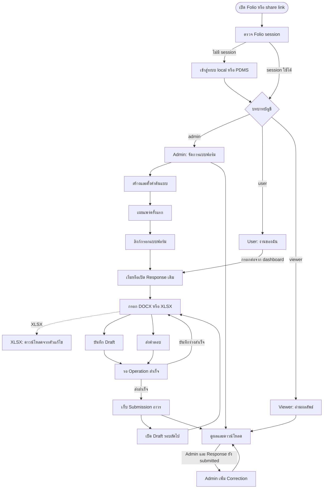

Admin กรอกแบบฟอร์มในฐานะเจ้าของ Response ของตนเองได้ด้วย ส่วน Viewer ใช้ได้เฉพาะหน้ารายการและรายละเอียด Results ใน UI การมี share link ไม่ยกเว้นการเข้าสู่ระบบ

อ้างอิง [AuthGate](../../apps/web/src/routes/__root.tsx#L37), [การเริ่ม Response](../../apps/server/src/routes/public-forms.ts#L130) และ [การจบ Submission](../../apps/server/src/operations/response-completion.ts#L97)

## 02 แผนที่ทุกหน้า

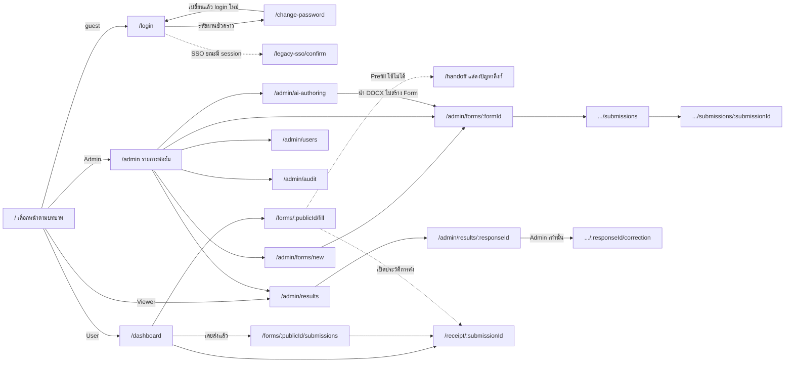

| หน้าและผู้ใช้ | หน้าไว้ทำอะไร | วิธีเปลี่ยนข้อมูลและหน้าถัดไป |
| --- | --- | --- |
| `/`, ทุกบทบาท | ตรวจบัญชีแล้วส่งไปหน้าเริ่มต้น | ไม่มีข้อมูลให้แก้ ผู้ไม่มี session ไป Login, Admin ไป Forms, User ไป Dashboard, Viewer ไป Results |
| `/login`, guest และผู้ทำ SSO | เข้าด้วยอีเมลและรหัสผ่าน หรือไป PDMS | เก็บ session แล้วกลับ `returnTo` ที่อนุญาต หรือตามบทบาท บัญชี local ที่มีรหัสชั่วคราวไป Change password |
| `/change-password`, ผู้มี session | เปลี่ยนรหัสปัจจุบันเป็นรหัสใหม่ | ตรวจรหัสเดิม บันทึก hash ใหม่ เพิกถอน sessions แล้วให้เข้าสู่ระบบใหม่ |
| `/legacy-sso/confirm`, ผู้เริ่มสลับบัญชี | แสดง Folio ปัจจุบันและบัญชี PDMS เป้าหมาย | ยืนยันก่อนเปลี่ยน session แม้เป็นคนเดียวกัน ยกเลิกแล้วใช้ session เดิม |
| `/handoff`, ทุกคน | แสดงว่า Prefill handoff ใช้ไม่ได้หรือหมดอายุ | ลองโหลดใหม่หรือกลับระบบต้นทาง หน้านี้ไม่สร้าง session หรือ Response |
| `/dashboard`, User และ Admin ที่เปิดเข้ามา | แสดงสถานะล่าสุดของ Response ที่ตนเป็นเจ้าของ | ร่างเปิดกรอกต่อ ผล submitted เปิดใบรับ ผู้ที่เคยส่งเปิดประวัติทั้งหมดได้ รวมเมื่อกลับมาเป็นร่าง มีปุ่มทิ้งร่างตามภาพ 10 |
| `/admin`, Admin | ค้นหา แบ่งหน้า กรองชนิดไฟล์และสถานะ ดูจำนวนร่างและ Submission | สร้างฟอร์ม เปิดรายละเอียด หรือลบร่างที่ยังไม่เคยเผยแพร่และไม่มี Response |
| `/admin/forms/new`, Admin | เลือก DOCX หรือ XLSX และใส่ชื่อกับคำอธิบาย | DOCX เริ่มเปล่าหรืออัปโหลดได้ XLSX เริ่มจาก workbook เปล่า สร้างแล้วไปหน้า editor |
| `/admin/forms/:formId`, Admin | ออกแบบต้นแบบ ตั้งค่าฟิลด์ บันทึก เผยแพร่ คัดลอกลิงก์ | หลังเผยแพร่เปลี่ยนชื่อและคำอธิบายได้ มีลิงก์ประวัติการส่งของทุกคน เปลี่ยนโครงสร้างด้วย Duplicate เป็น Form ใหม่ เก็บถาวรหรือเปิดกลับได้ |
| `/admin/forms/:formId/submissions`, Admin | ดู Submission ทุกครั้งของฟอร์มนั้น | เปิดรายละเอียดแต่ละ `submissionId` ประวัตินี้แยกจากสถานะปัจจุบันของ Response |
| `/admin/forms/:formId/submissions/:submissionId`, Admin | อ่านข้อมูลและประวัติ Correction ของ Submission ที่เลือก | สลับ revision และดาวน์โหลด DOCX หรือ XLSX ตามชนิดฟอร์ม รวม PDF |
| `/admin/results`, Admin และ Viewer | ค้นหาสถานะปัจจุบันของ Response ทั้งระบบ | กรอง Form, ผู้ใช้, จังหวัด, เดือน, ปีงบประมาณ, สถานะ, Correction และช่วงเวลา แล้วเปิดรายละเอียด |
| `/admin/results/:responseId`, Admin และ Viewer | อ่านร่างที่บันทึก หรือ Submission ล่าสุดพร้อม Correction | มีแท็บเอกสารและฟิลด์ สำหรับ submitted เลือก revision ได้ Admin ไป Correction หรือลบ Response ได้ |
| `/admin/results/:responseId/correction`, Admin | แก้ Submission ล่าสุดผ่าน editor แยก | กรอกเหตุผลแล้วบันทึก เก็บ Correction ใหม่พร้อมผู้แก้ เวลา ค่าที่เปลี่ยน และไฟล์ กลับรายละเอียดเมื่อสำเร็จ |
| `/admin/users`, Admin | ค้นหาและจัดการบัญชี กับคำขอเชื่อมบัญชี PDMS | สร้างบัญชี เปลี่ยนอีเมล บทบาท เปิดปิดบัญชี reset รหัส ลบบัญชีหลังลบ Responses แล้ว และอนุมัติหรือปฏิเสธการเชื่อม |
| `/admin/audit`, Admin | อ่าน Audit Trail ที่ระบบบันทึก | กรองผู้กระทำ action เป้าหมาย outcome และช่วงเวลา หน้านี้ไม่แก้หรือลบ event |
| `/admin/ai-authoring`, Admin | สร้าง DOCX จากคำอธิบายหรือ PDF แล้วคุยเพื่อแก้ฉบับปัจจุบัน | ดูตัวอย่าง ดาวน์โหลด จบ session หรือกดนำไปสร้าง Template Draft จากนั้นยังต้องตรวจและ Publish |
| `/forms/:publicId/fill`, User และ Admin | เริ่มกรอกหรือกลับมาร่างเดิม ใช้ Native form หรือ ONLYOFFICE | กรอก บันทึกร่าง และส่ง XLSX ดาวน์โหลดจากสมุดงานในตัวแก้ไข DOCX บันทึกก่อนดาวน์โหลด เมื่อมีงานค้างจะเตือนก่อนออกหรือเปลี่ยน session ส่งสำเร็จแล้วเปิดร่างรอบถัดไป |
| `/forms/:publicId/submissions`, เจ้าของ Response | ดูประวัติที่ตนเคยส่งของฟอร์มนั้น | เปิดใบรับแต่ละ Submission หรือกลับ Dashboard |
| `/receipt/:submissionId`, เจ้าของและ Admin | ใบรับคำตอบของ Submission หนึ่งครั้ง | อ่านข้อมูล เลือก Correction revision ดาวน์โหลดเอกสารหรือ PDF และกลับระบบต้นทางตาม URL ที่เซิร์ฟเวอร์กำหนด |

Viewer ถูก UI จำกัดไว้ที่ `/admin/results` และ `/admin/results/:responseId` แม้ API อ่าน Submission จะยอมรับบทบาท Viewer ด้วย

`formId` ใน URL ฝั่ง Admin เป็นชื่อ parameter ที่ใช้เก็บ `Form.publicId` ไม่ใช่ primary key ของ Form ส่วน `responseId` กับ `submissionId` เป็นคนละ entity และใช้แทนกันไม่ได้

layout ที่ไม่มีหน้าต่างใหม่ของตนเองคือ `__root`, `/admin`, `/admin/forms/$formId`, `/admin/forms/$formId/submissions` และ `/admin/results` เส้นทางที่ลงท้าย `/` ใน source เป็น index page ของ layout

อ้างอิง [inventory หน้าเว็บ](inventory.md#pages-and-route-layouts), [หน้าเริ่มต้น](../../apps/web/src/routes/index.tsx#L5) และ [ขอบเขต Viewer](../../apps/web/src/lib/api.ts#L425)

## 03 Login, session, เปลี่ยนรหัส และออกจากระบบ

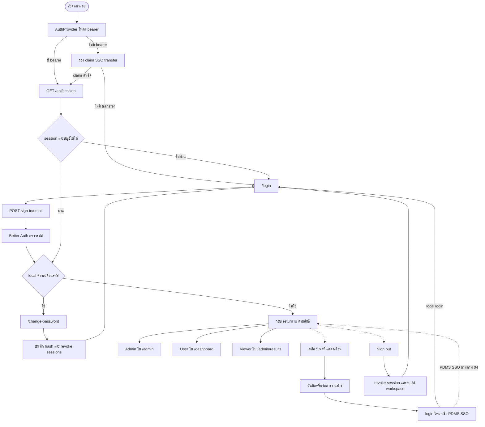

Session มีอายุ 1 ชั่วโมงและไม่ refresh อัตโนมัติ เว็บเก็บ opaque bearer ใน localStorage และส่งให้ API ตรวจบัญชีจริง รวม `enabled`, role และเวลาหมดอายุ การเตือนล่วงหน้า 5 นาทีไม่ใช่การขยาย session

รหัสผ่าน local ยาว 12 ถึง 128 ตัวอักษร ไม่มีการสมัครสมาชิกด้วยตนเอง การเปลี่ยนรหัสและ reset บังคับเข้าสู่ระบบใหม่ SSO session ได้รับข้อยกเว้นจากข้อบังคับเปลี่ยนรหัสชั่วคราวของ local

อ้างอิง [Better Auth config](../../packages/auth/src/index.ts#L10), [identityFor](../../apps/server/src/auth/identity.ts#L24), [AuthProvider](../../apps/web/src/lib/auth.tsx#L73) และ [password route](../../apps/server/src/routes/auth.ts#L53)

## 04 PDMS SSO และการเชื่อมบัญชี

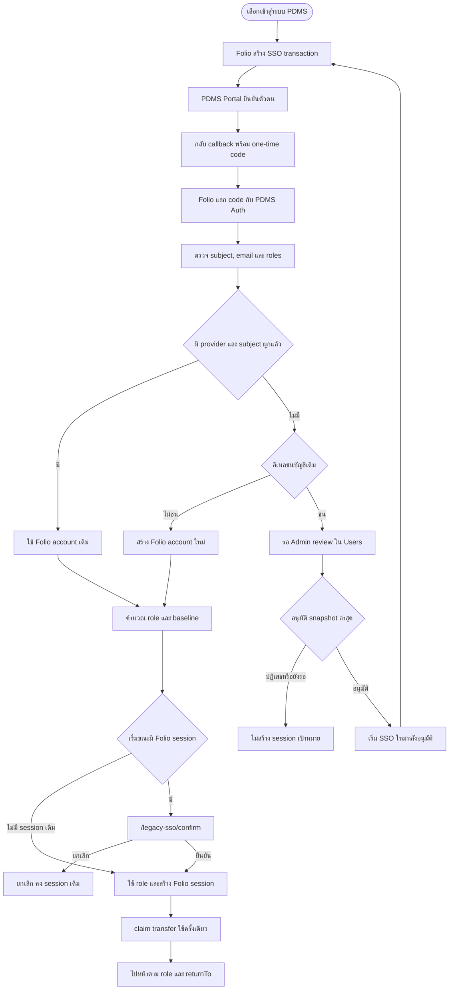

ระบบเชื่อมบัญชีด้วย provider และ subject ที่คงที่ อีเมลตรงกันไม่พอจะเชื่อมบัญชีอัตโนมัติ การอนุมัติคำขอไม่ทำให้ login ได้ทันที ต้องเริ่ม SSO รอบใหม่หลังอนุมัติ หลักฐานที่เปลี่ยนระหว่างรอตรวจทำให้ต้อง review ใหม่ บัญชี Admin ก็ต้องผ่านขั้นตอนนี้

| PDMS roles ที่ได้รับ                        | Folio role ที่คำนวณ |
| --------------------------------------- | ----------------- |
| มี `admin (กปม.)` โดยไม่แยกตัวเล็กใหญ่       | Admin             |
| ไม่มี role ข้างต้น แต่มี `เจ้าหน้าที่ กปม.` ตรงชื่อ | Viewer            |
| valid role list แบบอื่น รวม list ว่าง      | User              |

การเข้า SSO ครั้งแรกที่ยังไม่มี baseline ใช้ role ที่คำนวณ หลังจากนั้น ถ้า PDMS mapping ไม่เปลี่ยนจะรักษา role ที่ Admin แก้ใน Folio ถ้า mapping เปลี่ยนจึง sync role ใหม่ การเปลี่ยน role จริงเพิกถอน session เก่า และไม่ยอมลดสิทธิ์ enabled Admin คนสุดท้าย ระบบไม่ติดตาม PDMS role ระหว่าง login

อ้างอิง [SSO routes](../../apps/server/src/routes/legacy-sso.ts#L16), [การเชื่อมหลังอนุมัติ](../../apps/server/src/legacy-sso/accounts.ts#L198), [role finalization](../../apps/server/src/legacy-sso/finalize.ts#L105) และ [ADR 0002](../../docs/adr/0002-legacy-one-time-code-sso.md)

## 05 Admin สร้าง ออกแบบ เผยแพร่ และแก้แบบฟอร์ม

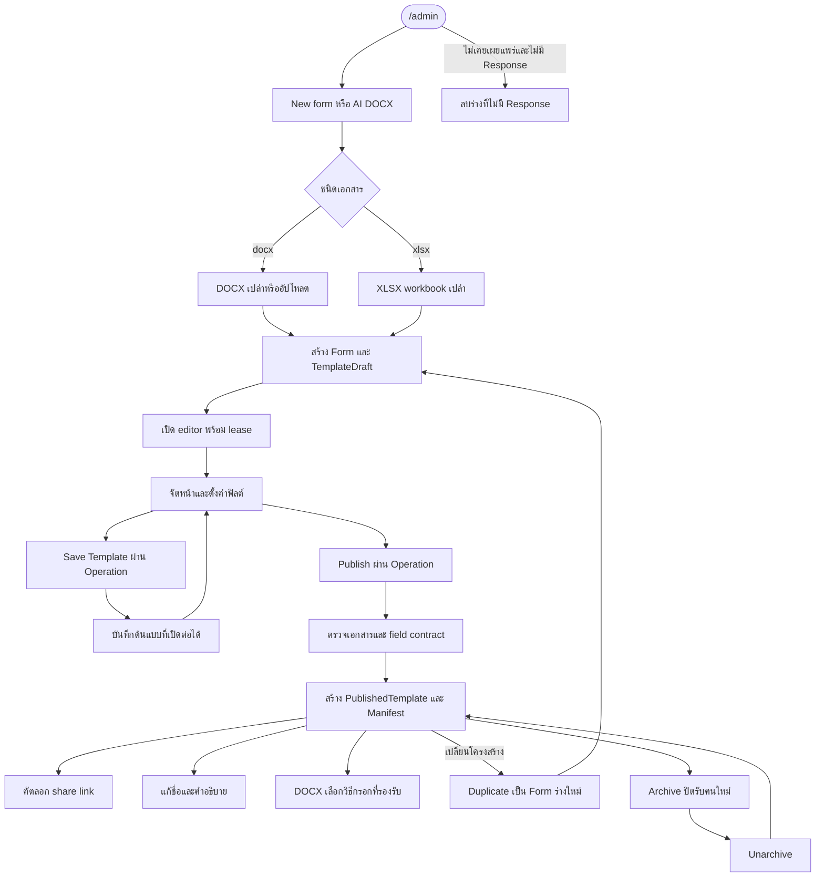

DOCX อัปโหลดได้ไม่เกิน 25 MiB ใช้ content controls ที่มี Tag เป็น key ส่วน Title/Alias เป็นชื่อที่แสดง ถ้าไม่มี Title ใช้ Tag แทน แผง Form Bridge ตั้ง required, Prefill pointer และ policy ได้

XLSX ไม่รับนำเข้าต้นแบบ ใช้ native editor จัด workbook แล้วผูกเซลล์หรือ merged cell กับ key ผ่าน named ranges ฟิลด์ร่วมกันอยู่ใน `DraftFieldRule` ก่อนเผยแพร่ และ `ManifestField` หลังเผยแพร่ ไม่สร้างตารางข้อมูล Excel อีกชุด

Save Template ไม่ใช่ Publish เมื่อ Publish สำเร็จ โครงสร้างและ policy ถูกตรึง Form เดิมไม่ให้แก้โครงสร้างหรือ publish ซ้ำ การ Duplicate คัดลอกเอกสารและกฎไป Form ใหม่พร้อม share ID ใหม่ โดยไม่ย้าย Response หรือ Submission

ชื่อและคำอธิบายแก้ได้ภายหลัง การเปลี่ยน DOCX Fill Method ใช้กับ Response ที่มีอยู่ด้วย และ Native form ต้องผ่านการตรวจชนิดฟิลด์ที่รองรับ XLSX ใช้ ONLYOFFICE เสมอ

Archive ปิดเริ่ม Response สำหรับผู้ที่ยังไม่มี Response แต่ผู้ที่มี Response ของฟอร์มนั้นแล้วผ่านเงื่อนไขเปิดต่อได้ จึงไม่ใช่การลบหรือปิดอ่านประวัติทั้งหมด

อ้างอิง [form catalog routes](../../apps/server/src/routes/form-catalog.ts#L64), [authoring routes](../../apps/server/src/routes/form-authoring.ts#L109), [completePublishOperation](../../apps/server/src/operations/template-completion.ts#L270) และ [หน้าแก้ Form](../../apps/web/src/routes/admin/forms/$formId/index.tsx#L148)

## 06 User เริ่มกรอก บันทึก ส่ง และกรอกครั้งถัดไป

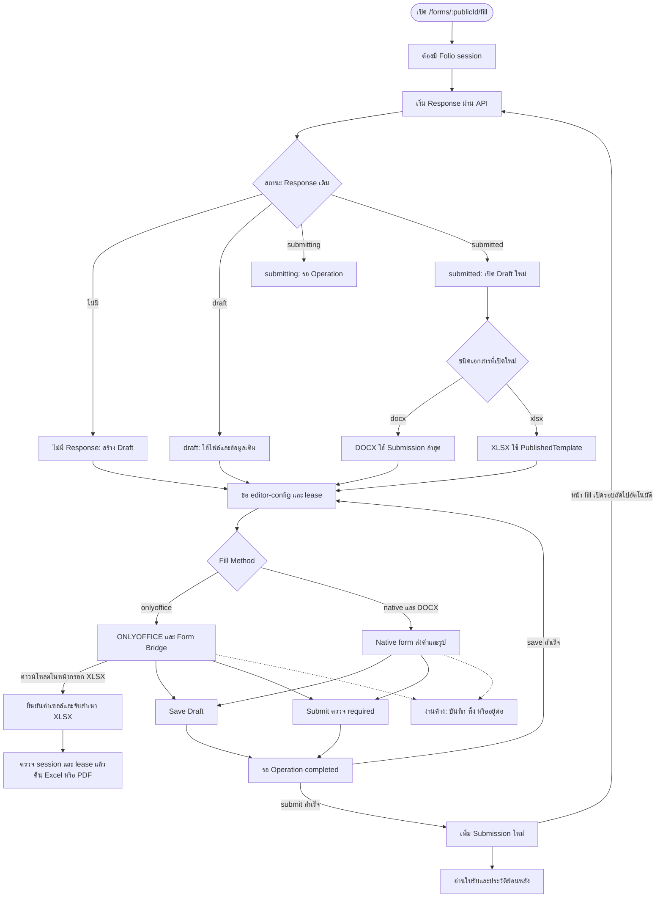

หนึ่งบัญชีมี Response ได้ไม่เกินหนึ่งตัวต่อ Form แต่ Response หนึ่งตัวส่งได้หลายครั้ง แต่ละครั้งสร้าง Submission แยก กดส่งซ้ำไม่ได้เขียนทับ Submission เดิม

หน้า fill ปัจจุบันเปิด Draft รอบถัดไปให้หลังส่งสำเร็จ ถ้าเป็น DOCX จะเริ่มจากข้อมูลและไฟล์ของ Submission ล่าสุด ถ้าเป็น XLSX จะเริ่มจาก PublishedTemplate เพื่อกรอกชุดใหม่ สำหรับ DOCX เส้นทางนี้อ่าน `Submission.data` และ `Submission.objectKey` โดยตรง ไม่ได้เลือกไฟล์ Correction ล่าสุดมาเป็นต้นร่าง

Prefill ของร่างเดิมเป็น snapshot ตอนเริ่ม Resume ไม่ดึงข้อมูลต้นทางมาเติมซ้ำ Handoff ของ Response ที่ submitted อยู่แล้วพาไป receipt แทนการเปิดรอบใหม่

เมื่อเจ้าของเคยส่งแบบฟอร์ม Dashboard แสดงลิงก์ไปประวัติรายฟอร์ม รวมเมื่อเปิดร่างรอบใหม่ หน้า `/forms/:publicId/submissions` แสดงเฉพาะ Submission ของเจ้าของและเปิดใบรับแต่ละครั้ง ประวัติแบบฝังในหน้า Native form ใช้ตามรายการฟอร์มในโค้ด ส่วน Admin เปิดประวัติของทุกคนจากหน้าออกแบบ Form

บนหน้า XLSX ปุ่มดาวน์โหลดรอให้ Form Bridge พร้อม เมื่อกด ปลั๊กอินยืนยันค่าเซลล์ที่ยังแก้ค้างผ่าน SDK ของ ONLYOFFICE 9.4 บน gateway ต้นทางเดียวกัน แล้วสร้างสำเนา XLSX ของสมุดงานปัจจุบัน แต่ละคำขอใช้ session ของเจ้าของ Response และ capability ผูกกับ editor lease และ document key ปัจจุบัน API อ่านสำเนาผ่าน cache ของ ONLYOFFICE ที่ตรวจต้นทางและขอบเขต แล้วตรวจโครงสร้างไฟล์และกฎ external resources ของสมุดงาน

ปุ่ม Excel คืนสำเนาเป็นไฟล์ `.xlsx` ปุ่ม PDF ส่งสำเนาชั่วคราวเข้าเครื่องแปลง PDF เดิม แล้วเบราว์เซอร์เริ่มดาวน์โหลดเมื่อแปลงเสร็จ ปุ่มแสดงสถานะเตรียมไฟล์และลองใหม่ได้เมื่อดาวน์โหลดล้มเหลว ผลของการดาวน์โหลดเป็นไฟล์สำหรับผู้กรอก การอัปเดต Draft เกิดเมื่อบันทึกผ่าน Operation สำเร็จ

อ้างอิง [start และรูปแบบการเปิดใหม่](../../apps/server/src/routes/public-forms.ts#L260), [userEditorConfig](../../apps/server/src/responses/editor.ts#L336), [fill หลัง Submit](../../apps/web/src/routes/forms/$publicId/fill.tsx#L439), [native submit](../../apps/web/src/routes/forms/$publicId/fill.tsx#L618), [จับสำเนาในปลั๊กอิน](../../apps/onlyoffice-plugin/src/office.js#L52) และ [API ดาวน์โหลดจาก editor](../../apps/server/src/routes/responses.ts#L229)

## 07 การกดบันทึกหนึ่งครั้งเดินทางอย่างไร

ตัวอย่างนี้เป็นเส้นทาง ONLYOFFICE ของ save, publish, submit และ correction การ commit แต่ละชนิดใช้ completion handler ต่างกัน

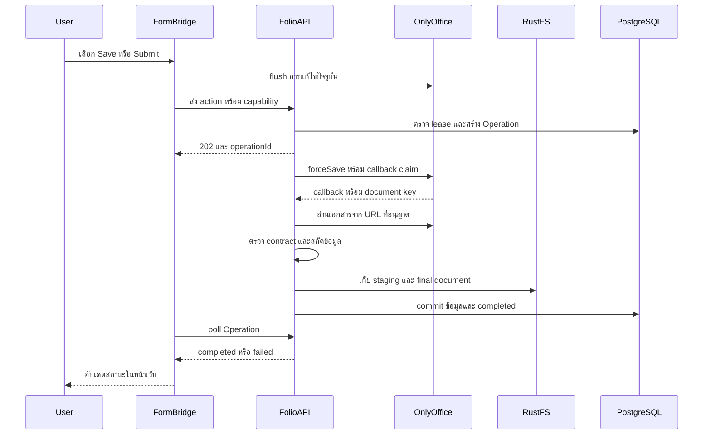

Native form ใช้ action API และ Operation เดียวกัน แต่สร้างหรือ overlay DOCX ที่เซิร์ฟเวอร์จากค่าที่กรอกและรูปภาพ จึงไม่ต้องรอ ONLYOFFICE force-save callback ในเส้นทางนั้น

การกด Save ใน editor หรือได้ HTTP 202 ยังไม่ใช่หลักฐานว่า Draft หรือ Submission สำเร็จ UI ต้องรอ Operation เป็น `completed` โดยเซิร์ฟเวอร์บันทึกทั้งข้อมูล JSON และไฟล์เอกสารที่สอดคล้องกันก่อน

Callback มีการตรวจ JWT, document key, claim, operation และแหล่ง URL ใช้ claim กันการประมวลผลซ้ำ ถ้า ONLYOFFICE ตอบว่าไม่มีการเปลี่ยนไฟล์ มีเส้นทางใช้ snapshot ที่ตรวจความน่าเชื่อถือแทน callback ปกติ ส่วน Excel บางงานต้องมี checkpoint และหลักฐาน editor save เพิ่ม

อ้างอิง [plugin operations](../../apps/onlyoffice-plugin/src/operations.js#L393), [createOperation](../../apps/server/src/operations/create.ts#L20), [force-save](../../apps/server/src/operations/force-save.ts#L147), [finalizeCallback](../../apps/server/src/operations/callback.ts#L155) และ [native processing](../../apps/server/src/operations/response-completion.ts#L192)

## 08 Excel, field mapping และตัวเลือกโครงการ PDMS

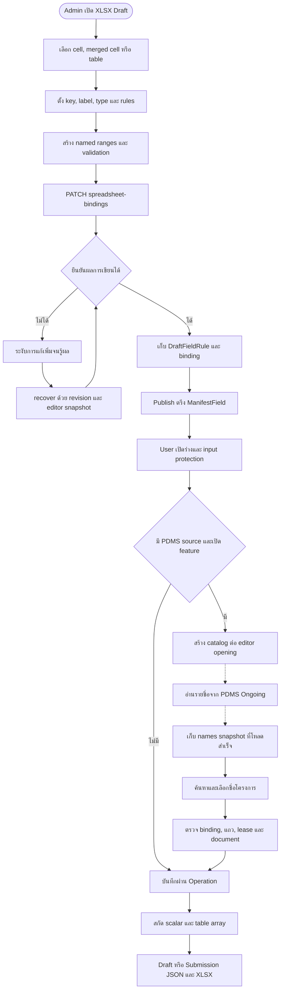

Contract รองรับ scalar fields และหนึ่ง repeating table ในหนึ่ง worksheet ที่แก้ได้ Key ของคอลัมน์ใน metadata ใช้ `tableKey.columnKey` แต่คำตอบเก็บเป็น array ของ object Named ranges ช่วยติดตามตำแหน่งเมื่อแทรกหรือย้ายคอลัมน์ หากระบุตำแหน่งไม่ชัด ระบบหยุดบันทึก

Table ข้ามแถวที่ input ว่างทั้งหมด แต่ `0` และ `false` เป็นข้อมูล แถวที่มีแต่สูตรไม่กลายเป็น record สูตรและ computed fields ไม่ใช่ช่องให้ผู้ใช้เปลี่ยนเอง รูปภาพเป็นชนิดข้อมูลที่จัดการในเอกสาร ส่วนปุ่มแนบไฟล์ Upload POC เป็นอีกเส้นทางหนึ่ง

PDMS Ongoing ถูกเรียกที่ `/api/pages/projects/names-and-doc-numbers` ฝั่ง server เลือกเฉพาะชื่อไม่ว่างและรวมชื่อซ้ำเป็นตัวเลือกเดียว คำตอบเก็บชื่อที่เลือก ไม่ได้เก็บ project ID สำหรับไปอ้างความเป็นโครงการเดียวกัน

Catalog ที่โหลดสำเร็จเป็น snapshot ของการเปิด editor นั้น ผูกผู้ใช้ Folio session, lease, document และ target เมื่อ submit ต้องโหลด catalog สำเร็จ การ retry ใช้ endpoint แยก ชื่อที่เคยบันทึกแล้วมีเส้นทางยอมรับแม้ต้นทางเปลี่ยนชื่อหรือเอาออก

Production จะเปิดความสามารถนี้เมื่อ `PDMS_PROJECT_NAME_SOURCE_ENABLED` เป็นจริงและมี configuration ที่ใช้ได้ แผนผังนี้ไม่ได้ยืนยันว่าระบบปลายทางเปิด flag แล้ว

Upload POC เก็บ marker และปุ่มใน XLSX สำหรับทดลองการเลือกไฟล์ เป็น metadata ที่แสดงผล ไม่ใช่ระบบอัปโหลดไฟล์แนบถาวร ไม่มี API upload/download attachment ใน route inventory ปัจจุบัน ส่วน HTTP หรือ HTTPS hyperlink ที่ผูกกับเซลล์เป็นอีกความสามารถหนึ่ง และไม่ได้เปิดให้โหลด external workbook หรือ resource ทั่วไป

อ้างอิง [spreadsheet bindings](../../apps/server/src/routes/spreadsheet-authoring.ts#L222), [shared fields](../../apps/server/src/forms/spreadsheet-fields.ts#L99), [PDMS loader](../../apps/server/src/pdms/projects.ts#L27), [catalog scope](../../apps/server/src/pdms/catalog.ts#L136), [selection target](../../apps/server/src/pdms/selection.ts#L26) และ [Upload POC](../../apps/server/src/documents/spreadsheets/upload-poc.ts#L61)

## 09 Results, ประวัติ, Correction และการดาวน์โหลด

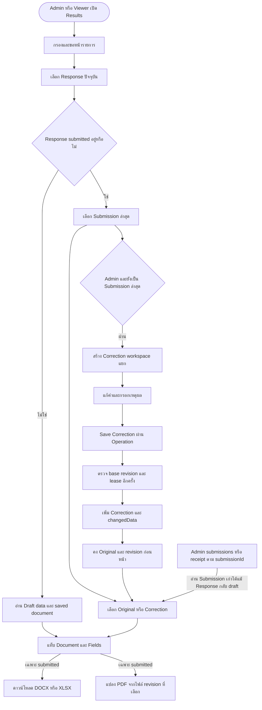

Results เป็นรายการสถานะปัจจุบันของ Response ไม่ใช่หนึ่งแถวต่อ Submission ทุกครั้ง ถ้า User ส่งแล้วหน้า fill เปิด Draft รอบใหม่ Results จะจัด Response นั้นเป็น draft อีกครั้ง แต่ประวัติ Submission เดิมยังอ่านได้ด้วย `submissionId` จนกว่าจะมีการลบ Response

ผล submitted ใช้ข้อมูลของ Submission ล่าสุดและ Correction ล่าสุดของ Submission นั้นตาม revision ที่เลือก จังหวัด เดือน และปีงบประมาณอ่านจาก scalar tags `province`, `month`, `fiscal_year` ไม่ใช่ profile ของผู้ใช้ การแสดงผลเก็บค่าตามที่บันทึก ส่วน filtering ยอมรับรูปแบบที่กำหนดแยกจากการแสดง

Correction เริ่มจากเอกสาร revision ปัจจุบันใน workspace แยก การบันทึก workspace ระหว่างเลือกโครงการยังไม่สร้าง Correction ที่เผยแพร่จริง การบันทึก Correction ต้องมีเหตุผลและผ่านการตรวจ Response ยัง submitted, Submission ยังเป็นล่าสุด และ base revision ไม่เปลี่ยน

เมื่อ User เปิดร่างรอบถัดไปแล้ว จะเพิ่ม Correction บน Submission เก่าไม่ได้ ประวัติเดิมยังอ่านได้ Revision number ของ Correction นับต่อในระดับ Response แต่ข้อมูลและเอกสารผูกกับ Submission ที่แก้

การดาวน์โหลดจากใบรับหรือรายละเอียด Submission ใช้ไฟล์ DOCX หรือ XLSX ที่บันทึกแล้ว PDF สร้างตามคำขอจาก revision ที่เลือก ถ้าแปลง PDF ไม่สำเร็จ Submission ที่ส่งสำเร็จแล้วไม่ได้ถูกย้อนกลับ หน้า receipt แสดงข้อมูลและดาวน์โหลดได้ แต่ไม่ได้มี editor สำหรับเปลี่ยน Submission

หน้า Results รายละเอียดของ Draft ปัจจุบันแสดงอ่านอย่างเดียวและไม่มีปุ่มดาวน์โหลด ทั้ง Admin และ Viewer ส่วน API export Draft แยกมีสิทธิ์ของเจ้าของและ Viewer ตาม route จึงต้องแยกความสามารถของ API ออกจากปุ่มที่มีในหน้านี้

อ้างอิง [Results API](../../apps/server/src/routes/results.ts#L271), [current result state](../../apps/server/src/responses/query.ts#L269), [Correction workspace](../../apps/server/src/responses/editor.ts#L57), [Correction commit](../../apps/server/src/operations/response-completion.ts#L421) และ [Submission API](../../apps/server/src/routes/submissions.ts#L34)

## 10 จัดการบัญชี Audit และการลบข้อมูล

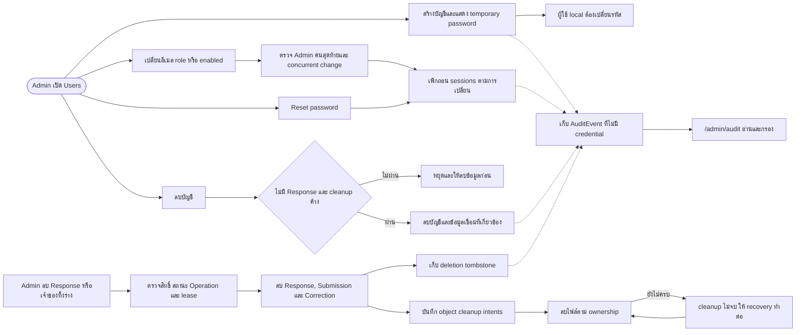

Admin ทุกบัญชีมีอำนาจจัดการบัญชีระดับเดียวกัน การ disable, เปลี่ยน role, แก้อีเมล หรือ reset มีการจัดการ session และ audit ตาม action ห้ามลบ ปิด หรือ demote enabled Admin คนสุดท้าย

การลบ account ไม่ได้ลบ Response ให้เอง ต้องลบ Responses และรอไฟล์ที่อยู่ระหว่าง cleanup ให้หมดก่อน การลบ Response โดย Admin มีการยืนยันใน UI และ API รวมทั้งไม่อนุญาตขณะมี editor lease อยู่ ส่วนเส้นทางทิ้งร่างของเจ้าของยอมจัดการ lease ของร่างได้ แต่ยังไม่ให้ลบขณะมี Operation ทำงาน

พฤติกรรมที่ต้องทราบจากโค้ดปัจจุบัน: ปุ่มทิ้งร่างเรียก `deleteResponseData` ซึ่งลบทั้ง Response รวม Submissions และ Corrections ที่ผูกอยู่ด้วย ไม่มี guard ว่าร่างนั้นเคยมี Submission มาก่อนหรือไม่ ดังนั้นการทิ้งร่างที่เกิดจากการส่งรอบก่อนอาจลบประวัติรอบก่อนด้วย แผนผังแสดงพฤติกรรมนี้ตาม source และงานสำรวจนี้ไม่ได้เปลี่ยนพฤติกรรมดังกล่าว

ถ้าต้องการให้ “ทิ้งร่างรอบปัจจุบัน” รักษาประวัติ ต้องออกแบบเส้นทาง discard แยกจาก erase ระดับ Response แล้วเปลี่ยน caller ของ Dashboard และ fill ให้เรียกเส้นทางใหม่ จุดแก้หลักคือ `responses/deletion.ts`, `routes/responses.ts` และหน้า Dashboard/fill

AuditEvent เก็บ action, actor, target, outcome, เวลา และ safe metadata การอ่านและ export บางชนิดก็บันทึก audit ด้วย Tombstone กับ cleanup intents ช่วยให้ลบต่อหลัง retry ได้ โดยไม่จำเป็นต้องเก็บข้อมูลส่วนบุคคลทั้งหมดไว้ใน audit

อ้างอิง [account routes](../../apps/server/src/routes/accounts.ts#L53), [account deletion guards](../../apps/server/src/routes/accounts.ts#L485), [response deletion](../../apps/server/src/responses/deletion.ts#L50), [การลบประวัติใน transaction](../../apps/server/src/responses/deletion.ts#L351), [Dashboard discard](../../apps/web/src/routes/dashboard.tsx#L122) และ [Audit API](../../apps/server/src/routes/audit.ts#L24)

## 11 AI Authoring เชื่อมกับ Form อย่างไร

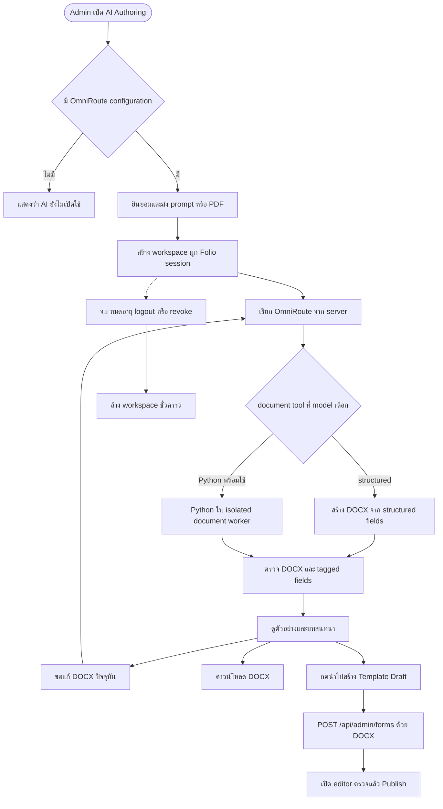

AI workspace เป็นข้อมูลชั่วคราวผูกกับ Folio auth session ไม่ใช่ Form ที่เผยแพร่แล้ว UI มีปุ่มดึง DOCX จาก workspace แล้วส่งเข้า API สร้าง Form ตามปกติ การสร้างด้วย AI จึงไม่ข้ามการตรวจต้นแบบหรือ Publish

PDF เป็น reference สำหรับสร้าง DOCX ไม่ใช่การเปิดแบบฟอร์ม PDF ให้ User กรอก Python document worker เป็น sidecar แยกและใช้ container งานชั่วคราว การสร้าง DOCX ปกติและการประมวลผล XLSX ด้วย ONLYOFFICE Builder เป็นคนละเส้นทางกับ worker นี้

อ้างอิง [AI routes](../../apps/server/src/routes/ai-authoring.ts#L15), [sessions](../../apps/server/src/ai-authoring.ts#L73), [document tools](../../apps/server/src/ai-authoring/agent.ts#L160), [นำไปสร้าง Form](../../apps/web/src/routes/admin/ai-authoring.tsx#L256) และ [private worker](../../apps/server/src/document-worker-server.ts#L170)

## 12 Prefill handoff จากระบบภายนอก

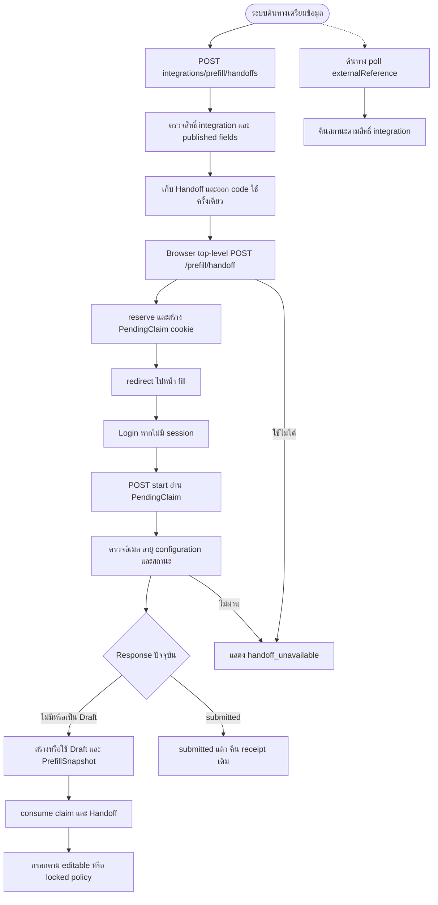

Handoff เป็นการนำข้อมูลเข้ากรอก ไม่ใช่การ login แทน SSO ระบบตรวจอีเมลของ Folio account หลัง login ว่าตรงกับ handoff ก่อน redeem และรับเฉพาะค่าที่อยู่ใน published Prefill configuration

`editable` ให้แก้ค่าที่เติมไว้ ส่วน `lock_when_available` ล็อกเมื่อมีค่าที่ใช้ได้ Resume ใช้ PrefillSnapshot เดิม การเปิดผ่าน GET `/prefill/handoff` ไม่ได้ redeem code เพราะ route นี้บังคับ top-level POST

`apps/prefill-mock` เป็น mock integration สำหรับทดสอบ Compose เปิดเฉพาะ profile `verification` จึงไม่ควรใส่ในเส้นทาง production ปกติว่ามีระบบภายนอกทำงานอยู่แล้ว

อ้างอิง [Prefill routes](../../apps/server/src/routes/prefill.ts#L23), [create/launch](../../apps/server/src/prefill/create-launch.ts#L36), [redeem](../../apps/server/src/prefill/redemption.ts#L49) และ [handoff error page](../../apps/web/src/routes/handoff.tsx#L19)

## 13 บริการและการเชื่อมต่อจริงตาม Compose

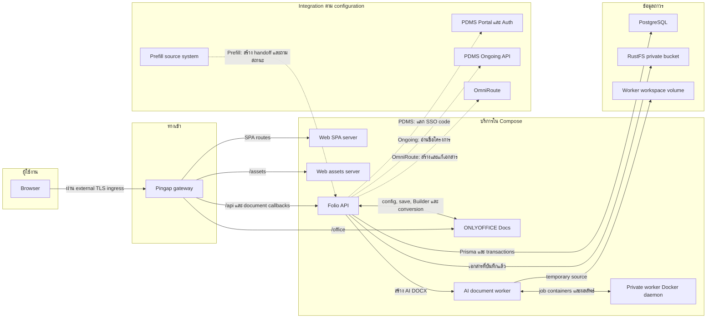

Gateway ปัจจุบันใน `compose.yaml` เป็น Pingap และ TLS อยู่ที่ external ingress ที่ไม่ได้ประกาศใน Compose นี้ `/api`, `/onlyoffice` และ `/prefill` ไป API, `/office` ไป ONLYOFFICE โดยตัด prefix, `/assets` ไป web-assets และหน้าอื่นไป Web SPA

PostgreSQL เก็บบัญชี session กฎฟอร์ม JSON คำตอบ และสถานะงาน RustFS เก็บ canonical DOCX หรือ XLSX และไฟล์ชั่วคราวที่เกี่ยวข้อง Browser และ ONLYOFFICE รับเอกสารผ่าน API ที่ออกสิทธิ์ให้ ไม่ได้รับการเปิด bucket สาธารณะ

การทำงาน XLSX เรียก ONLYOFFICE Document Builder และ conversion ผ่าน `documents/spreadsheets/engine.ts` ส่วน `document-worker` กับ daemon ใช้สำหรับ AI Python document tool แยกจากกัน

ข้อแตกต่างของเอกสารเดิม: README ตอนต้นยังบรรยาย Caddy แต่ Compose และ `gateway/pingap.toml` ใน commit ที่สำรวจใช้ Pingap แผนผังนี้ยึดไฟล์ deployment ปัจจุบัน ไม่ได้สรุปว่า production ที่รันอยู่ deploy commit นี้แล้ว

อ้างอิง [Compose](../../compose.yaml), [gateway routes](../../gateway/pingap.toml), [API composition](../../apps/server/src/app.ts#L167) และ [XLSX engine](../../apps/server/src/documents/spreadsheets/engine.ts)

## 14 ความสัมพันธ์ข้อมูลหลัก

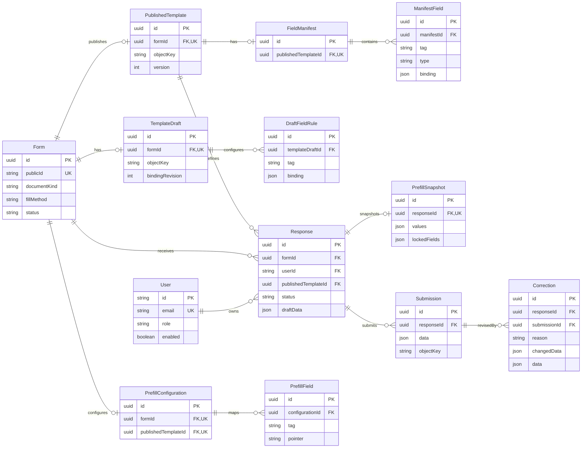

ER แสดงความสัมพันธ์หลักสำหรับอ่านวงจรฟอร์ม โดยย่อ FK ที่ซ้ำเพื่อให้ภาพอ่านได้ ส่วน schema จริงและ inventory มีรายการครบทุก model `Response` มี unique constraint บน `formId + userId` ไม่ใช่ unique บน Submission และ `Correction` มี unique บน `responseId + revision`

| กลุ่มข้อมูลที่เหลือ | Models และหน้าที่ |
| --- | --- |
| ตัวตนและ session | `Account` เก็บ local credential หรือ provider binding, `Session` เก็บ Folio sessions, `Verification` เก็บ SSO transaction/switch/transfer ตาม identifier, `LegacyAccountLinkRequest` เก็บผล review, `LoginFailure` เก็บตัวจำกัดความพยายาม login |
| การนำข้อมูลเข้า | `Handoff` และ `PendingClaim` ควบคุมการนำ Prefill เข้าใช้ครั้งเดียว |
| การแก้เอกสาร | `EditorLease` กันหลาย session แก้ target เดียวกัน, `Operation` เก็บงาน asynchronous, `CallbackClaim` กัน callback ใช้ซ้ำ |
| Catalog ต่อการเปิด editor | `PdmsProjectCatalogSession` ผูกรายชื่อโครงการกับผู้ใช้ auth session, lease, target และ document |
| การตรวจย้อนหลังและ cleanup | `AuditEvent` เก็บเหตุการณ์, `ObjectCleanupIntent` เก็บไฟล์ที่ต้องลบต่อ, `DeletionTombstone` กันข้อมูลที่ลบแล้วกลับมาจาก handoff เดิม |

AI authoring sessions อยู่ใน workspace ชั่วคราวของบริการ ไม่ได้มี Prisma model ชื่อ AI session ใน schema นี้

อ้างอิง [Prisma schema](../../packages/db/prisma/schema.prisma#L95) และ [รายการครบ 27 models](inventory.md#database-models)

## 15 เริ่มระบบ งานค้าง และการกู้สถานะ

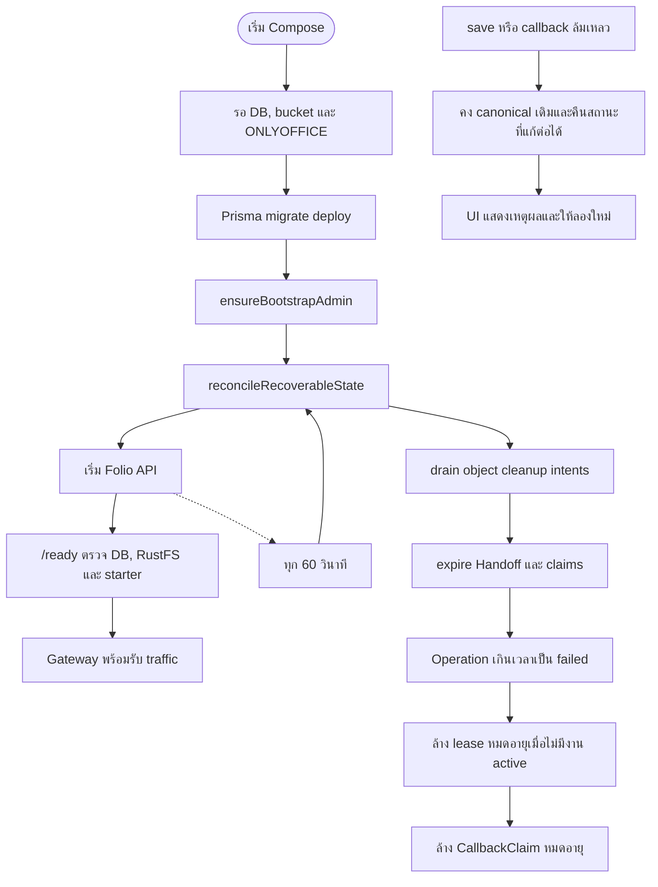

Bootstrap สร้าง Admin เริ่มต้นเมื่อยังไม่มี Admin โดยใช้ค่าที่กำหนดนอก repository ไม่ seed บัญชีตัวอย่าง การ recovery ทำก่อนเริ่มรับงานและทำซ้ำทุก 60 วินาที

`/health` บอกว่า API process ตอบได้ ส่วน `/ready` ตรวจ PostgreSQL, RustFS และ starter template การตอบ ready ของ API ไม่ใช่หลักฐานว่า PDMS SSO, Ongoing, OmniRoute และทุกฟังก์ชันใน ONLYOFFICE ใช้ได้ทั้งหมด Compose มี health check ของ ONLYOFFICE แยก

งานที่ล้มเหลวไม่ควรเปลี่ยน canonical document ไปเป็นไฟล์ที่ยังตรวจไม่ผ่าน เส้นทาง submitting ที่ failed มี lifecycle handler จัดสถานะให้กลับมาแก้ต่อได้ การ cleanup ใช้ intents และตรวจว่าไฟล์ยังเป็น canonical หรือไม่ก่อนลบ

อ้างอิง [startup](../../apps/server/src/index.ts#L9), [readiness](../../apps/server/src/readiness.ts#L6), [recovery](../../apps/server/src/operations/recovery.ts#L11) และ [operation lifecycle](../../apps/server/src/operations/lifecycle.ts)

## 16 บันทึกแล้วปิดหน้า กลับมาแก้ต่อได้อย่างไร

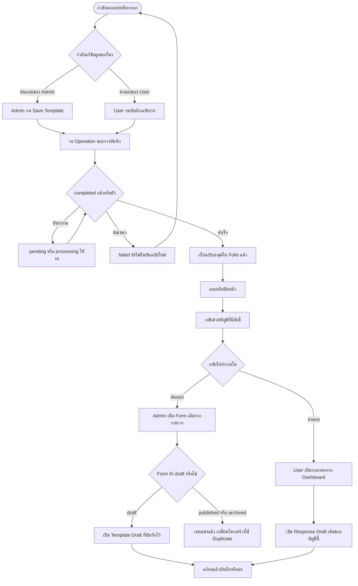

| เหตุการณ์ | สิ่งที่ระบบเก็บ | ผลเมื่อเปิดกลับ |
| --- | --- | --- |
| Admin สร้าง Form สำเร็จแต่ยังไม่ออกแบบต่อ | Form และไฟล์ตั้งต้นของ Template Draft | Form อยู่ในรายการร่าง เปิดออกแบบต่อได้ |
| Admin กด Save Template และ completed | ไฟล์ต้นแบบฉบับที่บันทึกกับข้อมูลที่ต้องใช้เปิดใหม่ | กลับมาแก้ต้นแบบเดิมได้ตราบใดที่ยังไม่ Publish |
| Admin บันทึกชื่อหรือคำอธิบาย | Form metadata ผ่านคำขอแยก | ชื่อใหม่ไม่ได้ยืนยันว่าการแก้เนื้อหาใน editor ถูก Save Template ไปด้วย |
| Admin Apply ตั้งค่าฟิลด์ | กฎฟิลด์ผ่าน API และการปรับใน editor ตามชนิดเอกสาร | ต้องบันทึกต้นแบบให้ไฟล์กับกฎสอดคล้องกันก่อนถือว่างานพร้อมเปิดใหม่หรือ Publish |
| User เริ่มกรอกแล้วพิมพ์เฉย ๆ | มี Response ตั้งต้น แต่ค่าที่พิมพ์ยังอาจอยู่ใน browser หรือ editor | ไม่รับประกันว่าค่าที่พิมพ์ค้างจะกลับมาครบ |
| User ดาวน์โหลด Excel หรือ PDF จากหน้ากรอก XLSX | ได้สำเนาจากสมุดงานที่เปิดอยู่บนเครื่องผู้กรอก | Folio เปิดจาก Draft ที่บันทึกสำเร็จล่าสุด |
| User กดบันทึกฉบับร่างและ completed | ค่าคำตอบและไฟล์ DOCX หรือ XLSX ของร่างเดียวกัน | เปิดต่อได้ด้วยบัญชีเจ้าของเดิม ใช้ Response เดิม ไม่สร้างคำตอบใหม่เพิ่ม |
| User บันทึกแล้วปิด browser และ login ใหม่ | ร่างยังอยู่ในฐานข้อมูลกับ object storage | กลับมาทำต่อได้ ถ้าบัญชียังใช้ได้ Form และ Response ยังอยู่ และได้สิทธิ์ editor |
| User พิมพ์เพิ่มหลังบันทึกครั้งล่าสุดแล้วปิดหน้า | ฉบับที่ยืนยันแล้วคือครั้งล่าสุดที่ completed | ค่าที่เพิ่มหลังครั้งนั้นไม่ถือว่าบันทึกเข้าร่างของ Folio แล้ว |

การกลับมาแก้ Response ต้องเป็นเจ้าของบัญชีเดิม Admin ที่อ่านร่างของคนอื่นผ่าน Results ได้สิทธิ์อ่าน ไม่ใช่การเปิดร่างนั้นเป็นผู้กรอกแทนเจ้าของ ส่วน Admin ที่มีสิทธิ์ออกแบบ Form สามารถเปิด Template Draft ต่อกันได้ แต่ editor lease จะกันคนละ session แก้ target เดียวกันพร้อมกัน

ถ้าเปิดกลับแล้วขึ้น editor ถูกใช้อยู่ ต้องให้ session เดิม release หรือหมดอายุ Lease มีช่วงอายุ 90 วินาทีและเว็บ renew ทุก 30 วินาที ภายใต้อายุ Folio session การรอไม่ได้ทำให้ค่าที่ไม่เคย Save ในหน้าต่างเก่ากลายเป็นข้อมูลที่บันทึกแล้ว

อ้างอิง [completeTemplateOperation](../../apps/server/src/operations/template-completion.ts#L32), [completeDraftOperation](../../apps/server/src/operations/response-completion.ts#L25), [start/resume](../../apps/server/src/routes/public-forms.ts#L239), [claimEditorLease](../../apps/server/src/editor/leases.ts#L98) และ [lease renewal interval](../../apps/web/src/features/onlyoffice/editor-protocol.ts#L33)

## 17 สถานะ Form และสิ่งที่ Admin ทำได้ในแต่ละสถานะ

Form มี status จริงสามค่า การลบ Form เป็นการนำ record ออก ไม่ใช่ค่า `deleted` ของ FormStatus ดู flow การลบแยกในภาพ 10

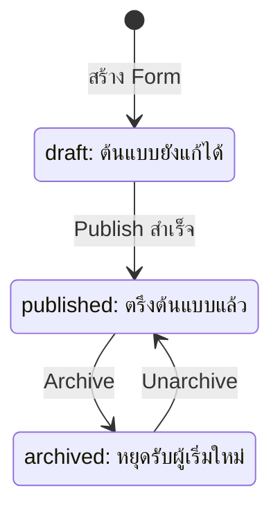

| Form status | สร้างหรือเกิดเมื่อใด | แก้อะไรได้ | สิ่งที่ยังทำไม่ได้ |
| --- | --- | --- | --- |
| `draft` | สร้างจาก New form, AI หรือ Duplicate | ออกแบบเอกสาร ตั้งฟิลด์ บันทึก เปิดกลับมาแก้ เปลี่ยนชื่อและคำอธิบาย Publish หรือ Duplicate | คนทั่วไปยังใช้ share link เริ่มกรอกไม่ได้ เปลี่ยน Fill Method จาก UI ก่อน Publish ไม่ได้ |
| `published` | Publish Operation completed | แก้ชื่อและคำอธิบาย คัดลอกลิงก์ อ่าน Submission, Duplicate, Archive และเลือก DOCX Fill Method ที่รองรับ | แก้โครงสร้างหรือ policy ของต้นแบบเดิม Publish ซ้ำ หรือ hard-delete Form นี้ไม่ได้ |
| `archived` | Admin กด Archive | เปลี่ยน metadata, อ่านข้อมูลเดิม และ Unarchive | ไม่รับเริ่ม Response ของผู้ที่ยังไม่เคยมี Response กับฟอร์มนี้ ปุ่ม Duplicate ใน UI ยังไม่เปิดให้ใช้จน Unarchive |

การ Save Template ไม่เปลี่ยน Form จาก `draft` เป็น `published` การ Publish ล้มเหลวก็ไม่ทำให้ Form กลายเป็น published

การ Duplicate สร้าง Form อีกตัวที่เป็น `draft` มี publicId และ share link ใหม่ ต้นฉบับยังอยู่ในสถานะเดิม ไม่ใช่การนำ published กลับเป็น draft และไม่คัดลอก Response หรือประวัติการส่งไปด้วย สำเนาอ่านไฟล์ฉบับที่บันทึกแล้ว จึงไม่ใช้การแก้ค้างที่ยังไม่ Save ใน editor เป็นข้อมูลอัตโนมัติ

หลัง Archive ผู้ที่มี Response อยู่แล้วมีเส้นทางเปิดต่อและส่งได้ตามเงื่อนไขเดิม ข้อมูลเก่าไม่ได้หายไป การ Archive จึงต่างจากการลบ

อ้างอิง [FormStatus](../../packages/db/prisma/schema.prisma#L16), [metadata และ archive rules](../../apps/server/src/routes/form-catalog.ts#L74), [publish commit](../../apps/server/src/operations/template-completion.ts#L270) และ [ปุ่มตามสถานะ](../../apps/web/src/routes/admin/forms/$formId/index.tsx#L309)

## 18 สถานะ Response และเหตุผลที่ส่งแล้วกลับเห็นร่าง

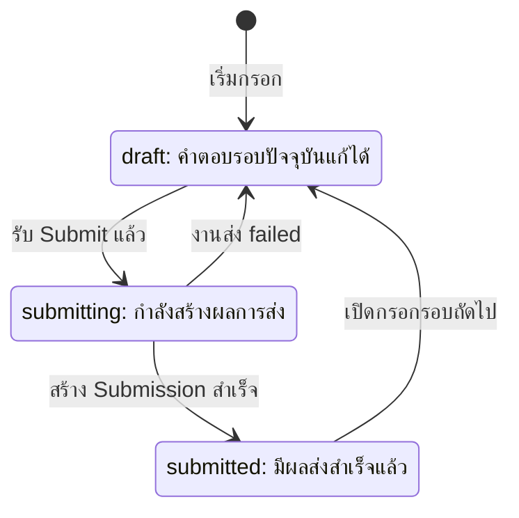

| Response status | ผู้กรอกแก้ได้ไหม | บันทึกหรือส่งซ้ำได้ไหม | ข้อมูลที่ Admin อ่านใน Results |
| --- | --- | --- | --- |
| `draft` | เจ้าของเปิดกรอกต่อได้ | Save Draft ได้ ส่งได้เมื่อผ่าน validation และไม่มี Operation ค้าง | ร่างที่บันทึกไว้ ไม่ใช่ค่าที่กำลังพิมพ์ในหน้าต่างเจ้าของ |
| `submitting` | เส้นทางแก้และส่งใหม่ถูกกันไว้ | รอ Operation เดิม เมื่อส่งล้มเหลวระบบคืนเป็น draft | API สรุปสถานะ Results เป็น draft สำหรับสถานะที่ยังไม่ใช่ submitted จึงต้องดู Operation ด้วย |
| `submitted` | Submission ที่ส่งแล้วอ่านอย่างเดียว | เปิดกรอกใหม่ได้ โดยกลับมาเป็น draft ของ Response เดิมและเพิ่ม Submission ใหม่เมื่อส่งอีกครั้ง | Submission ล่าสุดพร้อม Correction ล่าสุด หรือ revision ที่เลือก |

เมื่อส่งสำเร็จ เซิร์ฟเวอร์เพิ่ม Submission ใหม่ก่อนแล้วตั้ง Response เป็น `submitted` แต่หน้า fill ปัจจุบันเรียก start เพื่อเปิดร่างรอบถัดไปทันที ถ้าขั้นเปิดใหม่สำเร็จ Response จะกลับเป็น `draft` ดังนั้น "เห็นร่าง" ไม่ได้แปลว่าส่งครั้งก่อนล้มเหลว ต้องดูประวัติ Submission และผล Operation ประกอบ

| หลังส่งครั้งก่อน | รอบใหม่เริ่มจากอะไร | สิ่งที่ยังคงอยู่ |
| --- | --- | --- |
| DOCX ทั้ง Native และ ONLYOFFICE | ไฟล์กับค่าของ Submission ล่าสุดโดยตรง | Submission ทุกครั้งก่อนหน้าและ Correction ของแต่ละครั้งยังอ่านแยกได้ |
| XLSX | PublishedTemplate ที่เตรียมให้กรอกชุดใหม่ | ประวัติ Submission ที่ส่งแล้วไม่ถูกเขียนทับจากการเปิดร่างใหม่ |
| เข้าจาก Prefill handoff ขณะยัง submitted | เส้นทางนี้คืน receipt ของ Submission ล่าสุด | ไม่เปิดร่างใหม่ผ่าน handoff นั้น |

หากเปิดร่างรอบถัดไปไม่สำเร็จ แต่ Operation ส่งสำเร็จแล้ว ต้องแยกสองผลลัพธ์นี้ การเปิดร่างใหม่ล้มเหลวไม่ได้ลบ Submission ที่ commit ไปแล้ว

หนึ่ง Response จึงประกอบด้วย "สถานะงานรอบนี้" กับ "ประวัติที่เคยส่ง" อยู่พร้อมกัน Dashboard แสดง Response ไม่ใช่รายการหนึ่งแถวต่อการส่งทุกครั้ง หากต้องการดูแต่ละรอบใช้หน้า Submissions รายฟอร์ม หรือ receipt ตาม submissionId

การลบเป็นการนำ record ทั้ง Response ออกตาม flow ในภาพ 10 ไม่ใช่การย้อนสถานะกลับไปก่อนส่ง ส่วน Save Draft และการเพิ่ม Correction ไม่เปลี่ยน status จึงแสดงผลของ action เหล่านี้ไว้ในตาราง

อ้างอิง [ResponseStatus](../../packages/db/prisma/schema.prisma#L49), [รับ Submit](../../apps/server/src/routes/response-actions.ts#L240), [commit Submission](../../apps/server/src/operations/response-completion.ts#L97), [เปิดร่างรอบใหม่](../../apps/server/src/routes/public-forms.ts#L260) และ [Results state](../../apps/server/src/responses/query.ts#L269)

## 19 สถานะการบันทึกสำเร็จกับสถานะของฟอร์มเป็นคนละเรื่อง

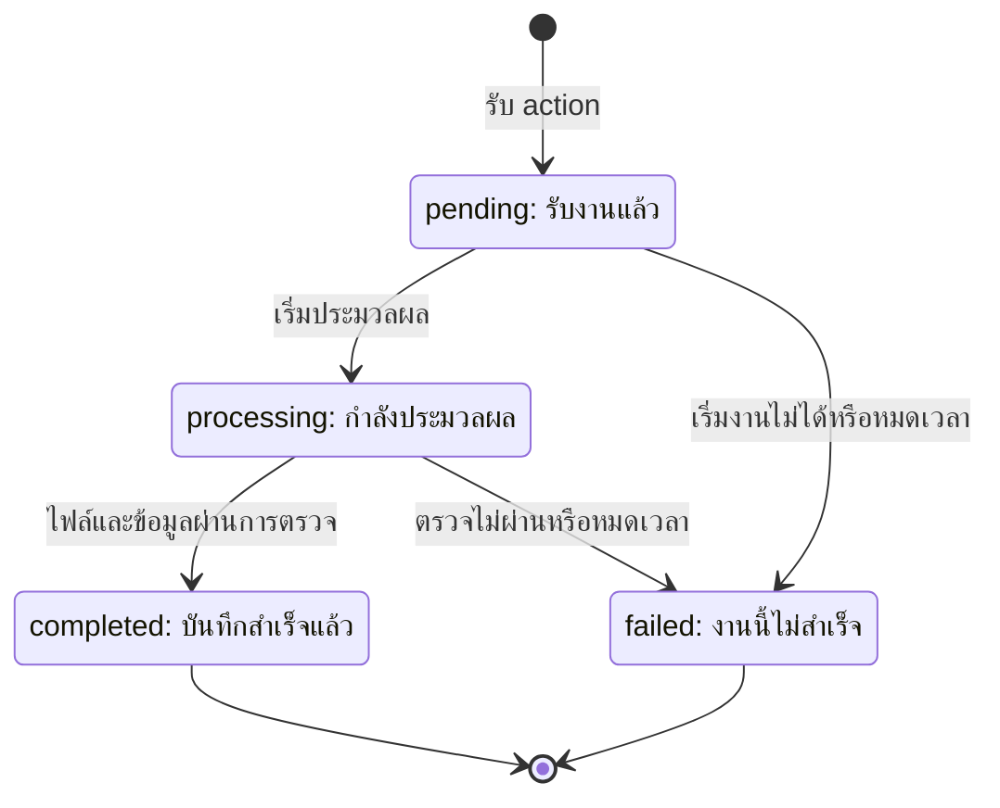

| Operation status | ผู้ใช้ควรเข้าใจว่าอะไรเกิดขึ้น | ออกจากหน้าแล้วถือว่าบันทึกไหม |
| --- | --- | --- |
| `pending` | API รับคำขอไว้แล้ว ยังไม่ใช่ผลลัพธ์สุดท้าย | ยังไม่ถือว่าสำเร็จ |
| `processing` | รอ editor save, callback หรือกำลังตรวจและเก็บเอกสารกับข้อมูล | ยังไม่ถือว่าสำเร็จ |
| `completed` | completion handler ยืนยันการบันทึกของ action นั้นแล้ว | ฉบับที่ action นี้บันทึกสำเร็จใช้เปิดกลับหรืออ่านผลต่อได้ |
| `failed` | คำขอนี้ทำไม่สำเร็จ มี error code หรือเหตุผล | อย่าตีความว่าฉบับที่เพิ่งแก้ถูกเก็บแล้ว ให้ดูฉบับสำเร็จก่อนหน้า |

| Action ที่สำเร็จ | สถานะทางธุรกิจหลัง completion |
| --- | --- |
| Save Template | Form ยัง `draft` ต้นแบบฉบับที่บันทึกเปลี่ยน |
| Publish | Form เป็น `published` และเกิด PublishedTemplate กับ Manifest |
| Save Draft | Response ยัง `draft` แต่ค่ากับไฟล์ร่างเปลี่ยน |
| Submit | เพิ่ม Submission และตั้ง Response เป็น `submitted` ก่อนหน้า fill เริ่มรอบใหม่ |
| Save Correction workspace | เก็บงานชั่วคราวใน workspace ยังไม่เพิ่ม Correction ที่เผยแพร่จริง |
| Save Correction | เพิ่ม Correction ใหม่ Response ยัง `submitted` |

การล้มเหลวไม่ได้มีผลเหมือนกันทุกกรณี ถ้า Submit Operation failed ระบบคืน Response จาก `submitting` เป็น `draft` ถ้า Save Draft failed ฉบับสำเร็จก่อนหน้ายังเป็นฉบับอ้างอิง ถ้า Publish failed Form ยังไม่กลายเป็น published

ถ้า API รับคำขอแล้วแต่ browser หลุดก่อนทราบผล ไม่ควรเดาว่า success หรือ failure ต้องเปิดตรวจสถานะปัจจุบันและฉบับที่บันทึกอีกครั้ง งานเดิมอาจจบฝั่ง server ไปแล้ว การกด retry หลังงาน failed สร้าง Operation ใหม่ ไม่ย้อน Operation เก่าไป pending

Operation ที่ pending หรือ processing และไม่มีการอัปเดตความคืบหน้าเกิน 4 นาที มีเส้นทางถูกตัดเป็น failed ผ่าน polling หรือ recovery รอบถัดไป ตัวจับเวลานี้ไม่ใช่คำรับประกันว่าทุกงานเสร็จภายใน 4 นาทีรวม

DOCX แสดงผลบันทึกและดาวน์โหลดแยกกันเมื่อการบันทึกสำเร็จแล้วแต่แปลง PDF ล้มเหลว บนหน้ากรอก XLSX การดาวน์โหลดมีสถานะเตรียมไฟล์และข้อผิดพลาดของตัวเอง การบันทึก Draft แสดงผลจาก Operation ของคำสั่งบันทึก

อ้างอิง [Operation lifecycle](../../apps/server/src/operations/lifecycle.ts#L26), [คืน submitting เป็น draft](../../apps/server/src/operations/lifecycle.ts#L149), [poll Operation](../../apps/server/src/routes/operations.ts#L19) และ [คำสั่งหน้ากรอก](../../apps/web/src/routes/forms/$publicId/fill.tsx)

## 20 ออกจากหน้า Reload เน็ตหลุด และ session หมดอายุ

ภาพนี้แสดง dialog ของหน้า User fill ส่วนการบังคับปิดแท็บหรือ browser ใช้คำเตือนของ browser และไม่รับประกันว่าจะทำ Save ให้เสร็จแทนผู้ใช้

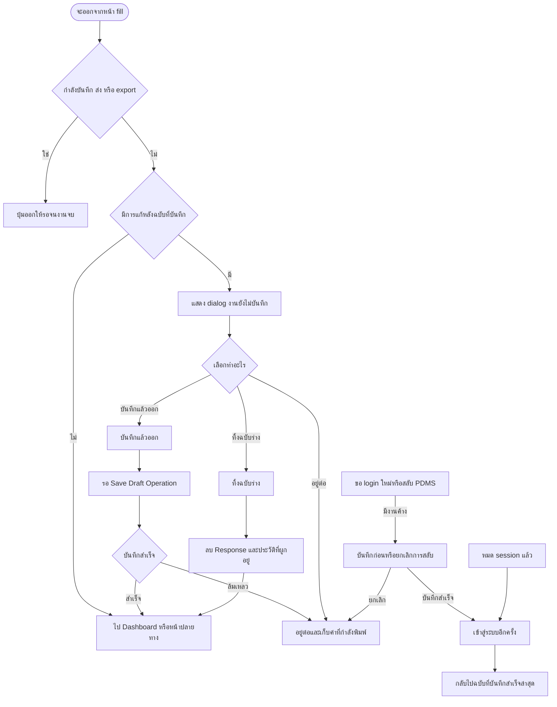

| เหตุการณ์ | พฤติกรรมปัจจุบัน |
| --- | --- |
| กดกลับจาก fill โดยไม่ได้แก้เพิ่ม | ไป Dashboard ได้ |
| มีการแก้แล้วกดออกหรือเปลี่ยนหน้าภายในแอป | มี dialog ให้บันทึกแล้วออก ทิ้งร่าง หรืออยู่ต่อ |
| ดาวน์โหลดจากหน้ากรอก XLSX ขณะที่มีงานค้าง | ผู้กรอกได้ไฟล์จากค่าปัจจุบัน เมื่อกดออก Folio ยังเตือนให้จัดการงานค้าง |
| กดอยู่ต่อ | ปิด dialog และยกเลิก navigation ค่าที่กำลังพิมพ์ยังอยู่ในหน้าปัจจุบัน |
| กดบันทึกแล้วออก | รอ Save Draft สำเร็จจึงออก ถ้าบันทึกล้มเหลวยังไม่ออกตาม flow นี้ |
| กดทิ้งฉบับร่าง | เรียกการลบ Response จริง ไม่ใช่แค่ทิ้งการพิมพ์หลัง Save ครั้งล่าสุด และตามโค้ดจะลบประวัติที่ผูกอยู่ด้วย |
| กด Reload หรือปิดแท็บขณะมี dirty data | ตั้ง beforeunload warning ไว้ แต่ไม่ใช่ flow บันทึกอัตโนมัติที่รับประกันข้อมูลครบ |
| เน็ตหลุดก่อน action ถึง API | ยังไม่มีหลักฐานว่า Folio รับบันทึกไว้ ฉบับที่ไว้ใจได้คือฉบับสำเร็จก่อนหน้า |
| เน็ตหลุดหลัง action ถึง API | งานอาจยังทำต่อฝั่ง server ต้องตรวจผลจริงเมื่อเชื่อมต่อได้ ไม่สรุปจากการที่หน้าต่างเดิมหายไป |
| เหลืออายุ session 5 นาที | แสดงเตือนให้บันทึกและเข้าสู่ระบบใหม่ ไม่ต่อ session อัตโนมัติ |
| ขอเปลี่ยน session ขณะ User มีงานค้าง | dialog ให้บันทึกก่อนหรืออยู่ต่อ ปุ่มทิ้งร่างถูกซ่อนใน dialog กรณี reauth |
| Admin ขอเปลี่ยน session ขณะมีงานค้าง | guard ให้บันทึกการแก้ต้นแบบ metadata หรือรอ Operation ให้จบก่อน |
| session หมดอายุหรือถูก revoke ไปแล้ว | ไม่รับประกันว่าจะ Save ค่าค้างสำเร็จ ต้อง login ใหม่และเปิดจากฉบับที่บันทึกแล้ว |
| editor ขึ้น blocked | อาจมี lease ของ session อื่นหรือสิทธิ์ editor ไม่พร้อม ยังไม่ใช่สถานะว่า Form ถูก Archive |
| editor เปิดใหม่ได้หลัง lease หมด | กลับมาใช้เอกสารที่ API เลือกจากฉบับที่เก็บไว้ ไม่ย้ายการพิมพ์ที่ยังไม่บันทึกจากเครื่องอื่นมาให้เอง |

ปุ่ม logout ของ AppShell จัดการ session และ AI workspace ส่วนหน้า fill มี blocker สำหรับ navigation และ flow บันทึกก่อนเปลี่ยน session ของตนเอง จึงควรกดบันทึกและรอผลก่อนตั้งใจออก ไม่ถือว่าการ logout ทุกกรณีคือ Save Draft

XLSX ยังมีสถานะการตั้งค่าฟิลด์ที่ผลการเขียนไม่แน่ชัด หากระบบยังยืนยันว่า Apply สำเร็จหรือ rollback สำเร็จไม่ได้ จะกัน mutation ต่อ การปิดข้อความ error ไม่ได้ทำให้การตั้งค่านั้นปลอดภัยที่จะ Save หรือ Publish ต่อทันที

อ้างอิง [saveAndExit และ discardDraft](../../apps/web/src/routes/forms/$publicId/fill.tsx#L793), [ตัวเลือก dialog](../../apps/web/src/routes/forms/$publicId/fill.tsx#L970), [navigation blocker](../../apps/web/src/routes/forms/$publicId/fill.tsx#L196), [reauth guard](../../apps/web/src/lib/use-reauthentication-guard.ts#L8) และ [Admin guard](../../apps/web/src/routes/admin/forms/$formId/index.tsx#L181)

## 21 ส่งแล้วแก้ได้แค่ไหน และ Correction กลับมาทำต่อได้ไหม

```mermaid
flowchart TD
    submitted(["มี Submission ที่ส่งแล้ว"])
    actor{"ใครต้องการแก้"}
    user["User เปิดกรอกรอบถัดไป"]
    newDraft["Response กลับ draft"]
    next["ส่งแล้วเพิ่ม Submission ใหม่"]
    gate{"Admin เปิด Correction ได้หรือไม่"}
    block["Response เป็น draft หรือเป้าหมายเก่า จึงถูกกัน"]
    workspace["สร้าง workspace จาก revision ปัจจุบัน"]
    edit["แก้เอกสารใน workspace"]
    preview["Save workspace ยังไม่เผยแพร่ Correction"]
    reason["ระบุเหตุผลแล้ว Save Correction"]
    commit["ตรวจ latest Submission และ base revision"]
    revision["เพิ่ม Correction ที่อ่านย้อนหลังได้"]
    history["Original และ revision ก่อนหน้ายังอยู่"]
    abandon["ยกเลิกหรือปล่อย lease หมด"]
    cleanup["workspace ชั่วคราวอาจถูกเก็บกวาด"]
    submitted --> actor
    actor -->|"User"| user --> newDraft --> next
    actor -->|"Admin"| gate
    gate -->|"ไม่ใช่ submitted ล่าสุด"| block
    gate -->|"ผ่านเงื่อนไข"| workspace --> edit
    edit --> preview --> edit
    edit --> reason --> commit --> revision --> history
    edit --> abandon --> cleanup
```

| ต้องการทำอะไร | ทำได้อย่างไร | ข้อมูลที่เปลี่ยน |
| --- | --- | --- |
| User เปลี่ยนคำตอบหลังส่ง | เปิด fill เพื่อทำรอบถัดไป แล้วส่งอีกครั้ง | ใช้ Response เดิม เพิ่ม Submission ใหม่ ไม่เขียนทับผลที่ส่งครั้งก่อน |
| Admin แก้คำตอบของ User ที่ส่งแล้ว | เปิด Correction ของ Submission ล่าสุด ขณะ Response ยัง submitted | สร้าง Correction ใหม่พร้อมเหตุผล ผู้แก้ เวลา ค่าที่เปลี่ยน และเอกสาร |
| Admin อ่านฉบับก่อนแก้ | เลือก Original หรือ revision ที่ต้องการในประวัติ | เป็นการอ่าน ไม่เขียนทับข้อมูล |
| Admin ต้องการแก้ Correction ที่สำเร็จแล้ว | เริ่มการแก้อีกรอบจาก revision ปัจจุบัน | เพิ่ม revision ใหม่ ไม่แก้ row Correction เก่า |
| Admin ทำ Correction ค้างแล้วออก | งานที่ยังไม่ commit อยู่ใน workspace ที่ผูกกับ lease | ไม่ใช่ Draft ถาวรแบบ User Response การเปิดกลับขึ้นกับ workspace และ lease ที่ยังใช้ได้ |
| Admin กดยกเลิก | กลับไปอ่านผล ไม่เท่ากับ Save Correction | ผลที่เผยแพร่ล่าสุดยังเป็นฉบับก่อนหน้า |
| User เปิดร่างรอบถัดไปขณะ Admin กำลังแก้ | การ commit ต้องตรวจสถานะและ base ใหม่ | ไม่ให้ Correction เก่าเขียนทับรอบใหม่ที่เปลี่ยนสถานะไปแล้ว |

Correction ไม่มี `status` ของตนเองใน Prisma schema การมี workspace หรือการ Save workspace สำเร็จจึงไม่ใช่หลักฐานว่าเกิด Correction revision ที่ผู้ใช้คนอื่นอ่านแล้ว

ในโค้ดปัจจุบันหน้า fill เปิดร่างรอบถัดไปหลัง Submit สำเร็จทันที หากการเปิดนั้นสำเร็จ Response จะเป็น draft และ Admin จะสร้าง Correction บน Submission ก่อนหน้าไม่ได้ แม้ประวัติการส่งยังอยู่ นี่เป็นผลของสอง flow ที่เชื่อมกันจริง ไม่ใช่เพียงการซ่อนปุ่มใน UI

อ้างอิง [Correction editor และ workspace](../../apps/server/src/responses/editor.ts#L57), [Save workspace](../../apps/server/src/operations/response-completion.ts#L327), [Save Correction](../../apps/server/src/operations/response-completion.ts#L421) และ [UI ยกเลิก/บันทึก](../../apps/web/src/routes/admin/results/$responseId/correction.tsx#L72)

## 22 สถานะทั้งหมดและสิ่งที่ไม่ใช่ status ของฟอร์ม

ตารางแถวที่ชื่อจบด้วย `Status` มาจาก enum ของ Prisma โดยตรง สถานะ editor, catalog และตัวแปร boolean เป็นคนละชั้นกับ status ของ Form หรือ Response

| เจ้าของสถานะ | ค่าทั้งหมด | ความหมายและจุดเปลี่ยน |
| --- | --- | --- |
| `FormStatus` | `draft`, `published`, `archived` | วงจรต้นแบบ สร้างเป็น draft, Publish เป็น published, Archive และ Unarchive สลับ published กับ archived |
| `ResponseStatus` | `draft`, `submitting`, `submitted` | งานของผู้กรอก เริ่มเป็น draft, รับส่งเป็น submitting, สำเร็จเป็น submitted, failed หรือเปิดรอบใหม่กลับ draft |
| `OperationStatus` | `pending`, `processing`, `completed`, `failed` | ผลการทำ Save, Publish, Submit หรือ Correction ต้องรอ completed จึงนับว่างานนั้นสำเร็จ |
| `HandoffStatus` | `pending`, `reserved`, `consumed`, `expired`, `deleted` | code ยังไม่ใช้, เปิดจาก browser แล้ว, ผูกและใช้กับ Response แล้ว, หมดอายุ หรือถูกลบ/ล้างข้อมูล |
| `LegacyAccountLinkStatus` | `pending`, `approved`, `rejected`, `linked` | รอตรวจ, Admin อนุมัติแต่ยังไม่ผูก, ปฏิเสธ หรือ SSO รอบใหม่ผูกบัญชีเสร็จ หลักฐานของคำขอที่ยังไม่ผูกเปลี่ยนต้อง review ใหม่ |
| ONLYOFFICE editor UI | `loading`, `ready`, `blocked`, `error` | กำลังเตรียม editor, พร้อม, ถูกกัน หรือมีข้อผิดพลาด ไม่ได้เปลี่ยน FormStatus ให้เอง |
| PDMS catalog UI | `loading`, `ready`, `error` | การโหลดตัวเลือกโครงการของการเปิด editor นั้น ต้อง ready เมื่อ action บังคับใช้ catalog |
| `enabled` ของ User | `true`, `false` | บัญชีเปิดหรือปิดการใช้งาน ไม่ใช่ role และไม่ลบ Response ให้เอง |
| `mustChangePassword` | `true`, `false` | local login ต้องเปลี่ยนรหัสก่อนทำงานตาม guard, SSO มีข้อยกเว้นตาม session |
| `role` ของ User | `admin`, `viewer`, `user` | สิทธิ์ของบัญชี ไม่ใช่สถานะร่างหรือผลการส่ง |
| dirty ของหน้า editor | `true`, `false` | มีการแก้ที่ยังไม่ยืนยันว่าบันทึกแล้วหรือไม่ dirty ไม่ได้เป็นคอลัมน์ status ของ Response |
| Folio session | ใช้ได้, หมดอายุ, ถูก revoke | สรุปจาก session record และเวลาหมดอายุ ไม่ใช่ enum ข้างต้น หมด session ไม่ได้ลบร่างที่บันทึกแล้ว |
| TemplateDraft | ไม่มี status แยก | ใช้ FormStatus กำกับการแก้และเผยแพร่ |
| Submission | ไม่มี status ร่างแยก | การมี row คือผลที่ส่งและ commit แล้ว อ่านย้อนหลังได้จนมีการลบ Response |
| Correction | ไม่มี status แยก | revision ที่ commit แล้ว ส่วน workspace อยู่ภายใต้ editor lease |

```mermaid
stateDiagram-v2
    direction TB
    state "pending: รอเปิด code" as pending
    state "reserved: browser เปิดแล้ว" as reserved
    state "consumed: ใช้กับ Response แล้ว" as consumed
    state "expired: หมดอายุ" as expired
    state "deleted: ล้างข้อมูลแล้ว" as deleted
    [*] --> pending: สร้าง Handoff
    pending --> reserved: top-level POST
    reserved --> consumed: redeem หรือรับ receipt
    pending --> expired: code หมดอายุ
    reserved --> expired: Handoff หมดอายุ
    pending --> deleted: ลบข้อมูลที่เกี่ยวข้อง
    reserved --> deleted: ลบข้อมูลที่เกี่ยวข้อง
    consumed --> deleted: ลบข้อมูลที่เกี่ยวข้อง
```

ตัวอย่างที่มักสับสนคือ Form `published` + Response `draft` + Save Operation `completed` สามค่านี้เกิดพร้อมกันได้ แปลว่าฟอร์มเปิดใช้งานอยู่ ผู้ใช้บันทึกคำตอบไว้แล้ว แต่คำตอบรอบนี้ยังไม่ส่ง

อีกตัวอย่างคือ Form `published` + Response `draft` + Submit Operation เก่า `completed` + มี Submission ครั้งก่อน หมายถึงเคยส่งสำเร็จแล้วและเปิดร่างรอบใหม่ ไม่ใช่ต้องเปลี่ยน Form กลับเป็น draft เพื่อกรอกใหม่

`rejected` ของคำขอเชื่อมบัญชีเป็นเรื่องสิทธิ์ SSO ไม่ใช่สถานะปฏิเสธ Submission ระบบนี้ไม่มีขั้นตอนอนุมัติหรือปฏิเสธคำตอบก่อนนับว่า submitted ตาม lifecycle ปัจจุบัน

อ้างอิง [status enums](../../packages/db/prisma/schema.prisma#L16), [editor และ catalog states](../../apps/web/src/features/onlyoffice/editor-protocol.ts#L24), [หมดอายุ Handoff](../../apps/server/src/prefill/expiry.ts#L5) และ [การใช้ Handoff](../../apps/server/src/prefill/redemption.ts#L49)

## 23 ตัวอย่างใช้งานจริงตั้งแต่วันสร้างจนกลับมากรอกต่อ

```mermaid
flowchart TD
    create(["Admin สร้าง Form"])
    template["Form draft ออกแบบต้นแบบ"]
    templateSaved["Save Template completed"]
    returnAdmin["ปิดแล้วเปิด Form เดิมมาแก้ต่อ"]
    publish["Publish completed: Form published"]
    share["แชร์ลิงก์ให้ User"]
    first["User login และเริ่ม Response draft"]
    save["กรอกบางส่วนแล้ว Save Draft completed"]
    leave["ออกจากระบบหรือปิด browser"]
    tomorrow["วันถัดไป login บัญชีเดิม"]
    resume["Dashboard กรอกต่อจากร่างเดิม"]
    submit["Submit: submitting"]
    success["completed เพิ่ม Submission ครั้งแรก"]
    reopen["หน้า fill เปิด Response draft รอบใหม่"]
    next["บันทึกหรือส่งรอบถัดไป"]
    past["อ่าน Submission แต่ละครั้งแยกได้"]
    create --> template --> templateSaved --> returnAdmin
    returnAdmin -->|"ต้นแบบพร้อม"| publish --> share --> first
    first --> save --> leave --> tomorrow --> resume --> submit --> success
    success --> reopen --> next
    success --> past
    next -->|"ส่งสำเร็จอีกครั้ง"| past
```

| คำถามระหว่างใช้งาน | คำตอบตาม flow ปัจจุบัน |
| --- | --- |
| วันนี้ออกแบบฟอร์มยังไม่เสร็จ พรุ่งนี้มาทำต่อได้ไหม | ได้ Save Template แล้วรอ completed กลับไปเปิด Form เดิมที่ยัง draft |
| กรอกคำตอบไม่ครบ required จะพักไว้ก่อนได้ไหม | ใช้ Save Draft ได้ โดยยังต้องผ่านการตรวจชนิดข้อมูลและข้อจำกัดที่ใช้กับการบันทึกร่าง ส่วนการส่งตรวจ required เพิ่ม |
| เก็บร่างแล้ว logout ข้อมูลหายไหม | logout ไม่ลบ Draft ที่บันทึกสำเร็จ กลับด้วยบัญชีเดิมเพื่อเปิดต่อ |
| เปิดลิงก์เดิมจะสร้าง Response ซ้ำไหม | ไม่เกินหนึ่ง Response ต่อ Form ต่อบัญชี ถ้ายังมีร่างที่ใช้ได้จะเปิดต่อร่างนั้น |
| เปลี่ยนไปอีกบัญชีแล้วจะได้ร่างเดิมไหม | ไม่ใช่ร่างเดียวกัน ร่างผูกเจ้าของบัญชี Folio SSO ที่ผูกกับ Folio account เดียวกันจึงเป็นเจ้าของเดิม |
| บันทึกค่า 100 แล้วแก้เป็น 200 จากนั้นดาวน์โหลดบนหน้า Excel จะได้ค่าไหน | ไฟล์ Excel และ PDF ได้ 200 ส่วนร่างใน Folio ใช้ 100 จนกดบันทึกฉบับร่างอีกครั้ง |
| ดาวน์โหลด DOCX หรือ XLSX ไปแก้ข้างนอกแล้วจะ sync กลับเองไหม | ไม่มี flow sync คำตอบจากไฟล์ภายนอกอัตโนมัติใน API นี้ กลับมาแก้ผ่านหน้า fill |
| Publish แล้ว User กรอกอยู่ Admin เปลี่ยนแบบเดิมได้ไหม | เปลี่ยนโครงสร้างเดิมไม่ได้ ใช้ Duplicate เป็น Form และ share link ใหม่ |
| เปลี่ยนชื่อ Form แล้วผู้กรอกใช้ลิงก์เดิมได้ไหม | ได้ metadata ไม่สร้าง publicId ใหม่ ส่วน Duplicate สร้างลิงก์ใหม่ |
| เปลี่ยน Fill Method ระหว่างมีร่างอยู่เกิดอะไร | ใช้กับร่างเดิมด้วย API ตรวจวิธีกรอกปัจจุบันและกัน action ที่ถือวิธีหรือ document เก่า ต้องเปิด configuration ปัจจุบัน |
| เปิดหน้ากรอกพร้อมกันอีกเครื่องได้ไหม | คนละ session มี editor lease กันไว้ หากกลับมาได้ภายหลังยังต้องใช้ document ปัจจุบัน |
| ส่งแล้วทำไม Dashboard หรือ Results เห็นเป็นร่าง | หน้า fill เปิดรอบใหม่อัตโนมัติ ตรวจประวัติการส่งแยกจากสถานะรอบปัจจุบัน |
| อยากเก็บ Submission เก่า แต่ไม่ทำรอบใหม่แล้ว | การมีร่างใหม่ไม่ได้ลบประวัติ แต่ปุ่มทิ้งร่างปัจจุบันเรียกการลบทั้ง Response จึงมีผลต่อประวัติด้วยตามภาพ 10 |
| Admin จะตรวจคำตอบที่ส่งไปเมื่อเดือนก่อนได้ไหม | อ่านผ่าน Submission ของเดือนนั้นและ revision ของมันได้ แม้ Response ปัจจุบันเป็นร่างอีกรอบ |
| Save failed แล้วต้องกรอกใหม่หมดไหม | ค่าที่อยู่ในหน้าต่างอาจยังแก้และ retry ได้ ส่วนฉบับที่กลับมาเปิดใหม่อ้างการบันทึกสำเร็จครั้งล่าสุด ไม่รับประกันค่าที่ไม่เคย commit |
| ส่งสำเร็จแต่ PDF ไม่ออก ถือว่าส่งแล้วไหม | ถือว่าส่งแล้วเมื่อ Submit Operation completed และมี Submission การแปลง PDF เป็นอีกงานหนึ่ง |
| Archive แล้วผู้มีร่างเดิมกลับมาได้ไหม | ผู้ที่มี Response เดิมมีเส้นทางเปิดต่อได้ ไม่ใช่การปิดและลบงานของทุกคน |
| ปิดบัญชี User แล้วร่างกับประวัติถูกลบไหม | ไม่ถูกลบเพราะ enabled เปลี่ยนอย่างเดียว ต้องใช้ flow ลบ Response แยก |
| ลบบัญชีเลยได้ไหม | ต้องลบ Responses และรอ cleanup ให้หมดก่อน และห้ามเอา enabled Admin คนสุดท้ายออก |
| AI สร้างฟอร์มเสร็จถือว่า User เปิดกรอกได้แล้วไหม | ยัง ต้องนำ DOCX ไปสร้าง Form ตรวจต้นแบบและ Publish ผ่าน flow เดิม |
| Prefill เติมข้อมูลใหม่ให้ทุกครั้งที่กลับเข้ามาไหม | Resume ใช้ snapshot เดิม ไม่ refresh ค่าจากต้นทางใหม่ทับร่างอัตโนมัติ |

ตัวอย่างนี้แยกการเปลี่ยนสถานะของ Form, Response และ Operation ไว้ตามลำดับ ส่วนเรื่องสิทธิ์ SSO, Excel, Prefill และ AI ใช้ผังรายละเอียด 03 ถึง 12 ประกอบในขั้นตอนที่เกี่ยวข้อง

อ้างอิง [start/resume/reopen](../../apps/server/src/routes/public-forms.ts#L130), [Save/Submit guards](../../apps/server/src/routes/response-actions.ts#L62), [Draft completion](../../apps/server/src/operations/response-completion.ts#L25), [Dashboard](../../apps/web/src/routes/dashboard.tsx#L76) และผัง 03 ถึง 15 ที่อ้าง source ของแต่ละ feature ไว้แล้ว

## ถ้าต้องเปลี่ยนหน้า กฎ หรือการบันทึก ให้เริ่มที่ไหน

ตารางนี้แยกจุดเปลี่ยน UI ออกจากเจ้าของกฎและการบันทึก เพื่อไม่ให้แก้เฉพาะปุ่มแล้วขัดกับ API

| สิ่งที่ต้องเปลี่ยน | จุด UI | จุดกฎ API หรือข้อมูล |
| --- | --- | --- |
| Login, session, role redirect | `routes/login.tsx`, `routes/__root.tsx`, `lib/auth.tsx`, `lib/api.ts` | `packages/auth/src/index.ts`, `auth/identity.ts`, `auth/password-session.ts`, `routes/auth.ts` |
| PDMS SSO, role mapping, account switching | `routes/legacy-sso.confirm.tsx`, `components/legacy-sso-switch-button.tsx` | `legacy-sso/config.ts`, `accounts.ts`, `browser.ts`, `finalize.ts`, `routes/legacy-sso.ts` |
| รายการฟอร์ม ค้นหา และ metadata | `features/admin-forms/`, `routes/admin/forms/$formId/index.tsx` | `forms/catalog.ts`, `routes/form-catalog.ts` |
| สร้างและออกแบบ DOCX | `routes/admin/forms/new.tsx`, หน้า editor, plugin `field-panel.js` | `routes/form-authoring.ts`, `forms/field-rules.ts`, `documents/fields.ts` |
| Excel field/table mapping | plugin `spreadsheet.js`, `spreadsheet-selection.js`, `spreadsheet-commands.js` | `forms/excel-binding.ts`, `forms/spreadsheet-fields.ts`, `routes/spreadsheet-authoring.ts` |
| แก้ validation, สูตร, protection หรือภาพ Excel | plugin spreadsheet modules | `documents/spreadsheets/` และ `operations/spreadsheet-document.ts` |
| PDMS project picker | `features/onlyoffice/pdms-popup-relay.ts`, plugin `pdms-project-picker.js` และ `pdms-popup.js` | `pdms/projects.ts`, `catalog.ts`, `selection.ts`, `routes/pdms-project-catalog.ts` |
| หน้า User กรอก Native หรือ ONLYOFFICE | `routes/forms/$publicId/fill.tsx`, `components/native-form.tsx`, `features/forms/native-response.ts` | `routes/public-forms.ts`, `routes/response-actions.ts`, `responses/editor.ts`, `responses/data.ts` |
| ดาวน์โหลดจากหน้ากรอก Excel | หน้า fill, `components/onlyoffice-editor.tsx`, plugin `bridge.js` | `POST /api/responses/:id/editor-export/:format`, ตัวแปลง PDF และสำเนาชั่วคราว XLSX |
| การบันทึกจริงและ callback | plugin `operations.js`, `bridge.js`, web `components/onlyoffice-editor.tsx` | `operations/create.ts`, `force-save.ts`, `callback.ts`, `template-completion.ts`, `response-completion.ts` |
| Dashboard และ discard ร่าง | `routes/dashboard.tsx`, หน้า fill | `routes/responses.ts`, `responses/deletion.ts` ต้องพิจารณาประวัติ Submission ที่อยู่ใต้ Response ด้วย |
| Results, filters และ Correction | `routes/admin/results/`, `components/submission-result-viewer.tsx` | `routes/results.ts`, `responses/query.ts`, `responses/result-filters.ts`, `packages/results-filters/`, `responses/editor.ts` |
| Receipt, export และประวัติรายฟอร์ม | `routes/receipt/$submissionId.tsx`, `routes/admin/forms/$formId/submissions/` | `routes/submissions.ts`, `routes/form-authoring.ts`, `responses/query.ts`, `onlyoffice.ts` |
| Users และ pending account links | `routes/admin/users.tsx`, `features/admin-users/` | `routes/accounts.ts`, `accounts/mutations.ts`, `accounts/review.ts` |
| Audit | `routes/admin/audit.tsx` | `routes/audit.ts`, `audit/events.ts`, `audit/query.ts` |
| AI Authoring | `routes/admin/ai-authoring.tsx`, `features/ai-authoring/` | `routes/ai-authoring.ts`, `ai-authoring.ts`, `ai-authoring/`, `document-worker.ts`, `document-worker-server.ts` |
| Prefill handoff | `routes/handoff.tsx`, หน้า fill | `routes/prefill.ts`, `prefill/` |
| Pagination | `components/list-pagination.tsx`, `lib/pagination.ts`, state ของแต่ละหน้า | `http/pagination.ts`, query ของแต่ละ list route |
| Models, relations และ constraints | types ที่ derive จาก API | `packages/db/prisma/schema.prisma` และ migration ใหม่ |
| Deployment และ routing | `apps/web/Dockerfile` และ SWS configs | `compose.yaml`, `gateway/pingap.toml`, `apps/server/Dockerfile`, `packages/env/src/server.ts` |

ไฟล์ในคอลัมน์ UI ที่ไม่ขึ้นต้น `apps/` อยู่ใต้ `apps/web/src/` ส่วนคอลัมน์ API อยู่ใต้ `apps/server/src/` ยกเว้นที่ระบุ `packages/`, `compose.yaml` หรือ `gateway/` ไว้ชัดเจน ไฟล์ plugin อยู่ใต้ `apps/onlyoffice-plugin/src/`

การเปลี่ยน UI มักต้องดูสี่ชั้นตามเส้นทางจริง คือหน้าเว็บ, HTTP contract และสิทธิ์, domain handler กับ transaction, แล้วจึง schema หรือไฟล์เอกสารที่เกี่ยวข้อง ไม่มีการแก้ source ในงานสำรวจนี้

## รายการ API ตามกลุ่ม

| กลุ่ม | เจ้าของ route และความเชื่อมโยง |
| --- | --- |
| Auth | `routes/auth.ts`: sign-in, session, password, sign-out และ Better Auth wildcard |
| PDMS SSO | `routes/legacy-sso.ts`: availability, start, callback, switch review, confirm, cancel และ claim session |
| Accounts | `routes/accounts.ts`: users CRUD, role/status/email, password reset และ review account links |
| Form catalog | `routes/form-catalog.ts`: list, create, detail, metadata/archive/fill method, duplicate, delete และ template export |
| Form authoring | `routes/form-authoring.ts`: editor-config, external schema search, DOCX rules, save, publish และ per-form submissions |
| Spreadsheet authoring | `routes/spreadsheet-authoring.ts`: get/patch/recover bindings |
| Form fill | `routes/public-forms.ts`: published metadata, start/resume/reopen, editor-config และประวัติการส่งของเจ้าของ |
| Response actions | `routes/response-actions.ts`: save Draft และ Submit ทั้ง native กับ ONLYOFFICE |
| Response read/delete | `routes/responses.ts`: my responses, current correction history, saved Draft export, owner discard และ Admin erase |
| Excel Fill Download | `POST /api/responses/:id/editor-export/:format`: เจ้าของ Response ใช้ editor lease ปัจจุบันดาวน์โหลดสำเนา XLSX หรือแปลงเป็น PDF |
| Results/correction | `routes/results.ts`: list, detail, viewer-config, correction editor, final correction และ workspace save |
| Submission | `routes/submissions.ts`: data/fields, correction history, JSON, DOCX หรือ XLSX และ PDF ตาม revision |
| Operation/lease | `routes/operations.ts`, `routes/editor-leases.ts`: poll, renew และ release |
| PDMS catalog | `routes/pdms-project-catalog.ts`: retry catalog ภายใต้ editor scope |
| Prefill | `routes/prefill.ts`: create handoff, integration status, top-level launch และ GET ที่ปฏิเสธวิธีเปิดผิด |
| AI | `routes/ai-authoring.ts`: availability, create/current/revise/download/end workspace |
| Audit | `routes/audit.ts`: filtered paginated events |
| ONLYOFFICE | `routes/onlyoffice.ts`: signed document access, editor plugin assets และ authenticated callback |
| Health | `app.ts`: `/health` และ `/ready` |
| AI worker ภายใน | `document-worker-server.ts`: `GET /health` และ `POST /run` บน private listener |

ดู method, path และบรรทัด source ครบทุกรายการใน [inventory.md](inventory.md#api-endpoints)

## ขอบเขตการตรวจ

ใช้ CodeGraph ไล่ entrypoints, caller และ module ที่รับผิดชอบ แล้วอ่านส่วน source ที่ถูกตัดออกเฉพาะจุดที่มีผลต่อ flow รายการ routes และ models สร้างซ้ำด้วยสคริปต์ ไม่อ้างจำนวนจาก README

ทดสอบเฉพาะการดาวน์โหลดจากหน้ากรอก XLSX บันทึก Draft และส่งคำตอบด้วยเบราว์เซอร์และ ONLYOFFICE 9.4 ในเครื่อง ใช้ฟอร์มและฐานข้อมูลทดสอบแยก การตรวจในระบบจริงครอบคลุมค่าที่พิมพ์ค้าง การแปลง PDF และการอ่าน Draft กลับหลังดาวน์โหลด ส่วน flow อื่นในคู่มืออิงการอ่าน source รวมการเชื่อมต่อ PDMS, OmniRoute และ deployment
