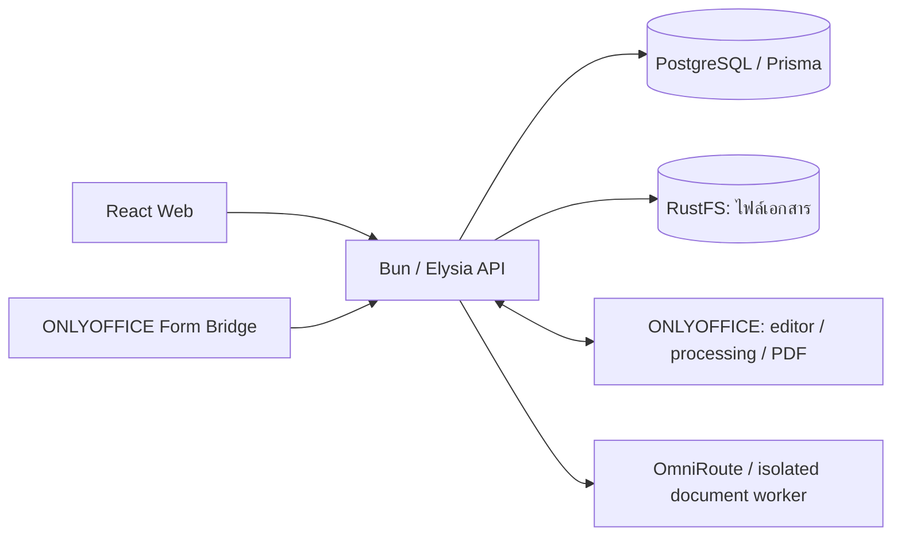
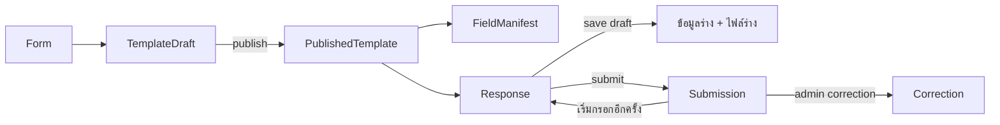

# Folio Forms: สถาปัตยกรรมและตำแหน่งเก็บข้อมูล

ปรับตาม implementation และผลตรวจวันที่ 15 ตุลาคม 2026 อ่านคู่กับ [คู่มือวางไฟล์](STRUCTURE.th.md) และ [คำศัพท์ของระบบ](../CONTEXT.md)

## ภาพรวม

Folio Forms ใช้ API หลักตัวเดียว แบ่งโค้ดตามหน้าที่ของระบบ Web และปลั๊กอิน ONLYOFFICE เรียก lifecycle เดียวกันสำหรับสร้างต้นแบบ เผยแพร่ บันทึกร่าง ส่งคำตอบ และแก้ไขผลย้อนหลัง PostgreSQL เก็บข้อมูลและตัวอ้างอิงไฟล์ ส่วน RustFS เก็บไฟล์ DOCX/XLSX จริง

[compose.yaml](../compose.yaml) และ [gateway/pingap.toml](../gateway/pingap.toml) กำหนดเส้นทาง Web, assets, API และ ONLYOFFICE ส่วน HTTPS อยู่ที่ ingress ภายนอก API ประกอบ routes ใน [app.ts](../apps/server/src/app.ts) และเริ่มงาน recovery ใน [index.ts](../apps/server/src/index.ts)

## วงจรข้อมูลตามระบบเดิม

- หนึ่ง User มีหนึ่ง Response ต่อ Form แต่ส่งได้หลายครั้ง แต่ละครั้งสร้าง Submission ใหม่
- Template Draft และร่างคำตอบแก้ทับได้ ส่วน Published Template, Submission และ Correction เป็นประวัติที่ไม่แก้ทับ
- เปลี่ยนโครงสร้างแบบฟอร์มที่เผยแพร่แล้วด้วยการ Duplicate เป็น Form ใหม่
- การบันทึกสำเร็จต้องมีทั้งข้อมูลที่สกัดแล้วและไฟล์ที่บันทึกสำเร็จ การพิมพ์ใน editor หรือ HTTP 202 ยังไม่ใช่ผลสำเร็จ
- PDF สร้างจากเอกสารที่บันทึกไว้เมื่อขอดาวน์โหลด การแปลง PDF ล้มเหลวไม่ลบ Submission

สำหรับ XLSX ที่แก้ไขได้ Web รับ `onDocumentStateChange: true` เพื่อระบุว่ามีการเปลี่ยนแปลงและเตือนก่อนออกจากหน้า ค่า `false` หมายถึง ONLYOFFICE รับการเปลี่ยนแปลงไว้ในบริการ editor แล้ว จึงไม่ล้างสถานะร่างของ Folio ต้องรอผลบันทึกผ่าน lifecycle ของ Folio ตามเดิม DOCX ยังคงใช้การแจ้งสถานะจากปลั๊กอินเดิม

## ข้อมูลแต่ละอย่างควรอยู่ที่ไหน

ชื่อตารางและคอลัมน์จริงดูที่ [schema.prisma](../packages/db/prisma/schema.prisma)

| ข้อมูล | เจ้าของข้อมูล | เหตุผล |
| --- | --- | --- |
| ชื่อ คำอธิบาย ลิงก์ สถานะ วิธีกรอก ชนิดเอกสาร | `Form` / `forms` | เป็นคุณสมบัติของแบบฟอร์มทั้งหมด |
| ต้นแบบที่ Admin กำลังแก้ | `TemplateDraft` / `template_drafts` | มีไฟล์และ editor identity ของต้นแบบแยกจากผลกรอก |
| กฎและการตั้งค่าฟิลด์ก่อนเผยแพร่ | `DraftFieldRule` / `draft_field_rules` | DOCX ใช้กฎตาม Tag เดิม; XLSX ใช้แถวเดียวกันเก็บชื่อ ชนิด ตัวเลือก กฎ และ binding |
| เอกสารต้นแบบฉบับเผยแพร่ | `PublishedTemplate` / `published_templates` | เป็นฉบับที่ Response อ้างถึงและเปลี่ยนทับไม่ได้ |
| สัญญาช่องกรอกที่เผยแพร่แล้ว | `FieldManifest`, `ManifestField` | ใช้แสดงผล ตรวจข้อมูล และรองรับ Prefill ร่วมกับ DOCX |
| ตำแหน่งที่ฟิลด์ XLSX อ้างถึง | `DraftFieldRule.binding` หรือ `ManifestField.binding` | เก็บเฉพาะ identity, named anchor, offset และ computed ตามชนิดแถว ไม่คัดลอกชื่อหรือกฎลง JSON อีก |
| mapping ข้อมูลภายนอก | `PrefillConfiguration`, `PrefillField` | บอกว่าค่า JSON Pointer ใดใช้กับช่องใด |
| ค่า Prefill และช่องที่ล็อกของผู้กรอกแต่ละราย | `PrefillSnapshot` | ตรึงค่าเมื่อเริ่มกรอก ไม่ดึงใหม่ทุกครั้งที่ resume |
| คำตอบที่บันทึกเป็นร่าง | `Response.draftData` และ `draftObjectKey` | ยังแก้ไขได้และยังไม่ใช่การส่งคำตอบ |
| คำตอบที่ส่งแล้วแต่ละครั้ง | `Submission.data` และ `objectKey` | เก็บประวัติผลกรอกแบบ immutable |
| ฉบับที่ Admin แก้ผลกรอก | `Correction.data`, `changedData`, `objectKey`, `reason` | เก็บ revision ใหม่โดยยังอ่าน Submission เดิมได้ |
| ไฟล์ DOCX/XLSX จริง | RustFS ตาม `objectKey` | ไม่เก็บ binary เอกสารซ้ำใน JSON หรือฐานข้อมูล |

### ทำไมยังแยก template_drafts

`template_drafts` มีอยู่ในระบบ DOCX เดิม ไม่ใช่ตารางที่เพิ่มขึ้นเพื่อ Excel โดยเฉพาะ `id` ของมันเป็นเป้าหมายของ Editor Lease และ capability ส่วน `documentKey` ใช้ตรวจรุ่นเอกสารระหว่าง save/publish

| คอลัมน์ | หน้าที่ |
| --- | --- |
| `formId` | ระบุว่าเป็นต้นแบบของ Form ใด โดยหนึ่ง Form มีได้หนึ่ง Template Draft |
| `objectKey` | ตำแหน่งไฟล์ต้นแบบที่บันทึกแล้วใน RustFS |
| `documentKey` | identity ของเอกสารที่ ONLYOFFICE เปิด และเงื่อนไขตรวจคำขอเก่า |
| `contentHash` | ลายนิ้วมือของเนื้อไฟล์ ใช้คนละหน้าที่กับตำแหน่งไฟล์ |
| `fieldRules` | relation ไปยังแถว `DraftFieldRule` ที่ใช้ร่วมกัน ไม่ใช่ JSON การตั้งค่าอีกชุด |
| `bindingRevision` | ลำดับการแก้การตั้งค่า ใช้ป้องกันการเขียนทับจากคำขอเก่า |

การรวมกับ Form จะกระทบ identity และความสัมพันธ์ของระบบแก้ไข DOCX เดิม ส่วนการรวมกับ Submission จะปนต้นแบบที่ยังไม่มีเจ้าของคำตอบเข้ากับผลกรอกที่ต้องมี Response และ User จึงรักษาตารางเดิมไว้

### รวมข้อมูลที่เซฟกับ submissions ได้แค่ไหน

คำตอบ XLSX ที่ส่งแล้วใช้ `submissions.data` และไฟล์ตาม `submissions.object_key` อยู่แล้ว ไม่มีตารางคำตอบ Excel อีกชุดหนึ่ง แต่ Save Draft ยังเก็บใน `responses` เพราะผู้ใช้ยังแก้ได้และอาจไม่ส่งเลย การนำร่างทุกครั้งไปเป็น Submission จะเปลี่ยนความหมายของประวัติ ใบรับคำตอบ และการส่งซ้ำของ DOCX

ตารางรายการใน Excel เป็นส่วนของ JSON คำตอบตาม key ที่ผู้สร้างตั้ง เช่น `data.items = [{ description: "รายการ A", quantity: 2 }]` ส่วนชื่อ key, label และชนิดคอลัมน์อยู่ในแถว `DraftFieldRule` ก่อนเผยแพร่ และ `ManifestField` หลังเผยแพร่ ไม่ต้องเพิ่ม SQL table สำหรับแต่ละแบบฟอร์ม

### เปรียบเทียบ DOCX และ Excel ในแต่ละขั้นตอน

| ขั้นตอน/ข้อมูล | DOCX เดิม | Excel หลังปรับ |
| --- | --- | --- |
| ไฟล์ต้นแบบที่กำลังออกแบบ | `TemplateDraft.objectKey` → DOCX ใน RustFS | `TemplateDraft.objectKey` → XLSX ใน RustFS |
| ชื่อ ชนิด ตัวเลือก และตำแหน่งในต้นแบบ | อยู่ใน content controls ของไฟล์ DOCX ตามเดิม | `DraftFieldRule.tag/label/type/options/position` และ `binding` |
| Required และ Prefill ตอนออกแบบ | `DraftFieldRule.required/prefillPointer/prefillPolicy` | คอลัมน์เดียวกัน |
| ชื่อ ชนิด ตัวเลือก และกฎหลังเผยแพร่ | `ManifestField` | `ManifestField` เดียวกัน รวมแถวตารางและคอลัมน์ |
| ตัวชี้ Prefill หลังเผยแพร่ | `PrefillField` ใน `PrefillConfiguration` | ตารางเดียวกัน รองรับ scalar fields ตามขอบเขตเดิม |
| ค่า Prefill ของผู้กรอกแต่ละราย | `PrefillSnapshot` | ตารางเดียวกัน |
| คำตอบร่าง | `Response.draftData` | คอลัมน์เดียวกัน |
| คำตอบที่ส่งแล้ว | `Submission.data` | คอลัมน์เดียวกัน |
| คำตอบที่ Admin แก้ | `Correction.data/changedData` | คอลัมน์เดียวกัน |

ไม่ได้ย้ายชื่อใน content control ของ DOCX ออกมาเป็นข้อมูลต้นแบบอีกชุด: คอลัมน์ใหม่ที่เพิ่มใน `DraftFieldRule` เป็น nullable และ DOCX ใช้พฤติกรรมเดิม เมื่อเผยแพร่ DOCX ระบบยังอ่าน metadata จากเอกสารมาสร้าง `ManifestField` ตามเดิม

### ตัวอย่างฟิลด์และตำแหน่ง Excel

แถวต่อไปนี้อยู่ใน `DraftFieldRule` ตอนออกแบบ และถูกตรึงเป็น `ManifestField` เมื่อเผยแพร่:

| `tag` | `label` | `type` | `binding` |
| --- | --- | --- | --- |
| `name` | ชื่อผู้กรอก | `text` | `{"id":"folio_name","anchor":"folio_name","computed":false}` |
| `items` | รายการ | `table` | `{"id":"folio_items","anchor":"folio_items"}` |
| `items.quantity` | จำนวน | `number` | `{"id":"folio_quantity","offset":1,"computed":false}` |

- `id` เป็น identity ที่ปลั๊กอินใช้ติดตามฟิลด์ ไม่ใช่ UUID ของแถวฐานข้อมูล
- `anchor` เป็นชื่อ named range ในไฟล์ เช่น `folio_name` อาจชี้ไป `Sheet1!B4` ระบบอ่านตำแหน่งจริงจาก workbook ที่เชื่อถือได้ ไม่เก็บพิกัดซ้ำใน DB
- แถวตารางใช้ `anchor` ของช่วง body; คอลัมน์ใช้ `offset` นับจากศูนย์ ดังนั้น `offset: 1` คือคอลัมน์ที่สองของตาราง
- `computed` บอกว่าเป็นช่องสูตรตามสัญญาเดิม ไม่ได้เพิ่มความสามารถสร้างช่องสูตรใหม่ในแผงตั้งค่า
- ชื่อคอลัมน์ใช้ `tag` แบบ `tableKey.columnKey`; key ที่ผู้สร้างตั้งห้ามมีจุดอยู่แล้ว จึงแยก `quantity` ของฟิลด์หลักกับ `items.quantity` ได้โดยไม่ชนกัน

โครงสร้างทั้งหมดนี้มีนิยามกลางชื่อ `ExcelBinding` ใน [forms/excel-binding.ts](../apps/server/src/forms/excel-binding.ts) ใช้ทั้ง `DraftFieldRule.binding` และ `ManifestField.binding`:

| ชนิดข้อมูลในโค้ด | สมาชิกของ JSON | ตัวตรวจใน `excelBindingSchemas` |
| --- | --- | --- |
| `ExcelScalarBinding` | `id`, `anchor`, `computed` | `scalar` |
| `ExcelTableBinding` | `id`, `anchor` | `table` |
| `ExcelColumnBinding` | `id`, `offset`, `computed` | `column` |

`ExcelBinding` รวมสามชนิดนี้ และ `excelBindingSchema` ตรวจ JSON ก่อนเขียนแถวฟิลด์ เมื่ออ่านกลับจะเลือก schema ของชนิดแถวที่คาดหวัง เพื่อปฏิเสธ property ที่ปนจากชนิดอื่นหรือชื่อ/กฎที่คัดลอกเข้ามา กลุ่มนี้เป็นชนิดข้อมูลในโค้ด ไม่ใช่ Prisma model ใหม่ ฐานข้อมูลยังเป็น `binding Json?` คอลัมน์เดิม รูป JSON และข้อมูลที่มีอยู่เดิมอ่านได้เหมือนเดิม จึงไม่ต้องเพิ่ม migration

Required, ตัวเลือก dropdown และ Prefill ใช้คอลัมน์ร่วม ไม่อยู่ใน `binding` ตัวเลือกใช้รูป `{displayText, value}` แบบ DOCX; Boolean ใช้ `FieldType.checkbox` และเพิ่มชนิด `number`/`table` เพื่อไม่สูญเสียความหมายของ Excel โดยไม่เปลี่ยนชนิด content controls ของ DOCX

คำตอบของตัวอย่างนี้เป็น `{"name":"สมชาย","items":[{"quantity":2}]}` ใน `draftData` หรือ `data` ตามขั้นตอน ใช้ key เชื่อมกับนิยามฟิลด์ แต่ไม่คัดลอก label ชนิด หรือกฎลงในคำตอบ ส่วน DOCX มี `binding = null`

### DocumentKind อยู่ตรงไหน

`DocumentKind` เป็น enum `docx | xlsx` และมีคอลัมน์ `forms.document_kind` เพียงตำแหน่งเดียว ไม่ใช่ตารางใหม่ Responses/Submissions รู้ชนิดเอกสารผ่าน Form เดิม ชนิดเอกสารเปลี่ยนไม่ได้หลังสร้าง และ XLSX ใช้ ONLYOFFICE ตาม constraint เดิมของส่วน Excel

ค่านี้เพียงพอสำหรับเลือกวิธีประมวลผลเอกสาร ไม่ต้องเพิ่มชนิดเอกสารซ้ำในแต่ละแถว แต่ไม่ได้บอกว่าแต่ละฟิลด์อยู่เซลล์ไหน จึงยังต้องมี `binding` ขนาดเล็กในแถวฟิลด์นั้น

## ส่วน spreadsheet ที่เก็บไว้และส่วนที่ตัดออก

| ส่วน | การตัดสินใจหลังปรับปรุง |
| --- | --- |
| `TemplateDraft.spreadsheetBindings` | เอาออก ย้ายข้อมูลไป `DraftFieldRule` |
| `TemplateDraft.bindingRevision` | เก็บไว้ ตรวจ revision ทั้งตอนแก้ field และตอน callback ของ save/publish |
| `FieldManifest.spreadsheetContract` | เอาออก ย้ายข้อมูลไป `ManifestField` และใช้ `PrefillField` เดิม |
| `Response/Submission/Correction.spreadsheetState` | เอาออกทั้งสามคอลัมน์ เพราะ mapping ซ้ำกับ manifest และตำแหน่งอยู่ใน named ranges ของไฟล์ |
| `Response.spreadsheetInitialized` | Boolean เดียว ระบุว่าเตรียม Prefill และ protection แล้ว ป้องกันการเติมค่าทับเมื่อเปิดร่างอีกครั้ง |
| `DraftFieldRule` ของ XLSX | ใช้จริงทั้งการแก้ฟิลด์และ Duplicate โดยไม่มี blob สำรองคู่กัน |
| contract ใน Operation | ไม่เก็บสำเนาทั้ง publish และ save/submit/correction; publish อ่าน draft rows ภายใต้ transaction และ revision guard |

`bindingRevision` ต่างจาก `Form.version`: ตัวแรกเปลี่ยนตามการแก้ mapping ส่วนตัวหลังระบุฉบับเผยแพร่ ตัวเลข revision ใน request และ Operation เป็นค่าที่คาดหวังเพื่อเปรียบเทียบกับ Template Draft ไม่ใช่เจ้าของข้อมูลอีกแห่งหนึ่ง

ตำแหน่งเซลล์หลังเพิ่มหรือลบแถวต้องอ่านจาก named ranges ของ **ไฟล์ที่บันทึกและเชื่อถือได้** แล้วตรวจไฟล์ที่ editor ส่งมาเทียบกับฉบับนั้น ห้ามใช้ตำแหน่งจาก client เป็นฐานตัดสินสิทธิ์แก้ไข การเตรียมเอกสารเริ่มต้นอ่าน named ranges จากไฟล์ที่บันทึกไว้เช่นกัน ไม่มีตำแหน่งสำรองใน manifest

หน้าผลลัพธ์ใช้ JSON คำตอบกับสัญญาที่ตรึงไว้ จึงอ่านประวัติข้อมูลได้แม้ไฟล์ไม่พร้อมดาวน์โหลด ส่วนการเปิด editor และประมวลผลคำตอบต้องมีไฟล์จริง การเริ่มต้น XLSX ไม่เปลี่ยน `draftData` จาก null ให้กลายเป็นร่างที่ผู้ใช้บันทึกแล้ว

ชื่อ `spreadsheetBindings` ใน editor configuration และ `spreadsheetContract` ใน API ผลลัพธ์ยังคงไว้เพื่อให้ปลั๊กอิน/Web ใช้รูปข้อมูลเดิม แต่เป็นข้อมูลที่ประกอบจากแถวร่วม ไม่ใช่คอลัมน์ JSON ที่บันทึกซ้ำ API ผลลัพธ์ส่ง `locations: {}` เพราะการแสดงชื่อและตารางไม่ต้องใช้พิกัดเซลล์

แถว draft และ published ยังแยกกันตาม lifecycle DOCX: draft แก้ไขได้ ส่วน published ตรึงไว้ให้คำตอบและประวัติอ้างถึง นี่เป็นการแยกตามขั้นตอนของระบบเดิม ไม่ใช่การแยกที่เก็บตามชนิดเอกสาร

## ขอบเขตการทำงานของโค้ด

| ขั้นตอน | จุดหลัก |
| --- | --- |
| ตรวจและอ่านการตั้งค่าของต้นแบบ | [forms/spreadsheet-fields.ts](../apps/server/src/forms/spreadsheet-fields.ts) |
| HTTP แก้ mapping ของ Excel | [routes/spreadsheet-authoring.ts](../apps/server/src/routes/spreadsheet-authoring.ts) |
| อ่าน workbook, named ranges, ค่า, สูตร, validation และ protection | [documents/spreadsheets/](../apps/server/src/documents/spreadsheets/) |
| เตรียม Prefill ในร่างพร้อม cleanup และป้องกันคำขอชนกัน | [responses/spreadsheet-document.ts](../apps/server/src/responses/spreadsheet-document.ts) |
| เตรียมไฟล์ก่อนบันทึกผ่าน Operation เดิม | [operations/spreadsheet-document.ts](../apps/server/src/operations/spreadsheet-document.ts) |
| commit ข้อมูลและตัวอ้างอิงไฟล์ | [template-completion.ts](../apps/server/src/operations/template-completion.ts), [response-completion.ts](../apps/server/src/operations/response-completion.ts) |

DOCX ยังคง content controls, Tag, Field Rules, native/ONLYOFFICE fill และ lifecycle เดิม XLSX มีขอบเขตเดิมคือเริ่มจาก workbook เปล่า หนึ่ง worksheet ที่แก้ไขได้ และหนึ่งตารางรายการ ไม่เพิ่มระบบ import Excel หรือระบบแก้ไขแบบใหม่

## การทำงานร่วมกับส่วนอื่น

- Better Auth และ account/SSO ใช้ identity และ session ของ Folio; การผูกบัญชี legacy ต้องทำตาม [ADR 0002](adr/0002-legacy-one-time-code-sso.md)
- Editor Lease และ action capability ควบคุมสิทธิ์แก้ไข callback ต้องผูกกับ Operation และตรวจ token/document key ตามเดิม
- Operation บันทึกสถานะ pending/processing/completed/failed ใน DB งานเริ่มใน API process และมี recovery สำหรับงานค้าง ไม่มี queue service ใหม่
- `ObjectCleanupIntent` ทำให้การเก็บกวาดไฟล์ที่ไม่เป็น canonical แล้ว retry ได้ การล้มเหลวระหว่างบันทึกต้องไม่ลบไฟล์ canonical เดิม
- `AuditEvent`, `LoginFailure` และ `DeletionTombstone` ยังคงหน้าที่ด้าน audit, login และ deletion แยกจากคำตอบ
- AI authoring ใช้ session ชั่วคราวและ worker แยก container ตาม [ADR 0001](adr/0001-ai-authoring-through-omniroute.md) ไม่รวมบทสนทนา AI เข้า Submission
- Spreadsheet engine และ export snapshot มีข้อมูลชั่วคราวเพื่อ processing/conversion พร้อมหมดอายุและ cleanup ไม่ใช่แหล่งเก็บคำตอบถาวร

## Migration และผลตรวจครั้งนี้

เก็บ migration ที่มีอยู่เดิมไว้ตามลำดับ:

1. `20261014120000_spreadsheet_state_from_workbooks` ย้ายสถานะ initialization ก่อนลบสามสำเนาของคำตอบ และล้างแถวกฎ XLSX เก่าที่ไม่ได้ใช้งานในโครงสร้างขณะนั้น
2. [20261014130000_shared_field_types](../packages/db/prisma/migrations/20261014130000_shared_field_types/migration.sql) เพิ่ม enum `number`/`table` และ commit ก่อนนำมาใช้
3. [20261014130100_shared_spreadsheet_fields](../packages/db/prisma/migrations/20261014130100_shared_spreadsheet_fields/migration.sql) ย้าย JSON เดิมเข้าแถวร่วม ตรวจความตรงกันของ published Prefill เก็บ UUID ของ scalar manifest เดิม แล้วลบสอง blob และ snapshot ใน Operation เฉพาะ XLSX ภายใน transaction เดียว

หาก configuration เดิมผิดรูปหรือ Prefill ไม่ตรงกัน migration จะล้มเหลวและ rollback การย้ายข้อมูล ไม่ลบแหล่งข้อมูลเดิมทิ้งเพื่อให้ผ่าน การเพิ่ม enum ใน migration ก่อนหน้ายังคงอยู่และไม่เปลี่ยนข้อมูล DOCX

ทดสอบทั้ง fresh migration และ upgrade ที่มีข้อมูลเดิมในฐานข้อมูลแยกแล้ว รวมถึงตรวจว่าข้อมูลคำตอบและตัวอ้างอิงไฟล์ไม่เปลี่ยน งานนี้ยังไม่ได้ apply migration กับฐานข้อมูลที่ใช้งานอยู่ การนำโค้ดไปใช้งานต้องใช้ schema ใหม่ด้วย คำสั่ง migration อยู่ใน [README](../README.md#commands)

ผลตรวจหลังปรับโค้ดส่วน shared fields:

- root formatting/lint, type check และ build ผ่าน
- HTTP 132 tests / 4,643 assertions ผ่าน รวมการเผยแพร่จริงใน transaction, revision เก่า, Duplicate และใบรับคำตอบเมื่อไฟล์หาย; suite ของ isolated AI document worker ไม่ได้เปิดรัน
- spreadsheet unit 35 tests, plugin 52 tests, web lifecycle 10 และ UI 68 tests ผ่าน
- ONLYOFFICE runtime 14 tests และ HTTP builder จริง 1 test ผ่าน
- fresh/upgrade ของ 20 migrations ผ่านในฐานข้อมูลแยก โดยเปรียบเทียบชนิดฟิลด์ ตาราง คอลัมน์ Prefill, DOCX dropdown/picture, UUID เดิม และกฎ immutable
- ทดสอบ Prefill ไม่ตรงกันและ options ผิดรูป: migration ปฏิเสธพร้อม rollback โดยเก็บข้อมูลเดิมและ trigger ไว้ครบ

การตรวจครั้งนี้ไม่ใช่การรับรอง deployment production หรือ browser journey ทุกกรณี และยังไม่ได้เปลี่ยน schema ของฐานข้อมูลที่ใช้งานอยู่

หลังจัดกลุ่ม `ExcelBinding` วันที่ 15 ตุลาคม 2026: spreadsheet unit 35 tests และ HTTP เฉพาะ spreadsheet authoring/initialization กับ DOCX native scalar รวม 15 tests / 593 assertions ผ่าน รวมถึงตรวจรูป binding ที่ปนผิดชนิดทั้ง draft และ published; root formatting/lint, type check และ build ผ่าน การปรับรอบนี้เปลี่ยนเฉพาะนิยาม/ตัวตรวจในโค้ดและคำอธิบาย schema ไม่มีการเปลี่ยนคอลัมน์หรือตาราง

ตรวจผ่าน browser จริงเพิ่มเติมวันที่ 15 ตุลาคม 2026 โดยใช้บัญชีจำลอง ฐานข้อมูลและ bucket แยก:

- Excel: สร้าง workbook เปล่า เพิ่มฟิลด์ตัวเลขและตาราง เปลี่ยนชนิดฟิลด์ บันทึกและเปิดกลับมา แล้วเผยแพร่สำเร็จ ชื่อ scalar `quantity` และคอลัมน์ `items.quantity` อยู่ร่วมกันได้
- Excel: กรอกตัวเลขและรายการ บันทึกร่าง เพิ่มแถว เปิดร่างกลับมา แก้ค่าแล้วใช้ “บันทึกแล้วออก” เปิดกลับมาได้ค่าเดิม และส่งคำตอบสำเร็จ
- DOCX: อัปโหลดไฟล์ที่มี text content control บันทึกและเผยแพร่ แล้วกรอกแบบ Native บันทึกร่าง โหลดหน้าใหม่ได้คำตอบเดิม และส่งสำเร็จ
- ตรวจข้อมูลหลังส่งแบบอ่านอย่างเดียว: Excel `Submission.data` มี `quantity: 4` และรายการ `Pen` จำนวน `3` ตรงกับเซลล์ในไฟล์จริง พร้อมช่วงตาราง `A8:B11`; DOCX มี `name: "Browser User QA"` ตรงกับ content control แถว manifest ไม่เปลี่ยน และทั้งสอง Response กลับเป็นร่างที่ใช้ข้อมูลและไฟล์จาก Submission ตาม lifecycle เดิม
- พบและแก้ปัญหา Excel ไม่แจ้งสถานะหลังแก้เซลล์ โดยรับ event ของ editor ที่รองรับจริง ตรวจแล้วว่าค่า autosave ของ ONLYOFFICE ไม่ล้างสถานะ Folio และมีคำเตือนก่อนออกจากหน้า
- หลังแก้สถานะ: Web UI 70 tests และ plugin 50 tests / 226 assertions ผ่าน พร้อม root lint, type check และ build

browser รอบนี้ไม่ได้ครอบคลุมการตัดการเชื่อมต่อ การแก้พร้อมกันหลายแท็บ การดาวน์โหลด PDF หรือ correction ทุกกรณี และไม่ได้ apply migration กับฐานข้อมูลที่ใช้งานอยู่
